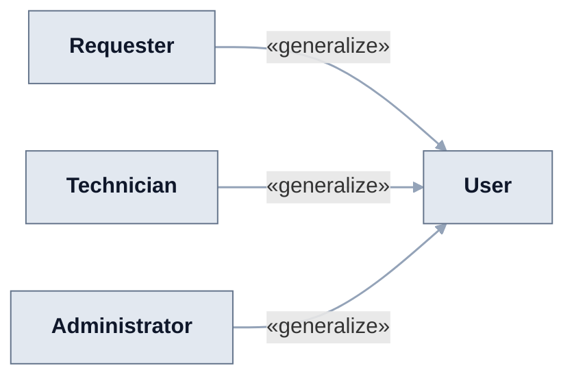
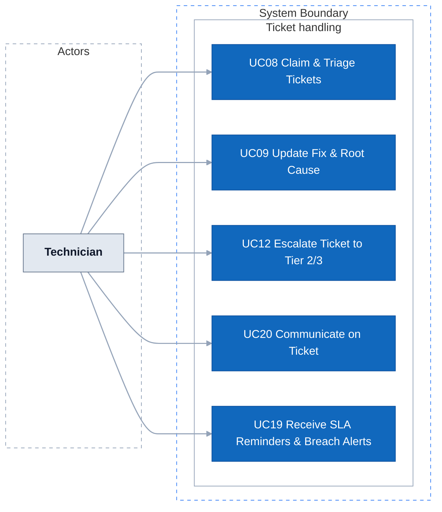
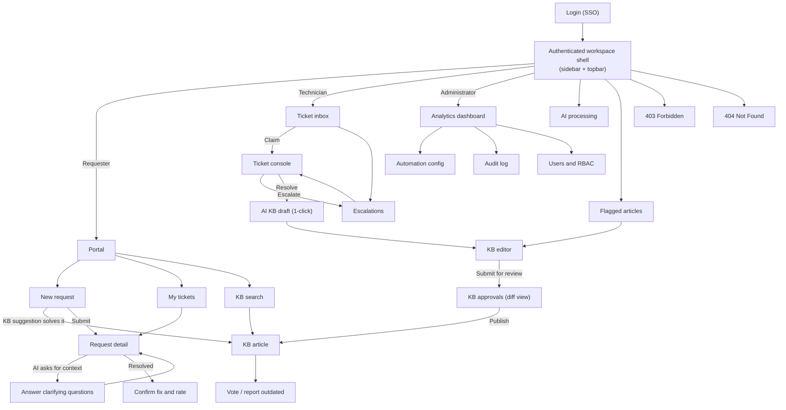

# AI-Powered IT Ticket Routing and Automated Resolution System

The system helps an enterprise receive, classify, and dispatch internal IT support requests — processing approximately **8,000 tickets per day** across corporate departments. The AI Service evaluates incoming requests: basic requests within scope are **approved by the AI and executed automatically through backend APIs**; requests requiring hands-on human intervention are routed directly to technicians with an AI summary; when context is missing, it **asks the requester for clarification**.

## 1. Requirements — User Stories and Use Cases

Requirements define what the system must do, who uses it, and the value delivered. The detailed specification is split into feature branches F01–F09; F02–F08 each have a folder under `docs/`, while F01 Authentication & Authorization and F09 User Management are not specified yet. This section gives the overview across branches.

### 1.1 Product mind map


The outline for XMind import is in [the mind map outline](docs/mindmap-xmind.md).

The mind map groups features by area (8 groups); the specification folders are organized by feature branch. The groups map to the branches as follows:

| Mind map group | Specified in | Branch design status |
| :--- | :--- | :--- |
| 1. Requester Self-Service | [F03 Ticket Management](docs/f03-ticket-management/README.md); KB deflection in [F06](docs/f06-knowledge-base/README.md) | TARGET V1 |
| 2. Technician Workspace | [F03 Ticket Management](docs/f03-ticket-management/README.md); AI summary in [F04](docs/f04-ai-ticket-processing/README.md) | TARGET V1 |
| 3. Administration & Coordination | [F05 Workflow & Automation](docs/f05-workflow-automation/README.md) (rules, SLA, AI scope); RBAC and user directory in F09 (not specified) | TARGET V1 |
| 4. Knowledge Base | [F06 Knowledge Base](docs/f06-knowledge-base/README.md) | TARGET V1 |
| 5. AI Intelligent Processing | [F04 AI Ticket Processing](docs/f04-ai-ticket-processing/README.md) | TARGET V1 (draft for team review) |
| 6. Automation Workflow Engine | [F05 Workflow & Automation](docs/f05-workflow-automation/README.md) | TARGET V1 |
| 7. Approval & Automated Execution | [F05 Workflow & Automation](docs/f05-workflow-automation/README.md) | TARGET V1 |
| 8. Dashboard & Governance Telemetry | [F02 Dashboard](docs/f02-dashboard/README.md), [F07 Reports & Analytics](docs/f07-reports-analytics/README.md), [F08 Activity Log](docs/f08-activity-log/README.md) | draft |
| Login (no group) | F01 Authentication & Authorization (not specified) | — |

The mind map is an early outline and is out of date in a few places. The system has four actors (see [1.2](#12-user-stories)), so the Team Lead role in the mind map is dropped; some branch docs still name Team Lead and are being aligned. The technician summary (at most 150 words rather than 3 lines) and the reopen window (7 days rather than 48 hours) follow the branch docs. The "Manager" who approves elevated permissions in groups 7.2 and 7.3 is the Administrator. Whether some sensitive entitlements still need that approval is open (US-WF-15 in F05); the agreed direction is to let the AI route and approve as many requests as possible, so that the Administrator's manual routing and approval work is kept to a minimum.

### 1.2 User stories

**Actors**

The system has four actors: three human roles and the AI Service.

*   **Requester:** Business employee who raises tickets and looks for self-service fixes.
*   **AI Service:** Background actor that classifies and routes every ticket, asks for missing context, resolves in-scope requests through backend APIs, summarizes tickets for technicians and drafts KB articles. It also does the triage and reassignment work: tickets it cannot route go to a shared triage queue.
*   **Technician:** Support engineer who handles what the AI cannot resolve: troubleshooting, fixing, escalating to a higher tier and writing KB articles.
*   **Administrator:** System owner who configures routing rules, SLA policies and the AI auto-approval scope, reviews KB articles before they are published, and watches operations, reports and the audit log. The Administrator is also the approver for elevated permissions (the "Manager" in the mind map). Design goal: the AI handles routing and approval wherever it safely can, and the Administrator widens or narrows the AI's scope instead of routing tickets by hand.

In the use case diagrams, **User** is the common parent of the three human roles (login, dashboard, KB search).

**Core backlog**

This is the system-level backlog: 22 stories across the branches. The last column lists the detailed stories in the branch folders, which hold the acceptance criteria.

| Story ID | Role | User Story (`As a... I want to... So that...`) | Priority | Branch stories |
| :--- | :--- | :--- | :---: | :--- |
| **US01** | `REQUESTER` | **As a** Requester, **I want to** submit tickets with screenshots and error logs, **So that** the AI and technicians understand my issue without asking again. | **Must** | US-TK-01, US-TK-02 |
| **US02** | `REQUESTER` | **As a** Requester, **I want** real-time KB solution suggestions while typing, **So that** I can resolve issues without submitting a ticket. | **Must** | US-AI-05, US-TK-04, US-KB-08 |
| **US03** | `REQUESTER` | **As a** Requester, **I want to** answer AI clarifying questions inside my ticket, **So that** my incomplete request has sufficient context for routing. | **Must** | US-AI-03, US-AI-04, US-WF-09, US-TK-16 |
| **US04** | `REQUESTER` | **As a** Requester, **I want to** track ticket status and confirm resolution, **So that** I know when my issue is fixed. | **Must** | US-TK-05, US-TK-20, US-WF-19, US-NK-02 |
| **US05** | `REQUESTER` | **As a** Requester, **I want to** report "not fixed" or reopen a closed ticket within 7 days, **So that** I don't have to start over when the problem comes back. | **Must** | US-TK-21 |
| **US06** | `AI` | **As the** AI Service, **I want to** classify tickets and extract structured fields, **So that** requests are routed to the right flow and team. | **Must** | US-AI-01, US-AI-02 |
| **US07** | `AI` | **As the** AI Service, **I want to** auto-approve in-scope basic requests after the policy check and call execution APIs, **So that** repetitive tickets are resolved instantly. | **Must** | US-WF-08, US-WF-15, US-WF-17, US-AI-17, US-AI-20 |
| **US08** | `AI` | **As the** AI Service, **I want to** route tickets that need a human to the right technician team, and send tickets that match no rule or that I fail to process to a shared triage queue, **So that** no ticket is left without an owner. | **Must** | US-WF-10, US-WF-11, US-NK-07 |
| **US09** | `TECHNICIAN` | **As a** Technician, **I want to** see an AI summary of at most 150 words (problem, impact, key details, what was tried, why it came to a human) on every ticket routed to me, **So that** I grasp the problem without reading long threads. | **Must** | US-AI-07, US-AI-08 |
| **US10** | `TECHNICIAN` | **As a** Technician, **I want to** claim tickets from my team queue or the triage queue, update states, and record the resolution and root cause, **So that** the ticket lifecycle is cleanly tracked. | **Must** | US-TK-11, US-TK-17, US-TK-18 |
| **US11** | `TECHNICIAN` | **As a** Technician, **I want to** transfer a misrouted ticket to another team or escalate it to a higher tier with the work done so far, **So that** hard or misrouted tickets reach the right expertise in time. | **Must** | US-TK-12, US-TK-13 |
| **US12** | `TECHNICIAN` | **As a** Technician, **I want** tickets whose automated execution or verification failed to be handed to me with the error log, **So that** I can retry or resolve them manually and no automation failure is forgotten. | **Must** | US-WF-20 |
| **US13** | `TECHNICIAN` | **As a** Technician, **I want to** be reminded before a ticket breaches its SLA, with the SLA paused while the requester owes an answer, **So that** I can act in time and am not penalized for delays outside my control. | **Must** | US-WF-12, US-WF-04 |
| **US14** | `TECHNICIAN` | **As a** Technician, **I want** AI to synthesize a KB article draft from a resolved ticket with 1-click, **So that** know-how is captured with zero effort. | **Must** | US-KB-04 |
| **US15** | `TECHNICIAN` | **As a** Technician, **I want to** author and revise troubleshooting guides in rich text/markdown, **So that** procedures are standardized. | **Must** | US-KB-02, US-KB-03 |
| **US16** | `TECHNICIAN` | **As a** Technician, **I want** a personal workbench with my tickets sorted by priority and SLA and figures for my team, **So that** I know what to work on next. | **Must** | US-DB-08, US-BC-02 |
| **US17** | `ADMINISTRATOR` | **As an** Administrator, **I want to** configure rule-based routing and SLA timers (P1–P4), **So that** ticket allocation matches team capacity. | **Must** | US-WF-01, US-WF-02, US-WF-03 |
| **US18** | `ADMINISTRATOR` | **As an** Administrator, **I want to** define the AI auto-execution whitelist, entitlement matrix and confidence thresholds, **So that** automated actions are strictly governed. | **Must** | US-WF-05, US-WF-06, US-WF-07 |
| **US19** | `ADMINISTRATOR` | **As an** Administrator, **I want to** review KB articles using a side-by-side Visual Diff, **So that** only validated steps are published. | **Must** | US-KB-05 |
| **US20** | `ADMINISTRATOR` | **As an** Administrator, **I want** an operations dashboard with ticket volume, SLA risk and breached tickets, and to be notified when a ticket breaches its SLA, **So that** I can step in before incidents pile up. | **Must** | US-DB-01, US-DB-03, US-WF-13 |
| **US21** | `ADMINISTRATOR` | **As an** Administrator, **I want** reports on the AI self-resolution rate, handling time, SLA breaches and satisfaction, with CSV/XLSX export, **So that** I can decide whether to widen or narrow what the AI may do. | **Should** | US-BC-03, US-BC-04, US-BC-05, US-BC-06 |
| **US22** | `ADMINISTRATOR` | **As an** Administrator, **I want** an immutable activity log of every user, AI and system action, including why the AI approved, asked back or routed each request, **So that** AI decisions and incidents can be reviewed and trusted. | **Must** | US-NK-03, US-NK-04, US-NK-05, US-WF-16 |

Each branch keeps its detailed backlog with acceptance criteria in its own folder; see [Documentation](#documentation).

### 1.3 Use cases

The system has 22 use cases (`UC01` to `UC22`) shared by the three human roles (Requester, Technician, Administrator) and the AI Service. The first diagram shows how the human roles relate; the other four show the use cases by area. Purple nodes call the AI Service.







**Use case catalog**

| ID | Use Case Name | Primary Actor | Scope & Description | Branch use cases |
| :--- | :--- | :--- | :--- | :--- |
| **UC01** | Login & SSO Authentication | All human roles | Authenticate via enterprise SSO and load role-based workspace permissions. | — (F01 not specified) |
| **UC02** | Logout & Session Revocation | All human roles | Terminate session tokens and clear client-side caches. | — (F01 not specified) |
| **UC03** | View Dashboard & Telemetry | All human roles | View role-scoped metrics (personal tickets and team workload for Technicians, enterprise KPIs, SLA risk and incident feed for Administrators). | UC-DB-01 … UC-DB-05 |
| **UC04** | Submit Ticket & Evidence | Requester | Submit a request in free text through the portal or the support mailbox, with error logs and screenshots; matching KB articles are suggested while typing. | UC-TK-01, UC-AI-03 |
| **UC05** | Track, Confirm & Reopen Ticket | Requester | View the status timeline, answer AI clarifying questions, confirm the fix and rate it, reopen within 7 days, or cancel a request no longer needed. | UC-TK-02, UC-TK-06, UC-AI-02 |
| **UC06** | Search KB Solutions | All human roles | Natural language semantic search for verified solutions with instant answer extraction. | UC-KB-01 |
| **UC07** | Rate & Report KB Article | All human roles | Submit helpfulness votes (Helpful / Unhelpful) or report outdated/inaccurate technical steps. | UC-KB-05 |
| **UC08** | Claim & Triage Tickets | Technician | Claim tickets from the team queue or from the shared triage queue (tickets the AI could not route), or transfer a misrouted ticket to another team. | UC-TK-02, UC-TK-03, UC-DB-05 |
| **UC09** | Update Fix & Root Cause | Technician | Transition ticket states (In Progress, Needs Info, Resolved) and record resolution and root cause. | UC-TK-05 |
| **UC10** | AI Synthesize KB from Ticket | Technician | 1-click generation of structured KB draft from closed ticket with PII scrubbing. | UC-KB-04 |
| **UC11** | Author & Edit KB Articles | Technician / Admin | Author technical guides with rich text, markdown, code blocks, and tags. | UC-KB-02 |
| **UC12** | Escalate Ticket to Tier 2/3 | Technician | Transfer complex or blocked tickets to a higher support tier with the work done so far. | UC-TK-03 |
| **UC13** | Review & Publish (Diff View) | Administrator | Inspect proposed article revisions side-by-side (Diff View) and approve for release. | UC-KB-03 |
| **UC14** | Configure Rules, SLA & Scope | Administrator | Define deterministic assignment rules, SLA policies, and AI auto-approval whitelist. | UC-WF-01, UC-WF-02, UC-WF-03 |
| **UC15** | Classify & Route Ticket | AI Service | Read the ticket, classify it, fill the structured fields, suggest a priority and flag duplicates; then auto-resolve it, ask the requester one question, or route it to a technician team (the shared triage queue when no rule matches). | UC-AI-01, UC-AI-05, UC-AI-06, UC-WF-04, UC-WF-05 |
| **UC16** | Auto-resolve & Execute Request | AI Service | Approve in-scope requests after the deterministic policy check and call the backend APIs; domain agents answer known how-to questions with cited KB steps. | UC-WF-07, UC-WF-08, UC-AI-10 |
| **UC17** | Verify Result & Hand Off on Failure | AI Service | Verify the result on the target system and ask the requester to confirm; hand failed executions to a technician with the error log. | UC-WF-09 |
| **UC18** | Summarize Ticket & Draft Reply | AI Service | Give the technician a summary of at most 150 words when a ticket comes to a human, and draft the resolution and the reply when it is resolved. | UC-AI-04, UC-AI-08 |
| **UC19** | Receive SLA Reminders & Breach Alerts | Technician / Administrator | The SLA scheduler reminds the assignee before a deadline and alerts the Administrator when a ticket breaches its SLA. | UC-WF-06, UC-DB-02 |
| **UC20** | Communicate on Ticket | Requester / Technician | Exchange public replies with attachments; Technicians add internal notes hidden from the requester. | UC-TK-04 |
| **UC21** | View & Export Reports | Administrator | Ticket volume, handling time and SLA breaches, AI self-resolution rate and satisfaction, with CSV/XLSX export; Technicians see figures for their own scope. | UC-BC-01 … UC-BC-06 |
| **UC22** | View Activity Log | Administrator | Search the append-only log of user, AI and system actions, including AI approval decisions and workflow run errors; Technicians and Requesters see the history of their tickets. | UC-NK-01 … UC-NK-05 |

The use cases per branch (UC-DB, UC-TK, UC-AI, UC-WF, UC-KB, UC-BC, UC-NK) are specified in each branch folder. Two branch use cases are left out of this overview on purpose: UC-AI-07 (feedback and learning from verified tickets) and UC-AI-09 (structuring a business requirement) are specified in F04 only.

## 2. Information Architecture, Screen Hierarchy and UI/UX

The information architecture organizes features around each role's goals and mirrors the mind map groups. Navigation is rendered from the user's role token; every screen must define its access rules and its loading, empty, validation, error, saving and success states.

### 2.1 Information architecture

``` mermaid
flowchart TB
    ROOT["**IT Ticket Routing System**<br/>AI-powered ticket routing and automated resolution"]

    ROOT --> PUBLIC["Public area"]
    ROOT --> SELF["Self-service area<br/>(login required, all roles)"]
    ROOT --> SUPPORT["Support workspace<br/>(Technician / Administrator)"]
    ROOT --> GOV["Governance area<br/>(Administrator)"]

    subgraph PUBLIC_PAGES["PUBLIC SCREENS"]
        direction TB
        LOGIN["**Login** /login<br/>Enterprise SSO<br/>Role-based workspace loading<br/>Authentication errors"]
    end

    subgraph SELF_PAGES["SELF-SERVICE SCREENS"]
        direction TB
        PORTAL["**Portal** /portal<br/>Announcements<br/>Quick self-help search<br/>Trending resolutions"]
        NEWREQ["**New request** /requests/new<br/>Category, description<br/>Screenshots and error logs<br/>Real-time KB suggestions"]
        MYTICKETS["**My tickets** /requests/my-tickets<br/>Status timeline<br/>Filter by status<br/>Resolution verification"]
        REQDETAIL["**Request detail** /requests/:id<br/>Conversation<br/>AI clarifying questions<br/>Confirm fix and rating"]
        KBEXPLORE["**KB search** /kb/explore<br/>Semantic search<br/>Category hierarchy"]
        KBARTICLE["**KB article** /kb/articles/:id<br/>Problem, root cause, steps<br/>Helpful / unhelpful vote<br/>Report outdated content"]
    end

    subgraph SUPPORT_PAGES["SUPPORT SCREENS"]
        direction TB
        INBOX["**Ticket inbox** /tickets/inbox<br/>Assigned tickets<br/>Team queues<br/>Unassigned triage queue"]
        CONSOLE["**Ticket console** /tickets/:id<br/>AI summary (max 150 words)<br/>Conversation and internal notes<br/>Status, root cause, resolution<br/>History and field diff"]
        ESCAL["**Escalations** /tickets/escalations<br/>Approaching SLA breach<br/>Tier 2/3 escalation<br/>Transfer to another team"]
        AIFEED["**AI processing** /ai/*<br/>Classification feed and confidence<br/>Clarification queue<br/>Category overrides (model feedback)"]
        KBEDITOR["**KB editor** /kb/editor<br/>Rich text / Markdown<br/>Code blocks and screenshots<br/>Tags"]
        KBAI["**AI drafts** /kb/ai-inbox<br/>Drafts synthesized from resolved tickets<br/>PII scrubbed"]
        KBFLAG["**Flagged articles** /kb/flagged<br/>Reported and outdated articles"]
    end

    subgraph GOV_PAGES["GOVERNANCE SCREENS"]
        direction TB
        APPROVALS["**KB approvals** /kb/approvals<br/>Side-by-side visual diff<br/>Approve / reject"]
        ANALYTICS["**Analytics** /analytics/*<br/>AI deflection rate, MTTA, MTTR, SLA %<br/>Team workload and queue depth"]
        AUTOMATION["**Automation config** /automation/*<br/>Assignment rules<br/>SLA policies P1-P4<br/>AI auto-approval whitelist<br/>Execution runs and fallback alerts"]
        AUDIT["**Audit log** /audit/activity-log<br/>Immutable workflow and security trail"]
        USERS["**Users and RBAC** /admin/users-rbac<br/>User directory<br/>Teams and roles"]
    end

    PUBLIC --> LOGIN

    SELF --> PORTAL
    PORTAL --> NEWREQ
    PORTAL --> MYTICKETS
    MYTICKETS --> REQDETAIL
    NEWREQ --> REQDETAIL
    SELF --> KBEXPLORE
    KBEXPLORE --> KBARTICLE
    NEWREQ --> KBARTICLE

    SUPPORT --> INBOX
    INBOX --> CONSOLE
    SUPPORT --> ESCAL
    ESCAL --> CONSOLE
    SUPPORT --> AIFEED
    CONSOLE --> KBAI
    KBAI --> KBEDITOR
    SUPPORT --> KBFLAG
    KBFLAG --> KBEDITOR

    GOV --> APPROVALS
    GOV --> ANALYTICS
    GOV --> AUTOMATION
    GOV --> AUDIT
    GOV --> USERS

    classDef root fill:#ffffff,stroke:#222222,stroke-width:2px,color:#111111;
    classDef public fill:#fff0f0,stroke:#f87171,color:#7f1d1d;
    classDef self fill:#ecfdf5,stroke:#22c55e,color:#14532d;
    classDef support fill:#eff6ff,stroke:#60a5fa,color:#1e3a8a;
    classDef gov fill:#f5f3ff,stroke:#a78bfa,color:#4c1d95;
    classDef publicArea fill:#fecaca,stroke:#dc2626,stroke-width:2px,color:#7f1d1d;
    classDef selfArea fill:#bbf7d0,stroke:#16a34a,stroke-width:2px,color:#14532d;
    classDef supportArea fill:#bfdbfe,stroke:#2563eb,stroke-width:2px,color:#1e3a8a;
    classDef govArea fill:#ddd6fe,stroke:#7c3aed,stroke-width:2px,color:#4c1d95;
    class ROOT root;
    class PUBLIC publicArea;
    class SELF selfArea;
    class SUPPORT supportArea;
    class GOV govArea;
    class LOGIN public;
    class PORTAL,NEWREQ,MYTICKETS,REQDETAIL,KBEXPLORE,KBARTICLE self;
    class INBOX,CONSOLE,ESCAL,AIFEED,KBEDITOR,KBAI,KBFLAG support;
    class APPROVALS,ANALYTICS,AUTOMATION,AUDIT,USERS gov;
```



Access per area follows the role matrix: the self-service area is open to every role; the support workspace is for Technicians and Administrators (so an Administrator can open a breached ticket or edit an article) and hidden (403) for Requesters; the governance area (KB approvals, analytics, automation configuration, audit log, user management) is Administrator only. Technicians see figures for their own tickets and teams on their workbench, not the governance screens.

### 2.2 Screen hierarchy



Each role lands on its own home after login: Requesters on the Portal, Technicians on the ticket inbox and Administrators on analytics. Main requester flow: Portal → New request → KB suggestions (deflection) → Submit → AI classification → auto-execution for whitelisted requests, clarifying questions when context is missing, or routing to a technician team (the shared triage queue when no rule matches) → Track status → Confirm fix and rate. Main technician flow: Inbox → Claim → Ticket console with AI summary → Update status and root cause → Resolve → 1-click AI KB draft → Edit → Administrator review in diff view → Publish.

The ticket console must clearly show the AI summary (at most 150 words, in fixed sections), the AI-assigned category and confidence, the SLA timer, the conversation with internal notes kept separate, and a way to override the AI category (feeding model feedback). Any action executed automatically by the AI must be visible on the ticket timeline with its result, and failed executions must fall back to a technician queue.

Detailed routes, standard component states (loading, empty, validation, saving, success, error, 403) and the role-based navigation matrix are maintained in [Information Architecture](docs/information-architecture.md).

Each branch also has its own information architecture: [F02 Dashboard](docs/f02-dashboard/03-information-architecture.md), [F03 Ticket Management](docs/f03-ticket-management/03-information-architecture.md), [F04 AI Ticket Processing](docs/f04-ai-ticket-processing/information-architecture/README.md), [F05 Workflow & Automation](docs/f05-workflow-automation/information-architecture/README.md), [F06 Knowledge Base](docs/f06-knowledge-base/04-information-architecture.md), [F07 Reports & Analytics](docs/f07-reports-analytics/information-architecture/README.md), [F08 Activity Log](docs/f08-activity-log/information-architecture/README.md).

## Documentation

- System overview: [Mind map outline](docs/mindmap-xmind.md), [Information architecture](docs/information-architecture.md).
- F02 Dashboard: [Index](docs/f02-dashboard/README.md), [User stories](docs/f02-dashboard/01-user-stories.md), [Use cases](docs/f02-dashboard/02-use-cases.md), [Information architecture](docs/f02-dashboard/03-information-architecture.md).
- F03 Ticket Management: [Index](docs/f03-ticket-management/README.md), [User stories](docs/f03-ticket-management/01-user-stories.md), [Use cases](docs/f03-ticket-management/02-use-cases.md), [Information architecture](docs/f03-ticket-management/03-information-architecture.md).
- F04 AI Ticket Processing: [Index](docs/f04-ai-ticket-processing/README.md), [Features](docs/f04-ai-ticket-processing/01-features.md), [Use cases](docs/f04-ai-ticket-processing/02-use-cases.md), [User stories (INVEST)](docs/f04-ai-ticket-processing/03-user-stories-invest.md), [Acceptance criteria](docs/f04-ai-ticket-processing/04-acceptance-criteria.md), [Business rules](docs/f04-ai-ticket-processing/05-business-rules.md), [Information architecture](docs/f04-ai-ticket-processing/information-architecture/README.md).
- F05 Workflow & Automation: [Index](docs/f05-workflow-automation/README.md), [Features](docs/f05-workflow-automation/01-features.md), [Use cases](docs/f05-workflow-automation/02-use-cases.md), [Acceptance criteria](docs/f05-workflow-automation/03-acceptance-criteria.md), [INVEST backlog](docs/f05-workflow-automation/04-invest-requirements.md), [Information architecture](docs/f05-workflow-automation/information-architecture/README.md).
- F06 Knowledge Base: [Index](docs/f06-knowledge-base/README.md), [Mind map](docs/f06-knowledge-base/01-mindmap.md), [User stories](docs/f06-knowledge-base/02-user-stories.md), [Use cases](docs/f06-knowledge-base/03-use-cases.md), [Information architecture](docs/f06-knowledge-base/04-information-architecture.md), [Wireframes](docs/f06-knowledge-base/05-wireframes.md).
- F07 Reports & Analytics: [Index](docs/f07-reports-analytics/README.md), [Features](docs/f07-reports-analytics/01-features.md), [Use cases](docs/f07-reports-analytics/02-use-cases.md), [User stories (INVEST)](docs/f07-reports-analytics/03-user-stories-invest.md), [Acceptance criteria](docs/f07-reports-analytics/04-acceptance-criteria.md), [Business rules](docs/f07-reports-analytics/05-business-rules.md), [Information architecture](docs/f07-reports-analytics/information-architecture/README.md).
- F08 Activity Log: [Index](docs/f08-activity-log/README.md), [Features](docs/f08-activity-log/01-features.md), [Use cases](docs/f08-activity-log/02-use-cases.md), [User stories (INVEST)](docs/f08-activity-log/03-user-stories-invest.md), [Acceptance criteria](docs/f08-activity-log/04-acceptance-criteria.md), [Business rules](docs/f08-activity-log/05-business-rules.md), [Information architecture](docs/f08-activity-log/information-architecture/README.md).
- Requirements catalogs (F05 Workflow & Automation so far): [Business rules](docs/requirements/business-rules.md), [Non-functional requirements](docs/requirements/non-functional-requirements.md).
- Traceability (F05 Workflow & Automation so far): [Master traceability matrix](docs/traceability/master-traceability.md). The system-level stories and use cases trace to the branches through the "Branch stories" and "Branch use cases" columns above.

### Repository layout

No source code exists yet. The repository holds the documents.

```text
Fable/
├── docs/
│   ├── f02-dashboard/             # Dashboard: user stories, use cases, IA
│   ├── f03-ticket-management/     # Ticket management: user stories, use cases, IA
│   ├── f04-ai-ticket-processing/  # AI ticket processing: features, use cases, INVEST, AC, business rules, IA
│   ├── f05-workflow-automation/   # Workflow and automation: features, use cases, AC, INVEST, IA
│   ├── f06-knowledge-base/        # Knowledge base: mind map, user stories, use cases, IA, wireframes
│   ├── f07-reports-analytics/     # Reports and analytics: features, use cases, INVEST, AC, business rules, IA
│   ├── f08-activity-log/          # Activity log: features, use cases, INVEST, AC, business rules, IA
│   ├── requirements/              # Business rules and non-functional requirements (F05 so far)
│   ├── traceability/              # Traceability matrix (F05 so far)
│   ├── information-architecture.md  # System-wide information architecture
│   ├── mindmap-xmind.md           # Mind map outline for XMind
│   └── mindmap.png                # Mind map image
└── README.md
```

Every branch folder is named `fNN-<branch>` after its feature branch number (F01–F09, mapped to the mind map groups in [1.1](#11-product-mind-map)), its files are numbered `NN-<topic>.md` (F04 and F05 keep their IA in an `information-architecture/` subfolder), and its `README.md` lists the files.

## Project Progress

- [x] Draw the product mind map
- [x] Write the system user stories (22) and use cases (22), with the use case diagrams
- [x] Design the system information architecture and screen hierarchy
- [x] F02 Dashboard: user stories, use cases, IA (draft)
- [x] F03 Ticket Management: user stories, use cases, IA (TARGET V1)
- [x] F04 AI Ticket Processing: features, use cases, INVEST, acceptance criteria, business rules, IA (TARGET V1, draft for team review)
- [x] F05 Workflow & Automation: features, use cases, INVEST, acceptance criteria, IA (TARGET V1)
- [x] F06 Knowledge Base: mind map, user stories, use cases, IA, wireframes (TARGET V1)
- [x] F07 Reports & Analytics: features, use cases, INVEST, acceptance criteria, business rules, IA (TARGET V1, draft for team review)
- [x] F08 Activity Log: features, use cases, INVEST, acceptance criteria, business rules, IA (TARGET V1, draft for team review)
- [ ] Align the branch docs with the four actors (remove Team Lead) and the system IA role matrix
- [ ] Specify F01 Authentication & Authorization and F09 User Management
- [ ] C4 System Context, Container, Component
- [ ] Database design (ERD)
- [ ] OpenAPI 3.0
