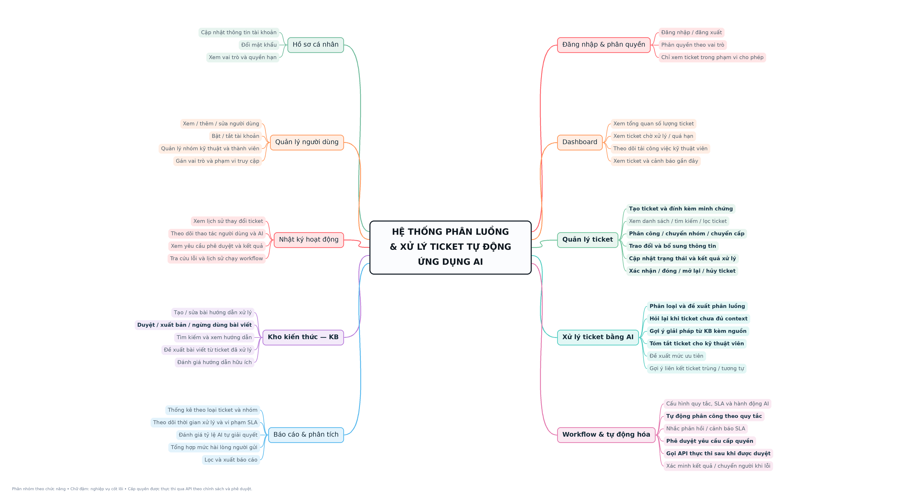
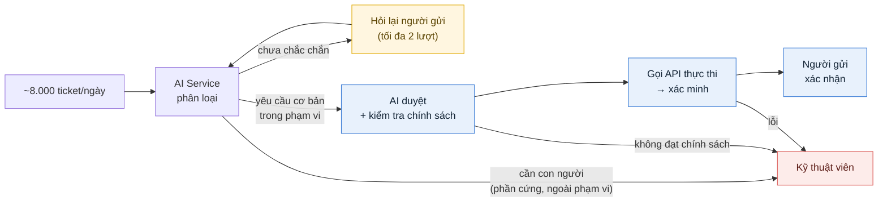
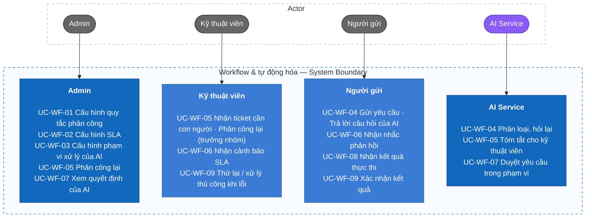

# Hệ thống phân luồng & xử lý ticket IT tự động ứng dụng AI

Hệ thống giúp doanh nghiệp tiếp nhận, phân loại và điều phối các yêu cầu hỗ trợ IT nội bộ — khoảng **8.000 ticket mỗi ngày** từ các phòng ban. AI Service phân loại từng ticket: các yêu cầu cơ bản trong phạm vi cho phép (kiểm tra tài khoản, cấp tài khoản, cấp thêm quyền) được **AI tự duyệt và hệ thống tự thực thi qua API**; các yêu cầu cần con người (phần cứng như cấp chuột, sửa máy…) được chuyển cho kỹ thuật viên kèm bản tóm tắt; khi AI chưa chắc chắn, AI **hỏi lại người gửi**. Người gửi theo dõi và xác nhận kết quả; kỹ thuật viên xử lý các trường hợp cần can thiệp; Admin cấu hình phạm vi của AI, quy tắc, SLA, và theo dõi báo cáo, nhật ký.

> Phạm vi tài liệu hiện tại: **F05 Workflow & tự động hóa**. Các nhánh khác của mindmap sẽ được bổ sung theo cùng cấu trúc.

## 1. Requirements — INVEST, Use Cases, and Acceptance Criteria

Yêu cầu mô tả hệ thống phải làm gì, ai sử dụng, giá trị mang lại và điều kiện thành công quan sát được. User story được rà soát theo INVEST và ánh xạ tới use case và tiêu chí nghiệm thu.

### 1.1 Product mind map



### 1.2 Luồng xử lý tổng quát



| Luồng | Ví dụ | Ai xử lý |
| --- | --- | --- |
| **A — AI tự xử lý** | Kiểm tra tài khoản, cấp tài khoản, cấp thêm quyền trong danh mục phòng ban | AI duyệt → hệ thống gọi API |
| **B — Hỏi lại** | Ticket mơ hồ, thiếu thông tin | AI hỏi người gửi, rồi phân luồng lại |
| **C — Con người** | Cấp chuột, sửa máy, quyền ngoài danh mục, lỗi tự động hóa | Kỹ thuật viên |

**AI duyệt an toàn:** AI chỉ *hiểu* yêu cầu; việc *cho phép* do bộ kiểm tra chính sách cố định quyết định (whitelist + danh mục quyền theo phòng ban + thời hạn + người nhận). AI hiểu sai cũng không thể cấp quyền ra ngoài phạm vi Admin đã cấu hình.

### 1.3 INVEST requirements

Backlog nhánh Workflow gồm **20 user story** (16 Must, 3 Should, 1 Could).

| Tiêu chí | Ý nghĩa trong hệ thống |
| --- | --- |
| **Independent** | Mỗi story tạo ra một kết quả demo được, chỉ phụ thuộc story khác khi thật sự cần. |
| **Negotiable** | Giao diện và cách cài đặt có thể đổi, miễn mục tiêu, quyền và business rule giữ nguyên. |
| **Valuable** | Mỗi story mang lại giá trị cho người dùng hoặc doanh nghiệp. |
| **Estimable** | Vai trò, đầu vào, đầu ra, phụ thuộc và kết quả lỗi đều được mô tả. |
| **Small** | Mỗi story một năng lực chính, tách được thành task API, application, persistence, UI và test. |
| **Testable** | Mỗi story có tiêu chí nghiệm thu quan sát được, gồm cả phân quyền, kiểm tra dữ liệu và lỗi. |

```text
US-WF-01–02   Cấu hình quy tắc phân công
US-WF-03–04   Cấu hình SLA
US-WF-05–07   Cấu hình phạm vi xử lý của AI
US-WF-08–09   Phân luồng ticket (AI tự xử lý / hỏi lại)
US-WF-10–11   Tự động phân công kỹ thuật viên
US-WF-12–14   Nhắc & cảnh báo SLA
US-WF-15–16   AI duyệt yêu cầu trong phạm vi
US-WF-17–18   Thực thi qua API
US-WF-19–20   Xác minh / chuyển người khi lỗi
```

Bản đánh giá INVEST đầy đủ từng story nằm ở [INVEST Requirements](docs/08-invest-requirements.md).

### 1.4 Use cases



Chi tiết actor, nguyên tắc phân luồng, trạng thái ticket và từng use case có tại [Actor, vai trò và use case](docs/03-use-cases.md).

### 1.5 Roles and permissions

Hệ thống có **3 vai trò** (Admin, Kỹ thuật viên, Người gửi) và **1 actor hệ thống** (AI Service).

| Chức năng | Admin | Kỹ thuật viên | Người gửi | AI Service |
| --- | --- | --- | --- | --- |
| Cấu hình quy tắc, SLA, phạm vi AI | Có | Không | Không | Không |
| Phân loại, hỏi lại người gửi | Không | Không | Không | Có |
| Duyệt yêu cầu cơ bản trong phạm vi | Không | Không | Không | Có, khi đạt kiểm tra chính sách |
| Xử lý yêu cầu cần con người | Không | Có | Không | Không |
| Hàng chờ thủ công, phân công lại | Có | Trưởng nhóm, trong nhóm mình | Không | Không |
| Xem quyết định của AI và căn cứ | Có | Ticket được giao | Lý do tóm tắt, ticket của mình | — |
| Thử lại / xử lý thủ công khi lỗi | Có | Ticket được giao | Không | Không |
| Gửi yêu cầu, trả lời AI, xác nhận kết quả | Có | Có | Có | — |

Backend phải thực thi RBAC, whitelist và danh mục quyền; ẩn nút ở frontend chỉ phục vụ UI/UX.

### 1.6 Business rules cốt lõi

- **Whitelist:** chỉ các thao tác `CHECK_ACCOUNT`, `CREATE_ACCOUNT`, `GRANT_ACCESS`, `REVOKE_ACCESS` được tự động thực thi (BR-WF-01).
- **AI duyệt có giới hạn:** AI chỉ duyệt khi đạt kiểm tra chính sách cố định — không bao giờ ngoài danh mục quyền của phòng ban (BR-WF-02, BR-WF-16).
- **Cần con người thì chuyển người:** phần cứng, ngoài phạm vi, không đạt chính sách → kỹ thuật viên (BR-WF-03).
- **Hỏi lại khi chưa chắc chắn:** tối đa 2 lượt, sau đó chuyển kỹ thuật viên (BR-WF-06).
- **Idempotent:** một quyết định duyệt dẫn tới tối đa một thay đổi trên hệ thống bên ngoài (BR-WF-04).
- **Truy vết:** mọi quyết định của AI và hành động tự động được lưu kèm căn cứ (BR-WF-05, BR-WF-17).

Danh sách đầy đủ: [Business rules](docs/requirements/business-rules.md).

### 1.7 Câu hỏi mở

| # | Câu hỏi | Giá trị tạm dùng trong tài liệu |
| --- | --- | --- |
| Q1 | Có quyền nhạy cảm nào (quản trị hệ thống, dữ liệu tài chính…) vẫn cần **Admin duyệt** thay vì AI không? | Không có bước Admin duyệt; quyền nhạy cảm chỉ cần **không đưa vào danh mục** là sẽ chuyển kỹ thuật viên. |
| Q2 | AI hỏi lại tối đa bao nhiêu lượt trước khi chuyển người? | 2 lượt (Admin cấu hình được). |
| Q3 | Có bao nhiêu kỹ thuật viên / nhóm kỹ thuật? | Chưa xác định; ảnh hưởng quy tắc phân công và SLA. |

## Documentation

- Requirements: [Features](docs/02-features.md), [Use cases](docs/03-use-cases.md), [INVEST backlog](docs/08-invest-requirements.md), [Acceptance criteria](docs/06-acceptance-criteria.md).
- Requirements catalogs: [Business rules](docs/requirements/business-rules.md) và [Non-functional requirements](docs/requirements/non-functional-requirements.md).
- Traceability: [Master traceability matrix](docs/traceability/master-traceability.md).

## Project Progress

- [x] Xác định đề tài và mindmap chức năng
- [x] Xác định luồng xử lý: AI tự xử lý / hỏi lại / chuyển con người; tải 8.000 ticket/ngày
- [x] Đặc tả nhánh Workflow & tự động hóa: tính năng, use case, user story (INVEST), acceptance criteria
- [x] Business rules và NFR cho nhánh Workflow
- [x] Traceability nhánh Workflow (tên màn hình / API / bảng ở mức dự kiến)
- [ ] Chốt các câu hỏi mở Q1–Q3
- [ ] Đặc tả các nhánh còn lại: Đăng nhập & phân quyền, Dashboard, Quản lý ticket, Xử lý ticket bằng AI, KB, Báo cáo, Nhật ký, Người dùng, Hồ sơ
- [ ] Kiến trúc thông tin và cây màn hình
- [ ] C4 System Context, Container, Component
- [ ] Thiết kế cơ sở dữ liệu (ERD)
- [ ] OpenAPI 3.0
- [ ] Class diagram, sequence diagram
- [ ] Cài đặt và kiểm thử
