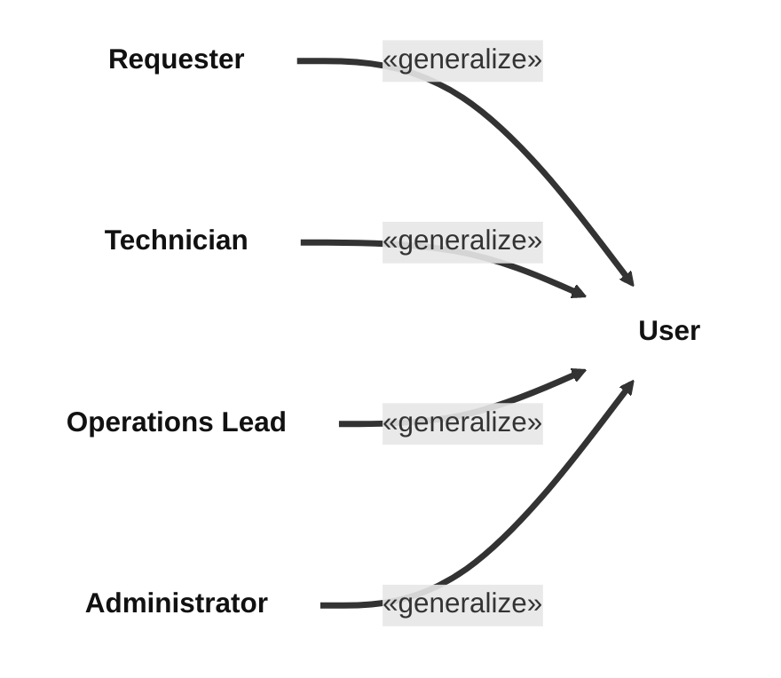
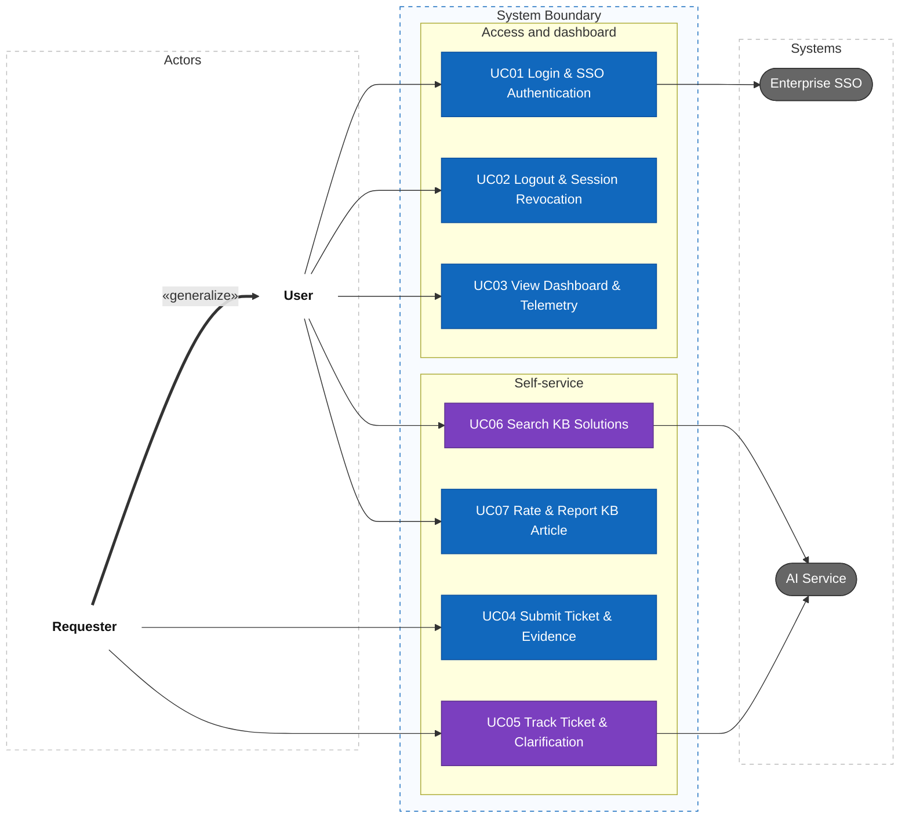
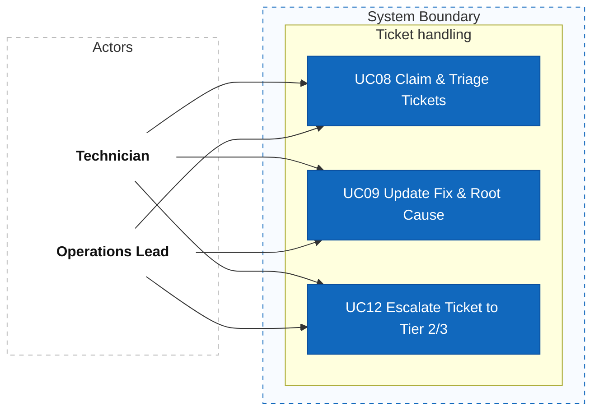
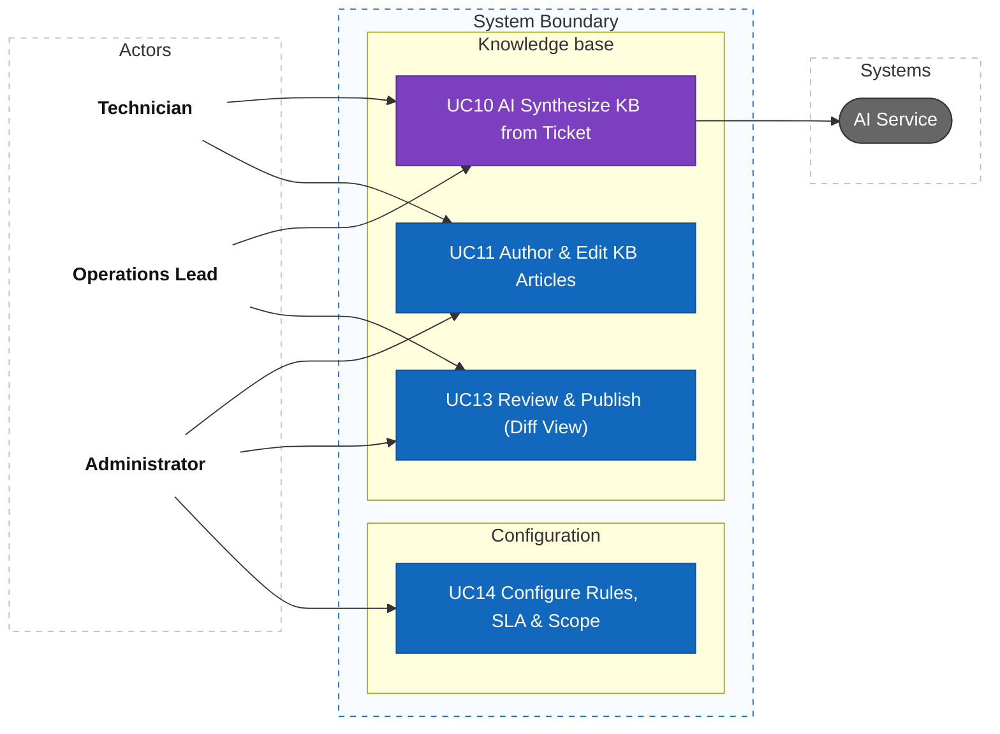
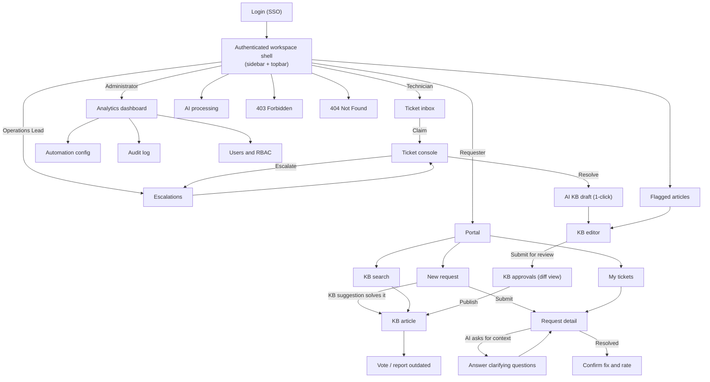

# AI-Powered IT Ticket Routing and Automated Resolution System

The system helps an enterprise receive, classify, and dispatch internal IT support requests — processing approximately **8,000 tickets per day** across corporate departments. The AI Service evaluates incoming requests: basic requests within scope are **approved by the AI and executed automatically through backend APIs**; requests requiring hands-on human intervention are routed directly to technicians with an AI summary; when context is missing, it **asks the requester for clarification**.

## 1. Requirements — User Stories and Use Cases

Requirements define what the system must do, who uses it, and the value delivered. Each branch of the mind map (F01–F09) is specified in its own folder under `docs/`; this section gives the overview across branches.

### 1.1 Product mind map


The outline for XMind import is in [the mind map outline](docs/mindmap-xmind.md).

### 1.2 User stories

**Personas and roles**


*   **Requester:** Business employee seeking quick self-service or IT assistance.
*   **Technician:** Support engineer troubleshooting issues, executing fixes, and authoring KB articles.
*   **Operations Lead:** Team supervisor overseeing triage queues, escalations, and article reviews.
*   **Administrator:** System owner configuring routing rules, SLA policies, and AI auto-approval scopes.
*   **AI Service:** Intelligent background actor classifying requests, extracting context, and synthesizing articles.

**Core backlog**

| Story ID | Role | User Story (`As a... I want to... So that...`) | Priority |
| :--- | :--- | :--- | :---: |
| **US01** | `REQUESTER` | **As a** Requester, **I want to** submit tickets with screenshots and error logs, **So that** technicians understand my issue. | **Must** |
| **US02** | `REQUESTER` | **As a** Requester, **I want** real-time KB solution suggestions while typing, **So that** I can resolve issues without submitting a ticket. | **Must** |
| **US03** | `REQUESTER` | **As a** Requester, **I want to** answer AI clarifying questions, **So that** my incomplete request has sufficient context for routing. | **Must** |
| **US04** | `REQUESTER` | **As a** Requester, **I want to** track ticket status and confirm resolution, **So that** I know when my issue is fixed. | **Must** |
| **US05** | `AI` | **As the** AI Service, **I want to** classify tickets and extract structured fields, **So that** requests are routed to the right team. | **Must** |
| **US06** | `AI` | **As the** AI Service, **I want to** auto-approve in-scope basic requests and call execution APIs, **So that** repetitive tickets are resolved instantly. | **Must** |
| **US07** | `TECHNICIAN` | **As a** Technician, **I want to** view a 3-line AI summary on ticket assignment, **So that** I grasp the problem without reading long threads. | **Must** |
| **US08** | `TECHNICIAN` | **As a** Technician, **I want to** claim tickets, update states, and document root causes, **So that** ticket lifecycle is cleanly tracked. | **Must** |
| **US09** | `TECHNICIAN` | **As a** Technician, **I want** AI to synthesize a KB article draft from a resolved ticket with 1-click, **So that** know-how is captured with zero effort. | **Must** |
| **US10** | `TECHNICIAN` | **As a** Technician, **I want to** author and revise troubleshooting guides in rich text/markdown, **So that** procedures are standardized. | **Must** |
| **US11** | `OPERATIONS LEAD`| **As an** Operations Lead, **I want to** reassign tickets and escalate priority, **So that** critical incidents are resolved within SLA. | **Must** |
| **US12** | `OPERATIONS LEAD`| **As an** Operations Lead, **I want to** review KB articles using a side-by-side Visual Diff, **So that** only validated steps are published. | **Must** |
| **US13** | `ADMINISTRATOR` | **As an** Administrator, **I want to** configure rule-based routing and SLA timers (P1–P4), **So that** ticket allocation matches team capacity. | **Must** |
| **US14** | `ADMINISTRATOR` | **As an** Administrator, **I want to** define the AI auto-execution whitelist and entitlement matrix, **So that** automated actions are strictly governed. | **Must** |

Each branch keeps its detailed backlog with acceptance criteria in its own folder; see [Documentation](#documentation).

### 1.3 Use cases

The system has 14 use cases (`UC01` to `UC14`) shared by 4 roles. The first diagram shows how the roles relate; the other three show the use cases by area. Purple nodes call the AI Service.









**Use case catalog**

| ID | Use Case Name | Primary Actor | Scope & Description |
| :--- | :--- | :--- | :--- |
| **UC01** | Login & SSO Authentication | All Roles | Authenticate via enterprise SSO and load role-based workspace permissions. |
| **UC02** | Logout & Session Revocation | All Roles | Terminate session tokens and clear client-side caches. |
| **UC03** | View Dashboard & Telemetry | All Roles | View role-scoped metrics (personal tickets, team backlog, or enterprise KPIs). |
| **UC04** | Submit Ticket & Evidence | Requester | Submit support requests with category, error logs, and screenshots. |
| **UC05** | Track Ticket & Clarification | Requester | View real-time status timeline and respond to AI clarifying questions. |
| **UC06** | Search KB Solutions | All Roles | Natural language semantic search for verified solutions with instant answer extraction. |
| **UC07** | Rate & Report KB Article | All Roles | Submit helpfulness votes (Helpful / Unhelpful) or report outdated/inaccurate technical steps. |
| **UC08** | Claim & Triage Tickets | Technician / Lead | Claim unassigned tickets from team queue or reassign across tiers. |
| **UC09** | Update Fix & Root Cause | Technician / Lead | Transition ticket states (In Progress, Needs Info, Resolved) and record resolution. |
| **UC10** | AI Synthesize KB from Ticket | Technician / Lead | 1-click generation of structured KB draft from closed ticket with PII scrubbing. |
| **UC11** | Author & Edit KB Articles | Technician / Admin | Author technical guides with rich text, markdown, code blocks, and tags. |
| **UC12** | Escalate Ticket to Tier 2/3 | Technician / Lead | Transfer complex or blocked tickets to specialized tier with updated priority. |
| **UC13** | Review & Publish (Diff View) | Lead / Admin | Inspect proposed article revisions side-by-side (Diff View) and approve for release. |
| **UC14** | Configure Rules, SLA & Scope | Administrator | Define deterministic assignment rules, SLA policies, and AI auto-approval whitelist. |

The use cases per branch (UC-DB, UC-TK, UC-AI, UC-WF, UC-KB, UC-BC, UC-NK) are specified in each branch folder.

## 2. Information Architecture, Screen Hierarchy and UI/UX

The information architecture organizes features around each role's goals and mirrors the mind map groups. Navigation is rendered from the user's role token; every screen must define its access rules and its loading, empty, validation, error, saving and success states.

### 2.1 Information architecture

``` mermaid
flowchart TB
    ROOT["**IT Ticket Routing System**<br/>AI-powered ticket routing and automated resolution"]

    ROOT --> PUBLIC["Public area"]
    ROOT --> SELF["Self-service area<br/>(login required, all roles)"]
    ROOT --> SUPPORT["Support workspace<br/>(Technician / Operations Lead)"]
    ROOT --> GOV["Governance area<br/>(Operations Lead / Administrator)"]

    subgraph PUBLIC_PAGES["PUBLIC SCREENS"]
        direction TB
        LOGIN["**Login** /login<br/>Enterprise SSO<br/>Role-based workspace loading<br/>Authentication errors"]
    end

    subgraph SELF_PAGES["SELF-SERVICE SCREENS"]
        direction TB
        PORTAL["**Portal** /portal<br/>Announcements<br/>Quick self-help search<br/>Trending resolutions"]
        NEWREQ["**New request** /requests/new<br/>Category, description<br/>Screenshots and error logs<br/>Real-time KB suggestions"]
        MYTICKETS["**My tickets** /requests/my-tickets<br/>Status timeline<br/>Filter by status<br/>Resolution verification"]
        REQDETAIL["**Request detail** /requests/:id<br/>Conversation<br/>AI clarifying questions<br/>Confirm fix and rating"]
        KBEXPLORE["**KB search** /kb/explore<br/>Semantic search<br/>Category hierarchy"]
        KBARTICLE["**KB article** /kb/articles/:id<br/>Problem, root cause, steps<br/>Helpful / unhelpful vote<br/>Report outdated content"]
    end

    subgraph SUPPORT_PAGES["SUPPORT SCREENS"]
        direction TB
        INBOX["**Ticket inbox** /tickets/inbox<br/>Assigned tickets<br/>Team queues<br/>Unassigned triage queue"]
        CONSOLE["**Ticket console** /tickets/:id<br/>3-line AI summary<br/>Conversation and internal notes<br/>Status, root cause, resolution<br/>History and field diff"]
        ESCAL["**Escalations** /tickets/escalations<br/>Approaching SLA breach<br/>Tier 2/3 escalation<br/>Reassignment"]
        AIFEED["**AI processing** /ai/*<br/>Classification feed and confidence<br/>Clarification queue<br/>Category overrides (model feedback)"]
        KBEDITOR["**KB editor** /kb/editor<br/>Rich text / Markdown<br/>Code blocks and screenshots<br/>Tags"]
        KBAI["**AI drafts** /kb/ai-inbox<br/>Drafts synthesized from resolved tickets<br/>PII scrubbed"]
        KBFLAG["**Flagged articles** /kb/flagged<br/>Reported and outdated articles"]
    end

    subgraph GOV_PAGES["GOVERNANCE SCREENS"]
        direction TB
        APPROVALS["**KB approvals** /kb/approvals<br/>Side-by-side visual diff<br/>Approve / reject"]
        ANALYTICS["**Analytics** /analytics/*<br/>AI deflection rate, MTTA, MTTR, SLA %<br/>Team workload and queue depth"]
        AUTOMATION["**Automation config** /automation/*<br/>Assignment rules<br/>SLA policies P1-P4<br/>AI auto-approval whitelist<br/>Execution runs and fallback alerts"]
        AUDIT["**Audit log** /audit/activity-log<br/>Immutable workflow and security trail"]
        USERS["**Users and RBAC** /admin/users-rbac<br/>User directory<br/>Teams and roles"]
    end

    PUBLIC --> LOGIN

    SELF --> PORTAL
    PORTAL --> NEWREQ
    PORTAL --> MYTICKETS
    MYTICKETS --> REQDETAIL
    NEWREQ --> REQDETAIL
    SELF --> KBEXPLORE
    KBEXPLORE --> KBARTICLE
    NEWREQ --> KBARTICLE

    SUPPORT --> INBOX
    INBOX --> CONSOLE
    SUPPORT --> ESCAL
    ESCAL --> CONSOLE
    SUPPORT --> AIFEED
    CONSOLE --> KBAI
    KBAI --> KBEDITOR
    SUPPORT --> KBFLAG
    KBFLAG --> KBEDITOR

    GOV --> APPROVALS
    GOV --> ANALYTICS
    GOV --> AUTOMATION
    GOV --> AUDIT
    GOV --> USERS

    classDef root fill:#ffffff,stroke:#222222,stroke-width:2px,color:#111111;
    classDef public fill:#fff0f0,stroke:#f87171,color:#7f1d1d;
    classDef self fill:#ecfdf5,stroke:#22c55e,color:#14532d;
    classDef support fill:#eff6ff,stroke:#60a5fa,color:#1e3a8a;
    classDef gov fill:#f5f3ff,stroke:#a78bfa,color:#4c1d95;
    classDef publicArea fill:#fecaca,stroke:#dc2626,stroke-width:2px,color:#7f1d1d;
    classDef selfArea fill:#bbf7d0,stroke:#16a34a,stroke-width:2px,color:#14532d;
    classDef supportArea fill:#bfdbfe,stroke:#2563eb,stroke-width:2px,color:#1e3a8a;
    classDef govArea fill:#ddd6fe,stroke:#7c3aed,stroke-width:2px,color:#4c1d95;
    class ROOT root;
    class PUBLIC publicArea;
    class SELF selfArea;
    class SUPPORT supportArea;
    class GOV govArea;
    class LOGIN public;
    class PORTAL,NEWREQ,MYTICKETS,REQDETAIL,KBEXPLORE,KBARTICLE self;
    class INBOX,CONSOLE,ESCAL,AIFEED,KBEDITOR,KBAI,KBFLAG support;
    class APPROVALS,ANALYTICS,AUTOMATION,AUDIT,USERS gov;
```



Access per area follows the role matrix: the self-service area is open to every role; the support workspace is hidden (403) for Requesters; KB approvals and analytics require Operations Lead or Administrator; automation configuration is view/dry-run for Operations Leads and full configuration for Administrators; the audit log and user management are Administrator only.

### 2.2 Screen hierarchy



Each role lands on its own home after login: Requesters on the Portal, Technicians on the ticket inbox, Operations Leads on escalations and Administrators on analytics. Main requester flow: Portal → New request → KB suggestions (deflection) → Submit → AI classification → auto-execution for whitelisted requests, clarifying questions when context is missing, or routing to a technician → Track status → Confirm fix and rate. Main technician flow: Inbox → Claim → Ticket console with AI summary → Update status and root cause → Resolve → 1-click AI KB draft → Edit → Lead review in diff view → Publish.

The ticket console must clearly show the AI summary (3 lines), the AI-assigned category and confidence, the SLA timer, the conversation with internal notes kept separate, and a way to override the AI category (feeding model feedback). Any action executed automatically by the AI must be visible on the ticket timeline with its result, and failed executions must fall back to a technician queue.

Detailed routes, standard component states (loading, empty, validation, saving, success, error, 403) and the role-based navigation matrix are maintained in [Information Architecture](docs/information-architecture.md).

Each branch also has its own information architecture: [F02 Dashboard](docs/f02-dashboard/03-information-architecture.md), [F03 Ticket Management](docs/f03-ticket-management/03-information-architecture.md), [F04 AI Ticket Processing](docs/f04-ai-ticket-processing/information-architecture/README.md), [F05 Workflow & Automation](docs/f05-workflow-automation/information-architecture/README.md), [F06 Knowledge Base](docs/f06-knowledge-base/04-information-architecture.md), [F07 Reports & Analytics](docs/f07-reports-analytics/03-information-architecture.md), [F08 Activity Log](docs/f08-activity-log/03-information-architecture.md).

## Documentation

- System overview: [Mind map outline](docs/mindmap-xmind.md), [Information architecture](docs/information-architecture.md).
- F02 Dashboard: [Index](docs/f02-dashboard/README.md), [User stories](docs/f02-dashboard/01-user-stories.md), [Use cases](docs/f02-dashboard/02-use-cases.md), [Information architecture](docs/f02-dashboard/03-information-architecture.md).
- F03 Ticket Management: [Index](docs/f03-ticket-management/README.md), [User stories](docs/f03-ticket-management/01-user-stories.md), [Use cases](docs/f03-ticket-management/02-use-cases.md), [Information architecture](docs/f03-ticket-management/03-information-architecture.md).
- F04 AI Ticket Processing: [Index](docs/f04-ai-ticket-processing/README.md), [Features](docs/f04-ai-ticket-processing/01-features.md), [Use cases](docs/f04-ai-ticket-processing/02-use-cases.md), [User stories (INVEST)](docs/f04-ai-ticket-processing/03-user-stories-invest.md), [Acceptance criteria](docs/f04-ai-ticket-processing/04-acceptance-criteria.md), [Business rules](docs/f04-ai-ticket-processing/05-business-rules.md), [Information architecture](docs/f04-ai-ticket-processing/information-architecture/README.md).
- F05 Workflow & Automation: [Index](docs/f05-workflow-automation/README.md), [Features](docs/f05-workflow-automation/01-features.md), [Use cases](docs/f05-workflow-automation/02-use-cases.md), [Acceptance criteria](docs/f05-workflow-automation/03-acceptance-criteria.md), [INVEST backlog](docs/f05-workflow-automation/04-invest-requirements.md), [Information architecture](docs/f05-workflow-automation/information-architecture/README.md).
- F06 Knowledge Base: [Index](docs/f06-knowledge-base/README.md), [Mind map](docs/f06-knowledge-base/01-mindmap.md), [User stories](docs/f06-knowledge-base/02-user-stories.md), [Use cases](docs/f06-knowledge-base/03-use-cases.md), [Information architecture](docs/f06-knowledge-base/04-information-architecture.md), [Wireframes](docs/f06-knowledge-base/05-wireframes.md).
- F07 Reports & Analytics: [Index](docs/f07-reports-analytics/README.md), [User stories](docs/f07-reports-analytics/01-user-stories.md), [Use cases](docs/f07-reports-analytics/02-use-cases.md), [Information architecture](docs/f07-reports-analytics/03-information-architecture.md).
- F08 Activity Log: [Index](docs/f08-activity-log/README.md), [User stories](docs/f08-activity-log/01-user-stories.md), [Use cases](docs/f08-activity-log/02-use-cases.md), [Information architecture](docs/f08-activity-log/03-information-architecture.md).
- Requirements catalogs: [Business rules](docs/requirements/business-rules.md), [Non-functional requirements](docs/requirements/non-functional-requirements.md).
- Traceability: [Master traceability matrix](docs/traceability/master-traceability.md).

### Repository layout

No source code exists yet. The repository holds the documents.

```text
Fable/
├── docs/
│   ├── f02-dashboard/             # Dashboard: user stories, use cases, IA
│   ├── f03-ticket-management/     # Ticket management: user stories, use cases, IA
│   ├── f04-ai-ticket-processing/  # AI ticket processing: features, use cases, INVEST, AC, business rules, IA
│   ├── f05-workflow-automation/   # Workflow and automation: features, use cases, AC, INVEST, IA
│   ├── f06-knowledge-base/        # Knowledge base: mind map, user stories, use cases, IA, wireframes
│   ├── f07-reports-analytics/     # Reports and analytics: user stories, use cases, IA
│   ├── f08-activity-log/          # Activity log: user stories, use cases, IA
│   ├── requirements/              # Shared business rules and non-functional requirements
│   ├── traceability/              # Master traceability matrix
│   ├── information-architecture.md  # System-wide information architecture
│   ├── mindmap-xmind.md           # Mind map outline for XMind
│   └── mindmap.png                # Mind map image
└── README.md
```

Every branch folder is named `fNN-<branch>` after its number in the mind map, its files are numbered `NN-<topic>.md`, and its `README.md` lists the files.

## Project Progress

- [x] Draw the product mind map
- [x] Write the system user stories and use cases, with the use case diagrams
- [x] Design the system information architecture and screen hierarchy (draft)
- [x] F02 Dashboard: user stories, use cases, IA (draft)
- [x] F03 Ticket Management: user stories, use cases, IA (draft)
- [x] F04 AI Ticket Processing: use cases, INVEST, acceptance criteria, business rules, IA (draft)
- [x] F05 Workflow & Automation: use cases, INVEST, acceptance criteria, IA (draft)
- [x] F06 Knowledge Base: user stories, use cases, IA, wireframes (draft)
- [x] F07 Reports & Analytics: user stories, use cases, IA (draft)
- [x] F08 Activity Log: user stories, use cases, IA (draft)
- [ ] Specify F01 Authentication & Authorization and F09 User Management
- [ ] C4 System Context, Container, Component
- [ ] Database design (ERD)
- [ ] OpenAPI 3.0
