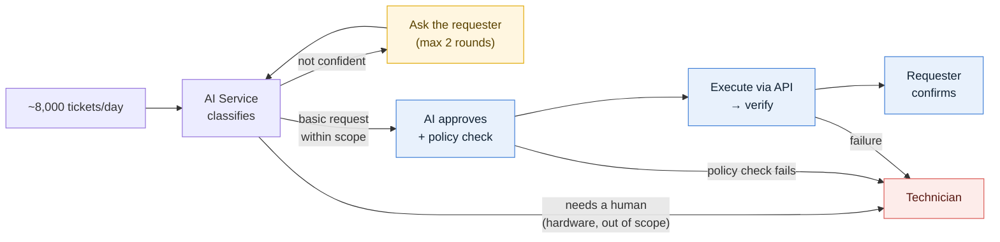
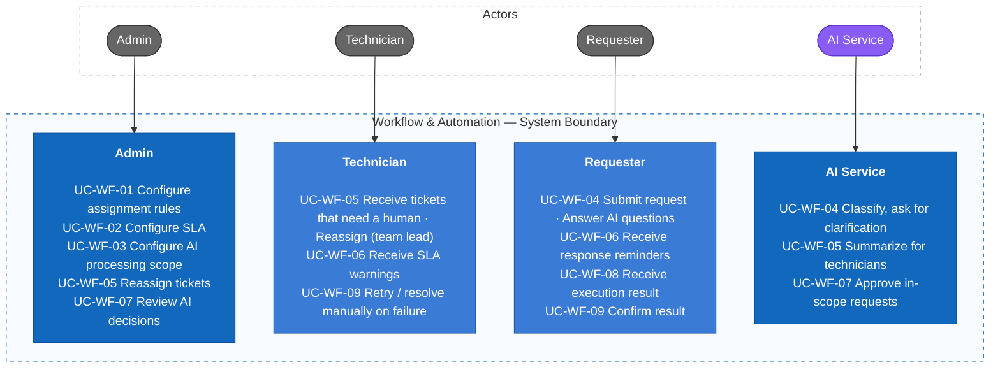

# AI-Powered IT Ticket Routing and Automated Resolution System

The system helps an enterprise receive, classify and dispatch internal IT support requests — about **8,000 tickets per day** from its departments. The AI Service classifies every ticket: basic requests within the allowed scope (account check, account creation, additional access) are **approved by the AI and executed automatically through APIs**; requests that need a human (hardware such as a new mouse, PC repair…) are routed to technicians with a summary; when the AI is not confident, it **asks the requester for clarification**. Requesters track and confirm results; technicians handle the cases that need intervention; Admins configure the AI scope, rules and SLAs, and monitor reports and activity logs.

> Current documentation scope: **F05 Workflow & Automation**. The other branches of the mind map will be added using the same structure.

## 1. Requirements — INVEST, Use Cases, and Acceptance Criteria

Requirements define what the system must do, who uses it, the value delivered, and the observable conditions of success. User stories are reviewed with INVEST and mapped to use cases and acceptance criteria.

### 1.1 Product mind map


### 1.2 Overall processing flow



| Flow | Examples | Handled by |
| --- | --- | --- |
| **A — AI self-service** | Account check, account creation, additional access within the department catalog | AI approves → system calls the API |
| **B — Clarification** | Vague ticket, missing information | AI asks the requester, then re-routes |
| **C — Human handling** | New mouse, PC repair, access outside the catalog, automation failures | Technician |

**Safe AI approval:** the AI only *understands* the request; *permission* is decided by a deterministic policy check (whitelist + department entitlement catalog + duration + beneficiary). Even if the AI misunderstands, it cannot grant access outside the scope configured by the Admin.

### 1.3 INVEST requirements

The Workflow backlog contains **20 user stories** (16 Must, 3 Should, 1 Could).

| Criterion | Meaning in this system |
| --- | --- |
| **Independent** | Each story delivers a demonstrable outcome and depends on other stories only when necessary. |
| **Negotiable** | UI and implementation may change as long as the goal, permissions and business rules stay the same. |
| **Valuable** | Each story provides value to the user or the business. |
| **Estimable** | Roles, inputs, outputs, dependencies and failure outcomes are documented. |
| **Small** | Each story covers one capability and can be split into API, application, persistence, UI and test tasks. |
| **Testable** | Each story has observable acceptance criteria, including authorization, validation and error behavior. |

```text
US-WF-01–02   Configure assignment rules
US-WF-03–04   Configure SLA
US-WF-05–07   Configure AI processing scope
US-WF-08–09   Route ticket (AI self-service / clarification)
US-WF-10–11   Auto-assign technician
US-WF-12–14   SLA reminders & warnings
US-WF-15–16   AI approves in-scope request
US-WF-17–18   Execute via API
US-WF-19–20   Verify / hand off on failure
```

The complete story-level review is maintained in [INVEST Requirements](docs/08-invest-requirements.md).

### 1.4 Use cases



Detailed actors, routing principles, ticket states and every use case are described in [Actors, roles, and use cases](docs/03-use-cases.md).

### 1.5 Roles and permissions

The system has **3 roles** (Admin, Technician, Requester) and **1 system actor** (AI Service).

| Capability | Admin | Technician | Requester | AI Service |
| --- | --- | --- | --- | --- |
| Configure rules, SLA, AI scope | Yes | No | No | No |
| Classify, ask the requester for clarification | No | No | No | Yes |
| Approve basic in-scope requests | No | No | No | Yes, when the policy check passes |
| Handle requests that need a human | No | Yes | No | No |
| Manual triage queue, reassignment | Yes | Team lead, own team | No | No |
| View AI decisions and grounds | Yes | Assigned tickets | Summary reason, own tickets | — |
| Retry / resolve manually on failure | Yes | Assigned tickets | No | No |
| Submit requests, answer the AI, confirm results | Yes | Yes | Yes | — |

The backend must enforce RBAC, the whitelist and the entitlement catalog; hiding frontend controls serves UI/UX only.

### 1.6 Core business rules

- **Whitelist:** only `CHECK_ACCOUNT`, `CREATE_ACCOUNT`, `GRANT_ACCESS`, `REVOKE_ACCESS` are executed automatically (BR-WF-01).
- **Bounded AI approval:** the AI only approves when the deterministic policy check passes — never outside the department entitlement catalog (BR-WF-02, BR-WF-16).
- **Human work goes to humans:** hardware, out-of-scope, policy-check failures → technician (BR-WF-03).
- **Clarify when unsure:** at most 2 rounds, then route to a technician (BR-WF-06).
- **Idempotent:** one approval decision leads to at most one change in the external system (BR-WF-04).
- **Traceability:** every AI decision and automated action is stored with its grounds (BR-WF-05, BR-WF-17).

Full list: [Business rules](docs/requirements/business-rules.md).

### 1.7 Open questions

| # | Question | Value currently assumed in the documents |
| --- | --- | --- |
| Q1 | Are there sensitive entitlements (system administration, financial data…) that still require **Admin approval** instead of the AI? | No Admin approval step; sensitive entitlements are simply **left out of the catalog**, so they are routed to technicians. |
| Q2 | How many clarification rounds may the AI ask before routing to a human? | 2 rounds (configurable by Admin). |
| Q3 | How many technicians / technical teams are there? | Not yet defined; affects assignment rules and SLAs. |

## Documentation

- Requirements: [Features](docs/02-features.md), [Use cases](docs/03-use-cases.md), [INVEST backlog](docs/08-invest-requirements.md), [Acceptance criteria](docs/06-acceptance-criteria.md).
- Requirements catalogs: [Business rules](docs/requirements/business-rules.md) and [Non-functional requirements](docs/requirements/non-functional-requirements.md).
- Information architecture: [sitemap, routes, navigation, screen inventory, user flows, UI states](docs/04-information-architecture/README.md).
- Traceability: [Master traceability matrix](docs/traceability/master-traceability.md).

## Project Progress

- [x] Define the topic and functional mind map
- [x] Define the processing flow: AI self-service / clarification / human handling; load of 8,000 tickets/day
- [x] Specify the Workflow & Automation branch: features, use cases, user stories (INVEST), acceptance criteria
- [x] Business rules and NFRs for the Workflow branch
- [x] Traceability for the Workflow branch (screen / API / table names are proposed)
- [ ] Resolve open questions Q1–Q3
- [ ] Specify the remaining branches: Authentication & Authorization, Dashboard, Ticket Management, AI Ticket Processing, KB, Reports, Activity Log, Users, Profile
- [x] Information architecture for the Workflow branch (draft, awaiting review)
- [ ] Information architecture for the remaining branches
- [ ] C4 System Context, Container, Component
- [ ] Database design (ERD)
- [ ] OpenAPI 3.0
- [ ] Class diagrams, sequence diagrams
- [ ] Implementation and testing
