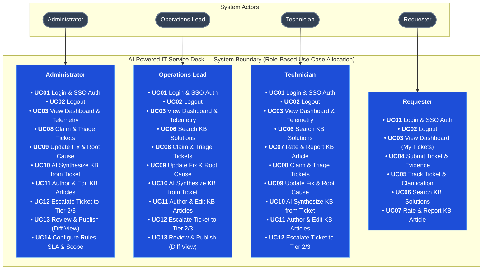

# AI-Powered IT Ticket Routing and Automated Resolution System

The system helps an enterprise receive, classify, and dispatch internal IT support requests — processing approximately **8,000 tickets per day** across corporate departments. The AI Service evaluates incoming requests: basic requests within scope are **approved by the AI and executed automatically through backend APIs**; requests requiring hands-on human intervention are routed directly to technicians with an AI summary; when context is missing, it **asks the requester for clarification**.

---

## 1. Mindmap


> **XMind Outline:** A complete hierarchical outline for XMind import is provided in [XMind Outline Documentation](docs/mindmap-xmind.md).

---

## 2. User Stories

### Personas & Roles
*   **Requester:** Business employee seeking quick self-service or IT assistance.
*   **Technician:** Support engineer troubleshooting issues, executing fixes, and authoring KB articles.
*   **Operations Lead:** Team supervisor overseeing triage queues, escalations, and article reviews.
*   **Administrator:** System owner configuring routing rules, SLA policies, and AI auto-approval scopes.
*   **AI Service:** Intelligent background actor classifying requests, extracting context, and synthesizing articles.

### Core Backlog User Stories

| Story ID | Role | User Story (`As a... I want to... So that...`) | Priority |
| :--- | :--- | :--- | :---: |
| **US01** | `REQUESTER` | **As a** Requester, **I want to** submit tickets with screenshots and error logs, **So that** technicians understand my issue. | **Must** |
| **US02** | `REQUESTER` | **As a** Requester, **I want** real-time KB solution suggestions while typing, **So that** I can resolve issues without submitting a ticket. | **Must** |
| **US03** | `REQUESTER` | **As a** Requester, **I want to** answer AI clarifying questions, **So that** my incomplete request has sufficient context for routing. | **Must** |
| **US04** | `REQUESTER` | **As a** Requester, **I want to** track ticket status and confirm resolution, **So that** I know when my issue is fixed. | **Must** |
| **US05** | `AI` | **As the** AI Service, **I want to** classify tickets and extract structured fields, **So that** requests are routed to the right team. | **Must** |
| **US06** | `AI` | **As the** AI Service, **I want to** auto-approve in-scope basic requests and call execution APIs, **So that** repetitive tickets are resolved instantly. | **Must** |
| **US07** | `TECHNICIAN` | **As a** Technician, **I want to** view a 3-line AI summary on ticket assignment, **So that** I grasp the problem without reading long threads. | **Must** |
| **US08** | `TECHNICIAN` | **As a** Technician, **I want to** claim tickets, update states, and document root causes, **So that** ticket lifecycle is cleanly tracked. | **Must** |
| **US09** | `TECHNICIAN` | **As a** Technician, **I want** AI to synthesize a KB article draft from a resolved ticket with 1-click, **So that** know-how is captured with zero effort. | **Must** |
| **US10** | `TECHNICIAN` | **As a** Technician, **I want to** author and revise troubleshooting guides in rich text/markdown, **So that** procedures are standardized. | **Must** |
| **US11** | `OPERATIONS LEAD`| **As an** Operations Lead, **I want to** reassign tickets and escalate priority, **So that** critical incidents are resolved within SLA. | **Must** |
| **US12** | `OPERATIONS LEAD`| **As an** Operations Lead, **I want to** review KB articles using a side-by-side Visual Diff, **So that** only validated steps are published. | **Must** |
| **US13** | `ADMINISTRATOR` | **As an** Administrator, **I want to** configure rule-based routing and SLA timers (P1–P4), **So that** ticket allocation matches team capacity. | **Must** |
| **US14** | `ADMINISTRATOR` | **As an** Administrator, **I want to** define the AI auto-execution whitelist and entitlement matrix, **So that** automated actions are strictly governed. | **Must** |

---

## 3. Use Cases

The system organizes capabilities across 14 discrete use cases (`UC01` to `UC14`) mapped to 4 operational roles:



For detailed actors, permissions, and business flows, see [Actors, roles, and use cases](docs/f05-workflow-automation/02-use-cases.md).

### Use Case Catalog

| ID | Use Case Name | Primary Actor | Scope & Description |
| :--- | :--- | :--- | :--- |
| **UC01** | Login & SSO Authentication | All Roles | Authenticate via enterprise SSO and load role-based workspace permissions. |
| **UC02** | Logout & Session Revocation | All Roles | Terminate session tokens and clear client-side caches. |
| **UC03** | View Dashboard & Telemetry | All Roles | View role-scoped metrics (personal tickets, team backlog, or enterprise KPIs). |
| **UC04** | Submit Ticket & Evidence | Requester | Submit support requests with category, error logs, and screenshots. |
| **UC05** | Track Ticket & Clarification | Requester | View real-time status timeline and respond to AI clarifying questions. |
| **UC06** | Search KB Solutions | All Roles | Natural language semantic search for verified solutions with instant answer extraction. |
| **UC07** | Rate & Report KB Article | All Roles | Submit helpfulness votes (Helpful / Unhelpful) or report outdated/inaccurate technical steps. |
| **UC08** | Claim & Triage Tickets | Technician / Lead | Claim unassigned tickets from team queue or reassign across tiers. |
| **UC09** | Update Fix & Root Cause | Technician / Lead | Transition ticket states (In Progress, Needs Info, Resolved) and record resolution. |
| **UC10** | AI Synthesize KB from Ticket | Technician / Lead | 1-click generation of structured KB draft from closed ticket with PII scrubbing. |
| **UC11** | Author & Edit KB Articles | Technician / Admin | Author technical guides with rich text, markdown, code blocks, and tags. |
| **UC12** | Escalate Ticket to Tier 2/3 | Technician / Lead | Transfer complex or blocked tickets to specialized tier with updated priority. |
| **UC13** | Review & Publish (Diff View) | Lead / Admin | Inspect proposed article revisions side-by-side (Diff View) and approve for release. |
| **UC14** | Configure Rules, SLA & Scope | Administrator | Define deterministic assignment rules, SLA policies, and AI auto-approval whitelist. |

---

## 4. Information Architecture

```text
Public Access Layer
└── /login                                  - SSO Corporate Authentication Portal & Role Selector

Authenticated Workspace (Fixed 260px Collapsible Sidebar + Sticky 64px Topbar)
│
├── [REQUESTER SELF-SERVICE PORTAL]
│   ├── /portal                             - Requester Home, search bar, and trending resolutions
│   ├── /requests/new                       - Smart ticket draft form with real-time AI solution deflection
│   ├── /requests/my-tickets                - Requester ticket tracking, status timeline & verification
│   └── /requests/:id                       - Ticket conversation, clarifying question answers, feedback rating
│
├── [TICKET & TECHNICIAN WORKSPACE]
│   ├── /tickets/inbox                      - Team queues, assigned tickets, triage unassigned queue
│   ├── /tickets/:id                        - Unified technician console (AI summary, conversation, internal notes)
│   └── /tickets/escalations                - Approaching SLA breach tickets & department reassignments
│
├── [AI PROCESSING & AUTOMATION]
│   ├── /ai/classifications                 - Real-time classification feed, intent detection, confidence telemetry
│   ├── /ai/clarification-queue             - Active clarification interactions with requesters
│   ├── /automation/rules                   - Assignment rules builder (Round-robin, workload balance, team matching)
│   └── /automation/sla-policies            - Priority-based SLA policies (P1–P4) & business hour calendar
│
├── [KNOWLEDGE MANAGEMENT — KB]
│   ├── /kb/explore                         - Semantic solution search portal & faceted category hierarchy
│   ├── /kb/articles/:id                    - Article view (Problem, root cause, step-by-step fix, attachments)
│   ├── /kb/editor                          - Rich Text/Markdown authoring tool, code blocks & screenshot uploads
│   ├── /kb/ai-inbox                        - AI-synthesized drafts extracted from resolved tickets (1-click draft)
│   ├── /kb/approvals                       - Side-by-side Visual Diff inspection for pending article updates
│   └── /kb/flagged                         - Problematic & outdated article maintenance queue
│
├── [GOVERNANCE, ANALYTICS & AUDIT]
│   ├── /analytics/dashboard                - Executive KPI telemetry, AI deflection rate, MTTA, MTTR, SLA %
│   ├── /audit/activity-log                 - Immutable security and workflow audit trail (SOC-2 compliant)
│   └── /admin/users-rbac                   - Enterprise user directory, team assignments & role matrix
│
└── [SYSTEM EXCEPTION & FALLBACK]
    ├── /403                                - Access Forbidden (Role-Based Access Control fallback guard)
    └── /404                                - Page Not Found (Routing error fallback)
```
