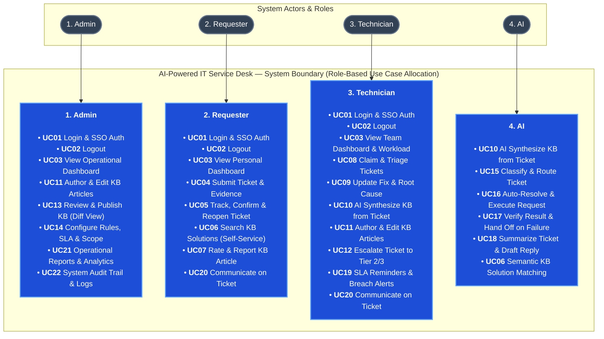
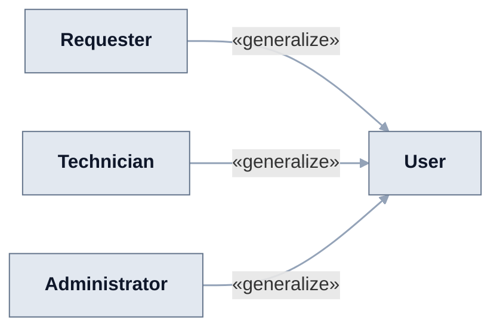
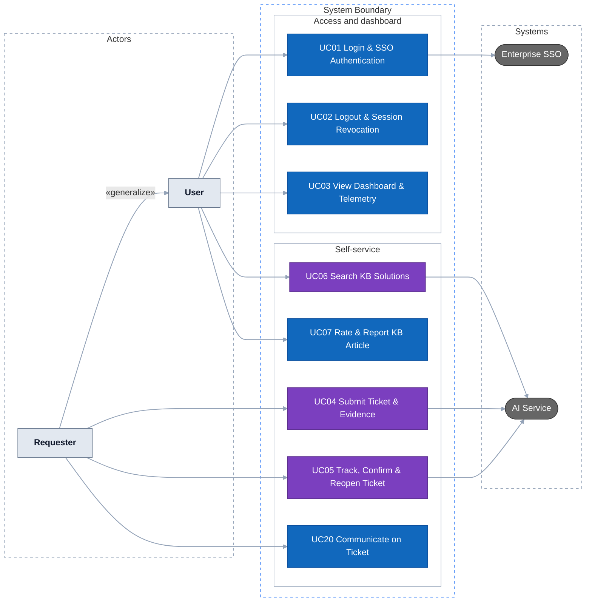
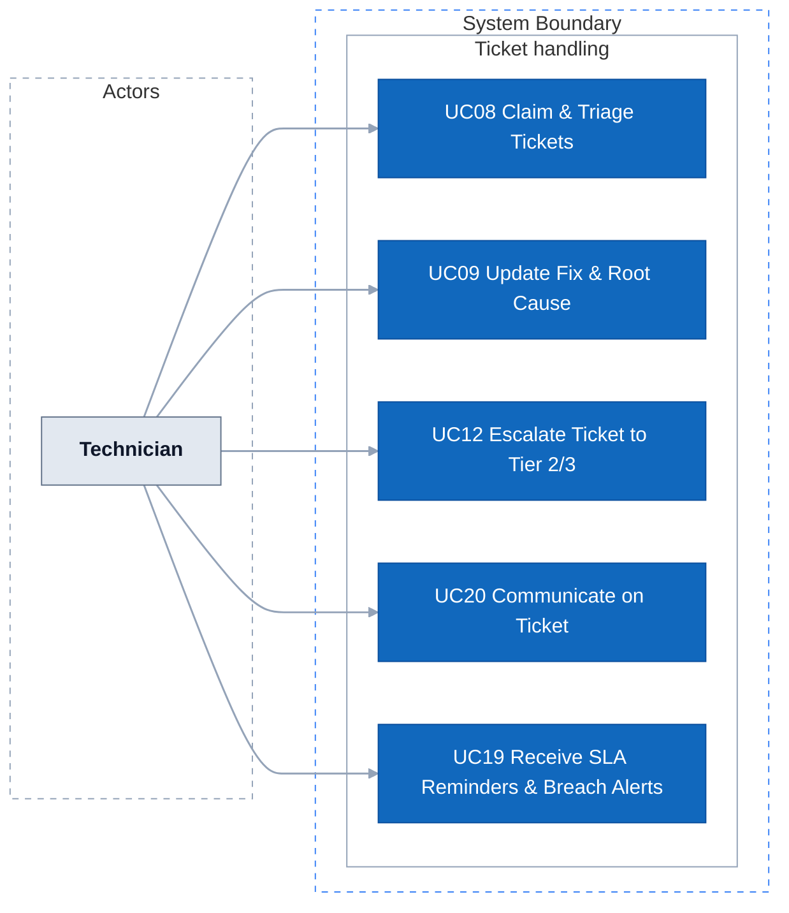
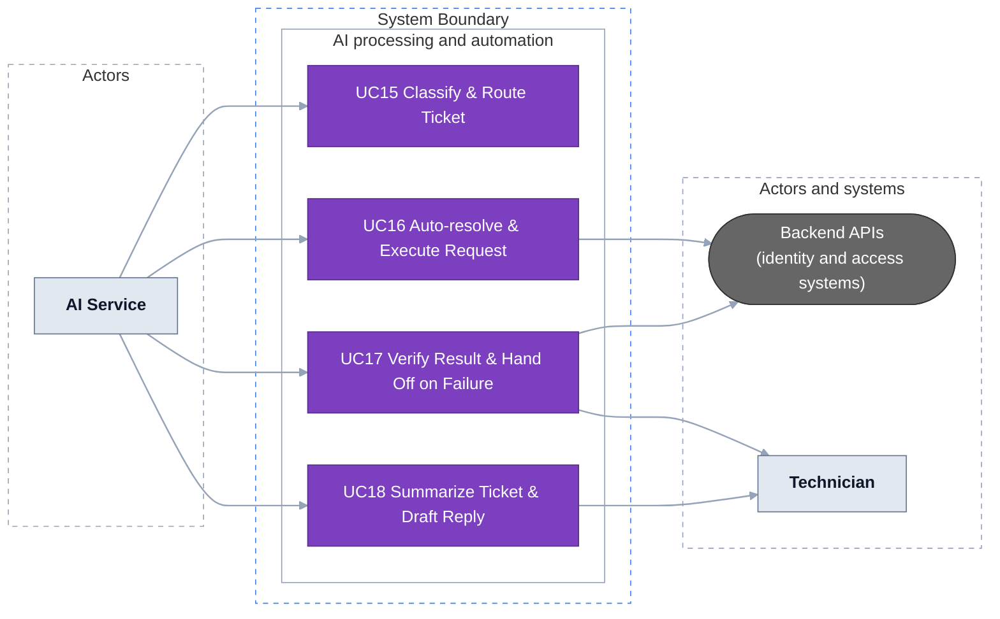
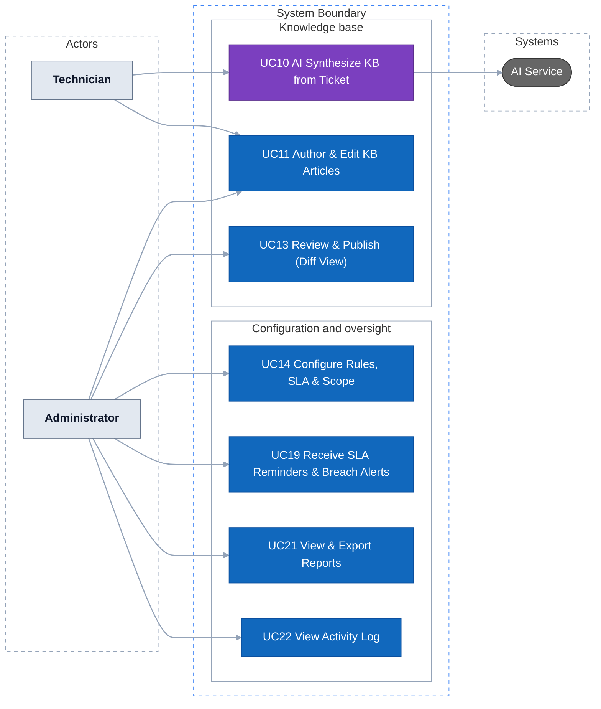
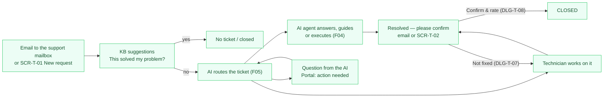
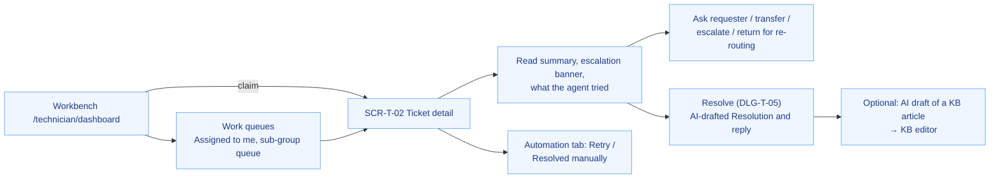
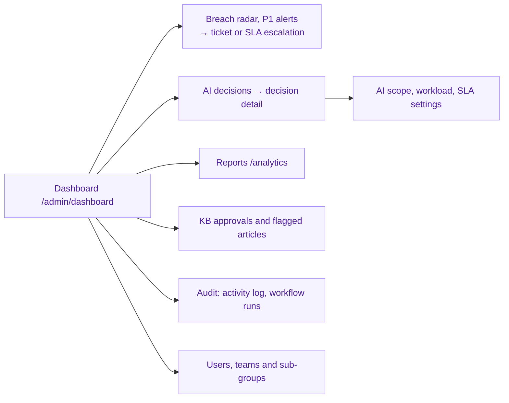

# AI-Powered IT Ticket Routing and Automated Resolution System

The system helps an enterprise receive, classify, and dispatch internal IT support requests — processing approximately **8,000 tickets per day** across corporate departments. The AI Service evaluates incoming requests: basic requests within scope are **approved by the AI and executed automatically through backend APIs**; requests requiring hands-on human intervention are routed directly to technicians with an AI summary; when context is missing, it **asks the requester for clarification**.

## 1. Requirements — User Stories and Use Cases

Requirements define what the system must do, who uses it, and the value delivered. The detailed specification is split into feature branches F01–F09; F02–F08 each have a folder under `docs/`, while F01 Authentication & Authorization and F09 User Management are not specified yet. This section gives the overview across branches.

### 1.1 Product mind map


The outline for XMind import is in [the mind map outline](docs/mindmap-xmind.md).

The mind map groups features by area (8 groups); the specification folders are organized by feature branch. The groups map to the branches as follows:

| Mind map group | Specified in | Branch design status |
| :--- | :--- | :--- |
| 1. Requester Self-Service | [F03 Ticket Management](docs/f03-ticket-management/README.md); KB deflection in [F06](docs/f06-knowledge-base/README.md) | TARGET V1 |
| 2. Technician Workspace | [F03 Ticket Management](docs/f03-ticket-management/README.md); ticket summary on handoff in F03, AI resolution in [F04](docs/f04-ai-ticket-processing/README.md) | TARGET V1 |
| 3. Administration & Coordination | [F05 Workflow & Automation](docs/f05-workflow-automation/README.md) (rules, SLA, AI scope); RBAC and user directory in F09 (not specified) | TARGET V1 |
| 4. Knowledge Base | [F06 Knowledge Base](docs/f06-knowledge-base/README.md) | TARGET V1 |
| 5. AI Intelligent Processing | [F04 AI Ticket Processing](docs/f04-ai-ticket-processing/README.md) | TARGET V1 (draft for team review) |
| 6. Automation Workflow Engine | [F05 Workflow & Automation](docs/f05-workflow-automation/README.md) | TARGET V1 |
| 7. Approval & Automated Execution | [F05 Workflow & Automation](docs/f05-workflow-automation/README.md) | TARGET V1 |
| 8. Dashboard & Governance Telemetry | [F02 Dashboard](docs/f02-dashboard/README.md), [F07 Reports & Analytics](docs/f07-reports-analytics/README.md), [F08 Activity Log](docs/f08-activity-log/README.md) | F02 draft; F07, F08 TARGET V1 (draft for team review) |
| Login (no group) | F01 Authentication & Authorization (not specified) | — |

The mind map is an early outline and is out of date in a few places. The system has four actors (see [1.2](#12-user-stories)), so the Team Lead role in the mind map is dropped; some branch docs still name Team Lead and are being aligned. The technician summary (at most 150 words rather than 3 lines) and the reopen window (7 days rather than 48 hours) follow the branch docs. The "Manager" who approves elevated permissions in groups 7.2 and 7.3 is the Administrator. Whether some sensitive entitlements still need that approval is open (US-WF-15 in F05); the agreed direction is to let the AI route and approve as many requests as possible, so that the Administrator's manual routing and approval work is kept to a minimum.

### 1.2 User stories

**Actors**

The system has four actors: three human roles (Requester, Technician, Administrator) and the AI Service.

*   **Requester (Người gửi ticket):** Business employee who submits tickets, tracks status, answers AI clarifying questions, verifies KB solutions, and confirms resolution.
*   **Technician (Kỹ thuật viên):** Support engineer who handles what the AI cannot resolve: troubleshooting, fixing, updating states and solutions, escalating to a higher tier, and authoring KB articles.
*   **Administrator (Admin):** System owner who configures routing rules, SLA policies, and AI auto-approval whitelists, reviews KB revisions via visual diff, and monitors operational dashboards and audit logs. The Administrator is also the approver for elevated permissions (the "Manager" in the mind map).
*   **AI Service (Hệ thống AI):** Intelligent background service that classifies and routes tickets, auto-resolves whitelisted requests, prompts for missing context, summarizes conversations, links duplicate cases, and synthesizes KB drafts from resolved tickets.

In the use case diagrams, **User** is the common parent of the three human roles (login, dashboard, KB search).

**Core backlog**

This is the system-level backlog: 22 stories across the branches. The last column lists the detailed stories in the branch folders, which hold the acceptance criteria.

| Story ID | Role | User Story (`As a... I want to... So that...`) | Priority | Branch stories |
| :--- | :--- | :--- | :---: | :--- |
| **US01** | `REQUESTER` | **As a** Requester, **I want to** submit tickets with screenshots and error logs, **So that** the AI and technicians understand my issue without asking again. | **Must** | US-TK-01, US-TK-02 |
| **US02** | `REQUESTER` | **As a** Requester, **I want** real-time KB solution suggestions while typing, **So that** I can resolve issues without submitting a ticket. | **Must** | US-AI-05, US-TK-04, US-KB-08 |
| **US03** | `REQUESTER` | **As a** Requester, **I want to** answer AI clarifying questions inside my ticket, **So that** my incomplete request has sufficient context for routing. | **Must** | US-AI-03, US-AI-04, US-WF-09, US-TK-16 |
| **US04** | `REQUESTER` | **As a** Requester, **I want to** track ticket status and confirm resolution, **So that** I know when my issue is fixed. | **Must** | US-TK-05, US-TK-20, US-WF-19, US-NK-02 |
| **US05** | `REQUESTER` | **As a** Requester, **I want to** report "not fixed" or reopen a closed ticket within 7 days, **So that** I don't have to start over when the problem comes back. | **Must** | US-TK-21 |
| **US06** | `AI` | **As the** AI Service, **I want to** classify tickets and extract structured fields, **So that** requests are routed to the right flow and team. | **Must** | US-AI-01, US-AI-02 |
| **US07** | `AI` | **As the** AI Service, **I want to** auto-approve in-scope basic requests after the policy check and call execution APIs, **So that** repetitive tickets are resolved instantly. | **Must** | US-WF-08, US-WF-15, US-WF-17, US-AI-17, US-AI-20 |
| **US08** | `AI` | **As the** AI Service, **I want to** route tickets that need a human to the right technician team, and send tickets that match no rule or that I fail to process to a shared triage queue, **So that** no ticket is left without an owner. | **Must** | US-WF-10, US-WF-11, US-NK-07 |
| **US09** | `TECHNICIAN` | **As a** Technician, **I want to** see an AI summary of at most 150 words (problem, impact, key details, what was tried, why it came to a human) on every ticket routed to me, **So that** I grasp the problem without reading long threads. | **Must** | US-AI-07, US-AI-08 |
| **US10** | `TECHNICIAN` | **As a** Technician, **I want to** claim tickets from my team queue or the triage queue, update states, and record the resolution and root cause, **So that** the ticket lifecycle is cleanly tracked. | **Must** | US-TK-11, US-TK-17, US-TK-18 |
| **US11** | `TECHNICIAN` | **As a** Technician, **I want to** transfer a misrouted ticket to another team or escalate it to a higher tier with the work done so far, **So that** hard or misrouted tickets reach the right expertise in time. | **Must** | US-TK-12, US-TK-13 |
| **US12** | `TECHNICIAN` | **As a** Technician, **I want** tickets whose automated execution or verification failed to be handed to me with the error log, **So that** I can retry or resolve them manually and no automation failure is forgotten. | **Must** | US-WF-20 |
| **US13** | `TECHNICIAN` | **As a** Technician, **I want to** be reminded before a ticket breaches its SLA, with the SLA paused while the requester owes an answer, **So that** I can act in time and am not penalized for delays outside my control. | **Must** | US-WF-12, US-WF-04 |
| **US14** | `TECHNICIAN` | **As a** Technician, **I want** AI to synthesize a KB article draft from a resolved ticket with 1-click, **So that** know-how is captured with zero effort. | **Must** | US-KB-04 |
| **US15** | `TECHNICIAN` | **As a** Technician, **I want to** author and revise troubleshooting guides in rich text/markdown, **So that** procedures are standardized. | **Must** | US-KB-02, US-KB-03 |
| **US16** | `TECHNICIAN` | **As a** Technician, **I want** a personal workbench with my tickets sorted by priority and SLA and figures for my team, **So that** I know what to work on next. | **Must** | US-DB-08, US-BC-02 |
| **US17** | `ADMINISTRATOR` | **As an** Administrator, **I want to** configure rule-based routing and SLA timers (P1–P4), **So that** ticket allocation matches team capacity. | **Must** | US-WF-01, US-WF-02, US-WF-03 |
| **US18** | `ADMINISTRATOR` | **As an** Administrator, **I want to** define the AI auto-execution whitelist, entitlement matrix and confidence thresholds, **So that** automated actions are strictly governed. | **Must** | US-WF-05, US-WF-06, US-WF-07 |
| **US19** | `ADMINISTRATOR` | **As an** Administrator, **I want to** review KB articles using a side-by-side Visual Diff, **So that** only validated steps are published. | **Must** | US-KB-05 |
| **US20** | `ADMINISTRATOR` | **As an** Administrator, **I want** an operations dashboard with ticket volume, SLA risk and breached tickets, and to be notified when a ticket breaches its SLA, **So that** I can step in before incidents pile up. | **Must** | US-DB-01, US-DB-03, US-WF-13 |
| **US21** | `ADMINISTRATOR` | **As an** Administrator, **I want** reports on the AI self-resolution rate, handling time, SLA breaches and satisfaction, with CSV/XLSX export, **So that** I can decide whether to widen or narrow what the AI may do. | **Must** | US-BC-03, US-BC-04, US-BC-05, US-BC-06 |
| **US22** | `ADMINISTRATOR` | **As an** Administrator, **I want** an immutable activity log of every user, AI and system action, including why the AI approved, asked back or routed each request, **So that** AI decisions and incidents can be reviewed and trusted. | **Must** | US-NK-03, US-NK-04, US-NK-05, US-WF-16 |

Each branch keeps its detailed backlog with acceptance criteria in its own folder; see [Documentation](#documentation).

### 1.3 Use cases

#### Role-based use case allocation

The system organizes capabilities across discrete use cases mapped to the 4 operational roles (Admin, Requester, Technician, AI Service):



#### Subsystem boundary and functional use case diagrams

The system has 22 use cases (`UC01` to `UC22`) shared by the three human roles (Requester, Technician, Administrator) and the AI Service. The first diagram shows how the human roles relate; the other four show the use cases grouped by functional domain. Purple nodes call the AI Service.











**Use case catalog**

| ID | Use Case Name | Primary Actor | Scope & Description | Branch use cases |
| :--- | :--- | :--- | :--- | :--- |
| **UC01** | Login & SSO Authentication | All human roles | Authenticate via enterprise SSO and load role-based workspace permissions. | — (F01 not specified) |
| **UC02** | Logout & Session Revocation | All human roles | Terminate session tokens and clear client-side caches. | — (F01 not specified) |
| **UC03** | View Dashboard & Telemetry | All human roles | View role-scoped workspaces (self-service action cards, active request tracking and KB deflection for Requesters; personal workbench and unassigned team pool for Technicians; enterprise live KPIs, SLA radar and incident stream for Administrators). | UC-DB-01 … UC-DB-05 |
| **UC04** | Submit Ticket & Evidence | Requester | Submit a request in free text through the portal or the support mailbox, with error logs and screenshots; matching KB articles are suggested while typing. | UC-TK-01, UC-AI-03 |
| **UC05** | Track, Confirm & Reopen Ticket | Requester | View the status timeline, answer AI clarifying questions, confirm the fix and rate it, reopen within 7 days, or cancel a request no longer needed. | UC-TK-02, UC-TK-06, UC-AI-02 |
| **UC06** | Search KB Solutions | All human roles | Natural language semantic search for verified solutions with instant answer extraction. | UC-KB-01 |
| **UC07** | Rate & Report KB Article | All human roles | Submit helpfulness votes (Helpful / Unhelpful) or report outdated/inaccurate technical steps. | UC-KB-05 |
| **UC08** | Claim & Triage Tickets | Technician | Claim tickets from the team queue or from the shared triage queue (tickets the AI could not route), or transfer a misrouted ticket to another team. | UC-TK-02, UC-TK-03, UC-DB-04 |
| **UC09** | Update Fix & Root Cause | Technician | Transition ticket states (In Progress, Needs Info, Resolved) and record resolution and root cause. | UC-TK-05 |
| **UC10** | AI Synthesize KB from Ticket | Technician | 1-click generation of structured KB draft from closed ticket with PII scrubbing. | UC-KB-04 |
| **UC11** | Author & Edit KB Articles | Technician / Admin | Author technical guides with rich text, markdown, code blocks, and tags. | UC-KB-02 |
| **UC12** | Escalate Ticket to Tier 2/3 | Technician | Transfer complex or blocked tickets to a higher support tier with the work done so far. | UC-TK-03 |
| **UC13** | Review & Publish (Diff View) | Administrator | Inspect proposed article revisions side-by-side (Diff View) and approve for release. | UC-KB-03 |
| **UC14** | Configure Rules, SLA & Scope | Administrator | Define deterministic assignment rules, SLA policies, and AI auto-approval whitelist. | UC-WF-01, UC-WF-02, UC-WF-03 |
| **UC15** | Classify & Route Ticket | AI Service | Read the ticket, classify it, fill the structured fields, suggest a priority and flag duplicates; then auto-resolve it, ask the requester one question, or route it to a technician team (the shared triage queue when no rule matches). | UC-AI-01, UC-AI-05, UC-AI-06, UC-WF-04, UC-WF-05 |
| **UC16** | Auto-resolve & Execute Request | AI Service | Approve in-scope requests after the deterministic policy check and call the backend APIs; domain agents answer known how-to questions with cited KB steps. | UC-WF-07, UC-WF-08, UC-AI-10 |
| **UC17** | Verify Result & Hand Off on Failure | AI Service | Verify the result on the target system and ask the requester to confirm; hand failed executions to a technician with the error log. | UC-WF-09 |
| **UC18** | Summarize Ticket & Draft Reply | AI Service | Give the technician a summary of at most 150 words when a ticket comes to a human, and draft the resolution and the reply when it is resolved. | UC-AI-04, UC-AI-08 |
| **UC19** | Receive SLA Reminders & Breach Alerts | Technician / Administrator | The SLA scheduler reminds the assignee before a deadline and alerts the Administrator when a ticket breaches its SLA. | UC-WF-06, UC-DB-02 |
| **UC20** | Communicate on Ticket | Requester / Technician | Exchange public replies with attachments; Technicians add internal notes hidden from the requester. | UC-TK-04 |
| **UC21** | View & Export Reports | Administrator | Ticket volume, handling time and SLA breaches, AI self-resolution rate, satisfaction and team workload, with CSV/XLSX export and a weekly email digest; Technicians see figures for their own scope. | UC-BC-01 … UC-BC-08 |
| **UC22** | View Activity Log | Administrator | Search the append-only log of user, AI and system actions, including AI approval decisions and workflow run errors; Technicians and Requesters see the history of their tickets. | UC-NK-01 … UC-NK-05 |

The use cases per branch (UC-DB, UC-TK, UC-AI, UC-WF, UC-KB, UC-BC, UC-NK) are specified in each branch folder. Two branch use cases are left out of this overview on purpose: UC-AI-07 (feedback and learning from verified tickets) and UC-AI-09 (structuring a business requirement) are specified in F04 only.

## 2. Information Architecture, Screen Hierarchy and UI/UX

This section is the **single map of every screen** for UI work. It follows the latest mind map: one sidebar area per branch, one ticket page shared by everyone. Each screen keeps the ID and route of the branch that owns it. **Where a branch's own IA disagrees with this section, this section wins until that branch is updated** (see [2.7](#27-decisions-that-settle-conflicts-between-branch-docs)). Every screen must define its access rule and its loading, empty, validation, error, saving and success states (see [2.8](#28-shared-ui-rules)).

### 2.1 Global layout

Every role uses the same shell: a **top bar** and a **left sidebar** that shows only the items the role may open (never a disabled item).

| Top bar element | Content | Owner |
|---|---|---|
| **+ New request** | Primary button for every role → SCR-T-01 | F03 |
| Notifications | "Notifications N" with the unread count → SCR-91 | F05 |
| Status switch | *ON / OFF*, technicians only (used by automatic assignment) | F05 |
| User menu | Name and role → *Profile* (SCR-PF-01), *Log out* | F10, F01 |

Login is **Microsoft SSO only** (SCR-01). After login, `/dashboard` sends each role to its home: Requester → `/portal`, Technician → `/technician/dashboard`, Admin → `/admin/dashboard`.

### 2.2 Information architecture

Colours follow the branch that owns the screen. Dashed boxes: modals and dialogs. The ticket detail page (SCR-T-02) is shared and detailed in [2.5](#25-ticket-detail-scr-t-02-who-owns-each-zone).

```mermaid
flowchart TB
    ROOT["<b>AI-Powered Ticket Routing System</b><br/>Microsoft SSO"]

    subgraph AUTH["F01 Login & Authorization"]
        direction TB
        S01["SCR-01 Login /login"]
        S90["SCR-90 Access denied /403"]
        S92["SCR-92 Not found /404 (proposed)"]
    end

    subgraph DASH["F02 Dashboard"]
        direction TB
        DB03["SCR-DB-03 Requester portal /portal"]
        DB02["SCR-DB-02 Technician workbench<br/>/technician/dashboard"]
        DB01["SCR-DB-01 Admin dashboard<br/>/admin/dashboard"]
    end

    subgraph TICK["F03 Ticket Management"]
        direction TB
        T01["SCR-T-01 New request /tickets/new"]
        T03["SCR-T-03 My tickets /my-tickets"]
        T04["SCR-T-04 Work queues /tickets"]
        T02["SCR-T-02 Ticket detail /tickets/:code<br/>(shared, see 2.5)"]
    end

    subgraph KB["F06 Knowledge Base"]
        direction TB
        KB01["SCR-KB-01 KB search /kb"]
        KB02["SCR-KB-02 Article /kb/articles/:id"]
        KB03["SCR-KB-03 Article editor /kb/editor"]
        KB05["SCR-KB-05 Approvals and diff /kb/approvals"]
        KB06["SCR-KB-06 Flagged articles /kb/flagged"]
    end

    subgraph REP["F07 Reports & Analytics"]
        direction TB
        BC["SCR-BC-01 … 04 Tickets · SLA · AI · Satisfaction<br/>/analytics/tickets · sla · ai · satisfaction"]
        BC05["SCR-BC-05 Report settings /analytics/settings"]
    end

    subgraph WF["F05 Workflow & Automation (AI and workflow)"]
        direction TB
        WF30["SCR-WF-30 AI decisions /workflow/ai-decisions"]
        WF31["SCR-WF-31 AI decision detail<br/>/workflow/ai-decisions/:id"]
        WF03["SCR-WF-03 AI scope /workflow/ai-scope"]
        WF01["SCR-WF-01 Workload /workflow/workload"]
        WF02["SCR-WF-02 SLA and calendar /workflow/sla"]
    end

    subgraph AIP["F04 AI Ticket Processing"]
        direction TB
        AI01["SCR-AI-01 Learning examples<br/>/admin/ai/learning-examples"]
    end

    subgraph LOG["F08 Activity Log"]
        direction TB
        NK02["SCR-NK-02 Activity log /audit/activity-log"]
        NK04["SCR-NK-04 Workflow runs /audit/workflow-runs"]
        NK05["SCR-NK-05 Run detail /audit/workflow-runs/:id"]
    end

    subgraph USERS["F09 User Management (proposed)"]
        direction TB
        UM01["SCR-UM-01 Users /admin/users"]
        UM02["SCR-UM-02 User detail /admin/users/:id"]
        UM03["SCR-UM-03 Teams and sub-groups /admin/teams"]
    end

    subgraph PROF["F10 Personal Profile (proposed)"]
        direction TB
        PF01["SCR-PF-01 Profile /profile"]
    end

    S91["SCR-91 Notifications /notifications"]

    ROOT --> AUTH
    ROOT --> DASH
    DASH --> TICK
    DASH --> KB
    DASH --> REP
    ROOT --> WF
    ROOT --> AIP
    ROOT --> LOG
    ROOT --> USERS
    ROOT --> PROF
    ROOT --> S91
    T03 --> T02
    T04 --> T02
    T01 --> T02
    KB01 --> KB02
    WF30 --> WF31
    NK04 --> NK05
    UM01 --> UM02

    classDef root fill:#ffffff,stroke:#222222,stroke-width:2px,color:#111111;
    classDef f01 fill:#fee2e2,stroke:#dc2626,color:#7f1d1d;
    classDef f02 fill:#ffedd5,stroke:#ea580c,color:#7c2d12;
    classDef f03 fill:#d1fae5,stroke:#059669,color:#064e3b;
    classDef f04 fill:#ccfbf1,stroke:#0d9488,color:#134e4a;
    classDef f05 fill:#dbeafe,stroke:#2563eb,color:#1e3a8a;
    classDef f06 fill:#fecdd3,stroke:#e11d48,color:#881337;
    classDef f07 fill:#f3e8ff,stroke:#9333ea,color:#581c87;
    classDef f08 fill:#fef3c7,stroke:#d97706,color:#78350f;
    classDef f09 fill:#e0f2fe,stroke:#0284c7,color:#0c4a6e;
    classDef f10 fill:#f1f5f9,stroke:#64748b,color:#1e293b;
    class ROOT root;
    class S01,S90,S92 f01;
    class DB01,DB02,DB03 f02;
    class T01,T02,T03,T04 f03;
    class AI01 f04;
    class WF01,WF02,WF03,WF30,WF31,S91 f05;
    class KB01,KB02,KB03,KB05,KB06 f06;
    class BC,BC05 f07;
    class NK02,NK04,NK05 f08;
    class UM01,UM02,UM03 f09;
    class PF01 f10;
```



### 2.3 Sidebar per role

The first item is the home page. Badges are counts computed by the server.

| Sidebar item | Route | Requester | Technician | Admin |
|---|---|:---:|:---:|:---:|
| Home: Portal / Workbench / Dashboard | `/portal` · `/technician/dashboard` · `/admin/dashboard` | ✅ portal | ✅ workbench | ✅ dashboard |
| My tickets (badge: needs my action) | `/my-tickets` | ✅ | ✅ | ✅ |
| Work queues: Assigned to me · Sub-group queue · On hold · Due soon / Breached · saved views | `/tickets?view=…` | | ✅ | ✅ |
| Work queues: Escalated to me · All open | `/tickets?view=escalated-to-me` · `all-open` | | | ✅ |
| Knowledge base: Search | `/kb` | ✅ public articles | ✅ + internal | ✅ |
| Knowledge base: New article · Flagged | `/kb/editor` · `/kb/flagged` | | ✅ | ✅ |
| Knowledge base: Approvals | `/kb/approvals` | | | ✅ |
| Reports: Tickets · SLA · Satisfaction | `/analytics/…` | | ✅ own scope | ✅ |
| Reports: AI · Settings | `/analytics/ai` · `/analytics/settings` | | | ✅ |
| AI & workflow: AI decisions · AI scope · Workload · SLA · Learning examples | `/workflow/…` · `/admin/ai/learning-examples` | | | ✅ |
| Audit: Activity log · Workflow runs | `/audit/…` | | | ✅ |
| Users & teams: Users · Teams and sub-groups | `/admin/users` · `/admin/teams` | | | ✅ |

Saved filters that F04 adds to the work queues: *Suspected bugs*, *Failed automation*.

### 2.4 Screen inventory

Pages and modals by owner branch. "Proposed" screens come from the mind map leaves and are not specified in a branch folder yet.

| ID | Screen | Type | Route / opened from | Roles | Owner |
|---|---|---|---|---|---|
| SCR-01 | Login (Microsoft SSO) | Page | `/login` | Public | F01 |
| SCR-90 | Access denied | Page | `/403` | All | F01 |
| SCR-92 | Not found *(proposed)* | Page | `/404` | All | F01 |
| SCR-91 | Notifications | Page | `/notifications`, top bar | All | F05 |
| SCR-DB-03 | Requester portal: action needed (questions to answer, results to confirm), my open requests, announcements, KB search | Page | `/portal` | All (requester home) | F02 |
| SCR-DB-02 | Technician workbench: my queue by SLA, sub-group queue with claim, personal figures | Page | `/technician/dashboard` | Technician | F02 |
| SCR-DB-01 | Admin dashboard: volume, open by status, daily AI resolution rate, SLA breach radar, P1 alerts, workload | Page | `/admin/dashboard` | Admin | F02 |
| SCR-DB-10 | Live incident / P1 drawer | Drawer | Alert banner on the dashboards | Admin, on-duty technician | F02 |
| SCR-DB-11 | SLA escalation | Modal | SLA widget | Admin, technician | F02 |
| SCR-T-01 | New request: free text, *for someone else*, attachments; no category form; KB suggestions | Page | `/tickets/new` | All | F03 |
| SCR-T-03 | My tickets: Open · Needs my action · Resolved & closed · Cancelled | Page | `/my-tickets` | All | F03 |
| SCR-T-04 | Work queues: views, filters, saved views | Page | `/tickets` | Technician, Admin | F03 |
| SCR-T-02 | Ticket detail (see 2.5) | Page | `/tickets/:code` | Per ticket scope | F03 (host) |
| DLG-T-02 … 08 | Transfer within the group · Escalate · Ask requester · Resolve · Cancel · Not fixed / reopen · Confirm & rate | Dialogs | SCR-T-02, email links | Per action | F03 |
| SCR-WF-11 · 23 · 24 | Reassign (Admin) · Unlink tickets · Return for re-routing | Modals | SCR-T-02 | Admin; assignee | F05 |
| SCR-AI-04 · 06 · 07 | Review requirement brief · Resolve run manually · Correct domain form | Modals | SCR-T-02, email link | Requester; assignee; technician | F04 |
| SCR-KB-01 | KB search | Page | `/kb` | All (requesters see public articles only) | F06 |
| SCR-KB-02 | Article | Page | `/kb/articles/:id` | All | F06 |
| SCR-KB-03 | Article editor | Page | `/kb/editor`, `/kb/editor/:id` | Technician, Admin | F06 |
| SCR-KB-04 | AI draft from a resolved ticket | Modal | Resolve dialog | Technician | F06 |
| SCR-KB-05 | Approvals with visual diff | Page | `/kb/approvals` | Admin | F06 |
| SCR-KB-06 | Flagged articles | Page | `/kb/flagged` | Technician, Admin | F06 |
| SCR-KB-07 | Report an inaccurate article | Modal | SCR-KB-02 | All | F06 |
| SCR-BC-01 … 04 | Reports: Tickets · SLA · AI (Admin only) · Satisfaction | Tabs | `/analytics/tickets` · `sla` · `ai` · `satisfaction` | Admin; technician in scope | F07 |
| SCR-BC-05 | Report settings | Page | `/analytics/settings` | Admin | F07 |
| SCR-BC-10 | Export CSV / XLSX | Modal | Any report tab | Admin | F07 |
| SCR-WF-30 | AI decisions | Page | `/workflow/ai-decisions` | Admin | F05 |
| SCR-WF-31 | AI decision detail | Page | `/workflow/ai-decisions/:id` | Admin | F05 |
| SCR-WF-03 | AI scope: AI actions, automation actions (whitelist), entitlement catalog | Page | `/workflow/ai-scope` | Admin | F05 |
| SCR-WF-01 | Workload settings | Page | `/workflow/workload` | Admin | F05 |
| SCR-WF-02 | SLA and business calendar | Page | `/workflow/sla` | Admin | F05 |
| SCR-WF-05 · 06 · 07 | Assignment preview · Automation action form · Department entitlement form | Modals | SCR-WF-01, SCR-WF-03 | Admin | F05 |
| SCR-AI-01 | Learning examples | Page | `/admin/ai/learning-examples` | Admin | F04 |
| SCR-NK-02 | Activity log | Page | `/audit/activity-log` | Admin | F08 |
| SCR-NK-04 | Workflow runs | Page | `/audit/workflow-runs` | Admin | F08 |
| SCR-NK-05 | Workflow run detail | Page | `/audit/workflow-runs/:id` | Admin | F08 |
| SCR-UM-01 | Users: list, add, edit, enable / disable *(proposed)* | Page | `/admin/users` | Admin | F09 |
| SCR-UM-02 | User detail: role and access scope, groups *(proposed)* | Page | `/admin/users/:id` | Admin | F09 |
| SCR-UM-03 | Teams and sub-groups: members, domain and subcategories, support tier *(proposed)* | Page | `/admin/teams` | Admin | F09 |
| SCR-PF-01 | Profile: account information, role and permissions, change password *(proposed)* | Page | `/profile`, user menu | All | F10 |

Emails are part of the UI for most tickets: F03 sends EML-T-01 … 04 (acknowledgement, information needed, resolved – please confirm, update); F04 writes the AI emails EML-AI-01, 03 … 08 that F03 sends.

### 2.5 Ticket detail (SCR-T-02): who owns each zone

One page for every role, hosted by F03; the other branches plug their sections into it. Requesters never see the staff-only items (summary, escalation banner, agent results, run attempts, email tab, AI tab).

| Zone | Requester / beneficiary | Technician, Admin | Owner |
|---|---|---|---|
| Header | Code, title, plain-language status, owner shown as *AI Assistant* or the team | Code, title, internal status, source (`EMAIL` / `PORTAL`), support level, priority, SLA countdown, group › sub-group, owner (AI agent or technician) | F03 (fields from F05) |
| Action bar | Confirm (DLG-T-08), Not fixed / Reopen (DLG-T-07), Cancel (DLG-T-06), follow-up ticket | Start work, Ask requester (DLG-T-04), Resolve (DLG-T-05), Transfer (DLG-T-02), Escalate (DLG-T-03), Cancel; Return for re-routing (SCR-WF-24); Reassign (SCR-WF-11, Admin) | F03, F05 |
| Banners | On hold: the question and *Waiting for your reply* (SEC-T-02); *Resolved — is it working now?*; merge banner (*Not the same problem*) | Summary (SEC-T-01); escalation banner (SEC-AI-05); *On hold since …*; *Automation running — actions locked* | F03, F04, F05 |
| Conversation tab | Messages, AI messages (SEC-AI-03), guidance step card (SEC-AI-17), reply box | + internal notes, public / internal toggle, `@mention` | F03, F04 |
| KB panel | Up to 3 articles with *This solved my problem* (SEC-KB-02 + SEC-AI-04) | Cited solution steps with *Insert into reply* (SEC-AI-09) | F06, F04 |
| Details panel | Submitted on, source, team, Resolution when resolved, related tickets (SEC-T-03) | Requester, beneficiary, fields marked *Filled by AI* with *Correct*, domain form (SEC-AI-07), related tickets with *Unlink* (SCR-WF-23) | F03, F05, F04 |
| Tab *Attachments* | Public attachments | + internal ones, blocked files | F03 |
| Tab *Email* | — | Original email (`EMAIL` tickets) | F03 |
| Tab *History* | Allowlisted events (SEC-NK-01) | Full timeline, routing history | F08 |
| Tab *Automation* | One status line (*Being processed* / *Done* / *A technician is taking over*) | Run, attempts, verification, *Retry*, *Resolved manually* (SEC-AI-16, SCR-AI-06); approval chain (SEC-NK-02) | F04, F08 |
| Tab *AI* | — | AI decision and policy check (F05); agent results (SEC-AI-18, Admin) | F05, F04 |
| Tab *Brief* (business requirements only) | Review and confirm (SEC-AI-11, SCR-AI-04) | Read, edit | F04 |
| Resolve dialog (DLG-T-05) | — | Resolution and reply drafted by AI (SEC-AI-13); *Suggest a KB article* (SCR-KB-04) | F03, F04, F06 |

### 2.6 Main flows per role

**Requester**



**Technician**



**Admin**



### 2.7 Decisions that settle conflicts between branch docs

| Topic | Branch docs say | Decision for UI | Basis |
|---|---|---|---|
| Requester home | F03, F05: *My tickets* | `/portal` (SCR-DB-03); *My tickets* is the second item | Mind map: Dashboard › *Requester self-service portal & active ticket tracking* |
| Ticket routes | F02 and the older system IA: `/requests/*`; F05: one list for all roles | F03's routes: `/tickets/new`, `/my-tickets`, `/tickets`, `/tickets/:code` | F03 owns the ticket pages |
| **SCR-T-03** | F03: *My tickets*; F05: *Ticket list* for all roles | **SCR-T-03 = My tickets.** Staff lists are SCR-T-04 *Work queues* | F03 owns the ticket pages |
| Triage queue, assignment rules | Still in the F02 sidebar | Removed: no triage queue, no assignment rules | F05 D-IA-07, D-IA-13 |
| Login | F05 SCR-01: email and password | Microsoft SSO only | Mind map: *Log in / log out (SSO)* |
| Confirm / not fixed | F03 DLG-T-07/08, F04 SCR-AI-05, F05 SCR-WF-22 | **One pair: DLG-T-08 Confirm & rate, DLG-T-07 Not fixed**, also for AI resolutions and email links | Mind map: Ticket Management › *Confirm / close / reopen / cancel ticket* |
| Automation tab | F05: tab with SCR-WF-20 Retry, SCR-WF-21 Resolved manually | F04 SEC-AI-16 with *Retry* and SCR-AI-06 | Mind map: AI Ticket Processing › *Execute*, *Verify* |
| AI analysis, ticket fields, priority, duplicates | Some docs still name F04 | F05 | Mind map: Workflow & Automation leaves |
| KB, reports, audit routes | `/kb/explore`, `/reports/*`, `/analytics/executive-dashboard` in older docs | `/kb`, `/analytics/*`, `/audit/*` | Owners F06, F07, F08 |
| Personal Profile | No branch number | **F10** | F05 feature catalog |

**Open — do not design a screen for these yet:**

- **Who approves an access request outside the catalog, and where.** The mind map no longer has an approval leaf under Ticket Management, but F03 US-TK-12 and F08 SEC-NK-02 still show approvals (F03 Q-TK-10, F04 Q-AI-16).
- **Change password with SSO-only login.** There is no local password. Proposal: SCR-PF-01 links to the Microsoft account page instead of a form.
- **F09 and F10 screens** are proposed from the mind map leaves until those branches are specified.

### 2.8 Shared UI rules

- **States:** every page and section defines loading (skeleton), empty, validation, error, saving and success. AI sections load on their own; the ticket page never waits for them.
- **Access:** a page the role may not open shows SCR-90 and never reveals whether the object exists; a missing route shows SCR-92. The API enforces every permission; hiding a button is only for usability.
- **Email links never act on one click.** A link opens the ticket with the action pre-selected; nothing changes until the user clicks in the dialog (mail scanners open links first).
- **Who did it:** every AI or workflow output shows a marker with text and icon: *AI*, *Filled by AI*, *Drafted by AI*, *Executed by AI · Verified*, *Decided by workflow*, *Corrected by {name}*.
- **Language:** Vietnamese by default, English available; content carries the right `lang` attribute.
- **Accessibility:** WCAG 2.1 AA: contrast ≥ 4.5:1, never colour alone, keyboard for every action, dialogs trap focus and close with Esc, live regions for content that updates.
- **Layout:** works from 360 px wide; below 768 px one column, the requester view shows only the conversation, the current step and the actions.
- **Design system:** one shared UI kit for every branch, because the sections of F04, F05, F06 and F08 live inside the F03 pages.

Each branch keeps the detail of its screens: [F02 Dashboard](docs/f02-dashboard/information-architecture/README.md), [F03 Ticket Management](docs/f03-ticket-management/information-architecture/README.md), [F04 AI Ticket Processing](docs/f04-ai-ticket-processing/information-architecture/README.md), [F05 Workflow & Automation](docs/f05-workflow-automation/information-architecture/README.md), [F06 Knowledge Base](docs/f06-knowledge-base/information-architecture/README.md), [F07 Reports & Analytics](docs/f07-reports-analytics/information-architecture/README.md), [F08 Activity Log](docs/f08-activity-log/information-architecture/README.md). The older system-wide draft [docs/information-architecture.md](docs/information-architecture.md) is superseded by this section.

## Documentation

- System overview: [Mind map outline](docs/mindmap-xmind.md), [Information architecture (section 2)](#2-information-architecture-screen-hierarchy-and-uiux); the older draft [docs/information-architecture.md](docs/information-architecture.md) is superseded.
- F02 Dashboard: [Index](docs/f02-dashboard/README.md), [Features](docs/f02-dashboard/01-features.md), [User stories](docs/f02-dashboard/02-user-stories.md), [Use cases](docs/f02-dashboard/03-use-cases.md), [Acceptance criteria](docs/f02-dashboard/04-acceptance-criteria.md), [INVEST backlog](docs/f02-dashboard/05-invest-requirements.md), [Information architecture](docs/f02-dashboard/information-architecture/README.md).
- F03 Ticket Management: [Index](docs/f03-ticket-management/README.md), [User stories](docs/f03-ticket-management/01-user-stories.md), [Use cases](docs/f03-ticket-management/02-use-cases.md), [Information architecture](docs/f03-ticket-management/information-architecture/README.md).
- F04 AI Ticket Processing: [Index](docs/f04-ai-ticket-processing/README.md), [Features](docs/f04-ai-ticket-processing/01-features.md), [Use cases](docs/f04-ai-ticket-processing/02-use-cases.md), [User stories (INVEST)](docs/f04-ai-ticket-processing/03-user-stories-invest.md), [Acceptance criteria](docs/f04-ai-ticket-processing/04-acceptance-criteria.md), [Business rules](docs/f04-ai-ticket-processing/05-business-rules.md), [Information architecture](docs/f04-ai-ticket-processing/information-architecture/README.md).
- F05 Workflow & Automation: [Index](docs/f05-workflow-automation/README.md), [Features](docs/f05-workflow-automation/01-features.md), [Use cases](docs/f05-workflow-automation/02-use-cases.md), [Acceptance criteria](docs/f05-workflow-automation/03-acceptance-criteria.md), [INVEST backlog](docs/f05-workflow-automation/04-invest-requirements.md), [Information architecture](docs/f05-workflow-automation/information-architecture/README.md).
- F06 Knowledge Base: [Index](docs/f06-knowledge-base/README.md), [Mind map](docs/f06-knowledge-base/01-mindmap.md), [User stories](docs/f06-knowledge-base/02-user-stories.md), [Use cases](docs/f06-knowledge-base/03-use-cases.md), [Information architecture](docs/f06-knowledge-base/04-information-architecture.md).
- F07 Reports & Analytics: [Index](docs/f07-reports-analytics/README.md), [Features](docs/f07-reports-analytics/01-features.md), [Use cases](docs/f07-reports-analytics/02-use-cases.md), [User stories (INVEST)](docs/f07-reports-analytics/03-user-stories-invest.md), [Acceptance criteria](docs/f07-reports-analytics/04-acceptance-criteria.md), [Business rules](docs/f07-reports-analytics/05-business-rules.md), [Information architecture](docs/f07-reports-analytics/information-architecture/README.md).
- F08 Activity Log: [Index](docs/f08-activity-log/README.md), [Features](docs/f08-activity-log/01-features.md), [Use cases](docs/f08-activity-log/02-use-cases.md), [User stories (INVEST)](docs/f08-activity-log/03-user-stories-invest.md), [Acceptance criteria](docs/f08-activity-log/04-acceptance-criteria.md), [Business rules](docs/f08-activity-log/05-business-rules.md), [Information architecture](docs/f08-activity-log/information-architecture/README.md).
- Requirements catalogs (F05 Workflow & Automation so far): [Business rules](docs/requirements/business-rules.md), [Non-functional requirements](docs/requirements/non-functional-requirements.md).
- Traceability (F05 Workflow & Automation so far): [Master traceability matrix](docs/traceability/master-traceability.md). The system-level stories and use cases trace to the branches through the "Branch stories" and "Branch use cases" columns above.

### Repository layout

No source code exists yet. The repository holds the documents.

```text
Fable/
├── docs/
│   ├── f02-dashboard/             # Dashboard: features, user stories, use cases, AC, INVEST, IA
│   ├── f03-ticket-management/     # Ticket management: user stories, use cases, IA
│   ├── f04-ai-ticket-processing/  # AI ticket processing: features, use cases, INVEST, AC, business rules, IA
│   ├── f05-workflow-automation/   # Workflow and automation: features, use cases, AC, INVEST, IA
│   ├── f06-knowledge-base/        # Knowledge base: mind map, user stories, use cases, IA, wireframes
│   ├── f07-reports-analytics/     # Reports and analytics: features, use cases, INVEST, AC, business rules, IA
│   ├── f08-activity-log/          # Activity log: features, use cases, INVEST, AC, business rules, IA
│   ├── requirements/              # Business rules and non-functional requirements (F05 so far)
│   ├── traceability/              # Traceability matrix (F05 so far)
│   ├── information-architecture.md  # System-wide information architecture
│   ├── mindmap-xmind.md           # Mind map outline for XMind
│   └── mindmap.png                # Mind map image
└── README.md
```

Every branch folder is named `fNN-<branch>` after its feature branch number (F01–F09, mapped to the mind map groups in [1.1](#11-product-mind-map)), its files are numbered `NN-<topic>.md` (F02, F04, F05, F07 and F08 keep their IA in an `information-architecture/` subfolder), and its `README.md` lists the files.

## Project Progress

- [x] Draw the product mind map
- [x] Write the system user stories (22) and use cases (22), with the use case diagrams
- [x] Design the system information architecture and screen hierarchy
- [x] F02 Dashboard: features, user stories, use cases, acceptance criteria, INVEST, IA (draft)
- [x] F03 Ticket Management: user stories, use cases, IA (TARGET V1)
- [x] F04 AI Ticket Processing: features, use cases, INVEST, acceptance criteria, business rules, IA (TARGET V1, draft for team review)
- [x] F05 Workflow & Automation: features, use cases, INVEST, acceptance criteria, IA (TARGET V1)
- [x] F06 Knowledge Base: mind map, user stories, use cases, IA (TARGET V1)
- [x] F07 Reports & Analytics: features, use cases, INVEST, acceptance criteria, business rules, IA (TARGET V1, draft for team review)
- [x] F08 Activity Log: features, use cases, INVEST, acceptance criteria, business rules, IA (TARGET V1, draft for team review)
- [ ] Align the branch docs with the four actors (remove Team Lead) and the system IA role matrix
- [ ] Specify F01 Authentication & Authorization and F09 User Management
- [ ] C4 System Context, Container, Component
- [ ] Database design (ERD)
- [ ] OpenAPI 3.0
