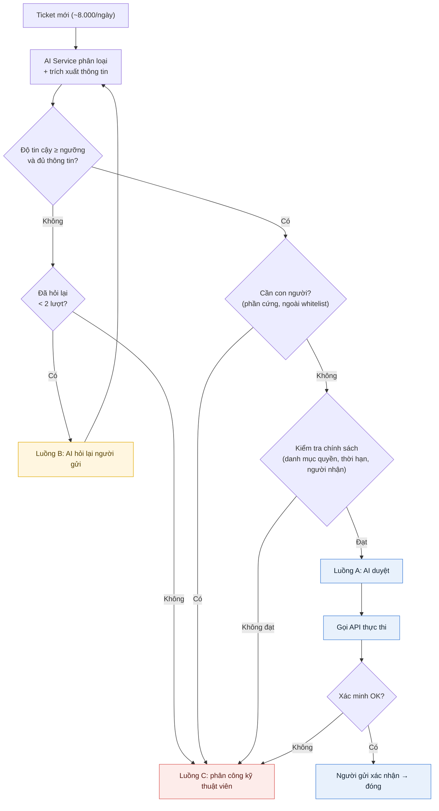
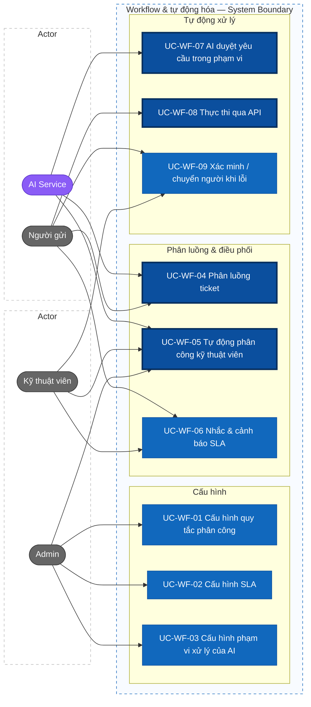
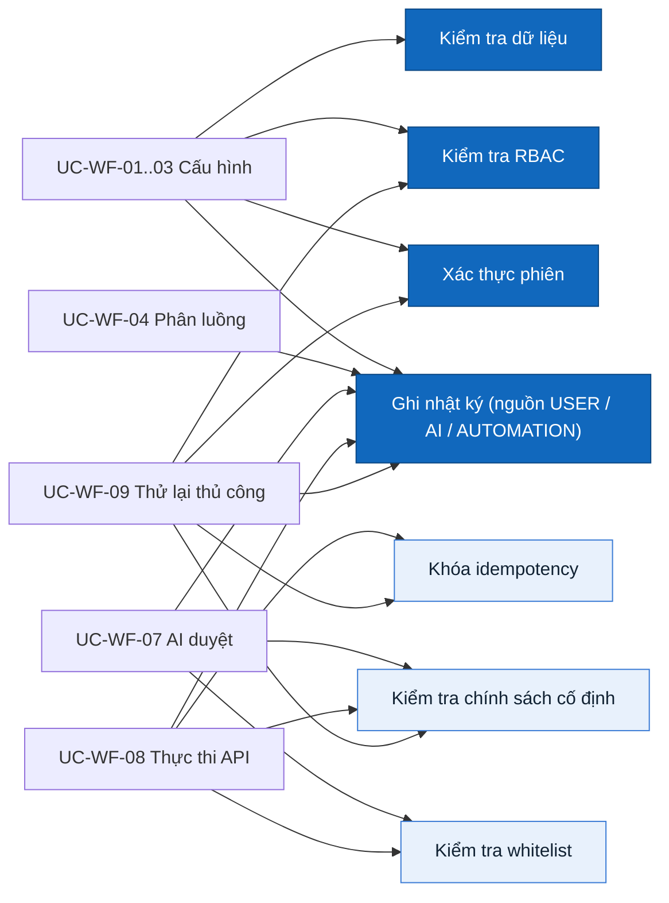
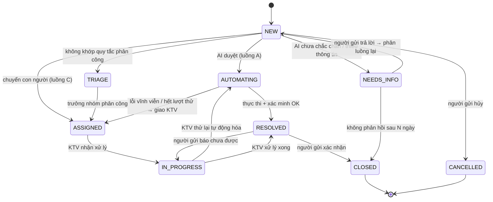

# Actor, vai trò, use case — Workflow & tự động hóa

> Trạng thái thiết kế: TARGET V1
>
> Phạm vi: F05 Workflow & tự động hóa (UC-WF-01 … UC-WF-09)

## Actor / vai trò

| Mã vai trò | Tên hiển thị | Trách nhiệm trong workflow |
|---|---|---|
| `ADMIN` | Quản trị viên | Cấu hình quy tắc phân công, SLA, phạm vi xử lý của AI (hành động AI, whitelist, danh mục quyền); theo dõi quyết định của AI |
| `TECHNICIAN` | Kỹ thuật viên | Xử lý yêu cầu cần con người và yêu cầu tự động hóa bị lỗi; có thể được đánh dấu **Trưởng nhóm** (`is_lead`) trong nhóm |
| `REQUESTER` | Người gửi | Gửi yêu cầu, trả lời câu hỏi của AI, xác nhận kết quả |

| Actor hệ thống | Mã trong nhật ký | Trách nhiệm |
|---|---|---|
| AI Service | `AI` | Phân loại ticket kèm độ tin cậy, trích xuất thông tin, hỏi lại khi chưa chắc chắn, **duyệt yêu cầu cơ bản trong phạm vi**, tóm tắt ticket cho kỹ thuật viên |

> Hệ thống có 3 vai trò người dùng và **1 actor hệ thống duy nhất là AI Service**.
>
> Các tác vụ tự động (áp quy tắc phân công, bộ hẹn giờ SLA, gọi API thực thi, xác minh) là **hành vi bên trong hệ thống**, không phải actor; chúng được ghi nhật ký với nguồn `AUTOMATION` (BR-WF-05). Hệ thống cấp quyền bên ngoài (AD, Google Workspace, mock API…) là **chi tiết tích hợp** qua connector.

## Nguyên tắc phân luồng

Khoảng **8.000 ticket/ngày** được AI Service phân thành ba luồng:

| Luồng | Điều kiện | Xử lý |
|---|---|---|
| **A — AI tự xử lý** | Độ tin cậy ≥ ngưỡng, loại yêu cầu có trong whitelist, **đạt kiểm tra chính sách** | AI duyệt → hệ thống gọi API → xác minh → người gửi xác nhận |
| **B — Hỏi lại người gửi** | Độ tin cậy < ngưỡng, hoặc thiếu thông tin bắt buộc | AI hỏi lại → người gửi trả lời → phân luồng lại (tối đa 2 lượt) |
| **C — Chuyển con người** | Yêu cầu cần con người (phần cứng…), ngoài whitelist, không đạt chính sách, hoặc vẫn chưa chắc chắn sau 2 lượt hỏi | Tự động phân công kỹ thuật viên kèm bản tóm tắt AI |

**AI duyệt gồm hai bước** (BR-WF-02):

1. **AI hiểu yêu cầu:** phân loại, trích xuất người nhận, hệ thống, quyền / loại tài khoản, thời hạn.
2. **Kiểm tra chính sách cố định (không dùng AI):** hành động có trong whitelist, quyền có trong danh mục cho phép của phòng ban người nhận, thời hạn không vượt mức tối đa, người nhận hợp lệ. Đạt → duyệt; không đạt → luồng C.

Nhờ vậy, kể cả khi AI hiểu sai, hệ thống cũng không cấp quyền ra ngoài phạm vi Admin đã cấu hình.

## Ma trận vai trò × chức năng

| Chức năng | Admin | Kỹ thuật viên | Người gửi |
|---|---|---|---|
| Cấu hình quy tắc phân công | ✓ | | |
| Cấu hình SLA, lịch làm việc | ✓ | | |
| Cấu hình phạm vi AI (hành động AI, whitelist, danh mục quyền) | ✓ | | |
| Xem quyết định của AI và căn cứ | ✓ | Ticket được giao | Ticket của mình (lý do tóm tắt) |
| Xem hàng chờ phân loại thủ công | ✓ | Trưởng nhóm | |
| Phân công lại ticket | ✓ | Trưởng nhóm (trong nhóm mình) | |
| Nhận nhắc / cảnh báo SLA | | ✓ | ✓ (khi AI chờ mình trả lời) |
| Gửi yêu cầu | ✓ | ✓ | ✓ |
| Trả lời câu hỏi của AI | ✓ | ✓ | ✓ (ticket của mình) |
| Thử lại / xử lý thủ công khi lỗi | ✓ | Ticket được giao | |
| Xác nhận kết quả / báo chưa được | | | Ticket của mình |

Menu và nút không hiển thị khi người dùng không có quyền. Truy cập URL trái phép → `#/403`. **Backend là nơi thực thi phân quyền**; ẩn nút ở frontend chỉ phục vụ UI/UX.

## Use Case Diagram

Viền đậm: nghiệp vụ cốt lõi. Màu tím: actor hệ thống (AI Service). UC-WF-05, 06, 08, 09 được hệ thống tự kích hoạt; actor nối vào là người hưởng kết quả hoặc người tác động (phân công lại, thử lại, xác nhận).

### Quy tắc và ràng buộc dùng chung

## Trạng thái liên quan

### Trạng thái ticket (phần do workflow điều khiển)

| Trạng thái | Ý nghĩa |
|---|---|
| `NEW` | Vừa tạo, chờ AI phân loại |
| `NEEDS_INFO` | AI đang hỏi lại người gửi — **SLA tạm dừng** |
| `TRIAGE` | Chưa có nhóm nào nhận (không khớp quy tắc phân công) — chờ trưởng nhóm phân loại thủ công |
| `ASSIGNED` | Đã giao cho nhóm / kỹ thuật viên |
| `IN_PROGRESS` | Kỹ thuật viên đang xử lý |
| `AUTOMATING` | AI đã duyệt, hệ thống đang thực thi / xác minh qua API |
| `RESOLVED` | Đã xử lý, chờ người gửi xác nhận |
| `CLOSED` | Đã đóng |
| `CANCELLED` | Người gửi hủy |

### Quyết định của AI (`ai_decisions.outcome`)

| Giá trị | Ý nghĩa | Luồng |
|---|---|---|
| `AUTO_APPROVED` | Đạt độ tin cậy và kiểm tra chính sách | A |
| `NEEDS_INFO` | Chưa chắc chắn hoặc thiếu thông tin | B |
| `ROUTE_TO_HUMAN` | Cần con người / ngoài whitelist / không đạt chính sách / hết lượt hỏi | C |

Mỗi quyết định lưu: danh mục, độ tin cậy, thông tin trích xuất, kết quả từng điều kiện chính sách, lý do.

### Trạng thái lần chạy workflow (`workflow_runs.status`)

`QUEUED` → `RUNNING` → (`RETRY_WAIT` → `RUNNING`)* → `VERIFYING` → `SUCCEEDED`
Nhánh lỗi: `FAILED` → `QUEUED` (thử lại thủ công) | `MANUALLY_RESOLVED`

## Use cases

### UC-WF-01 Cấu hình quy tắc phân công

- **Actor:** Admin
- **Tiền điều kiện:** đăng nhập `ADMIN`; có ít nhất một nhóm kỹ thuật có thành viên đang hoạt động
- **Luồng chính:** mở SCR-WF-01 → *Thêm quy tắc* → nhập tên, điều kiện (loại yêu cầu, danh mục, mức ưu tiên, phòng ban người gửi — kết hợp AND), nhóm đích, chiến lược chia việc (`ROUND_ROBIN` / `LEAST_LOADED`) → `createAssignmentRule` → backend kiểm tra quyền và dữ liệu → lưu ở trạng thái **Tắt** → ghi nhật ký → quy tắc xuất hiện cuối danh sách thứ tự
- **Luồng phụ:**
  - Kéo thả sắp xếp thứ tự → `reorderAssignmentRules`
  - Chạy thử trên ticket mẫu → `dryRunAssignmentRules` → hiển thị quy tắc khớp, nhóm và người dự kiến nhận; không thay đổi dữ liệu
  - Bật / tắt → `updateAssignmentRule`
  - Lưu trữ quy tắc (không xóa cứng để giữ tham chiếu lịch sử) → `archiveAssignmentRule`
- **Ngoại lệ:** nhóm đích không có thành viên hoạt động → `400`; điều kiện trùng hoàn toàn với quy tắc khác → cảnh báo, vẫn cho lưu
- **Quyền:** `workflowConfigManage`
- **Kết quả:** quy tắc được áp dụng cho ticket chuyển luồng C **sau** thời điểm bật

### UC-WF-02 Cấu hình chính sách SLA

- **Actor:** Admin
- **Tiền điều kiện:** đăng nhập `ADMIN`
- **Luồng chính:** mở SCR-WF-02 → chọn mức ưu tiên (P1–P4) → nhập thời hạn phản hồi đầu tiên, thời hạn giải quyết, ngưỡng cảnh báo (%) → chọn lịch làm việc (giờ làm, ngày nghỉ) → `updateSlaPolicy` → lưu phiên bản mới của chính sách → ghi nhật ký
- **Giá trị mặc định đề xuất:**

  | Ưu tiên | Phản hồi đầu | Giải quyết | Ngưỡng cảnh báo |
  |---|---|---|---|
  | P1 — Khẩn cấp | 15 phút | 4 giờ | 75% |
  | P2 — Cao | 1 giờ | 8 giờ làm việc | 75% |
  | P3 — Trung bình | 4 giờ làm việc | 3 ngày làm việc | 75% |
  | P4 — Thấp | 8 giờ làm việc | 5 ngày làm việc | 75% |

- **Ngoại lệ:** thời hạn giải quyết < thời hạn phản hồi, ngưỡng ngoài 1–99% → `400`
- **Quyền:** `workflowConfigManage`
- **Kết quả:** ticket mới hoặc ticket đổi mức ưu tiên sau thời điểm lưu dùng phiên bản mới; ticket đang chạy giữ phiên bản đã gắn (BR-WF-08)

### UC-WF-03 Cấu hình phạm vi xử lý của AI

- **Actor:** Admin
- **Tiền điều kiện:** đăng nhập `ADMIN`; connector của hệ thống cấp quyền bên ngoài đã được khai báo ở cấu hình triển khai (thông tin bí mật không nhập qua UI)
- **Luồng chính — hành động AI:** SCR-WF-03 tab *Hành động AI* → bật/tắt từng hành động (`AUTO_CLASSIFY`, `ASK_FOR_INFO`, `AUTO_APPROVE`, `SUGGEST_KB`, `SUGGEST_PRIORITY`) → đặt ngưỡng tin cậy (0.00–1.00) và số lượt hỏi lại tối đa (mặc định 2) → `updateAiActionSetting` → ghi nhật ký
- **Luồng chính — whitelist:** tab *Hành động tự động* → *Thêm* → nhập loại yêu cầu, connector, thao tác, tham số bắt buộc, thời hạn quyền tối đa, nhóm phụ trách khi lỗi → `createAutomationAction` → ghi nhật ký. Thao tác V1:

  | Thao tác | Ý nghĩa | Thay đổi dữ liệu? |
  |---|---|---|
  | `CHECK_ACCOUNT` | Kiểm tra trạng thái tài khoản (tồn tại, bị khóa, quyền hiện có) và trả kết quả cho người gửi | Không (chỉ đọc) |
  | `CREATE_ACCOUNT` | Cấp tài khoản mới theo mẫu tài khoản của phòng ban | Có |
  | `GRANT_ACCESS` | Cấp thêm quyền trên một hệ thống | Có |
  | `REVOKE_ACCESS` | Thu hồi quyền khi hết hạn (chỉ hệ thống tự gọi) | Có |

- **Luồng chính — danh mục quyền:** tab *Danh mục quyền* → chọn phòng ban → khai báo các quyền / mẫu tài khoản được AI tự cấp cho phòng ban đó, kèm thời hạn tối đa → `updateDepartmentEntitlements` → ghi nhật ký
- **Ngoại lệ:** connector không tồn tại → `400`; quyền tham chiếu hệ thống không có connector → `400`; ngưỡng ngoài 0.00–1.00 → `400`
- **Quyền:** `workflowConfigManage`
- **Kết quả:** AI chỉ tự duyệt những yêu cầu thuộc whitelist đang bật **và** nằm trong danh mục quyền của phòng ban người nhận

### UC-WF-04 Phân luồng ticket

- **Actor:** Người gửi; AI Service
- **Kích hoạt:** ticket mới được tạo, hoặc người gửi trả lời câu hỏi của AI
- **Luồng chính:**
  1. AI Service phân loại ticket, ước lượng độ tin cậy, trích xuất thông tin (người nhận, hệ thống, quyền / loại tài khoản, thời hạn)
  2. Hệ thống ghi một bản ghi `ai_decisions` và quyết định luồng theo bảng *Nguyên tắc phân luồng*
  3. Luồng A → UC-WF-07; luồng C → UC-WF-05
- **Luồng thay thế — hỏi lại (luồng B):** độ tin cậy < ngưỡng hoặc thiếu trường bắt buộc → AI gửi câu hỏi cụ thể cho người gửi (ví dụ *"Bạn cần quyền trên hệ thống nào?"*) → ticket `NEEDS_INFO` → người gửi trả lời → quay lại bước 1. Sau 2 lượt vẫn chưa chắc chắn → luồng C
- **Luồng thay thế — người gửi không trả lời:** xem UC-WF-06 (nhắc và tự đóng)
- **Ngoại lệ:** AI Service không phản hồi / lỗi → ticket chuyển luồng C, ghi lý do `AI_UNAVAILABLE`
- **Quyền:** tạo ticket: `ticketCreate`; trả lời: chủ ticket
- **Kết quả:** mỗi ticket có đúng một quyết định phân luồng hiện hành, có căn cứ, được ghi nhật ký

### UC-WF-05 Tự động phân công kỹ thuật viên

- **Actor:** Kỹ thuật viên (nhận phân công); Trưởng nhóm, Admin (phân công lại); AI Service (cung cấp bản tóm tắt)
- **Kích hoạt:** ticket vào luồng C (cần con người, ngoài phạm vi, không đạt chính sách, hết lượt hỏi), hoặc ticket bị trả về từ UC-WF-09
- **Luồng chính:** hệ thống lấy các quy tắc đang bật theo thứ tự → quy tắc **khớp đầu tiên** thắng → lọc thành viên nhóm đích đang hoạt động và không vắng mặt → chọn kỹ thuật viên theo chiến lược → tạo bản ghi phân công → ticket `ASSIGNED` → gửi thông báo kèm **bản tóm tắt AI và lý do chuyển người** → ghi nhật ký nguồn `AUTOMATION` kèm `ruleId`
- **Luồng thay thế:**
  - Không khớp quy tắc nào → ticket `TRIAGE`, thông báo trưởng nhóm của nhóm tiếp nhận mặc định
  - Nhóm không còn ai khả dụng → giao cho nhóm (chưa giao cá nhân), thông báo trưởng nhóm
  - Trưởng nhóm / Admin phân công lại → `reassignTicket` với lý do bắt buộc → ghi nhật ký giá trị trước/sau
- **Quyền:** tự động: nội bộ hệ thống; phân công lại: `ticketReassign`
- **Kết quả:** mọi ticket cần con người đều có người hoặc nhóm chịu trách nhiệm; SLA chạy ngay cả khi ở `TRIAGE`

### UC-WF-06 Nhắc phản hồi và cảnh báo SLA

- **Actor:** Kỹ thuật viên, Trưởng nhóm, Người gửi (nhận thông báo)
- **Kích hoạt:** tự động — tác vụ định kỳ của hệ thống mỗi phút
- **Luồng chính — cảnh báo:** ticket đạt ngưỡng cảnh báo → gửi nhắc cho người được giao (một lần cho mỗi ngưỡng) → ghi sự kiện `SLA_WARNING`
- **Luồng chính — vi phạm:** quá hạn → gắn cờ `sla_breached` → thông báo trưởng nhóm → nếu cấu hình cho phép, nâng một bậc ưu tiên → ghi sự kiện `SLA_BREACHED`
- **Luồng chính — chờ người gửi:** ticket `NEEDS_INFO` hoặc `RESOLVED` chờ xác nhận → nhắc người gửi ở ngày 1 và ngày N−1 → đến ngày N (mặc định 5 ngày làm việc) → `NEEDS_INFO` chuyển `CLOSED` với lý do *không phản hồi*; người gửi có thể mở lại trong 7 ngày
- **Ngoại lệ:** ticket `AUTOMATING` không bị tự đóng (BR-WF-11)
- **Quyền:** nội bộ hệ thống
- **Kết quả:** không có ticket nào quá hạn mà không có người được báo

### UC-WF-07 AI duyệt yêu cầu trong phạm vi

- **Actor:** AI Service; Người gửi (nhận kết quả)
- **Kích hoạt:** UC-WF-04 xác định ticket thuộc luồng A
- **Tiền điều kiện:** hành động `AUTO_APPROVE` đang bật; độ tin cậy ≥ ngưỡng; đủ thông tin bắt buộc
- **Luồng chính:**
  1. Hệ thống chạy **kiểm tra chính sách cố định** trên thông tin AI đã trích xuất:
     - thao tác có trong whitelist đang bật;
     - quyền / mẫu tài khoản có trong danh mục của phòng ban người nhận;
     - thời hạn ≤ thời hạn tối đa;
     - người nhận là chính người gửi, hoặc cùng phòng ban với người gửi (BR-WF-16);
     - người nhận chưa có quyền đó (tránh cấp trùng).
  2. Tất cả đạt → `ai_decisions.outcome = AUTO_APPROVED` kèm kết quả từng điều kiện → ticket `AUTOMATING` → kích hoạt UC-WF-08
  3. Thông báo người gửi: *"Yêu cầu của bạn đã được duyệt tự động và đang được xử lý"*
- **Luồng thay thế:**
  - `CHECK_ACCOUNT` (chỉ đọc) → chỉ kiểm tra whitelist và người gửi có quyền xem tài khoản đó, rồi sang UC-WF-08
  - Một điều kiện không đạt → `ROUTE_TO_HUMAN` với lý do cụ thể (ví dụ *"Quyền X không thuộc danh mục phòng Kế toán"*) → UC-WF-05
  - Người nhận đã có quyền → ticket `RESOLVED` với thông báo *"Bạn đã có quyền này"*
- **Ngoại lệ:** AI Service trả kết quả không hợp lệ (thiếu trường, sai định dạng) → luồng C
- **Quyền:** nội bộ hệ thống; AI không bao giờ được duyệt ngoài whitelist và danh mục quyền (BR-WF-02)
- **Kết quả:** yêu cầu cơ bản được duyệt trong vài giây, không cần con người; mọi quyết định có căn cứ để Admin kiểm tra lại

### UC-WF-08 Thực thi yêu cầu qua API

- **Actor:** Người gửi (nhận kết quả)
- **Kích hoạt:** tự động ngay khi AI duyệt (sự kiện `AiDecisionApproved`), hoặc khi kỹ thuật viên bấm *Thử lại* (UC-WF-09)
- **Tiền điều kiện:** quyết định `AUTO_APPROVED`; whitelist và danh mục quyền **tại thời điểm chạy** vẫn cho phép (BR-WF-12)
- **Luồng chính:** hệ thống tạo `workflow_run` với khóa idempotency = `decisionId + action` → gọi connector của hệ thống cấp quyền bên ngoài → lưu từng lần gọi vào `workflow_run_attempts` (request/response đã che dữ liệu nhạy cảm) → thành công → UC-WF-09 bước xác minh → nếu quyền có thời hạn, lên lịch thu hồi
- **Luồng thay thế:**
  - `CHECK_ACCOUNT` → kết quả kiểm tra được gửi cho người gửi, ticket `RESOLVED`
  - Lỗi tạm thời (timeout, `5xx`, `429`) → `RETRY_WAIT` → thử lại tối đa 3 lần, cách nhau 1 / 5 / 15 phút
  - Lỗi vĩnh viễn (`4xx` nghiệp vụ, từ chối quyền) hoặc hết lượt → `FAILED` → UC-WF-09 nhánh lỗi
  - Đến hạn thu hồi → tạo `workflow_run` thao tác `REVOKE_ACCESS`, thông báo người dùng trước 1 ngày
- **Ngoại lệ:** tiền điều kiện không thỏa → không gọi API, `FAILED` với mã `PRECONDITION_FAILED`
- **Quyền:** nội bộ hệ thống; connector dùng tài khoản dịch vụ quyền tối thiểu
- **Kết quả:** một quyết định duyệt dẫn tới **đúng một** thay đổi trên hệ thống cấp quyền bên ngoài

### UC-WF-09 Xác minh kết quả, chuyển người khi lỗi

- **Actor:** Người gửi (xác nhận kết quả), Kỹ thuật viên (xử lý khi lỗi)
- **Kích hoạt:** tự động sau khi UC-WF-08 kết thúc
- **Luồng chính — xác minh:** hệ thống gọi thao tác kiểm tra của connector (ví dụ tài khoản đã tồn tại, người dùng đã có trong nhóm quyền) → khớp → `workflow_run` `SUCCEEDED` → ticket `RESOLVED` → thông báo người gửi → người gửi *Xác nhận* → `confirmTicketResolution` → `CLOSED`
- **Luồng thay thế — người gửi báo chưa được:** `reopenTicket` → giao kỹ thuật viên của nhóm phụ trách (UC-WF-05)
- **Luồng thay thế — lỗi:** `workflow_run` `FAILED` hoặc xác minh không khớp → giao kỹ thuật viên của nhóm phụ trách kèm mã lỗi, bước lỗi và lịch sử các lần thử → kỹ thuật viên mở SCR-T-02 tab *Tự động hóa*:
  - *Thử lại* → `retryWorkflowRun` → quay lại UC-WF-08 (kiểm tra lại chính sách)
  - *Đã xử lý thủ công* (ghi chú bắt buộc) → `resolveWorkflowRunManually` → `MANUALLY_RESOLVED`, ticket `RESOLVED`
- **Ngoại lệ:** thử lại khi chính sách hiện tại không còn cho phép → `409`
- **Quyền:** xác nhận: chủ ticket; thử lại / xử lý thủ công: `workflowRunRetry` + là người được giao hoặc Admin
- **Kết quả:** ticket không bao giờ được đánh dấu đã xử lý nếu chưa xác minh hoặc chưa có kỹ thuật viên xác nhận (BR-WF-13)

**Related:** [Features](02-features.md) · [INVEST backlog](08-invest-requirements.md) · [Acceptance criteria](06-acceptance-criteria.md) · [Business rules](requirements/business-rules.md)
