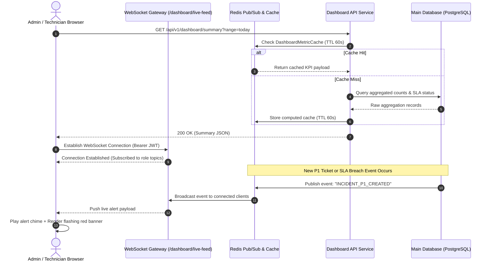
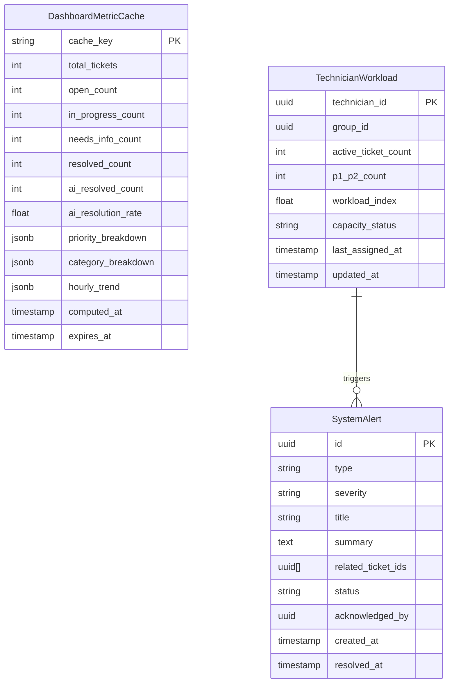

# Information Architecture — Dashboard Subsystem

This document defines the comprehensive Information Architecture (IA) for the **Dashboard** subsystem of the AI-Powered Automated Ticket Dispatching & Resolution System.  
It details the sitemap, visual hierarchy, widget component breakdown, role-based visibility matrix, domain data schemas, caching architecture, and REST/WebSocket API specifications.

Related specifications:
* [dashboard_use_cases.md](02-use-cases.md) — System interaction flows and processing logic.
* [dashboard_user_stories.md](01-user-stories.md) — Agile Epics, user personas, and BDD acceptance criteria.

---

## 1. Route Hierarchy & Sitemap

The Dashboard subsystem serves as the central operational hub, featuring role-based automated redirection and specialized views:

```
/dashboard                              Routing gateway (Redirects based on JWT role)
  │
  ├─ /admin/dashboard                   Executive & Operational Control Center (ADMIN)
  │    ├─ #overview                     KPI Summary & Volume Analytics
  │    ├─ #sla-radar                    SLA Breach & Bottleneck Watchlist
  │    ├─ #workload                     Engineering Capacity & Workload Matrix
  │    └─ #incidents                    Live Alert Stream & Critical Incidents
  │
  └─ /technician/dashboard              Support Operations & Personal Workbench (TECHNICIAN, TECHNICIAN_LEAD)
       ├─ #my-queue                     Personal Active Tasks (Ordered by SLA deadline)
       ├─ #team-queue                   Unassigned Group Backlog (1-click claim)
       ├─ #sla-countdown                Personal SLA Threshold Trackers
       └─ #performance                  Individual Throughput & CSAT Rating
```

---

## 2. Role-Based Visibility Matrix

| Component / Widget | ADMIN | TECHNICIAN_LEAD | TECHNICIAN | REQUESTER | AI_AGENT |
|---|---|---|---|---|---|
| **Executive KPI Summary Cards** | ✅ Full Company | ✅ My Department | ❌ Hidden | ❌ (403) | ✅ Read-only API |
| **AI Automation Rate Card** | ✅ Visible | ✅ Visible | ❌ Hidden | ❌ (403) | ✅ Read-only API |
| **Priority & Category Charts** | ✅ Full Company | ✅ My Department | ❌ Hidden | ❌ (403) | ✅ Read-only API |
| **SLA & Bottleneck Watch** | ✅ Full Company | ✅ My Team | ❌ Hidden | ❌ (403) | ✅ Read-only API |
| **Team Workload Matrix** | ✅ All Teams | ✅ Assigned Team | ❌ Hidden | ❌ (403) | ✅ Balancing Query |
| **Individual Capacity Meter** | ✅ All Engineers | ✅ Team Members | ✅ Self Only | ❌ (403) | ✅ Load Assessment |
| **Real-Time Critical Alert Banner** | ✅ Broadcast | ✅ Broadcast | ✅ Assigned Issues | ❌ (403) | ✅ Event Emitter |
| **My Daily Task Queue** | ❌ (Optional view) | ✅ Personal Queue | ✅ Personal Queue | ❌ (403) | ❌ N/A |
| **Unassigned Team Backlog** | ✅ Global View | ✅ Team Queue | ✅ Team Queue | ❌ (403) | ❌ N/A |
| **Date Range Filter** | ✅ Full Control | ✅ Full Control | ✅ Self History | ❌ (403) | ❌ N/A |
| **Engineering Team Filter** | ✅ All Groups | ❌ Locked to Team | ❌ Locked to Team | ❌ (403) | ❌ N/A |

---

## 3. Screen Layout & Widget Architecture

### 3.1. Executive Dashboard Layout (`/admin/dashboard`)

```
┌────────────────────────────────────────────────────────────────────────────────────────┐
│ Global Filter Bar: [ Date: Last 7 Days ▼ ] [ Team: All Teams ▼ ] [ 🔄 Refresh ]  🟢 Live │
├────────────────────────────────────────────────────────────────────────────────────────┤
│ [ALERT BANNER] 🚨 P1 Incident: VPN Authentication Gateway Timeout (Started 4m ago) [Ack] │
├────────────────────────────────────────────────────────────────────────────────────────┤
│ [ Total: 1,420 ]   [ Open: 184 ]   [ In Progress: 312 ]   [ Waiting: 89 ]   [ AI: 38% ]│
├──────────────────────────────────────────┬─────────────────────────────────────────────┤
│ 📊 Ticket Intake Trends & Categories      │ ⏱️ SLA Breach Radar (Top 10 Critical)       │
│  - Hourly Intake Volume (Line Chart)     │  - #TK-981 P1 Network Outage (Breached -18m)│
│  - Category Breakdown (Bar Chart)        │  - #TK-985 P2 DB Pool Exhausted (Due in 12m)│
│  - Priority Distribution (Donut Chart)   │  - #TK-990 P2 SSO Sync Failure (Due in 24m) │
├──────────────────────────────────────────┴─────────────────────────────────────────────┤
│ 👥 Engineering Workload & Capacity Grid (Grouped by Team)                              │
│  - Cloud Infra Team:   Lead: John D. | Avg Load: 4.2 | 🟢 Normal (85% SLA)             │
│    • Alice (Load: 8/7) [🔴 Overloaded] • Bob (Load: 3/7) [🟢 Normal]                   │
│  - IT Helpdesk Team:   Lead: Mark T. | Avg Load: 6.8 | 🟡 High Capacity (91% SLA)      │
│    • Carol (Load: 6/7) [🟡 Busy]       • Dave (Load: 2/7) [🟢 Normal]                   │
└────────────────────────────────────────────────────────────────────────────────────────┘
```

### 3.2. Technician Personal Workbench Layout (`/technician/dashboard`)

```
┌────────────────────────────────────────────────────────────────────────────────────────┐
│ Personal Status: 🟢 Online (Assigned Team: IT Helpdesk)               [ 🔄 Refresh ]   │
├────────────────────────────────────────────────────────────────────────────────────────┤
│ [ My Open Tasks: 4 ]       [ Due Today: 2 ]       [ Breached: 0 ]       [ CSAT: 4.9/5 ]│
├──────────────────────────────────────────┬─────────────────────────────────────────────┤
│ 📥 My Active Queue (Sorted by SLA)       │ 📋 Unassigned Team Pool (IT Helpdesk)       │
│  - #TK-1002 P2 Laptop Battery Swollen    │  - #TK-1011 P3 Email Forwarding Request     │
│    Deadline: 42m remaining [Start Work]  │    Created: 6m ago [ Claim Ticket ]         │
│  - #TK-0994 P3 Software License Renew    │  - #TK-1014 P3 Monitor Display Flicker      │
│    Deadline: 3h remaining [Request Info] │    Created: 14m ago [ Claim Ticket ]        │
├──────────────────────────────────────────┴─────────────────────────────────────────────┤
│ 📈 Personal Weekly Output: 38 Resolved Tickets | Average Resolution Time: 42 minutes   │
└────────────────────────────────────────────────────────────────────────────────────────┘
```

---

## 4. Real-Time Data Flow & WebSocket Architecture



---

## 5. Domain Entities & Database Models



### 5.1. Entity Field Descriptions

* **`DashboardMetricCache`**: Stores pre-aggregated metrics computed on demand or periodically. Key structure: `kpi:{date_range}:{group_id}:{role}`. Avoids scanning millions of rows on every dashboard load.
* **`TechnicianWorkload`**: Stores real-time capacity telemetry for active support personnel.
  * Formula: $\text{Workload Index} = \text{Active Tickets} + (\text{Count of P1/P2} \times 2)$.
  * Status thresholds: `NORMAL` ($\le 4$), `BUSY` ($5 - 7$), `OVERLOADED` ($> 7$ or $\ge 2$ P1/P2 tickets).
* **`SystemAlert`**: Tracks high-severity operational incidents displayed in the live broadcast banner. Types include `CRITICAL_P1`, `SPIKE_DETECTED`, `WORKFLOW_ERROR`, and `SLA_BREACH`.

---

## 6. Dashboard API Endpoints Catalog

Base path: `/api/v1/dashboard`.  
All endpoints require authentication header: `Authorization: Bearer <access_token>`.

### 6.1. REST Endpoints

| Method | Endpoint | Authorized Roles | Description | Query Parameters |
|---|---|---|---|---|
| `GET` | `/summary` | `ADMIN`, `TECHNICIAN` | Fetches aggregated KPI cards, AI automation rate, and chart data. | `range` (`today`, `7d`, `30d`, `custom`), `start_date`, `end_date`, `group_id` |
| `GET` | `/sla-breached` | `ADMIN`, `TECHNICIAN` | Retrieves list of tickets approaching deadline ($\le 20\%$ time left) or breached. | `status` (`warning`, `breached`, `all`), `limit` (default: 10), `group_id` |
| `GET` | `/workload` | `ADMIN`, `TECHNICIAN_LEAD` | Returns technician workload index matrix and capacity statuses. | `group_id` (optional), `status` (`all`, `overloaded`) |
| `GET` | `/alerts` | `ADMIN`, `TECHNICIAN` | Lists current active system broadcast alerts. | `severity` (`CRITICAL`, `HIGH`), `status` (`ACTIVE`, `ACKNOWLEDGED`) |
| `POST` | `/alerts/:id/ack` | `ADMIN`, `TECHNICIAN` | Acknowledges an active critical alert to dismiss the global siren. | None (alert UUID in path) |
| `GET` | `/technician/my-queue` | `TECHNICIAN` | Returns personalized active queue and unassigned team pool for current user. | `limit` (default: 20) |

### 6.2. WebSocket Streaming Endpoint

* **Endpoint:** `WS /api/v1/dashboard/live-feed`
* **Authentication:** Query token `?token=<access_token>` or WS handshake header.
* **Stream Events:**
  * `TICKET_INGESTED`: Sent when a new ticket is logged (payload includes ID, title, AI priority, category).
  * `SLA_STATUS_CHANGED`: Emitted when a ticket enters warning or breached state.
  * `CRITICAL_P1_ALERT`: Broadcast when a P1 ticket is submitted.
  * `WORKLOAD_ALERT`: Emitted when a technician transitions to `OVERLOADED`.

