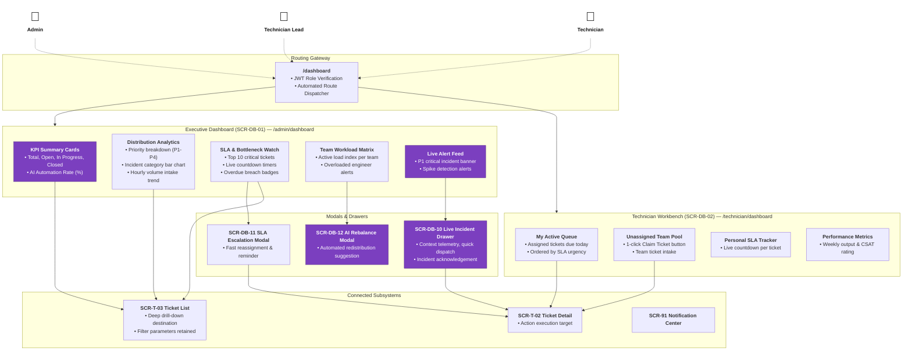

# Sitemap — F02 Dashboard

> Design status: V1 — draft, awaiting user review  
> Implementation status: NOT STARTED  

**Notation (D-IA-DB-01):**
- **Card:** Individual page, drawer, or widget container with ID and core functionality.
- **Area (box):** Logical functional grouping.
- **Solid arrow:** Direct drill-down or navigation flow.
- **Dashed arrow:** Role accessibility linkage.
- **Purple card / accent:** Elements powered by AI telemetry or automated prediction models.

---

## Visual Sitemap

---

## Screens by Role

| Role | Default Landing Route | Accessible Dashboard Views |
|---|---|---|
| **Admin** | `/admin/dashboard` (`SCR-DB-01`) | Full executive view, all engineering teams, company-wide KPI analytics, live incident broadcast, AI rebalancing proposals. |
| **Technician Lead** | `/technician/dashboard` (`SCR-DB-02`) | Frontline workbench plus team-scoped workload capacity matrix and SLA escalation controls. |
| **Technician** | `/technician/dashboard` (`SCR-DB-02`) | Personal daily task queue, unassigned group intake pool, personal SLA countdowns, individual throughput metrics. |
| **Requester** | `/my-tickets` (`SCR-T-03`) | **Access Denied (`403`)** for Dashboard routes. Redirected to personal ticket tracker. |

**Related:** [Decisions and Defaults](00-decisions.md) · [Routes and Permissions](02-routes-and-permissions.md) · [Screen Inventory](04-screen-inventory.md)

