# Sitemap — F02 Dashboard

> Design status: TARGET V1  
> Implementation status: NOT STARTED  

**Notation (D-IA-DB-01):**
- **Card:** Individual page, drawer, or widget container with ID and core functionality.
- **Area (box):** Logical functional grouping.
- **Solid arrow:** Direct drill-down or navigation flow.
- **Dashed arrow:** Role accessibility linkage.
- **Purple card / accent:** Elements powered by AI telemetry or automated prediction models.

---

## Visual Sitemap

```mermaid
flowchart TB
    admin["<span style='font-size:40px'>👤</span><br/><b>Admin</b>"]:::actor
    tech["<span style='font-size:40px'>👤</span><br/><b>Technician</b>"]:::actor
    req["<span style='font-size:40px'>👤</span><br/><b>Requester</b>"]:::actor

    subgraph gateway["Routing Gateway"]
        direction TB
        gate["<b>/dashboard</b><br/>• JWT Role Verification<br/>• Automated Route Dispatcher"]
    end

    subgraph exec["Executive Dashboard (SCR-DB-01) — /admin/dashboard"]
        direction TB
        kpi["<b>Live KPI Summary Cards</b><br/>• Ingested Today, Open, In Progress, Closed<br/>• Today's AI Automation Rate (%)"]:::ai
        charts["<b>Distribution Analytics</b><br/>• Priority breakdown (P1-P4)<br/>• Incident category bar chart<br/>• Hourly volume intake trend"]
        sla["<b>SLA & Bottleneck Watch</b><br/>• Top 10 critical active tickets<br/>• Live countdown timers<br/>• Overdue breach badges"]
        workload["<b>Team Workload Overview</b><br/>• Active ticket count per group"]
        alertStream["<b>Live Alert Feed</b><br/>• P1 critical incident banner<br/>• Spike detection alerts"]:::ai
    end

    subgraph techWork["Technician Workbench (SCR-DB-02) — /technician/dashboard"]
        direction TB
        myQueue["<b>My Active Queue</b><br/>• Assigned tickets due today<br/>• Ordered by SLA urgency"]
        unassignedPool["<b>Unassigned Team Pool</b><br/>• 1-click Claim Ticket button<br/>• Team ticket intake"]
        slaWatch["<b>Personal SLA Tracker</b><br/>• Live countdown per ticket"]
        csat["<b>Performance Metrics</b><br/>• Daily/weekly output & CSAT rating"]
    end

    subgraph reqPortal["Requester Self-Service Portal (SCR-DB-03) — /portal"]
        direction TB
        actionNeeded["<b>Action Needed Section</b><br/>• NEEDS_INFO tickets (Answer Question)<br/>• RESOLVED tickets (Confirm & Rate)"]:::ai
        reqTracker["<b>My Requests Tracker</b><br/>• Recent 5 tickets with milestone timeline"]
        kbDeflection["<b>Smart Search & KB</b><br/>• Real-time auto-suggested solutions"]:::ai
        itAnnounce["<b>IT Announcements</b><br/>• Maintenance notices & outage alerts"]
    end

    subgraph modals["Modals & Drawers"]
        direction TB
        draw10["<b>SCR-DB-10 Live Incident Drawer</b><br/>• Context telemetry, quick dispatch<br/>• Incident acknowledgement"]:::ai
        modal11["<b>SCR-DB-11 SLA Intervention Modal</b><br/>• Fast reassignment & reminder"]
    end

    subgraph external["Connected Subsystems"]
        direction TB
        tList["<b>SCR-T-03 Ticket List (F03)</b><br/>• Deep drill-down destination<br/>• Filter parameters retained"]
        tDetail["<b>SCR-T-02 Ticket Detail (F03)</b><br/>• Action execution target"]
        tHistory["<b>SCR-NK-01 Ticket History (F08)</b><br/>• Full chronological timeline"]
        wfRuns["<b>SCR-NK-04 Workflow Runs (F08)</b><br/>• Technical API failure trace"]
        repVolume["<b>SCR-BC-01 Reports (F07)</b><br/>• Long-term historical analysis"]
    end

    %% Role connections
    admin -.-> gate
    tech -.-> gate
    req -.-> gate

    gate --> exec
    gate --> techWork
    gate --> reqPortal

    %% Internal dashboard navigation
    alertStream --> draw10
    sla --> modal11

    %% Drill-down flows
    kpi --> tList
    charts --> tList
    sla --> tList
    myQueue --> tDetail
    unassignedPool --> tDetail
    draw10 --> tDetail
    draw10 --> wfRuns
    modal11 --> tDetail
    modal11 --> tHistory
    actionNeeded --> tDetail
    reqTracker --> tDetail
    charts -.-> repVolume

    classDef actor fill:none,stroke:none,color:#111
    classDef ai fill:#7b3fbf,color:#fff,stroke:#5a2d8c
```

---

## Role-Based Page Access

| Role | Default Landing Page | Dashboard Surface Permissions |
|---|---|---|
| **System Administrator (`ADMIN`)** | `/admin/dashboard` (`SCR-DB-01`) | Full company-wide operational visibility for the current operating day, SLA radar, real-time P1 broadcasts. |
| **Support Technician (`TECHNICIAN`)** | `/technician/dashboard` (`SCR-DB-02`) | Personal workbench: daily tasks sorted by SLA, 1-click team queue claiming, live SLA counters, productivity stats. |
| **Requester (`REQUESTER`)** | `/portal` (`SCR-DB-03`) | Personalized self-service hub: action-needed alerts (`NEEDS_INFO`, confirm `RESOLVED`), request progress milestones, KB deflection, IT notices. |

**Related:** [Architecture Decisions](00-decisions.md) · [Routes & Permissions](02-routes-and-permissions.md) · [Screen Inventory](04-screen-inventory.md)
