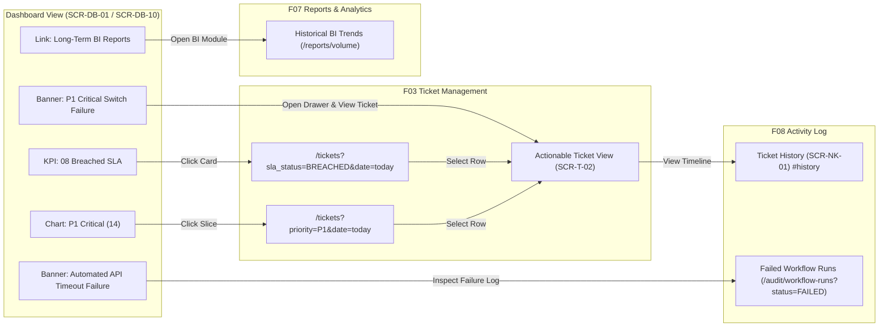

# Navigation & Alerts — F02 Dashboard

> Design status: TARGET V1  
> Implementation status: NOT STARTED  

## Global Navigation Integration

The Dashboard subsystem integrates seamlessly into the standardized enterprise layout: **Left Sidebar + Top Navigation Bar**.

### Top Navigation Bar Elements

| Element | Placement | Visual Rendering & Behavior |
|---|---|---|
| **Subsystem Title** | Left | "Executive Dashboard" (for Admin), "Technician Workbench" (for Engineers), or "Self-Service Portal" (for Requesters). |
| **Connection Telemetry** | Center-Right | Live WebSocket connection badge: `🟢 Live` (Connected), `🟡 Polling` (Fallback mode), `🔴 Reconnecting`. |
| **Manual Refresh** | Center-Right | `🔄 Refresh` button. Clears local widget cache and triggers immediate REST re-fetch without full page reload. |
| **Quick Create** | Right | `+ Create Ticket` button (opens ticket creation form `SCR-T-01`). |
| **Notification Center** | Right | `Notifications N` (displays unread count; clicks open `SCR-91`). |
| **User Profile & Logout** | Far Right | User avatar, name, active role, and Logout trigger. |

### Left Sidebar Navigation Hierarchy

* **For Administrator (`ADMIN`):**
  1. **Dashboard** (`/admin/dashboard`, active home page)
  2. **Tickets** (`/tickets`, all enterprise tickets)
  3. **Triage Queue** (`/workflow/triage`, tickets matching no automated rules)
  4. **AI Decisions & Monitoring** (`/workflow/ai-decisions`)
  5. **Workflow Configuration** (Assignment rules, SLA & Calendar, AI Scope)
  6. **Reports & Analytics** (`/reports/volume`, link to F07)
  7. **Audit & Activity Log** (`/audit/activity-log`, link to F08)
  8. **User & Team Management** (Users, Groups, Microsoft Entra Sync)
  9. **Notifications** (`/notifications`)

* **For Support Technician (`TECHNICIAN`):**
  1. **Dashboard** (`/technician/dashboard`, active personal workbench)
  2. **Assigned to Me** (`/tickets?view=assigned`)
  3. **Team Unassigned Pool** (`/tickets?view=team_pool`)
  4. **Notifications** (`/notifications`)

* **For Requester (`REQUESTER`):**
  1. **Home / Portal** (`/portal`, active self-service hub)
  2. **My Requests** (`/requests/my-tickets`, personal ticket list)
  3. **Submit New Request** (`/requests/new`)
  4. **Knowledge Base** (`/kb/explore`)
  5. **Notifications** (`/notifications`)

---

## Contextual Navigation & Drill-Downs

Deep drill-down navigation enables instantaneous transitions from macro operational monitoring to tactical task execution:

### Breadcrumb Navigation Protocol
* Opening the incident drawer: displays `Dashboard / Incidents / #INC-901`.
* Navigating from SLA radar to ticket list: displays `Dashboard / SLA Watch / #TK-981`.
* Browser Back action preserves active filter and scroll states.

---

## Alert Dispatch & Real-Time Event Protocol

High-severity operational events bypass standard notification queues to display immediate visual and audio indicators (D-IA-DB-10):

| Trigger Event | Visual Representation | Audio Alert | Tactical Mitigation |
|---|---|---|---|
| **New P1 Incident Ingestion** | Flashing red persistent banner across top viewport: *"🚨 Critical P1: Core Switch Failure in Data Center 01"* | Emergency Chime (toggleable in preferences - DF-IA-DB-04) | Click banner $\rightarrow$ opens Incident Drawer `SCR-DB-10` to acknowledge (`ACK`) or dispatch dedicated response team. |
| **Spike Detection Outage Alert** | Amber warning banner: *"⚠️ Spike Detected: >5 VPN failure tickets created within 15 minutes"* | Subtle chime | Click banner $\rightarrow$ filters grouped tickets to investigate widespread service disruption. |
| **Workflow Automation Failure** | Urgent banner in Automation card: *"Permission granting API timeout on Azure AD"* | None | Click banner $\rightarrow$ navigates to F08 `/audit/workflow-runs?status=FAILED` to inspect technical error logs and retry. |
| **Approaching SLA Breach ($\le 20\%$)** | Pulsing yellow countdown badge on ticket item | None | Click ticket $\rightarrow$ opens SLA Intervention Modal `SCR-DB-11` to send a reminder or reassign. |

**Related:** [Sitemap](01-sitemap.md) · [Routes & Permissions](02-routes-and-permissions.md) · [User Flows](05-user-flows.md)
