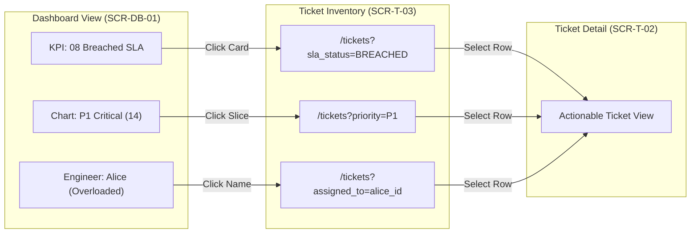

# Navigation & Alerts — F02 Dashboard

> Design status: V1 — draft, awaiting user review  
> Implementation status: NOT STARTED  

## Global Navigation Integration

The Dashboard subsystem integrates seamlessly into the standardized enterprise layout: **Left Sidebar + Top Navigation Bar**.

### Top Navigation Bar Elements

| Element | Placement | Visual Rendering & Behavior |
|---|---|---|
| **Subsystem Title** | Left | "Executive Dashboard" (for Admin) or "Technician Workbench" (for Engineers). |
| **Connection Telemetry** | Center-Right | Live WebSocket connection badge: `🟢 Live` (Connected), `🟡 Polling` (Fallback mode), `🔴 Reconnecting`. |
| **Manual Refresh** | Center-Right | `🔄 Refresh` button. Clears local widget cache and triggers immediate REST re-fetch without full page reload. |
| **Quick Create** | Right | `+ Create Ticket` button (opens ticket creation modal `SCR-T-01`). |
| **Notification Center** | Right | `Notifications N` (displays unread count; clicks open `SCR-91`). |
| **User Profile & Logout** | Far Right | User avatar, name, active role, and Logout trigger. |

### Left Sidebar Navigation Hierarchy

* **For Administrator (`ADMIN`):**
  1. **Dashboard** (`/admin/dashboard`, active home page)
  2. **Tickets** (`/tickets`, all enterprise tickets)
  3. **Triage Queue** (`/workflow/triage`, tickets matching no automated rules)
  4. **AI Decisions & Monitoring** (`/workflow/ai-decisions`)
  5. **Workflow Configuration** (Assignment rules, SLA & Calendar, AI Scope)
  6. **User & Team Management** (Users, Groups, Microsoft Entra Sync)
  7. **Notifications** (`/notifications`)

* **For Support Technician (`TECHNICIAN` / `TECHNICIAN_LEAD`):**
  1. **Dashboard** (`/technician/dashboard`, active personal workbench)
  2. **Assigned to Me** (`/tickets?view=assigned`)
  3. **Triage Queue** (`/workflow/triage`, visible only if `is_lead = true`)
  4. **Notifications** (`/notifications`)

---

## Contextual Navigation & Drill-Downs

Deep drill-down navigation enables instantaneous transitions from macro analytics to micro task execution:

### Breadcrumbs on Secondary Views
* Opening an incident drawer from the dashboard displays context: `Dashboard / Incidents / #INC-901`.
* Navigating from Dashboard drill-down to a ticket displays: `Dashboard / SLA Watch / #TK-981`.
* Clicking browser "Back" preserves previous date range and team filter selections.

---

## Live Incident Broadcast & Alerting Protocol

High-severity events bypass standard notification queues to deliver immediate visual and auditory alerts (D-IA-DB-10):

| Trigger Event | Visual Presentation | Audio / Sensory | Action Pathway |
|---|---|---|---|
| **New Critical P1 Ticket** | Persistent flashing red banner at viewport top: *"🚨 P1 Critical: Core Switch Failure in DC-01"* | Opt-in urgent chime (DF-IA-DB-05) | Click banner $\rightarrow$ opens `SCR-DB-10` Live Incident Drawer for immediate acknowledgement (`ACK`) or dispatch. |
| **Outage Surge (Spike Detection)** | Orange warning banner: *"⚠️ Spike Detected: >5 similar VPN tickets in 15m"* | Subtle alert chime | Click banner $\rightarrow$ filters ticket list by suspected incident cluster. |
| **Automation Workflow Failure** | Warning badge in Automation widget: *"Connector API timeout for Azure AD"* | None | Click badge $\rightarrow$ opens ticket Automation tab with manual retry option. |
| **SLA Warning ($\le 20\%$ time left)** | Yellow countdown chip pulses on affected row | None | Click ticket $\rightarrow$ opens `SCR-DB-11` SLA Escalation Modal to nudge assignee or reassign. |

**Related:** [Sitemap](01-sitemap.md) · [Routes and Permissions](02-routes-and-permissions.md) · [User Flows](05-user-flows.md)

