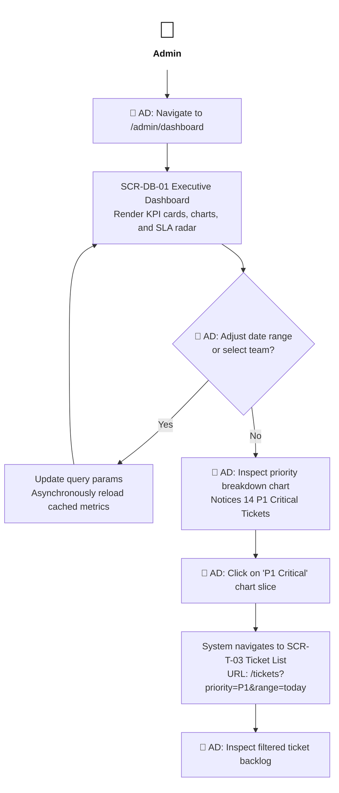
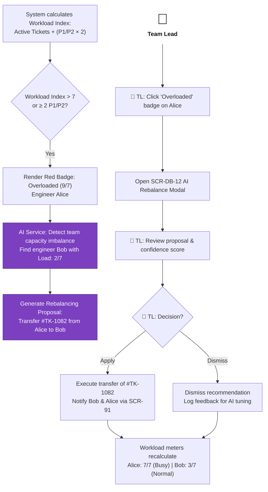
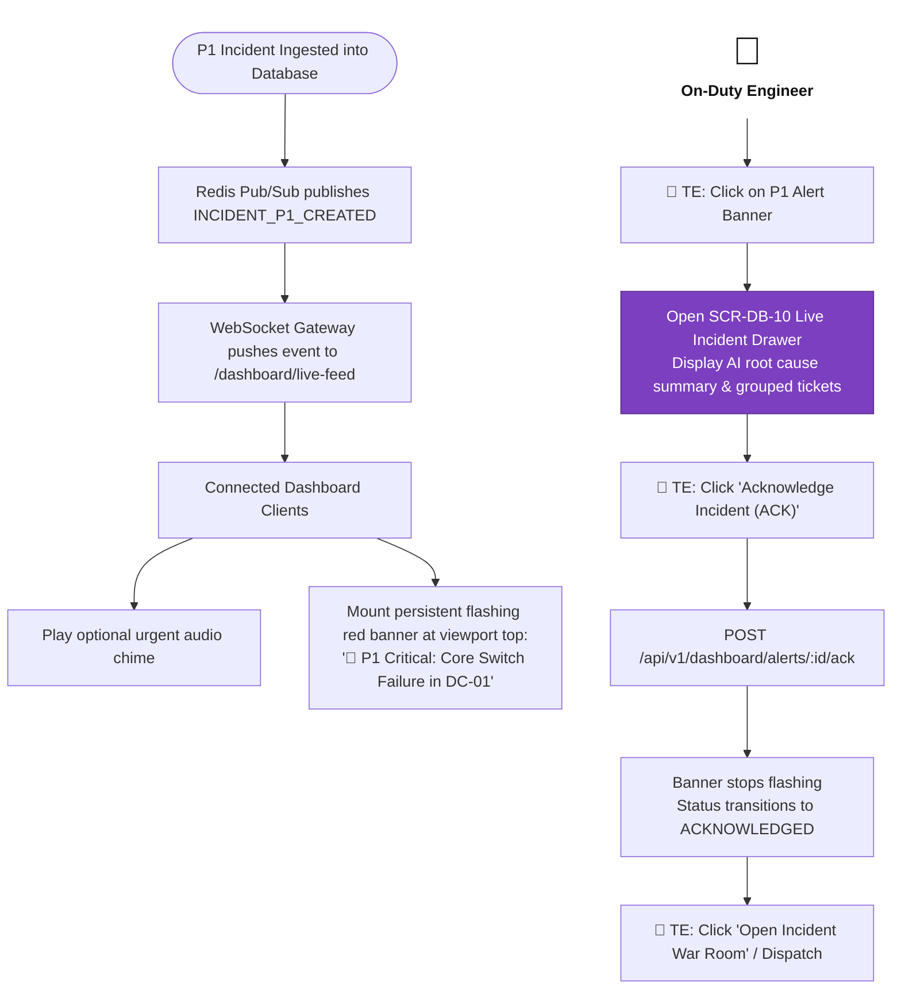
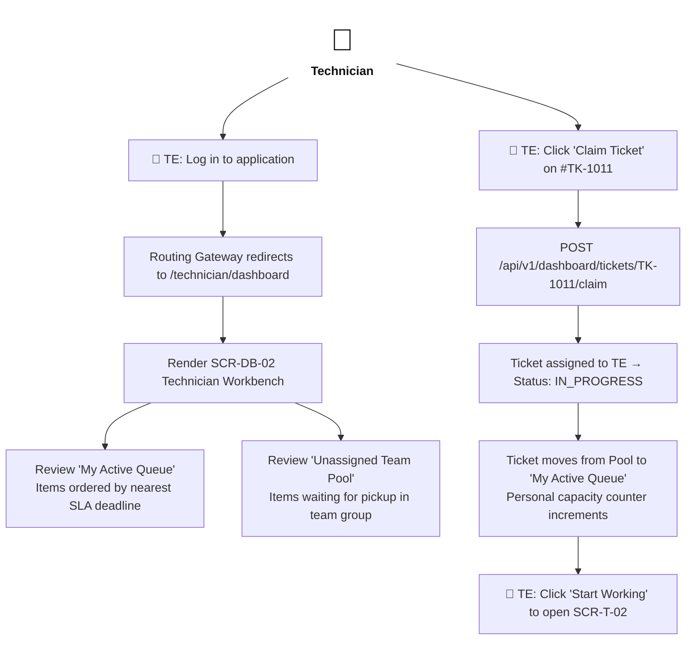

# Primary User Flows — F02 Dashboard

> Design status: V1 — draft, awaiting user review  
> Implementation status: NOT STARTED  

Five primary operational flows define user interactions across the Dashboard subsystem. Steps performed by human actors begin with 👤 (**AD** Admin, **TL** Team Lead, **TE** Technician); automated steps executed by the system or AI are highlighted in **purple**.

---

## Flow 1: Executive KPI Monitoring & Deep Metric Drill-Down

*Covers:* `US-DB-01`, `US-DB-04`  
*Actor:* Administrator (`AD`)  
*Scenario:* The Admin evaluates daily throughput, notices a spike in P1 tickets, and drills down to the underlying ticket records.



---

## Flow 2: Proactive SLA Breach Radar & Rapid Escalation

*Covers:* `US-DB-03`  
*Actor:* Team Lead (`TL`), Administrator (`AD`)  
*Scenario:* A high-priority ticket approaches its SLA resolution deadline; the Team Lead intervenes to prevent breach.

```mermaid
flowchart TD
    actLead["<span style='font-size:40px'>👤</span><br/><b>Team Lead</b>"]:::actor
    start(["SLA Monitoring Widget"]) --> scan["System: Detect ticket #TK-985 remaining time ≤ 20%"]
    scan --> yellow["Render Yellow Warning Badge<br/>Countdown: 00:14:52"]
    actLead --> see["👤 TL: Notice blinking yellow warning on radar"]
    see --> click["👤 TL: Click on ticket #TK-985"]
    click --> modal["Open SCR-DB-11 SLA Escalation Modal<br/>Display current assignee & capacity matrix"]
    modal --> decide{"👤 TL: Action choice?"}
    decide -->|"Nudge Assignee"| nudge["Dispatch instant reminder notification (SCR-91)"]
    decide -->|"Reassign"| reassign["Select available engineer from dropdown<br/>Enter required reassignment reason"]
    reassign --> update["Update ticket assignee → Status: IN_PROGRESS<br/>Log audit record AUDIT_SLA_REASSIGN"]
    nudge --> close["Modal closes; SLA radar counter updates"]
    update --> close

    classDef actor fill:none,stroke:none,color:#111
```

---

## Flow 3: Team Workload Monitoring & AI-Assisted Rebalancing

*Covers:* `US-DB-05`, `US-DB-06`  
*Actor:* Team Lead (`TL`), AI Service  
*Scenario:* An engineer becomes overloaded due to incoming urgent incidents; AI computes a load-balancing proposal.



---

## Flow 4: Real-Time Critical P1 Incident Broadcast & Triage

*Covers:* `US-DB-07`  
*Actor:* On-Duty Engineer (`TE`), Administrator (`AD`)  
*Scenario:* A critical data center network switch fails, generating an instant P1 incident broadcast.



---

## Flow 5: Technician Daily Workbench & 1-Click Ticket Claim

*Covers:* `US-DB-08`  
*Actor:* Support Technician (`TE`)  
*Scenario:* A technician logs in for their shift, reviews personal priorities, and claims an unassigned ticket from the group queue.



**Related:** [Screen Inventory](04-screen-inventory.md) · [UI States](06-ui-states-and-accessibility.md)

