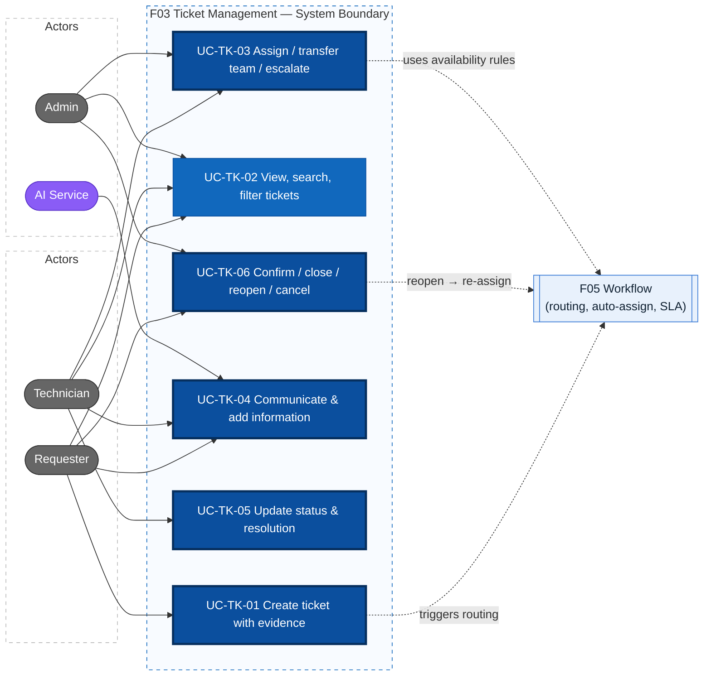
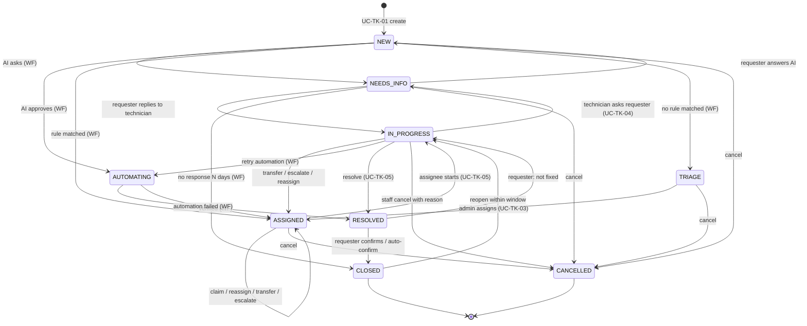

# Actors, Use Cases, Business Rules — F03 Ticket Management

> Design status: TARGET V1
>
> Implementation status: NOT IMPLEMENTED
>
> Scope: F03 Ticket Management (UC-TK-01 … UC-TK-06) — the "Quản lý ticket" branch of the mind map

This document reuses the roles, ticket data scope and permission style from the foundation modules (`mvp.md`, branch `feature/author`) and the ticket states, SLA, routing and AI rules from **F05 Workflow & Automation** (`03-use-cases.md`, `BR-WF-xx`, branch `docs/workflow-requirements`). It only adds `UC-TK-xx`, `BR-TK-xx` and **proposes** the changes to shared artifacts listed in [section 7](#7-proposed-changes-to-shared-artifacts).

Related: [User stories & acceptance criteria](01-user-stories.md) · [Information architecture](information-architecture/README.md)

## 1. Mind map → use case mapping

| Mind map leaf (Quản lý ticket) | Use case | Core? |
|---|---|---|
| Tạo ticket và đính kèm minh chứng | UC-TK-01 Create ticket with evidence | ✔ |
| Xem danh sách / tìm kiếm / lọc ticket | UC-TK-02 View, search and filter tickets | |
| Phân công / chuyển nhóm / chuyển cấp | UC-TK-03 Assign, transfer team, escalate | ✔ |
| Trao đổi và bổ sung thông tin | UC-TK-04 Communicate and add information | ✔ |
| Cập nhật trạng thái và kết quả xử lý | UC-TK-05 Update status and resolution | ✔ |
| Xác nhận / đóng / mở lại / hủy ticket | UC-TK-06 Confirm, close, reopen, cancel | ✔ |

**Boundary with other features**

| Owned elsewhere | Feature | What F03 does |
|---|---|---|
| AI classification, summary, priority suggestion, similar/duplicate ticket suggestion, KB suggestion | F04 AI Ticket Processing | Displays the output; lets humans correct it (the correction is the learning signal) |
| Routing (flows A/B/C), automatic assignment by rule, SLA timers and warnings, AI approval, API execution, automation retry | F05 Workflow & Automation | Triggers Workflow on create / answer / reopen; shows the result; never bypasses Workflow rules |
| Ticket history browsing, audit storage | F08 Activity Log | Writes the events; the *History* tab is rendered by F08 |
| Statistics, satisfaction reports | F07 Reports & Analytics | Produces status timestamps, escalation and rating data |
| Users, technical teams, membership, absence flag | F09 User Management | Reads them for assignment |
| Authentication, data scope enforcement | F01 Authentication & Authorization | Applies the scope on every query |

## 2. Actors

| Actor | Code | Responsibilities in F03 |
|---|---|---|
| Requester | `REQUESTER` | Creates tickets (for self or a colleague), adds information and evidence, answers questions, confirms / reopens / cancels own tickets, rates the result |
| Technician | `TECHNICIAN` | Works on tickets assigned to them or to their teams: claims, starts, asks the requester, writes replies and internal notes, transfers, escalates, resolves |
| Administrator | `ADMIN` | All tickets: handles the triage queue, assigns / reassigns anywhere, receives escalations, sets priority, cancels with reason, redacts sensitive content; any action on behalf of the organization |
| AI Service | `AI` (system actor) | Writes clarification questions and summaries into the ticket conversation; suggests category / priority / similar tickets (F04). Never changes ticket ownership or closes tickets by itself |

> Background jobs (auto-confirm, status timestamps, SLA) are **internal system behavior** with audit source `AUTOMATION` (BR-WF-05), not actors.
> Every role can *create* tickets (Admins and technicians also have IT problems).
> The system has **four roles only**: Requester, Technician, Admin and the AI Service. There is no Team Lead / Operations Lead role; the work such a role would do (triage, assignment, escalation target, priority approval) belongs to the Admin.

## 3. Use case diagram

## 4. Ticket lifecycle (F03 view)

The status set is the one defined by Workflow; F03 adds the **human-driven** transitions and one attribute, `waiting_on`, that tells who a `NEEDS_INFO` ticket is waiting for.

| Status | Meaning | Requester sees | SLA clock |
|---|---|---|---|
| `NEW` | Created, waiting for AI routing | Submitted | Running |
| `NEEDS_INFO` | Waiting for the requester. `waiting_on = AI` (AI clarification, UC-WF-04) or `TECHNICIAN` (technician asked, UC-TK-04) | **Waiting for your reply** | **Paused** (BR-WF-07, BR-TK-06) |
| `TRIAGE` | No assignment rule matched; waiting in the triage queue | Waiting for a technician | Running |
| `ASSIGNED` | Owned by a team, optionally by an individual technician | Waiting for a technician | Running |
| `IN_PROGRESS` | A technician is working on it | In progress | Running |
| `AUTOMATING` | AI approved; the system is executing via API | Being processed automatically | Running |
| `RESOLVED` | Handled, waiting for the requester's confirmation | **Resolved — please confirm** | Stopped |
| `CLOSED` | Final; reopenable within the reopen window | Closed | Stopped |
| `CANCELLED` | Final; never reopenable | Cancelled | Stopped |

### 4.1 Transition table (enforced by the API, BR-TK-04)

| # | From | To | Action / operationId | Allowed actor | Required input |
|---|---|---|---|---|---|
| T1 | — | `NEW` | `createTicket` | Any authenticated user | Title, description |
| T2 | `TRIAGE` | `ASSIGNED` | `assignTicket` | Admin | Team (+ optional technician) |
| T3 | `ASSIGNED` (team only) | `ASSIGNED` | `claimTicket` | Technician member of the team | — |
| T4 | `ASSIGNED`, `IN_PROGRESS` | `ASSIGNED` | `reassignTicket` | Admin | Target technician, reason |
| T5 | `ASSIGNED`, `IN_PROGRESS` | `ASSIGNED` | `transferTicket` | Assignee, Admin | Target team, reason |
| T6 | `ASSIGNED`, `IN_PROGRESS` | `ASSIGNED` | `escalateTicket` | Assignee, Admin | Escalation type, reason, work done so far |
| T7 | `ASSIGNED` | `IN_PROGRESS` | `startTicketWork` | Individual assignee | — |
| T8 | `IN_PROGRESS` | `NEEDS_INFO` (`waiting_on = TECHNICIAN`) | `requestTicketInfo` | Assignee | Question (public message) |
| T9 | `NEEDS_INFO` (`TECHNICIAN`) | `IN_PROGRESS` | `addTicketMessage` by requester (automatic) or `resumeTicketWork` | Requester / Assignee | Message, or resume reason |
| T10 | `NEEDS_INFO` (`AI`) | `NEW` | `answerClarification` (F05) | Requester | Answer |
| T11 | `IN_PROGRESS` | `RESOLVED` | `resolveTicket` | Assignee, Admin | Resolution code, resolution note |
| T12 | `RESOLVED` | `CLOSED` | `confirmTicketResolution` | Requester (owner) | Optional rating + comment |
| T13 | `RESOLVED` | `CLOSED` | auto-confirm job | `AUTOMATION` | — (BR-TK-12) |
| T14 | `RESOLVED` | `IN_PROGRESS` / `ASSIGNED` | `reopenTicket` | Requester (owner), Admin | Reason |
| T15 | `CLOSED` | `IN_PROGRESS` / `ASSIGNED` | `reopenTicket` | Requester (owner), Admin | Reason; within window (BR-TK-11) |
| T16 | `NEW`, `NEEDS_INFO`, `TRIAGE`, `ASSIGNED` | `CANCELLED` | `cancelTicket` | Requester (owner) | Optional note |
| T17 | `NEW`, `NEEDS_INFO`, `TRIAGE`, `ASSIGNED`, `IN_PROGRESS` | `CANCELLED` | `cancelTicket` | Assignee, Admin | Cancel reason code + note |

Transitions marked *(WF)* in the diagram are owned by Workflow (UC-WF-04 … UC-WF-09) and are not repeated here. **No F03 action can move a ticket out of `AUTOMATING`** (BR-TK-08).

## 5. Use cases

### UC-TK-01 Create ticket with evidence

- **Actor:** Requester (any authenticated role)
- **Goal:** submit an IT request with enough context and evidence for the AI or a technician to handle it.
- **Preconditions:** logged in; account `ACTIVE`; `must_change_password = false`.
- **Main flow:**
  1. User opens SCR-T-01 *New ticket*.
  2. User enters **title** (5–200 chars) and **description** (10–5,000 chars). Optional: category hint (default *"I'm not sure"*), urgency (`LOW` / `NORMAL` / `HIGH`, default `NORMAL`), affected device / system (free text).
  3. While the user types, the system shows **similar open tickets and KB articles** (F04/F06 suggestions, optional). The user may open one, or continue.
  4. User attaches evidence: drag-and-drop, file picker or **paste a screenshot** from the clipboard. Each file is uploaded immediately to temporary storage and scanned (BR-TK-03); the form shows progress and the scan result.
  5. User clicks *Submit* → `createTicket` with an `Idempotency-Key` header.
  6. Backend validates input, links clean attachments, generates the ticket code `TK-YYYY-NNNNNN` (BR-TK-02), stores the ticket in `NEW` with `requester_id`, `beneficiary_id` (= requester unless step A1), the requester's department, writes audit `TICKET_CREATED` and publishes `TicketCreated`.
  7. Workflow routes the ticket (UC-WF-04). The user is redirected to the ticket detail (SCR-T-02) showing *"Submitted — the assistant is reviewing your request"* and, within seconds, the routing outcome.
- **Alternative flows:**
  - **A1 — On behalf of a colleague:** user ticks *"This request is for someone else"* and picks a user (search by name / email among active users). The beneficiary can view the ticket (read + reply) but only the requester can cancel / confirm. AI self-approval applies only when the beneficiary is in the same department (BR-WF-16); otherwise Workflow routes to a technician.
  - **A2 — Similar ticket exists:** user opens a suggested open ticket they already own → system offers *"Add your information to this ticket instead"* → goes to UC-TK-04 on that ticket; no new ticket is created.
  - **A3 — Save draft:** if the user leaves the page, the unsent form (without attachments) is kept in the browser for 24 h (convenience only, not server state).
- **Exceptions:**
  - E1 Validation error (empty / too long title or description) → `400` with field messages; attachments already uploaded stay on the form.
  - E2 File type not allowed, file > 10 MB, more than 10 files → rejected on the client and `400` on the server (BR-TK-03).
  - E3 Malware detected → file is quarantined, removed from the form, the user is told *"This file was blocked for security reasons"*; the ticket can still be submitted without it.
  - E4 Same `Idempotency-Key` sent twice (double click, retry) → the existing ticket is returned with `200`, no duplicate.
  - E5 More than 20 tickets in one hour by the same user → `429` (BR-TK-19).
  - E6 Routing service unavailable → the ticket is still saved in `NEW`; Workflow's fallback routes it to a human (NFR-WF-REL-004).
- **Permission:** `ticket:create`
- **Postconditions:** exactly one ticket exists, visible to its requester (and beneficiary), with clean attachments linked, an audit record, and a routing request queued.

### UC-TK-02 View, search and filter tickets

- **Actors:** Requester, Technician, Admin
- **Goal:** find the right tickets quickly and see a ticket's full, role-appropriate picture.
- **Preconditions:** logged in.
- **Main flow — list:**
  1. User opens the ticket list. Default view by role: Requester → *My tickets* (SCR-T-03); Technician → *Assigned to me*; Admin → *All open tickets* (SCR-T-04).
  2. Backend applies the **data scope** in the query (BR-TK-01) before any filter, then returns a page (default 25, max 100) sorted by default by *SLA due soonest* for staff and *last updated* for requesters.
  3. User searches by keyword (ticket code exact match, or full-text on title / description / public messages) and filters by: status (multi), priority, category / request type, team, assignee (incl. *unassigned*), requester, requester department, created / updated date range, SLA state (`ON_TRACK`, `AT_RISK`, `BREACHED`, `PAUSED`), routing flow (A / B / C), `waiting_on`, *has attachments*, *escalated*, *reopened*.
  4. Filters, sort and page are reflected in the URL so a view can be shared / bookmarked; results update without full page reload.
- **Main flow — detail:**
  5. User opens a ticket → `getTicket` (scope re-checked) → SCR-T-02 shows header (code, title, status, priority, SLA countdown), conversation, details panel and role-dependent tabs (see [screen content §1.2](information-architecture/02-screen-content.md#12-scr-t-02-ticket-detail)).
  6. Requester sees only public messages, AI questions/answers and an outcome summary; staff see internal notes, AI summary, routing reason, AI confidence and the automation tab (BR-TK-10).
- **Alternative flows:**
  - **A1 — Saved views:** staff save the current filter set as a named personal view (max 20) → `createSavedView`; it appears in the left navigation.
  - **A2 — Quick actions from the list:** staff can claim / assign selected tickets (up to 50 per bulk action) without opening them; each ticket is processed and audited individually, and the result lists per-ticket success / failure.
  - **A3 — Beneficiary access:** a user who is the beneficiary (UC-TK-01 A1) also sees the ticket under *My tickets* with the label *"Requested by <name>"*.
- **Exceptions:**
  - E1 Ticket outside the user's scope (opened by URL) → `403`, page `#/403`; the response never reveals the title or existence details.
  - E2 Ticket code does not exist → `404`.
  - E3 Invalid filter value or date range (from > to, range > 366 days) → `400`.
  - E4 Search backend unavailable → keyword search disabled with a banner; plain filters still work (DB query).
- **Permission:** `ticket:read` with scope `own` (Requester, plus beneficiary), `assigned, group` (Technician), `all` (Admin).
- **Postconditions:** no data changes (read-only), except saved views.

### UC-TK-03 Assign, transfer team, escalate

- **Actors:** Admin (assign / reassign); Technician (claim, transfer, escalate); Workflow (automatic assignment — UC-WF-05, not repeated here)
- **Goal:** every ticket that needs a human has the **right owner** at the **right level**, with a traceable reason.
- **Preconditions:** ticket in `TRIAGE`, `ASSIGNED` or `IN_PROGRESS`; **not** `AUTOMATING` (BR-TK-08); the actor has the ticket in scope.
- **Main flow — assign from triage (Admin):**
  1. Admin opens the triage queue (SCR-WF-10, or SCR-T-04 view *Triage*) or a ticket in `TRIAGE`.
  2. Clicks *Assign* → DLG-T-01: choose any team and optionally a technician. The dialog shows each candidate's open-ticket count and absence flag; unavailable members are disabled (BR-TK-15).
  3. `assignTicket` → ticket `ASSIGNED` (team, assignee) → assignment record, audit `TICKET_ASSIGNED` (`source = USER`) → the assignee (or the team, if no individual) is notified with the AI summary.
- **Alternative flows:**
  - **A1 — Claim (Technician):** in *My team — unassigned*, technician clicks *Claim* → `claimTicket` → becomes the assignee. Two technicians claiming the same ticket → the second gets `409 ALREADY_ASSIGNED`.
  - **A2 — Reassign (Admin):** DLG-T-01 with a mandatory reason → `reassignTicket` → previous and new assignee are notified; status returns to `ASSIGNED` (the new owner must start it).
  - **A3 — Transfer to another team (chuyển nhóm):** the assignee (or an Admin) clicks *Transfer* → DLG-T-02: target team (list of active teams with their categories), reason code (`WRONG_TEAM`, `NEEDS_OTHER_SKILL`, `OTHER`) + note (≥ 10 chars) → `transferTicket` → ticket `ASSIGNED` to the target team **without individual assignee**; Workflow picks a member using that team's distribution strategy (UC-WF-05); otherwise the ticket waits in the target team queue and Admins are notified. The previous assignee loses edit rights but keeps read access via history. If the reason is `WRONG_TEAM`, the event is flagged as a **routing correction** for AI learning (F04).
  - **A4 — Functional escalation (chuyển cấp chuyên môn):** assignee clicks *Escalate* → DLG-T-03, type *To higher support tier*: system proposes teams with a higher `support_tier` (L1 → L2 → L3) covering the ticket category; technician selects one, enters reason and **work done so far** (mandatory, ≥ 20 chars, stored as an internal note) → `escalateTicket` → `escalation_level` +1, ticket `ASSIGNED` to the target team, audit `TICKET_ESCALATED`.
  - **A5 — Escalation to Admin (báo cấp quản lý):** DLG-T-03, type *To Admin*: ticket stays with its owner, Admins are notified with the reason, `is_escalated_to_admin = true`; an Admin may reassign (A2) or raise priority (UC-TK-05 A3). Workflow's SLA-breach escalation (UC-WF-06) uses the same flag with `source = AUTOMATION`.
  - **A6 — Assignee becomes unavailable:** the assignee is disabled, removed from the team or marked absent (F09) → their open tickets in `ASSIGNED` / `IN_PROGRESS` go back to the team queue (assignee cleared, status `ASSIGNED`), Admins are notified (BR-TK-20).
- **Exceptions:**
  - E1 Missing reason where required → `400`.
  - E2 Technician calls assign / reassign, or transfers a ticket they don't own → `403`.
  - E3 Target technician inactive / absent / not a member of the target team → `400 ASSIGNEE_UNAVAILABLE`.
  - E4 Target team = current team (transfer) or no higher tier available (functional escalation at L3) → `400`; UI suggests escalation to Admin instead.
  - E5 Ticket is `AUTOMATING`, `RESOLVED`, `CLOSED` or `CANCELLED` → `409 INVALID_TRANSITION`.
  - E6 Ticket changed since it was loaded (version mismatch) → `409 STALE_VERSION`; UI reloads and lets the user retry.
- **Permission:** `ticket:assign` (Admin), `ticket:claim`, `ticket:transfer`, `ticket:escalate` (assignee, Admin).
- **Postconditions:** exactly one current owner (team, optionally person); the **SLA clock is not reset** by any of these actions (BR-TK-06); an assignment / escalation record and audit entry with before/after values exist.

### UC-TK-04 Communicate and add information

- **Actors:** Requester, beneficiary, Technician, Admin; AI Service (writes clarification questions — F05/F04)
- **Goal:** keep all communication about a ticket in one traceable conversation, separating what the requester sees from internal work notes.
- **Preconditions:** ticket in scope; status is not `CLOSED` / `CANCELLED` (to talk about a closed ticket the requester reopens it — UC-TK-06).
- **Main flow — public reply:**
  1. User types in the conversation box of SCR-T-02 (plain text with basic formatting, ≤ 10,000 chars) and optionally attaches files (same rules as UC-TK-01).
  2. Staff choose visibility **Public reply** (default for requesters, the only option for them) or **Internal note**.
  3. `addTicketMessage` → message stored append-only with author, visibility, attachments → audit `TICKET_REPLIED` / `TICKET_NOTE_ADDED`.
  4. Notifications: public reply by staff → requester (+ beneficiary); public reply by requester → assignee (or team if unassigned). Internal notes never notify the requester (BR-TK-10).
  5. The first public reply or `startTicketWork` by a technician records `first_responded_at` (SLA first response — F05).
- **Alternative flows:**
  - **A1 — Technician asks the requester for information:** assignee clicks *Ask requester* → DLG-T-04: question (≥ 10 chars, sent as a public message) → `requestTicketInfo` → status `NEEDS_INFO`, `waiting_on = TECHNICIAN`, SLA **paused** → requester notified *"Your technician needs more information"*. Reminders and auto-close follow UC-WF-06.
  - **A2 — Requester replies while waiting:** any public message (or attachment) from the requester / beneficiary on a `NEEDS_INFO` ticket automatically resumes it: `waiting_on = TECHNICIAN` → `IN_PROGRESS` (same assignee); `waiting_on = AI` → handled as `answerClarification` and re-routed (UC-WF-04, max 2 rounds).
  - **A3 — Technician resumes without answer:** the assignee clicks *Resume work* with a reason (e.g. *"Found the info in AD"*) → `resumeTicketWork` → `IN_PROGRESS`.
  - **A4 — Requester adds information spontaneously:** on `NEW`, `TRIAGE`, `ASSIGNED`, `IN_PROGRESS` or `AUTOMATING`, the requester adds a message / evidence → no status change; assignee notified. On `NEW` (not yet routed), the routing uses the added text.
  - **A5 — Mention a colleague (internal):** in an internal note, staff type `@name` to notify another technician who can then **read** the ticket (temporary read access, logged) without becoming assignee.
  - **A6 — Redact sensitive content (Admin):** a message contains a password or personal data → Admin clicks *Redact* with a reason → content replaced by *"[Removed by administrator: <reason>]"*, the original is purged from storage, audit `TICKET_MESSAGE_REDACTED` (BR-TK-13).
- **Exceptions:**
  - E1 Empty message without attachment, message too long → `400`.
  - E2 Requester tries to post an internal note (API call with `visibility = INTERNAL`) → `403`.
  - E3 Ticket `CLOSED` / `CANCELLED` → `409`; UI shows *"This ticket is closed. Reopen it to continue."* (for requesters, within the reopen window).
  - E4 Attachment blocked by scan → same as UC-TK-01 E3.
- **Permission:** `ticket:comment` (public; anyone with the ticket in scope), `ticket:note` (internal; staff only), `ticket:redact` (Admin).
- **Postconditions:** an immutable message with correct visibility; the ticket's `updated_at` and *last public activity* are updated; the right people are notified.

### UC-TK-05 Update status and resolution

- **Actors:** Technician (assignee), Admin
- **Goal:** reflect real progress, and record **how** the request was resolved so the requester can verify it and the knowledge can be reused.
- **Preconditions:** ticket in scope; actor is the individual assignee (Admin for A3, A4).
- **Main flow:**
  1. Assignee opens an `ASSIGNED` ticket → *Start work* → `startTicketWork` → `IN_PROGRESS`, `started_at` set, requester sees *"In progress"*.
  2. Assignee works; may write notes / replies (UC-TK-04), ask for info (UC-TK-04 A1), or retry an automation (UC-WF-09).
  3. Assignee clicks *Resolve* → DLG-T-05: **resolution code** (`FIXED`, `WORKAROUND`, `ACCESS_GRANTED`, `HARDWARE_REPLACED`, `INFORMATION_PROVIDED`, `DUPLICATE`, `NOT_REPRODUCIBLE`, `OUT_OF_POLICY`), **resolution note** visible to the requester (≥ 20 chars), optional internal root-cause note, optional *"Suggest a KB article from this ticket"* (F06).
  4. `resolveTicket` → `RESOLVED`, `resolved_at`, `resolved_by` set → requester notified *"Your ticket has been resolved — please confirm"* with the resolution note → audit `TICKET_RESOLVED`.
  5. Requester confirms or reports not fixed (UC-TK-06).
- **Alternative flows:**
  - **A1 — Duplicate:** code `DUPLICATE` requires the code of the **original** ticket (must exist, be in the resolver's scope and not be `CANCELLED`) → a `DUPLICATE_OF` link is stored; requester sees a link to the original (if they have scope; otherwise only its code and status).
  - **A2 — Correct category (classification):** assignee changes category / request type with a reason → `updateTicketClassification` → `category_source = TECHNICIAN`; the AI value and the human value are stored for F04 learning and F07 reports. If the new category belongs to another team, UI suggests *Transfer* (UC-TK-03 A3).
  - **A3 — Change priority:** assignee proposes / Admin sets a new priority (P1–P4) with a mandatory reason → `updateTicketClassification` → SLA policy switches to the version in force for the new priority (BR-WF-08); raising to P1 notifies Admins.
  - **A4 — Link related tickets:** staff link tickets as `RELATED_TO` (no status effect), e.g. several users affected by the same outage.
  - **A5 — Automated ticket:** resolution of `AUTOMATING` tickets is done by Workflow verification (UC-WF-09) or *Resolved manually* (`resolveWorkflowRunManually`); `resolveTicket` is not available while `AUTOMATING`.
- **Exceptions:**
  - E1 Missing resolution code / note too short / duplicate without valid original → `400`.
  - E2 Actor is not the assignee (and not Admin) → `403`.
  - E3 Transition not allowed from the current status (e.g. resolve from `ASSIGNED`, any action on `AUTOMATING`) → `409 INVALID_TRANSITION`.
  - E4 Stale version → `409 STALE_VERSION`.
- **Permission:** `ticket:update_status` (assignee, Admin), `ticket:classify` (assignee, Admin; priority: Admin — assignee only *proposes*), `ticket:link`.
- **Postconditions:** status and timestamps reflect reality; a `RESOLVED` ticket always carries a resolution code and a requester-visible note (BR-TK-07).

### UC-TK-06 Confirm, close, reopen, cancel

- **Actors:** Requester (owner), Technician (cancel with reason), Admin
- **Goal:** let the requester decide when the request is really done, undo a premature closure, or withdraw a request — with clean, final states for reporting.
- **Main flow — confirm & close:**
  1. Requester opens a `RESOLVED` ticket (from the notification or *My tickets* → filter *Needs my confirmation*).
  2. Sees the resolution note and two buttons: **"Yes, it's solved"** / **"No, still a problem"**.
  3. *Yes* → DLG-T-08: optional satisfaction rating (1–5 stars) and comment (≤ 1,000 chars) → `confirmTicketResolution` → `CLOSED`, `close_reason = CONFIRMED`, `closed_at` set → audit `TICKET_CLOSED`; rating stored for F07.
- **Alternative flows:**
  - **A1 — No confirmation:** after the requester is reminded (day 1 and day N−1, UC-WF-06), on day N (default 5 business days) the system closes the ticket with `close_reason = AUTO_CONFIRMED`, `source = AUTOMATION` (BR-TK-12). The requester can still rate within the reopen window.
  - **A2 — Not fixed (from `RESOLVED`):** *No* → DLG-T-07: reason (≥ 10 chars) + optional evidence → `reopenTicket` → `IN_PROGRESS` with the **same assignee** if still available, otherwise `ASSIGNED` back to the owning team (UC-WF-05) → `reopen_count` +1 → assignee notified.
  - **A3 — Reopen a closed ticket:** within the reopen window (default **7 days** after `closed_at`, BR-TK-11) the requester clicks *Reopen* → same as A2. Tickets closed for *no response* (`NEEDS_INFO` → `CLOSED`) reopen to `NEW` and are routed again.
  - **A4 — Reopen limit reached:** the 3rd reopen of the same ticket automatically escalates it to Admin (UC-TK-03 A5) with reason *"Reopened 3 times"*.
  - **A5 — Window expired:** *Reopen* is replaced by **"Create follow-up ticket"** → UC-TK-01 pre-filled with the title and a `FOLLOW_UP_OF` link to the old ticket.
  - **A6 — Requester cancels:** in `NEW`, `NEEDS_INFO`, `TRIAGE` or `ASSIGNED` → *Cancel request* → DLG-T-06: optional note → `cancelTicket` → `CANCELLED`, `cancel_reason = REQUESTER_WITHDREW`; the assignee (if any) is notified. If the ticket is already `IN_PROGRESS`, the button is replaced by *"Ask to cancel"*, which posts a public message to the technician.
  - **A7 — Staff cancels:** assignee or Admin cancels a non-final, non-automating ticket with reason code (`DUPLICATE`, `SPAM_OR_TEST`, `REQUESTER_WITHDREW`, `OUT_OF_SCOPE`) + note (≥ 10 chars) → `CANCELLED` → requester notified with the reason. `DUPLICATE` requires the original ticket code.
  - **A8 — Admin acts on behalf of the requester:** Admin can confirm or reopen when the requester asks offline (reason required; audit shows the Admin as actor and `on_behalf_of = requester`).
- **Exceptions:**
  - E1 Confirm / reopen by someone other than the owner (or Admin) → `403`. The beneficiary can **reply** but not confirm, reopen or cancel.
  - E2 Reopen after the window → `409 REOPEN_WINDOW_EXPIRED`.
  - E3 Cancel an `AUTOMATING` ticket → `409` with message *"This request is being executed automatically and cannot be cancelled now"* (BR-TK-08); cancel / reopen a `CANCELLED` ticket → `409`.
  - E4 Requester cancels from `IN_PROGRESS` via API → `409 INVALID_TRANSITION`.
  - E5 Rating outside 1–5 → `400`.
- **Permission:** `ticket:confirm`, `ticket:reopen` (owner, Admin), `ticket:cancel` (owner within T16; staff within T17).
- **Postconditions:** `CLOSED` and `CANCELLED` are final for reporting; each closure carries `close_reason` / `cancel_reason`; reopen history (`reopen_count`, reasons) is kept.

## 6. Business rules (BR-TK)

| ID | Rule | Used in |
|---|---|---|
| **BR-TK-01** | **Data scope at query level.** Requester: tickets they created or are beneficiary of. Technician: tickets assigned to them + tickets of their teams (+ temporary read via @mention). Admin: all. The filter is applied by the backend query, not the UI; out-of-scope access → `403` (mvp.md §4). Scope changes take effect on the next request (BR-07). | UC-TK-02, all |
| **BR-TK-02** | **Ticket code** `TK-YYYY-NNNNNN` is generated by the server, unique, immutable, and is the human reference in UI, notifications and search. | UC-TK-01 |
| **BR-TK-03** | **Attachments.** Allowed: `png, jpg, jpeg, gif, webp, pdf, txt, log, csv, docx, xlsx, pptx, zip, eml`; ≤ 10 MB per file; ≤ 10 files per message; ≤ 50 MB per ticket. Every file is malware-scanned before it is linked; infected files are quarantined and never downloadable. Files are stored outside the web root, served only via short-lived (5 min) signed URLs after a scope check, with `Content-Disposition: attachment` (images may be previewed inline). File names are sanitized. | UC-TK-01, UC-TK-04 |
| **BR-TK-04** | **Allowed transitions only.** Status changes follow the transition table §4.1; the API rejects any other with `409 INVALID_TRANSITION`. The UI only shows actions allowed for the current status and role. | UC-TK-03, 05, 06 |
| **BR-TK-05** | **Mandatory reasons.** Reassign, transfer, escalate, priority change, category change, staff cancel, reopen, resume without answer and redaction require a reason (code and/or text). The reason is stored in the audit record. | UC-TK-03 … 06 |
| **BR-TK-06** | **SLA continuity.** Assign, claim, reassign, transfer and escalate never reset or pause the SLA clock. `NEEDS_INFO` pauses it for **both** `waiting_on = AI` and `waiting_on = TECHNICIAN` (extends BR-WF-07). | UC-TK-03, UC-TK-04 |
| **BR-TK-07** | **Resolution evidence.** A ticket enters `RESOLVED` by `resolveTicket` only with a resolution code and a requester-visible note (≥ 20 chars); `DUPLICATE` needs a valid original. Automated tickets follow BR-WF-13. | UC-TK-05 |
| **BR-TK-08** | **`AUTOMATING` is hands-off.** While a ticket is `AUTOMATING`, F03 allows only reading and adding messages; assign, transfer, escalate, status change and cancel are rejected (`409`). Ownership returns to humans only through Workflow (UC-WF-09). | UC-TK-03, 05, 06 |
| **BR-TK-09** | **Single owner.** A ticket in `ASSIGNED` / `IN_PROGRESS` always has exactly one team and at most one individual assignee; `IN_PROGRESS` requires an individual assignee. | UC-TK-03, UC-TK-05 |
| **BR-TK-10** | **Internal notes are internal.** Messages with `visibility = INTERNAL`, AI confidence, policy-check details, assignment between technicians and SLA internals are never returned to Requester / beneficiary API calls, never sent in requester notifications and never exported (aligns with BR-NK-04, BR-BC-04). | UC-TK-02, UC-TK-04 |
| **BR-TK-11** | **Reopen window.** A `CLOSED` ticket can be reopened by its requester (or Admin on behalf) within **7 days** of `closed_at` (Admin-configurable, same value as Workflow and metric M-04). `CANCELLED` tickets are never reopenable. After the window → follow-up ticket with a `FOLLOW_UP_OF` link. | UC-TK-06 |
| **BR-TK-12** | **Auto-confirm (proposed).** A `RESOLVED` ticket without the requester's response for N business days (default 5, reminders on day 1 and N−1) is closed with `close_reason = AUTO_CONFIRMED`, `source = AUTOMATION`. `AUTOMATING` tickets are never auto-closed (BR-WF-11). *Requires extending BR-WF-11 — see Q-TK-01.* | UC-TK-06 |
| **BR-TK-13** | **Append-only conversation.** Messages and attachments cannot be edited or deleted by their authors. Only Admin can redact (content replaced, original purged, reason audited). | UC-TK-04 |
| **BR-TK-14** | **Audit everything.** Every F03 change writes an audit record in the same transaction: `TICKET_CREATED`, `_ASSIGNED`, `_CLAIMED`, `_REASSIGNED`, `_TRANSFERRED`, `_ESCALATED`, `_REPLIED`, `_NOTE_ADDED`, `_INFO_REQUESTED`, `_RESUMED`, `_STARTED`, `_RECLASSIFIED`, `_PRIORITY_CHANGED`, `_LINKED`, `_RESOLVED`, `_CLOSED`, `_REOPENED`, `_CANCELLED`, `_RATED`, `_MESSAGE_REDACTED`, `_ATTACHMENT_BLOCKED` — with actor, `source` (`USER` / `AI` / `AUTOMATION`, BR-WF-05), before/after values and reason. | all |
| **BR-TK-15** | **Valid assignee.** An individual assignee must be `ACTIVE`, a member of the target team, and not marked absent (BR-WF-10). Only an Admin assigns or reassigns. | UC-TK-03 |
| **BR-TK-16** | **Support tiers.** Each technical team has `support_tier` ∈ {L1, L2, L3} (proposed field, F09). Functional escalation only targets a team with a **higher** tier whose categories cover the ticket; at L3 only escalation to Admin is possible. `escalation_level` never decreases. | UC-TK-03 |
| **BR-TK-17** | **Final states are read-only.** `CLOSED` tickets accept only *reopen* and *rating* (within the window); `CANCELLED` tickets accept nothing. | UC-TK-04, UC-TK-06 |
| **BR-TK-18** | **Requester-facing labels.** Requesters see plain-language statuses (§4) and an *outcome summary* instead of internal codes; AI messages are signed *"AI Assistant"*. | UC-TK-02 |
| **BR-TK-19** | **No duplicate submissions.** `createTicket` requires an `Idempotency-Key` (valid 24 h); max 20 tickets per user per hour → `429`. | UC-TK-01 |
| **BR-TK-20** | **Unavailable assignee.** When an assignee is disabled (incl. BR-20 Microsoft removal), removed from the team or marked absent, their `ASSIGNED` / `IN_PROGRESS` tickets are unassigned back to the team queue and Admins are notified within 5 minutes. | UC-TK-03 |
| **BR-TK-21** | **Optimistic concurrency.** Every mutating call carries the ticket `version` (`If-Match`); mismatch → `409 STALE_VERSION`. Prevents two technicians from overwriting each other at 8,000 tickets/day. | UC-TK-03, 05, 06 |
| **BR-TK-22** | **Ownership rights.** Only the requester (not the beneficiary) can confirm, reopen or cancel; both can read and reply. | UC-TK-01, UC-TK-06 |

## 7. Proposed changes to shared artifacts

| Artifact (owner) | Proposed change | Reason |
|---|---|---|
| Workflow state diagram (F05, `03-use-cases.md`) | Add `IN_PROGRESS → NEEDS_INFO` (technician asks), `NEEDS_INFO → IN_PROGRESS`, `TRIAGE/ASSIGNED/NEEDS_INFO/IN_PROGRESS → CANCELLED`, `ASSIGNED/IN_PROGRESS → ASSIGNED` (reassign/transfer/escalate), `CLOSED → IN_PROGRESS` (reopen) | Human-driven transitions of the mind map leaves |
| `tickets` table (F05) | Add `waiting_on` (`AI` / `TECHNICIAN`) | Distinguish who a `NEEDS_INFO` ticket waits for and where the answer goes |
| BR-WF-07 | Pause applies to both `waiting_on` values | Fair SLA when a technician waits for the requester |
| BR-WF-11 | Allow auto-confirm of `RESOLVED` (BR-TK-12) | Otherwise unconfirmed tickets stay `RESOLVED` forever |
| Technical team (F09, `TechnicianGroup`) | Add `support_tier` (L1/L2/L3) | Needed for "chuyển cấp" |
| Permission matrix (`mvp.md` §5) | Add the `ticket:*` permissions below | F03 actions |
| AuditLog (`mvp.md`) | Add `ticket_id`, `on_behalf_of`, `reason` | Ticket audit trail (same need as Q-07 of report-log) |

**Proposed permissions**

| Permission | ADMIN | TECHNICIAN | REQUESTER | AI_AGENT |
|---|---|---|---|---|
| `ticket:create` | ✅ | ✅ | ✅ | ❌ |
| `ticket:read` | all | assigned, group | own (+ beneficiary) | all (read-only) |
| `ticket:comment` (public) | all | assigned, group | own | ✅ (clarification only) |
| `ticket:note` (internal) | all | assigned, group | ❌ | ✅ (summary only) |
| `ticket:claim` | — | group | ❌ | ❌ |
| `ticket:assign` / `ticket:reassign` | all | ❌ | ❌ | ❌ |
| `ticket:transfer` / `ticket:escalate` | all | assigned | ❌ | ❌ |
| `ticket:update_status` | all | assigned | ❌ | ❌ |
| `ticket:classify` (category) | all | assigned | ❌ | ❌ |
| `ticket:classify` (priority) | all | propose only | ❌ | ❌ |
| `ticket:confirm` / `ticket:reopen` | on behalf | ❌ | own | ❌ |
| `ticket:cancel` | all | assigned | own (T16) | ❌ |
| `ticket:redact` | ✅ | ❌ | ❌ | ❌ |

## 8. Quality constraints (F03)

| ID | Statement | Verification |
|---|---|---|
| NFR-TK-PERF-001 | Ticket list / search returns the first page in ≤ 1.5 s (P95) over ~3 million tickets (1 year at 8,000/day). | `PERF-TK-LIST-001` PLANNED |
| NFR-TK-PERF-002 | `createTicket` responds in ≤ 1 s (P95) excluding attachment upload; routing is asynchronous. | `PERF-TK-CREATE-001` PLANNED |
| NFR-TK-PERF-003 | A new public message reaches the other party's in-app notification in ≤ 10 s. | `INT-TK-NOTIF-001` PLANNED |
| NFR-TK-SEC-001 | 100% of ticket endpoints enforce scope server-side (BR-TK-01); automated tests try every endpoint with an out-of-scope ticket. | `INT-TK-SCOPE-*` PLANNED |
| NFR-TK-SEC-002 | Internal content never appears in requester responses (BR-TK-10); contract test on every requester-visible DTO. | `INT-TK-VIS-001` PLANNED |
| NFR-TK-SEC-003 | 100% of attachments are scanned before linking; download URLs expire in ≤ 5 min. | `SEC-TK-FILE-001` PLANNED |
| NFR-TK-REL-001 | No duplicate ticket on client retry (Idempotency-Key). | `INT-TK-IDEM-001` PLANNED |
| NFR-TK-UX-001 | Create-ticket and ticket-detail screens are usable at 360 px width (requesters often report from phones) and meet WCAG 2.1 AA. | Manual + axe audit |

## 9. Open questions

| # | Question | Assumption in this document |
|---|---|---|
| Q-TK-01 | Should `RESOLVED` tickets auto-close when the requester never confirms? BR-WF-11 currently restricts auto-close to `NEEDS_INFO`. | Yes, after 5 business days (BR-TK-12), pending F05 agreement |
| Q-TK-02 | Reuse `NEEDS_INFO` + `waiting_on` for technician questions, or add a separate status `WAITING_REQUESTER`? | Reuse `NEEDS_INFO` (fewer states for reports) |
| Q-TK-03 | Do support tiers L1/L2/L3 exist in the organization? (relates to README Q3 — number of teams) | Yes, as a team attribute managed in F09 |
| Q-TK-04 | May a requester cancel once work has started (`IN_PROGRESS`)? | No; they ask the technician, who cancels with reason |
| Q-TK-05 | Out-of-scope access: `403` (mvp.md) or `404` (hides existence)? | `403`, per mvp.md |
| Q-TK-06 | Permission naming: `ticket:read` (mvp.md) vs `ticketReassign` (F05) — see report-log Q-22. | `ticket:*` style; F05 names mapped 1:1 |
| Q-TK-07 | Email-to-ticket and chat channels in V1? | Web portal only in V1 |
| Q-TK-08 | Attachment retention period after closure? | Same as ticket data; no separate purge in V1 |
| Q-TK-09 | Watchers / CC on tickets (besides the beneficiary)? | Not in V1 |
