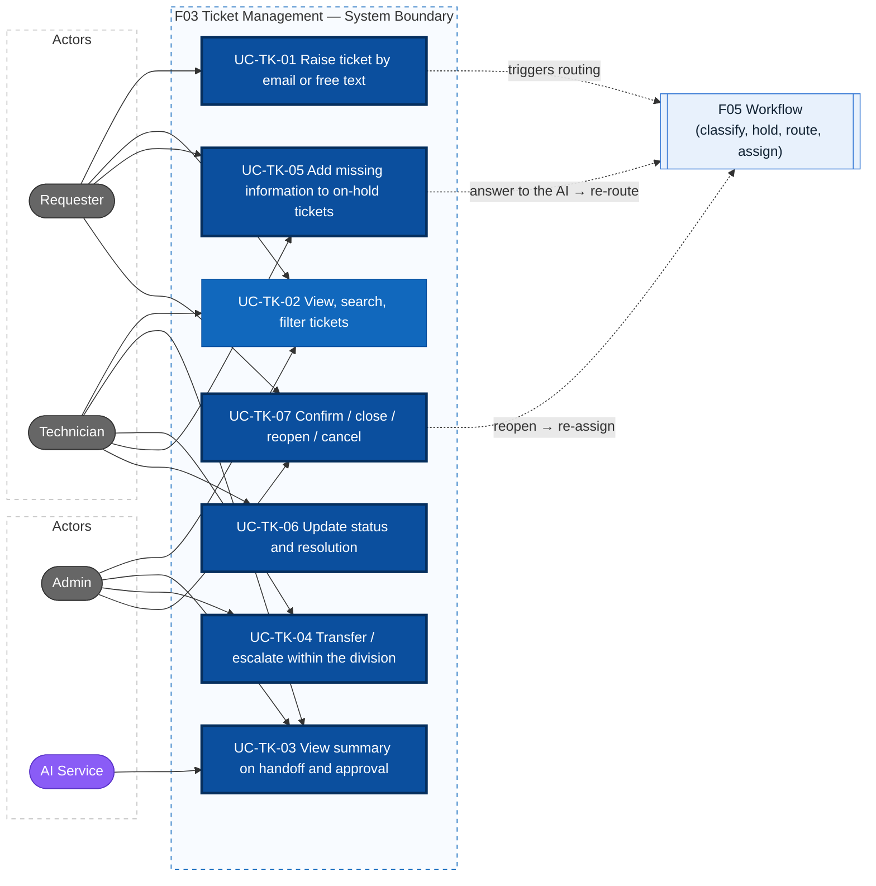
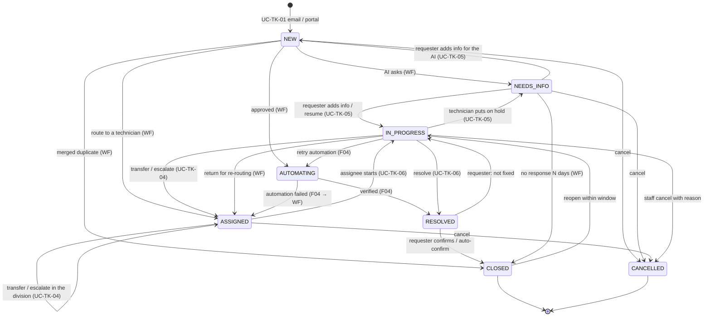

# Actors, Use Cases, Business Rules — F03 Ticket Management

> Design status: TARGET V1
>
> Implementation status: NOT IMPLEMENTED
>
> Scope: F03 Ticket Management (UC-TK-01 … UC-TK-07) — the **Ticket Management** branch of the final mind map (`docs/mindmap.png`)

This document reuses the roles and ticket statuses of **F05 Workflow & Automation** ([use cases](../f05-workflow-automation/02-use-cases.md), `BR-WF-xx` in the shared [business rules](../requirements/business-rules.md)) and the agent-first decision of **F04 AI Ticket Processing** (D-AI-01, D-AI-02). It adds `UC-TK-xx`, `BR-TK-xx` and **proposes** the changes to shared artifacts listed in [section 7](#7-proposed-changes-to-shared-artifacts).

**F05 routes, F04 processes, F03 owns the ticket.** F03 receives tickets from the support mailbox and the portal, stores the ticket, its conversation, attachments, links and Resolution, sends the emails, and gives people the ticket pages and the actions of the seven mind-map leaves.

Related: [User stories & acceptance criteria](01-user-stories.md) · [Information architecture](information-architecture/README.md)

## 1. Mind map → use case mapping

| Mind map leaf (Ticket Management) | Use case | Core? |
|---|---|---|
| Raise ticket by email or free text, no category form | UC-TK-01 Raise a ticket by email or free text | ✔ |
| View / search / filter tickets | UC-TK-02 View, search and filter tickets | |
| View ticket summary on handoff and approval | UC-TK-03 View the ticket summary on handoff and approval | ✔ |
| Transfer / escalate within the same division (admin, technician) | UC-TK-04 Transfer or escalate within the same division | ✔ |
| Add missing information to on-hold tickets | UC-TK-05 Add missing information to an on-hold ticket | ✔ |
| Update status and resolution | UC-TK-06 Update status and resolution | ✔ |
| Confirm / close / reopen / cancel ticket | UC-TK-07 Confirm, close, reopen, cancel | ✔ |

**Division.** A *division* is the **group** that owns the ticket's domain (F09; for example IT Helpdesk, SAP, Fleet Management), with its sub-groups and technicians. F03 moves a ticket only **inside** its group. A ticket that belongs to another group is returned to F05 for re-routing (*Return for re-routing*, UC-WF-11).

**Boundary with other features**

| Owned elsewhere | Feature | What F03 does |
|---|---|---|
| Reading and classifying the ticket, filling the ticket fields ("Filled by AI"), priority and SLA, duplicate detection and merge, holding the ticket and asking the requester, routing to a group, sub-group, AI agent or technician, automatic assignment by workload, re-routing, correcting an AI-filled field or the priority | F05 Workflow & Automation | Stores the fields, shows them, sends the AI questions by email and on the portal, passes the requester's answers back to F05, stores the links F05 creates |
| Resolving tickets routed to an AI agent (KB answer, guided troubleshooting, API execution and verification), drafting the Resolution and the reply, requirement briefs | F04 AI Ticket Processing | Hosts the F04 sections on the ticket pages, stores the Resolution, sends the replies |
| Claiming a ticket from the team queue (1-click claim on the technician workbench) | F02 Dashboard | Exposes the ticket API the workbench calls |
| Ticket history browsing, approval requests and outcomes, audit storage | F08 Activity Log | Writes the events; the *History* tab is rendered by F08 |
| Statistics, satisfaction reports | F07 Reports & Analytics | Produces status timestamps, escalation and rating data |
| Users, groups, sub-groups, membership, `ON` / `OFF` status, support tier | F09 User Management | Reads them for transfer and escalation |
| Authentication, data scope enforcement | F01 Authentication & Authorization | Applies the scope on every query |

## 2. Actors

| Actor | Code | Responsibilities in F03 |
|---|---|---|
| Requester | `REQUESTER` | Raises tickets by email or on the portal (for self or a colleague), adds missing information and evidence, confirms / reopens / cancels own tickets, rates the result |
| Technician | `TECHNICIAN` | Works on tickets owned by them or their sub-group: reads the summary, starts, puts on hold and asks the requester, writes replies and internal notes, transfers and escalates within the group, resolves |
| Administrator | `ADMIN` | All tickets: transfers and escalates within a group, receives escalations, reads the summary of tickets waiting for an approval, confirms / reopens on behalf, cancels with reason, redacts sensitive content |
| AI Service | `AI` (system actor) | Writes the ticket summary (UC-TK-03); the F04 domain agents and F05 write their messages through the ticket API. Never transfers, escalates or closes a ticket through F03 |

> Background jobs (email intake, auto-confirm, status timestamps) are **internal system behavior** with audit source `AUTOMATION` (BR-WF-05), not actors.
> Every role can raise tickets (Admins and technicians also have IT problems).
> The system has **four roles only**: Requester, Technician, Admin and the AI Service. There is no Team Lead and no manual triage queue (F05 D-IA-07).
> The **owner** of a ticket is either the **AI agent** of its domain (F04, flows A and B) or a **technician** (flow C). F03 technician actions apply only when the owner is a technician.

## 3. Use case diagram

## 4. Ticket lifecycle (F03 view)

The status set is the one defined by F05; there is **no `TRIAGE` status**. F03 adds the **human-driven** transitions and one attribute, `waiting_on`, that tells who an on-hold (`NEEDS_INFO`) ticket is waiting for.

| Status | Meaning | Requester sees | SLA clock |
|---|---|---|---|
| `NEW` | Received, waiting for F05 analysis and routing | Submitted | Running |
| `NEEDS_INFO` | **On hold**, waiting for the requester. `waiting_on = AI` (F05 asked, UC-WF-04 flow B; or an F04 guided session, Q-AI-15) or `TECHNICIAN` (technician asked, UC-TK-05) | **Waiting for your reply** | **Paused** (BR-WF-07, BR-TK-06) |
| `ASSIGNED` | Owned by a technician, or waiting in the sub-group queue when nobody is eligible (F05 UC-WF-05) | Waiting for a technician | Running |
| `IN_PROGRESS` | A technician is working on it | In progress | Running |
| `AUTOMATING` | Approved; the system is executing and verifying via API (F04 UC-AI-12, UC-AI-13) | Being processed automatically | Running |
| `RESOLVED` | Handled, waiting for the requester's confirmation | **Resolved — please confirm** | Stopped |
| `CLOSED` | Final; reopenable within the reopen window | Closed | Stopped |
| `CANCELLED` | Final; never reopenable | Cancelled | Stopped |

While the **AI agent** owns a ticket, its status and transitions are set by F05 and F04 (open point Q-AI-10); F03 shows the owner as *"AI Assistant"* to the requester and *"AI agent — <domain>"* to staff.

### 4.1 Transition table (enforced by the API, BR-TK-04)

| # | From | To | Action / operationId | Allowed actor | Required input |
|---|---|---|---|---|---|
| T1 | — | `NEW` | `createTicket` (portal) or email intake | Any authenticated user; a mailbox sender | Description (portal); an email (mailbox) |
| T2 | `ASSIGNED`, `IN_PROGRESS` | `ASSIGNED` | `transferTicket` | Assignee, Admin | Target sub-group or technician **in the same group**, reason |
| T3 | `ASSIGNED`, `IN_PROGRESS` | `ASSIGNED` | `escalateTicket` (type `TIER`) | Assignee, Admin | Higher-tier sub-group in the same group, reason, work done so far |
| T4 | `ASSIGNED`, `IN_PROGRESS` | unchanged | `escalateTicket` (type `ADMIN`) | Assignee | Reason, work done so far |
| T5 | `ASSIGNED` | `IN_PROGRESS` | `startTicketWork` | Individual assignee | — |
| T6 | `IN_PROGRESS` | `NEEDS_INFO` (`waiting_on = TECHNICIAN`) | `requestTicketInfo` | Assignee | Question (public message) |
| T7 | `NEEDS_INFO` (`TECHNICIAN`) | `IN_PROGRESS` | `addTicketMessage` / email reply by the requester (automatic), or `resumeTicketWork` | Requester / Assignee | Message, or resume reason |
| T8 | `NEEDS_INFO` (`AI`) | `NEW` (F05 re-routes) | `addTicketMessage` / email reply → `answerClarification` (F05) | Requester | Answer |
| T9 | `IN_PROGRESS` | `RESOLVED` | `resolveTicket` | Assignee, Admin | Resolution code, Resolution, reply to the requester |
| T10 | `RESOLVED` | `CLOSED` | `confirmTicketResolution` | Requester (owner) | Optional rating + comment |
| T11 | `RESOLVED` | `CLOSED` | auto-confirm job | `AUTOMATION` | — (BR-TK-12) |
| T12 | `RESOLVED` | `IN_PROGRESS` / `ASSIGNED` | `reopenTicket` | Requester (owner), Admin | Reason |
| T13 | `CLOSED` | `IN_PROGRESS` / `ASSIGNED` / `NEW` | `reopenTicket` | Requester (owner), Admin | Reason; within window (BR-TK-11) |
| T14 | `NEW`, `NEEDS_INFO`, `ASSIGNED` | `CANCELLED` | `cancelTicket` | Requester (owner) | Optional note |
| T15 | `NEW`, `NEEDS_INFO`, `ASSIGNED`, `IN_PROGRESS` | `CANCELLED` | `cancelTicket` | Assignee, Admin | Cancel reason code + note |

Transitions marked *(WF)* or *(F04)* in the diagram are owned by F05 (UC-WF-04 … UC-WF-11) or F04 (UC-AI-10 … UC-AI-13) and are not repeated here. **No F03 action can move a ticket out of `AUTOMATING`** (BR-TK-08).

## 5. Use cases

### UC-TK-01 Raise a ticket by email or free text

- **Actor:** Requester (any authenticated role, or any sender to the support mailbox)
- **Goal:** raise an IT request in the requester's own words — an email or a free-text box — **without picking a category or filling a category form**; the AI (F05) classifies it and fills the ticket fields.
- **Preconditions:** portal: logged in, account `ACTIVE`. Email: the support mailbox is connected (deployment configuration).
- **Main flow — email (most tickets):**
  1. The requester writes to the support mailbox (e.g. `it-support@…`) in free text, with any attachments.
  2. The intake job reads the mailbox, creates the ticket in `NEW` with `source_channel = EMAIL`, title = email subject, description = email body, requester = the sender matched in the directory (F09), `created_by` = sender (or the Helpdesk agent who forwarded it), and keeps the original email (BR-TK-23).
  3. Attachments are scanned and linked (BR-TK-03); the ticket code `TK-YYYY-NNNNNN` is generated (BR-TK-02); audit `TICKET_CREATED` with `source = AUTOMATION`; event `TicketCreated`.
  4. The requester receives the **acknowledgement email** (EML-T-01): ticket code in the subject, *"Reply to this email to add information"*, a link to the ticket.
  5. F05 analyses and routes the ticket (UC-WF-04). F05 / F04 may already add KB suggestions to the acknowledgement (F04.1).
- **Main flow — portal free text:**
  1. The user opens SCR-T-01 *New request*.
  2. The user writes a **description** (10–5,000 chars) in their own words; the **subject** is optional (≤ 200 chars; if empty, the first line of the description is used). There is **no category, no urgency and no category form** — F05 fills request type, category, support level, priority and the other ticket fields ("Filled by AI").
  3. The user attaches evidence: drag-and-drop, file picker or **paste a screenshot**. Each file is uploaded at once and scanned (BR-TK-03).
  4. *Submit* → `createTicket` with an `Idempotency-Key` → ticket `NEW` with `source_channel = PORTAL`, audit `TICKET_CREATED` (`source = USER`), event `TicketCreated`.
  5. The user lands on SCR-T-02 with *"Submitted — the assistant is reviewing your request"*; within seconds F05 shows the outcome (*"The assistant needs more information"*, *"Assigned to IT Helpdesk — Printers"*, *"Being processed automatically"*).
- **Alternative flows:**
  - **A1 — On behalf of a colleague:** portal: tick *"This request is for someone else"* and pick an active user; email: name the colleague in the text (F05 extracts `requestedFor`). The beneficiary can read and reply; only the requester can confirm, reopen or cancel (BR-TK-22). F05 never auto-approves for a beneficiary in another department (BR-WF-16).
  - **A2 — Reply to an existing ticket by email:** an email whose subject carries a ticket code `[TK-…]` or whose `In-Reply-To` matches a ticket email is **added to that ticket** as a public message (UC-TK-05), not a new ticket (BR-TK-23). A reply to a `CLOSED` ticket within the reopen window is added and the requester gets a *Reopen* link; it does not reopen the ticket by itself. A reply to a `CANCELLED` ticket, or after the window, creates a new ticket with a `FOLLOW_UP_OF` link.
  - **A3 — Duplicate of an own open ticket:** F05 merges it (UC-WF-10): F03 stores the `DUPLICATE_OF` link and closes the new ticket; the requester can undo within 7 days (*Not the same problem*).
  - **A4 — Unknown sender** (not in the directory): the ticket is created with the sender's address as contact; F05 routes it to a technician with reason `UNKNOWN_SENDER` and never automates it.
  - **A5 — Save draft (portal):** an unsent form (without attachments) is kept in the browser for 24 h (convenience only).
- **Exceptions:**
  - E1 Portal: description empty or out of range → `400` with field messages; uploaded attachments stay on the form.
  - E2 File type not allowed, file > 10 MB, more than 10 files → rejected on the client and `400` on the server; by email, the file is dropped and the acknowledgement lists it as *not accepted* (BR-TK-03).
  - E3 Malware detected → quarantined, never linked; *"This file was blocked for security reasons"*; the ticket is still created.
  - E4 Same `Idempotency-Key` twice, or the same email `Message-ID` read twice → the existing ticket is returned, no duplicate (BR-TK-19).
  - E5 More than 20 tickets in one hour from the same user or sender → portal `429`; email: the message is added to the sender's latest open ticket and the Admin is alerted (BR-TK-19).
  - E6 Auto-replies (`Auto-Submitted`, out-of-office, bounces) → never create a ticket and never get an acknowledgement (mail-loop protection).
  - E7 Routing service unavailable → the ticket stays saved in `NEW`; F05's fallback routes it to a human (`AI_UNAVAILABLE`).
- **Permission:** `ticket:create` (portal); mailbox intake: internal system.
- **Postconditions:** exactly one ticket per request, with its source, clean attachments, an audit record and a routing request queued; the requester has its code.

### UC-TK-02 View, search and filter tickets

- **Actors:** Requester, Technician, Admin
- **Goal:** find the right tickets quickly and see a ticket's full, role-appropriate picture.
- **Preconditions:** logged in.
- **Main flow — list:**
  1. User opens the ticket list. Default view by role: Requester → *My tickets* (SCR-T-03); Technician → *Assigned to me*; Admin → *All open tickets* (SCR-T-04).
  2. Backend applies the **data scope** in the query (BR-TK-01) before any filter, then returns a page (default 25, max 100) sorted by *SLA due soonest* for staff and *last updated* for requesters.
  3. User searches by keyword (ticket code exact match, or full-text on title / description / public messages) and filters by: status (multi), priority (P1–P3), source (`EMAIL` / `PORTAL`), support level (`L1` / `L2`), request type, category, group, sub-group, owner (AI agent / technician / *waiting in queue*), assignee, requester, requester department, created / updated date range, SLA state (`ON_TRACK`, `AT_RISK`, `BREACHED`, `PAUSED`), routing flow (A / B / C), `waiting_on`, *escalated*, *reopened*, *has attachments*, *linked* (duplicate / related).
  4. Filters, sort and page are reflected in the URL; results update without full page reload.
- **Main flow — detail:**
  5. User opens a ticket → `getTicket` (scope re-checked) → SCR-T-02 shows header (code, title, status, priority, SLA, source, owner), conversation, details panel and role-dependent tabs.
  6. Requester sees public messages, AI Assistant messages and an outcome line; staff also see internal notes, the **ticket summary** (UC-TK-03), the AI-filled fields with their marker, routing history, and the *Automation* / *AI* tabs (BR-TK-10).
- **Alternative flows:**
  - **A1 — Saved views:** staff save the current filter set as a named personal view (max 20).
  - **A2 — Beneficiary access:** the beneficiary sees the ticket under *My tickets* labelled *"Requested by {name}"*.
  - **A3 — Original email:** staff open the original email of an `EMAIL` ticket (headers, body, attachments list) from the details panel.
- **Exceptions:**
  - E1 Ticket outside the user's scope (opened by URL or email link) → `403`; the response never reveals the title or existence details.
  - E2 Ticket code does not exist → `404`.
  - E3 Invalid filter value or date range (from > to, range > 366 days) → `400`.
  - E4 Search backend unavailable → keyword search disabled with a banner; plain filters still work.
- **Permission:** `ticket:read` with scope `own` (Requester, plus beneficiary), `assigned, sub-group` (Technician), `all` (Admin).
- **Postconditions:** no data changes (read-only), except saved views.

### UC-TK-03 View the ticket summary on handoff and approval

> Taken over from F04 (retired UC-AI-04, US-AI-07, US-AI-08, SEC-AI-06; D-AI-02). The AI Service writes the summary; F03 owns when it is produced, where it is shown and who may read it.

- **Actors:** Technician, Admin; AI Service (writes the summary)
- **Goal:** whoever receives a ticket — or must decide on an approval — understands it in under a minute without reading the whole conversation.
- **Triggers — handoff:** F05 assigns the ticket to a technician (flow C, UC-WF-05); an AI agent escalates it (F04 `escalationClass`); F05 re-routes it (UC-WF-11); a person transfers or escalates it (UC-TK-04); the requester reopens it (UC-TK-07). **Approval:** the ticket waits for a human approval decision (Q-TK-10).
- **Main flow:**
  1. The AI Service reads the ticket, the conversation (public and internal), the AI-filled fields, the F05 route reason and, when present, what the AI agent already did (KB reply, guidance transcript, proposed action and its run).
  2. It writes a summary of at most **150 words** in fixed sections: **Problem** · **Impact** · **Key details** · **Already tried** · **Questions and answers** · **Why it came to you** · **Open points**. For an approval it adds **Requested action** (operation, target system, entitlement, duration, beneficiary) and **Why approval is needed** (the failed policy condition).
  3. Each fact links to the message it comes from; credentials stay masked (BR-AI-07).
  4. The summary is stored as a new **version** and shown at the top of SCR-T-02 (SEC-T-01) for staff in scope; the handoff notification and the approval request carry it.
  5. The receiver reads it, opens the linked messages if needed and starts work (UC-TK-06), or decides on the approval.
- **Alternative flows:**
  - **A1 — Not ready yet:** the notification says *"Summary is being prepared"*; the summary appears on the ticket when ready (≤ 30 s).
  - **A2 — New information:** a new message or attachment arrives → the summary is regenerated and marked *"Updated after a new message"*; earlier versions stay viewable.
  - **A3 — Regenerate:** a technician clicks *Regenerate*; if the latest version is less than 30 s old, it is returned without a new model call.
  - **A4 — Feedback:** the reader marks the summary *helpful / not helpful* (input for F04.8 learning and F07).
- **Exceptions:** AI Service unavailable → the original description and *"Summary unavailable"* are shown; the handoff is never blocked. A requester never receives the summary (`403` on the summary API; absent from requester DTOs).
- **Permission:** `ticket:summary_read` (technicians in scope, Admin); `ticket:summary_regenerate` (assignee, Admin).
- **Postconditions:** every ticket handed to a person, or waiting for an approval, has a current summary or a visible *"Summary unavailable"*.

### UC-TK-04 Transfer or escalate within the same division

- **Actors:** Technician (assignee), Admin
- **Goal:** move a ticket to the right person or level **inside its group**, with a traceable reason and the work done so far. Moving it to another group is not a transfer: it is *Return for re-routing* (F05 UC-WF-11).
- **Preconditions:** ticket in `ASSIGNED` or `IN_PROGRESS`, owned by a technician; **not** `AUTOMATING` (BR-TK-08); the actor has it in scope.
- **Main flow — transfer:**
  1. The assignee (or an Admin) clicks *Transfer* → DLG-T-02.
  2. Chooses a target: another **sub-group** of the same group, or a named **technician** of the same group (shown with status `ON` / `OFF` and workload score; `OFF` and full members are disabled, BR-TK-15).
  3. Picks a reason code (`NEEDS_OTHER_SKILL`, `WORKLOAD`, `ABSENCE`, `OTHER`) and a note (≥ 10 chars) → `transferTicket`.
  4. The ticket becomes `ASSIGNED` to the target. If only a sub-group was chosen, F05 picks a member with the selection rule (UC-WF-05); otherwise it waits in the sub-group queue. The new owner is notified **with the summary** (UC-TK-03); audit `TICKET_TRANSFERRED`.
- **Alternative flows:**
  - **A1 — Escalate to a higher support tier:** *Escalate* → DLG-T-03, type *Higher tier*: the system lists sub-groups of the **same group** with a higher `support_tier` covering the ticket's subcategory; the actor enters a reason and **work done so far** (≥ 20 chars, stored as an internal note) → `escalateTicket` → `escalation_level` +1, ticket `ASSIGNED` to that sub-group, F05 picks a member, audit `TICKET_ESCALATED`.
  - **A2 — Escalate to Admin:** DLG-T-03, type *Admin*: the ticket stays with its owner, `is_escalated_to_admin = true`, Admins are notified with the reason and the summary and see it in *Escalated to me*. An Admin may transfer it (main flow), change the priority (F05), or reassign it (F05 UC-WF-05, last resort). F05's SLA-breach escalation (UC-WF-06) uses the same flag with `source = AUTOMATION`.
  - **A3 — Wrong group:** the target the technician needs is in another group → DLG-T-02 shows *"This group does not handle it? Return for re-routing"* → F05 SCR-WF-24 (`returnForRerouting`).
- **Exceptions:**
  - E1 Missing reason or note → `400`.
  - E2 Technician who is not the assignee → `403`.
  - E3 Target outside the ticket's group → `400 OUTSIDE_DIVISION`; target technician `OFF`, at maximum load or not a member → `400 ASSIGNEE_UNAVAILABLE`.
  - E4 Target = current sub-group and technician, or no higher tier in the group → `400`; UI suggests escalation to Admin.
  - E5 Ticket owned by an AI agent, or `NEW`, `NEEDS_INFO`, `AUTOMATING`, `RESOLVED`, `CLOSED`, `CANCELLED` → `409 INVALID_TRANSITION`.
  - E6 Ticket changed since it was loaded → `409 STALE_VERSION`.
- **Permission:** `ticket:transfer`, `ticket:escalate` (assignee, Admin).
- **Postconditions:** exactly one current owner in the same group; the **SLA clock is not reset** (BR-TK-06); an assignment / escalation record and audit entry with before/after values and reason exist.

### UC-TK-05 Add missing information to an on-hold ticket

- **Actors:** Requester, beneficiary, Technician, Admin; AI Service / F05 (ask the questions)
- **Goal:** when a ticket is **on hold** (`NEEDS_INFO`) because information is missing, the requester adds it in the easiest way — a portal reply or an email reply — and the ticket resumes by itself; all communication stays in one traceable conversation.
- **Preconditions:** ticket in scope; status not `CLOSED` / `CANCELLED`.
- **Main flow — requester adds the missing information:**
  1. The ticket is on hold: F05 asked a question (`waiting_on = AI`, UC-WF-04 flow B) or the technician did (A1, `waiting_on = TECHNICIAN`). The requester gets the question by email (EML-T-02) and sees *"Waiting for your reply"* with the question on SCR-T-02 and in *Needs my action*.
  2. The requester answers: reply box on SCR-T-02 (text ≤ 10,000 chars, attachments) **or a reply to the email**.
  3. `addTicketMessage` (or email intake) stores the message append-only → audit `TICKET_INFO_ADDED`.
  4. The ticket resumes automatically: `waiting_on = TECHNICIAN` → `IN_PROGRESS` with the same assignee, SLA resumed; `waiting_on = AI` → passed to F05 as `answerClarification` → `NEW` → re-routed (max 2 rounds). Pause and resume times are stored.
  5. The owner is notified; the summary is refreshed (UC-TK-03 A2).
- **Alternative flows:**
  - **A1 — Technician puts the ticket on hold:** the assignee of an `IN_PROGRESS` ticket clicks *Ask requester* → DLG-T-04: question (≥ 10 chars, sent publicly) → `requestTicketInfo` → `NEEDS_INFO`, `waiting_on = TECHNICIAN`, SLA **paused** → requester notified (EML-T-02). Reminders and auto-close follow UC-WF-06.
  - **A2 — Technician resumes without an answer:** *Resume work* with a reason (e.g. *"Found the info in AD"*) → `resumeTicketWork` → `IN_PROGRESS`.
  - **A3 — Requester adds information on a ticket that is not on hold:** on `NEW`, `ASSIGNED`, `IN_PROGRESS` or `AUTOMATING`, a message or file → no status change, the owner is notified; on `NEW` the routing uses the added text.
  - **A4 — Public reply by staff:** staff write a public reply (≤ 10,000 chars, attachments) → requester and beneficiary notified (in-app + email); the first public reply by a technician sets `first_responded_at`.
  - **A5 — Internal note and mention:** staff switch the composer to *Internal note* (never sent to the requester, BR-TK-10); `@name` notifies a technician who then gets temporary **read** access (logged).
  - **A6 — Redact sensitive content (Admin):** content replaced by *"[Removed by administrator: {reason}]"*, original purged, audit `TICKET_MESSAGE_REDACTED` (BR-TK-13).
- **Exceptions:**
  - E1 Empty message without attachment, message too long → `400`.
  - E2 Requester posts with `visibility = INTERNAL` → `403`.
  - E3 Ticket `CLOSED` / `CANCELLED` → `409`; UI shows *"This ticket is closed. Reopen it to continue."*; by email see UC-TK-01 A2.
  - E4 Attachment blocked by scan → same as UC-TK-01 E3.
  - E5 A reply from an address that is neither the requester, the beneficiary nor staff in scope → stored as a held message for staff review, never resumes the ticket.
- **Permission:** `ticket:comment` (public; anyone with the ticket in scope), `ticket:note` (internal; staff), `ticket:update_status` (put on hold, resume: assignee), `ticket:redact` (Admin).
- **Postconditions:** the information is on the ticket as an immutable message with the right visibility; an on-hold ticket resumes as soon as the requester answers; the right people are notified.

### UC-TK-06 Update status and resolution

- **Actors:** Technician (assignee), Admin; F04 (drafts the Resolution and the reply)
- **Goal:** reflect real progress, and record **how** the request was resolved (the Resolution) so the requester can verify it and the knowledge can be reused.
- **Preconditions:** ticket in scope; actor is the individual assignee (or Admin).
- **Main flow:**
  1. The assignee opens an `ASSIGNED` ticket, reads the summary → *Start work* → `startTicketWork` → `IN_PROGRESS`, `started_at` set, requester sees *"In progress"*.
  2. The assignee works; may reply, write notes or put the ticket on hold (UC-TK-05), transfer or escalate (UC-TK-04), or retry an automation (F04 SEC-AI-16).
  3. *Resolve* → DLG-T-05 with the **Resolution** and the **reply to the requester** drafted by F04 (SEC-AI-13, UC-AI-08): resolution code (`FIXED`, `WORKAROUND`, `ACCESS_GRANTED`, `HARDWARE_REPLACED`, `INFORMATION_PROVIDED`, `DUPLICATE`, `NOT_REPRODUCIBLE`, `OUT_OF_POLICY`), Resolution (root cause and steps), reply visible to the requester (≥ 20 chars), optional *"Suggest a KB article from this ticket"* (F06). The technician edits and confirms the drafts.
  4. `resolveTicket` → `RESOLVED`, `resolved_at`, `resolved_by`, Resolution stored → the reply is sent (in-app + EML-T-03 with *Confirm* / *Not fixed*) → audit `TICKET_RESOLVED`.
  5. The requester confirms or reports not fixed (UC-TK-07).
- **Alternative flows:**
  - **A1 — Resolved by the AI:** when F04 resolves a ticket (verified execution, KB answer, guided fix), F04 calls the same resolve operation with author `AI` and the codes `ANSWERED_BY_KB`, `SOLVED_BY_KB` or `GUIDED_BY_AI` (in addition to the codes above); F03 stores the Resolution and sends the reply.
  - **A2 — Duplicate:** code `DUPLICATE` requires the code of the **original** ticket (exists, in scope, not `CANCELLED`) → `DUPLICATE_OF` link.
  - **A3 — Link related tickets:** staff link tickets as `RELATED_TO` (no status effect); F05 creates the same links automatically (UC-WF-10). Resolving a main ticket offers *Resolve the related tickets too*, each with its own reply.
  - **A4 — Automated ticket:** `AUTOMATING` tickets are resolved by F04 verification (UC-AI-13) or *Resolved manually* on the *Automation* tab; `resolveTicket` is not available while `AUTOMATING`.
  - **A5 — Field or priority wrong:** correcting an AI-filled field or the priority is done with the F05 actions (`correctTicketField`, `changeTicketPriority`) shown in the details panel; F03 stores the result.
  - **A6 — AI drafts unavailable:** the dialog opens with empty fields and *"Draft unavailable"*; the technician writes them.
- **Exceptions:**
  - E1 Missing resolution code / Resolution / reply too short / duplicate without valid original → `400`.
  - E2 Actor is not the assignee (and not Admin) → `403`.
  - E3 Transition not allowed (e.g. resolve from `ASSIGNED`, any action on `AUTOMATING`) → `409 INVALID_TRANSITION`.
  - E4 Stale version → `409 STALE_VERSION`.
- **Permission:** `ticket:update_status` (assignee, Admin; AI service account for A1), `ticket:link` (staff in scope).
- **Postconditions:** status and timestamps reflect reality; a `RESOLVED` ticket always carries a resolution code, a Resolution and a requester-visible reply (BR-TK-07).

### UC-TK-07 Confirm, close, reopen, cancel

- **Actors:** Requester (owner), Technician (cancel with reason), Admin
- **Goal:** let the requester decide when the request is really done, undo a premature closure, or withdraw a request — with clean, final states for reporting.
- **Main flow — confirm & close:**
  1. The requester opens a `RESOLVED` ticket (EML-T-03 link, notification or *My tickets* → *Needs my action*).
  2. Sees the reply and two buttons: **"Yes, it's solved"** / **"No, still a problem"**.
  3. *Yes* → DLG-T-08: optional rating (1–5 stars) and comment (≤ 1,000 chars) → `confirmTicketResolution` → `CLOSED`, `close_reason = CONFIRMED` → audit `TICKET_CLOSED`; rating stored for F07.
- **Alternative flows:**
  - **A1 — No confirmation:** reminders on day 1 and day N−1 (UC-WF-06); on day N (default 5 business days) the system closes the ticket with `close_reason = AUTO_CONFIRMED`, `source = AUTOMATION` (BR-TK-12).
  - **A2 — Not fixed (from `RESOLVED`):** *No* → DLG-T-07: reason (≥ 10 chars) + optional evidence → `reopenTicket` → `IN_PROGRESS` with the **same assignee** if still `ON`, otherwise `ASSIGNED` for F05 to pick a member of the same sub-group → `reopen_count` +1 → the new owner is notified with the summary. A ticket the **AI agent** resolved goes to a technician (F05, `AGENT_NOT_SOLVED`).
  - **A3 — Reopen a closed ticket:** within the reopen window (default **7 days**, BR-TK-11) → same as A2. Tickets closed for *no response* (`NEEDS_INFO` → `CLOSED`) reopen to `NEW` and are routed again.
  - **A4 — Reopen limit reached:** the 3rd reopen escalates the ticket to Admin (UC-TK-04 A2) with reason *"Reopened 3 times"*.
  - **A5 — Window expired:** *Reopen* is replaced by **"Create follow-up ticket"** → UC-TK-01 pre-filled with a `FOLLOW_UP_OF` link.
  - **A6 — Requester cancels:** in `NEW`, `NEEDS_INFO` or `ASSIGNED` → *Cancel request* → DLG-T-06: optional note → `CANCELLED`, `cancel_reason = REQUESTER_WITHDREW`; the owner is notified. In `IN_PROGRESS` the button becomes *"Ask to cancel"*, which posts a public message.
  - **A7 — Staff cancels:** assignee or Admin cancels a non-final, non-automating ticket with a reason code (`DUPLICATE`, `SPAM_OR_TEST`, `REQUESTER_WITHDREW`, `OUT_OF_SCOPE`) + note (≥ 10 chars) → requester notified with the reason. `DUPLICATE` requires the original ticket code.
  - **A8 — Admin acts on behalf of the requester:** confirm or reopen when the requester asks offline (reason required; audit shows `on_behalf_of`).
- **Exceptions:**
  - E1 Confirm / reopen / cancel by someone other than the owner (or Admin / staff for cancel) → `403`; the beneficiary can only reply.
  - E2 Reopen after the window → `409 REOPEN_WINDOW_EXPIRED`.
  - E3 Cancel an `AUTOMATING` ticket → `409` *"This request is being executed automatically and cannot be cancelled now"*; any action on `CANCELLED` → `409`.
  - E4 Requester cancels from `IN_PROGRESS` via API → `409 INVALID_TRANSITION`.
  - E5 Rating outside 1–5 → `400`.
- **Permission:** `ticket:confirm`, `ticket:reopen` (owner, Admin on behalf), `ticket:cancel` (owner within T14; staff within T15).
- **Postconditions:** `CLOSED` and `CANCELLED` are final for reporting; each closure carries `close_reason` / `cancel_reason`; reopen history is kept.

## 6. Business rules (BR-TK)

IDs are stable; retired rules keep their number and are never reused.

| ID | Rule | Used in |
|---|---|---|
| **BR-TK-01** | **Data scope at query level.** Requester: tickets they created or are beneficiary of. Technician: tickets assigned to them + tickets of their sub-groups (+ temporary read via @mention). Admin: all. The filter is applied by the backend query; out-of-scope access → `403`. | UC-TK-02, all |
| **BR-TK-02** | **Ticket code** `TK-YYYY-NNNNNN` is generated by the server, unique, immutable, and is the human reference in UI, emails (subject `[TK-…]`) and search. | UC-TK-01 |
| **BR-TK-03** | **Attachments.** Allowed: `png, jpg, jpeg, gif, webp, pdf, txt, log, csv, docx, xlsx, pptx, zip, eml`; ≤ 10 MB per file; ≤ 10 files per message; ≤ 50 MB per ticket — for the portal and for email. Every file is malware-scanned before it is linked; infected files are quarantined and never downloadable. Files are served only via short-lived (5 min) signed URLs after a scope check. File names are sanitized. | UC-TK-01, UC-TK-05 |
| **BR-TK-04** | **Allowed transitions only.** Status changes follow the transition table §4.1 (plus F05 / F04 transitions); the API rejects any other with `409 INVALID_TRANSITION`. The UI shows only actions allowed for the current status, owner and role. | UC-TK-04, 06, 07 |
| **BR-TK-05** | **Mandatory reasons.** Transfer, escalate, staff cancel, reopen, resume without answer and redaction require a reason (code and/or text), stored in the audit record. | UC-TK-04 … 07 |
| **BR-TK-06** | **SLA continuity.** Transfer and escalate never reset or pause the SLA clock. `NEEDS_INFO` pauses it for **both** `waiting_on = AI` and `waiting_on = TECHNICIAN` (extends BR-WF-07). | UC-TK-04, UC-TK-05 |
| **BR-TK-07** | **Resolution evidence.** A ticket enters `RESOLVED` only with a resolution code, a Resolution and a requester-visible reply (≥ 20 chars); `DUPLICATE` needs a valid original. Automated tickets also follow BR-WF-13. | UC-TK-06 |
| **BR-TK-08** | **`AUTOMATING` is hands-off.** While a ticket is `AUTOMATING`, F03 allows only reading and adding messages; transfer, escalate, status change and cancel are rejected (`409`). | UC-TK-04, 06, 07 |
| **BR-TK-09** | **Single owner.** A ticket always has exactly one owner: the AI agent of its domain, or one sub-group with at most one individual technician; `IN_PROGRESS` requires an individual technician. | UC-TK-04, UC-TK-06 |
| **BR-TK-10** | **Internal content is internal.** Internal notes, the ticket summary, AI confidence, policy-check details, routing internals, workload scores and SLA internals are never returned to Requester / beneficiary API calls, never sent in requester emails and never exported. | UC-TK-02, 03, 05 |
| **BR-TK-11** | **Reopen window.** A `CLOSED` ticket can be reopened by its requester (or Admin on behalf) within **7 days** of `closed_at` (same value as F05 and metric M-04). `CANCELLED` tickets are never reopenable. After the window → follow-up ticket with a `FOLLOW_UP_OF` link. | UC-TK-01, UC-TK-07 |
| **BR-TK-12** | **Auto-confirm (proposed).** A `RESOLVED` ticket without the requester's response for N business days (default 5, reminders on day 1 and N−1) is closed with `close_reason = AUTO_CONFIRMED`, `source = AUTOMATION`. `AUTOMATING` tickets are never auto-closed (BR-WF-11). *See Q-TK-01.* | UC-TK-07 |
| **BR-TK-13** | **Append-only conversation.** Messages, email bodies and attachments cannot be edited or deleted by their authors. Only Admin can redact (content replaced, original purged, reason audited). | UC-TK-05 |
| **BR-TK-14** | **Audit everything.** Every F03 change writes an audit record in the same transaction: `TICKET_CREATED`, `_TRANSFERRED`, `_ESCALATED`, `_REPLIED`, `_NOTE_ADDED`, `_INFO_REQUESTED`, `_INFO_ADDED`, `_RESUMED`, `_STARTED`, `_LINKED`, `_RESOLVED`, `_CLOSED`, `_REOPENED`, `_CANCELLED`, `_RATED`, `_SUMMARY_GENERATED`, `_MESSAGE_REDACTED`, `_ATTACHMENT_BLOCKED`, `_EMAIL_SENT` — with actor, `source` (`USER` / `AI` / `AUTOMATION`, BR-WF-05), before/after values and reason. | all |
| **BR-TK-15** | **Valid transfer target.** A technician chosen as target must be `ACTIVE`, `ON`, below the maximum load (BR-WF-10) and a member of the target sub-group. | UC-TK-04 |
| **BR-TK-16** | **Support tiers.** Each sub-group has `support_tier` ∈ {L1, L2, L3} (proposed field, F09). Tier escalation only targets a sub-group of the **same group** with a higher tier whose subcategories cover the ticket; at the top tier only escalation to Admin is possible. `escalation_level` never decreases. | UC-TK-04 |
| **BR-TK-17** | **Final states are read-only.** `CLOSED` tickets accept only *reopen* and *rating* (within the window); `CANCELLED` tickets accept nothing. | UC-TK-05, UC-TK-07 |
| **BR-TK-18** | **Requester-facing labels.** Requesters see plain-language statuses (§4) and an outcome line instead of internal codes; AI messages are signed *"AI Assistant"*. | UC-TK-02 |
| **BR-TK-19** | **No duplicate submissions.** `createTicket` requires an `Idempotency-Key` (valid 24 h); an email `Message-ID` is processed once; max 20 tickets per user / sender per hour → portal `429`, email added to the latest open ticket. | UC-TK-01 |
| **BR-TK-20** | *Retired.* Unavailable assignees are handled by F05 (technician `OFF` → not-started tickets reassigned, UC-WF-05). | — |
| **BR-TK-21** | **Optimistic concurrency.** Every mutating call carries the ticket `version` (`If-Match`); mismatch → `409 STALE_VERSION`. | UC-TK-04, 06, 07 |
| **BR-TK-22** | **Ownership rights.** Only the requester (not the beneficiary) can confirm, reopen or cancel; both can read and reply. | UC-TK-01, UC-TK-07 |
| **BR-TK-23** | **Email channel.** One email = one ticket, unless it is a reply: an email is threaded into an existing ticket when its subject carries a ticket code or its `In-Reply-To` / `References` match a ticket email, **and** the sender is the requester, the beneficiary or staff in scope. The original email (headers, body, attachments list) is kept read-only for staff. Auto-replies never create tickets or acknowledgements. | UC-TK-01, UC-TK-05 |
| **BR-TK-24** | **No category form.** Raising a ticket never requires choosing a category, request type, priority or filling a category form, on any channel; these fields are filled by F05 (BR-WF-21) and can be corrected only with the F05 actions. | UC-TK-01 |
| **BR-TK-25** | **Same division.** Transfer and tier escalation stay inside the group that owns the ticket's domain; another group is reached only through F05 re-routing (UC-WF-11). | UC-TK-04 |
| **BR-TK-26** | **Summary on every handoff.** Every handoff to a person (assignment, transfer, escalation, re-route, reopen) and every approval request carries the current ticket summary or *"Summary unavailable"*; the summary is grounded (each fact links to its message), at most 150 words, versioned, and internal (BR-TK-10). | UC-TK-03 |

## 7. Proposed changes to shared artifacts

| Artifact (owner) | Proposed change | Reason |
|---|---|---|
| Workflow state diagram (F05) | Add `IN_PROGRESS → NEEDS_INFO` (technician puts on hold), `NEEDS_INFO → IN_PROGRESS`, `ASSIGNED / NEEDS_INFO / IN_PROGRESS → CANCELLED`, `ASSIGNED / IN_PROGRESS → ASSIGNED` (transfer / escalate in the division), `CLOSED → IN_PROGRESS` (reopen) | Human-driven transitions of the mind-map leaves |
| `tickets` table (F05) | Add `waiting_on` (`AI` / `TECHNICIAN`) | Distinguish who an on-hold ticket waits for and where the answer goes |
| BR-WF-07 | Pause applies to both `waiting_on` values | Fair SLA when a technician waits for the requester |
| BR-WF-11 | Allow auto-confirm of `RESOLVED` (BR-TK-12) | Otherwise unconfirmed tickets stay `RESOLVED` forever |
| Sub-group (F09) | Add `support_tier` (L1/L2/L3) | Needed for tier escalation within the division |
| F04 | Call `resolveTicket` with author `AI` and codes `ANSWERED_BY_KB`, `SOLVED_BY_KB`, `GUIDED_BY_AI` (Q-AI-18); keep the summary model as an AI Service capability that F03 calls | F03 owns the Resolution and the summary feature |
| Permission matrix | Add the `ticket:*` permissions below | F03 actions |
| AuditLog (F08) | Add `ticket_id`, `on_behalf_of`, `reason` | Ticket audit trail |

**Proposed permissions**

| Permission | ADMIN | TECHNICIAN | REQUESTER | AI_AGENT |
|---|---|---|---|---|
| `ticket:create` | ✅ | ✅ | ✅ | ❌ |
| `ticket:read` | all | assigned, sub-group | own (+ beneficiary) | all (read-only) |
| `ticket:comment` (public) | all | assigned, sub-group | own | ✅ |
| `ticket:note` (internal) | all | assigned, sub-group | ❌ | ✅ |
| `ticket:summary_read` | all | assigned, sub-group | ❌ | ❌ |
| `ticket:summary_regenerate` | all | assigned | ❌ | ❌ |
| `ticket:transfer` / `ticket:escalate` | all (same group) | assigned (same group) | ❌ | ❌ |
| `ticket:update_status` | all | assigned | ❌ | resolve only (A1) |
| `ticket:link` | all | assigned, sub-group | ❌ | ❌ |
| `ticket:confirm` / `ticket:reopen` | on behalf | ❌ | own | ❌ |
| `ticket:cancel` | all | assigned | own (T14) | ❌ |
| `ticket:redact` | ✅ | ❌ | ❌ | ❌ |

## 8. Quality constraints (F03)

| ID | Statement | Verification |
|---|---|---|
| NFR-TK-PERF-001 | Ticket list / search returns the first page in ≤ 1.5 s (P95) over ~3 million tickets (1 year at 8,000/day). | `PERF-TK-LIST-001` PLANNED |
| NFR-TK-PERF-002 | `createTicket` responds in ≤ 1 s (P95) excluding attachment upload; routing is asynchronous. | `PERF-TK-CREATE-001` PLANNED |
| NFR-TK-PERF-003 | A new public message reaches the other party's in-app notification in ≤ 10 s. | `INT-TK-NOTIF-001` PLANNED |
| NFR-TK-PERF-004 | An email to the support mailbox becomes a ticket, and its acknowledgement is sent, within 2 minutes (P95). | `INT-TK-MAIL-001` PLANNED |
| NFR-TK-PERF-005 | The ticket summary is available ≤ 30 s after a handoff (P95). | `INT-TK-SUM-001` PLANNED |
| NFR-TK-SEC-001 | 100% of ticket endpoints enforce scope server-side (BR-TK-01). | `INT-TK-SCOPE-*` PLANNED |
| NFR-TK-SEC-002 | Internal content, including the summary, never appears in requester responses or emails (BR-TK-10). | `INT-TK-VIS-001` PLANNED |
| NFR-TK-SEC-003 | 100% of attachments (portal and email) are scanned before linking; download URLs expire in ≤ 5 min. | `SEC-TK-FILE-001` PLANNED |
| NFR-TK-REL-001 | No duplicate ticket on client retry (Idempotency-Key) or on re-reading an email (`Message-ID`). | `INT-TK-IDEM-001` PLANNED |
| NFR-TK-UX-001 | Raise-ticket and ticket-detail screens are usable at 360 px width and meet WCAG 2.1 AA. | Manual + axe audit |

## 9. Open questions

| # | Question | Assumption in this document |
|---|---|---|
| Q-TK-01 | Should `RESOLVED` tickets auto-close when the requester never confirms? BR-WF-11 restricts auto-close to `NEEDS_INFO`. | Yes, after 5 business days (BR-TK-12), pending F05 agreement |
| Q-TK-02 | Reuse `NEEDS_INFO` + `waiting_on` for technician questions, or add `WAITING_REQUESTER`? | Reuse `NEEDS_INFO` (the "on hold" status of the mind map) |
| Q-TK-03 | Do support tiers L1/L2/L3 exist per sub-group? | Yes, as a sub-group attribute managed in F09 |
| Q-TK-04 | May a requester cancel once work has started (`IN_PROGRESS`)? | No; they ask the technician, who cancels with reason |
| Q-TK-05 | Out-of-scope access: `403` or `404`? | `403` |
| Q-TK-06 | Permission naming: `ticket:*` vs F05 `ticketReassign`-style names? | `ticket:*` style; F05 names mapped 1:1 |
| Q-TK-07 | ~~Email-to-ticket in V1?~~ | **Decided by the mind map:** email and portal free text in V1. Chat channels: not in V1 |
| Q-TK-08 | Attachment and original-email retention after closure? | Same as ticket data; no separate purge in V1 |
| Q-TK-09 | Watchers / CC on tickets (besides the beneficiary)? Email CC addresses are stored but not given access | Not in V1 |
| Q-TK-10 | "Approval" in the summary leaf: which tickets wait for a human approval, and who approves? The mind map has no approval leaf (F04 Q-AI-16); F08 shows approval requests and outcomes. | F03 only shows the summary (with *Requested action*, *Why approval is needed*) to the approver on any ticket waiting for an approval decision; the approval decision itself is specified by F05 / F04 |
| Q-TK-11 | What is a "division": the group (F09) or the whole IT division? | The group that owns the ticket's domain (§1); other groups via F05 re-routing |
