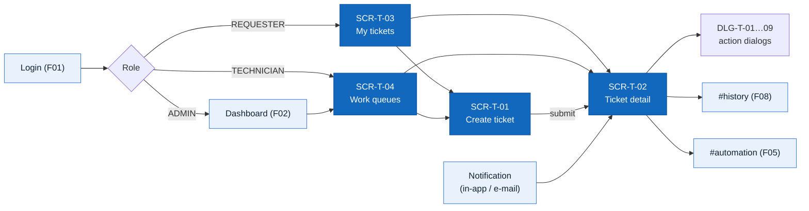
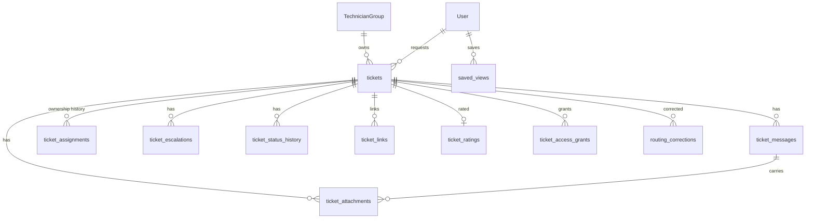

# Information Architecture — F03 Ticket Management

> Design status: TARGET V1 — screen, route, table and operationId names are **proposed** and will be finalized with the OpenAPI contract and ERD.

Screen structure, navigation per role, screen content, available actions, data and API for the "Quản lý ticket" branch. Flows and rules: [02-use-cases.md](02-use-cases.md); stories and acceptance criteria: [01-user-stories.md](01-user-stories.md).

## 1. Sitemap

```text
/tickets/new                      SCR-T-01  Create ticket                    (all roles)
/my-tickets                       SCR-T-03  My tickets                       (all roles; default home of REQUESTER)
  ├─ ?tab=open | action | done | cancelled
/tickets                          SCR-T-04  Ticket list / work queues        (TECHNICIAN, Team Lead, ADMIN)
  ├─ ?view=assigned-to-me                   default for TECHNICIAN
  ├─ ?view=team-unassigned                  default for Team Lead
  ├─ ?view=waiting-requester
  ├─ ?view=due-soon | breached
  ├─ ?view=escalated-to-me                  Team Lead, ADMIN
  ├─ ?view=triage                           Team Lead, ADMIN  (= SCR-WF-10 of F05)
  ├─ ?view=all-open                         default for ADMIN
  └─ ?view=saved:<id>                       personal saved views
/tickets/:code                    SCR-T-02  Ticket detail                    (per scope, BR-TK-01)
  ├─ #conversation                          default tab
  ├─ #attachments
  ├─ #history                               rendered by F08 Activity Log
  ├─ #sla                                   staff only (F05 data)
  ├─ #automation                            staff only, when a workflow run exists (F05)
  └─ #ai                                    staff only: AI summary, routing reason, confidence (F04/F05)
/tickets/new?followUpOf=:code               SCR-T-01  pre-filled follow-up ticket
/403                                        Not allowed (out-of-scope ticket)
```

Dialogs (opened from SCR-T-02 or the list, no own route):

| ID | Dialog | Opened by |
|---|---|---|
| DLG-T-01 | Assign / reassign | Team Lead, Admin |
| DLG-T-02 | Transfer to another team | Assignee, Team Lead, Admin |
| DLG-T-03 | Escalate (higher tier / team lead) | Assignee, Team Lead, Admin |
| DLG-T-04 | Ask requester for information | Assignee |
| DLG-T-05 | Resolve | Assignee, Admin |
| DLG-T-06 | Cancel | Requester (own), staff |
| DLG-T-07 | Not fixed / reopen | Requester (own), Admin on behalf |
| DLG-T-08 | Confirm & rate | Requester (own), Admin on behalf |
| DLG-T-09 | Change category / priority | Assignee, Team Lead, Admin |



## 2. Navigation per role

| Menu item | REQUESTER | TECHNICIAN | Team Lead | ADMIN |
|---|---|---|---|---|
| **+ New ticket** (primary button, always visible) | ✅ | ✅ | ✅ | ✅ |
| My tickets (badge: *needs my action*) | ✅ home | ✅ | ✅ | ✅ |
| Work queues → Assigned to me (badge: count) | ❌ | ✅ home | ✅ | ✅ |
| Work queues → My team — unassigned | ❌ | ✅ | ✅ home | ✅ (all teams) |
| Work queues → Waiting for requester / Due soon / Breached | ❌ | ✅ | ✅ | ✅ |
| Work queues → Escalated to me | ❌ | ❌ | ✅ | ✅ |
| Work queues → Triage | ❌ | ❌ | ✅ | ✅ |
| Work queues → All open tickets | ❌ | ❌ | ❌ | ✅ |
| Saved views | ❌ | ✅ | ✅ | ✅ |

Menus and buttons are hidden when the user lacks permission; **the backend still enforces every permission and scope** (BR-TK-01). Unauthorized URL → `/403`.

## 3. Screen content

### 3.1 SCR-T-01 Create ticket

| Zone | Content |
|---|---|
| Header | "New request"; short hint *"Describe what you need — our assistant will handle simple requests automatically."* |
| Form | Title* (counter 0/200); Description* (multi-line, counter 0/5,000, placeholder with examples: *what happened, since when, error message*); Category hint (dropdown: Account & access, Hardware, Software, Network, Email, Other, **I'm not sure** = default); Urgency (Low / Normal / High); Affected device or system (text); ☐ *This request is for someone else* → user picker (name / e-mail, active users) |
| Evidence | Drop zone *"Drag files here, browse, or paste a screenshot (Ctrl+V)"*; allowed types and limits text; per-file row: thumbnail / icon, name, size, progress, scan status (Scanning… / ✔ Clean / ⛔ Blocked), remove button |
| Suggestions panel (Could) | *"Is it one of these?"* up to 5 similar **own** open tickets (code, title, status, *Add my info here*) and 3 KB articles (title, *Open*) |
| Footer | *Submit* (disabled while uploads/scans are pending or required fields are invalid); *Cancel* (confirm discard if dirty) |
| States | Field errors inline; `429` banner *"You've created many tickets recently, please wait a moment"*; draft restored banner |

### 3.2 SCR-T-02 Ticket detail

| Zone | Requester / beneficiary | Staff (Technician, Team Lead, Admin) |
|---|---|---|
| Header | Code, title, **plain-language status** (BR-TK-18), created date, *"Requested by …"* when beneficiary | Code, title, **internal status**, priority badge, SLA badge + countdown (or *Paused*), flow A/B/C chip, escalation level, reopen count |
| Action bar | Status-dependent (see §4): *Confirm / Not fixed*, *Reopen*, *Cancel request*, *Ask to cancel*, *Create follow-up ticket* | Status-dependent: *Claim*, *Start work*, *Ask requester*, *Resume work*, *Resolve*, *Assign*, *Transfer*, *Escalate*, *Change category / priority*, *Link*, *Cancel* |
| Banner | Contextual call to action: *"Your technician needs more information"*, *"Resolved — is it working now?"* with buttons | AI summary card (collapsible) + routing reason (*"Hardware request"*, *"Entitlement X not in catalog"*); *"Waiting for requester since …"*; *"Automation running — actions locked"* when `AUTOMATING` |
| Tab *Conversation* | Public messages and AI Assistant messages in time order; composer (public only) + attachments | All messages; internal notes highlighted (yellow, 🔒); composer with toggle **Public reply / Internal note**, `@mention`, attachments; *Redact* (Admin) |
| Details panel (right) | Category (display), submitted on, assigned team name (no individual names unless they replied), resolution note when resolved | Requester (name, department, contact), beneficiary, category (+ source AI / human), request type, priority (+ source), team, assignee, support tier, urgency, affected system, created / first response / started / resolved / closed timestamps, SLA policy version, links (duplicate of, related, follow-up of) |
| Tab *Attachments* | All attachments on public messages; preview images; download | + attachments on internal notes; blocked files listed (name only, *Blocked*) |
| Tab *History* (F08) | Allowlisted events only (BR-NK-04) | Full timeline with actor, source (`USER` / `AI` / `AUTOMATION`), before/after, reason |
| Tab *SLA* | — | Response / resolution deadlines, pauses (from–to), warnings, breach flag |
| Tab *Automation* | — (requester sees outcome summary in banner) | Workflow runs, attempts, error codes; *Retry* / *Resolved manually* (F05 UC-WF-09) |
| Tab *AI* | — | AI decision: category, confidence, extracted fields, policy-check results, clarification rounds (F04/F05) |

### 3.3 SCR-T-03 My tickets

| Zone | Content |
|---|---|
| Tabs | *Open* · *Needs my action* (badge) · *Resolved & closed* · *Cancelled* |
| Toolbar | Search (code / keyword), date filter, *+ New ticket* |
| Card / row | Code, title, plain status chip, *Action needed* badge, last activity (*"Technician replied 2 h ago"*), *Requested by …* for beneficiary tickets |
| Empty state | Illustration + *"You have no requests yet"* + *Create ticket* |
| Mobile | Cards stacked, one column, sticky *+ New ticket* button |

### 3.4 SCR-T-04 Ticket list / work queues

| Zone | Content |
|---|---|
| Left nav | Views listed in §2 with live counts; *Saved views* (rename / delete) |
| Toolbar | Search box (code or keyword); filter chips: status, priority, category / request type, team, assignee (incl. *Unassigned*), requester, department, created / updated range, SLA state, flow A/B/C, waiting on, escalated, reopened, has attachments; sort (SLA due ↑ default, priority, created, updated); *Save view*; column picker |
| Table | ☐ select, code, title (+ attachment icon), requester, priority, status, team, assignee, SLA badge + time left, updated; row click → SCR-T-02 |
| Bulk actions | Claim, Assign (Team Lead / Admin) — max 50; result summary per ticket |
| States | Loading skeleton; empty view (*"Nothing here — nice work"*); search-down banner; `400` filter error inline |
| Paging | 25 / 50 / 100 per page; total count (approximate above 10,000) |

### 3.5 Dialog fields

| Dialog | Fields | Validation |
|---|---|---|
| DLG-T-01 Assign / reassign | Team (lead: own teams), technician list with open-ticket count and absence (unavailable disabled), reason (required for reassign) | BR-TK-15, BR-TK-05 |
| DLG-T-02 Transfer | Target team (with categories and tier), reason code (`WRONG_TEAM` / `NEEDS_OTHER_SKILL` / `OTHER`), note ≥ 10 chars | ≠ current team |
| DLG-T-03 Escalate | Type: *Higher support tier* (eligible teams only) or *Team lead*; reason; work done so far ≥ 20 chars | BR-TK-16 |
| DLG-T-04 Ask requester | Question ≥ 10 chars (sent publicly); info: *"SLA will pause until the requester replies"* | — |
| DLG-T-05 Resolve | Resolution code; requester-visible note ≥ 20 chars; internal root cause (optional); original ticket code (when `DUPLICATE`); ☐ *Suggest a KB article* | BR-TK-07 |
| DLG-T-06 Cancel | Requester: optional note. Staff: reason code (`DUPLICATE` / `SPAM_OR_TEST` / `REQUESTER_WITHDREW` / `OUT_OF_SCOPE`) + note ≥ 10 chars (+ original code if `DUPLICATE`) | BR-TK-08 |
| DLG-T-07 Not fixed / reopen | Reason ≥ 10 chars, attachments; info about remaining reopen window | BR-TK-11 |
| DLG-T-08 Confirm & rate | 1–5 stars (optional), comment ≤ 1,000 chars | — |
| DLG-T-09 Category / priority | New category / request type, new priority (technician: *propose*), reason | BR-TK-05, BR-WF-08 |

## 4. Action availability (status × role)

`R` = requester (owner), `A` = individual assignee, `T` = team member (not assignee), `L` = Team Lead of the ticket's team, `AD` = Admin. Anything not listed → hidden in UI and rejected by API.

| Action | `NEW` | `NEEDS_INFO` | `TRIAGE` | `ASSIGNED` | `IN_PROGRESS` | `AUTOMATING` | `RESOLVED` | `CLOSED` | `CANCELLED` |
|---|---|---|---|---|---|---|---|---|---|
| Public reply | R, AD | R, A, L, AD | R, L, AD | R, A, T, L, AD | R, A, T, L, AD | R, A, L, AD | R, A, L, AD | — | — |
| Internal note | AD | A, T, L, AD | L, AD | A, T, L, AD | A, T, L, AD | A, T, L, AD | A, L, AD | — | — |
| Claim | — | — | — | T (no assignee) | — | — | — | — | — |
| Assign / reassign | — | — | L, AD | L, AD | L, AD | — | — | — | — |
| Transfer / escalate | — | — | — | A, L, AD | A, L, AD | — | — | — | — |
| Start work | — | — | — | A | — | — | — | — | — |
| Ask requester | — | — | — | — | A | — | — | — | — |
| Resume work | — | A (`waiting_on = TECHNICIAN`) | — | — | — | — | — | — | — |
| Change category / priority | — | — | L, AD | A, L, AD | A, L, AD | — | — | — | — |
| Resolve | — | — | — | — | A, AD | — (F05) | — | — | — |
| Confirm & rate | — | — | — | — | — | — | R, AD* | rate only, R (window) | — |
| Not fixed / reopen | — | — | — | — | — | — | R, AD* | R, AD* (≤ 7 days) | — |
| Cancel | R, AD | R, A, L, AD | R, L, AD | R, A, L, AD | A, L, AD (R: *Ask to cancel*) | — | — | — | — |
| Create follow-up | — | — | — | — | — | — | — | R (> 7 days) | — |

`*` on behalf of the requester, reason required.

## 5. Notifications

All notifications are in-app; those marked ✉ are also sent by e-mail. Each links to SCR-T-02.

| Event | Requester / beneficiary | Assignee | Team (no assignee) | Team Lead |
|---|---|---|---|---|
| Ticket created | ✉ *"We received TK-…"* | — | — | — |
| Assigned / claimed / reassigned | — | ✉ (with AI summary + routing reason) | ✉ when team-only | — |
| Transferred / escalated (tier) | — | old: in-app; new: ✉ | target team ✉ | target lead |
| Escalated to lead | — | — | — | ✉ |
| Public reply by staff | ✉ | — | — | — |
| Public reply by requester | — | ✉ | in-app | — |
| @mention in internal note | — | — | mentioned user in-app | — |
| Info requested (`NEEDS_INFO`) | ✉ + reminders (F05) | — | — | — |
| Resolved | ✉ with *Confirm / Not fixed* | — | — | — |
| Reopened / not fixed | — | ✉ | in-app | 3rd reopen ✉ |
| Cancelled | ✉ (when by staff) | in-app (when by requester) | — | — |
| Assignee unavailable (BR-TK-20) | — | — | — | ✉ |

## 6. Main data

Fields marked *(F05)* already exist in the Workflow design; F03 adds the rest.

| Entity / table | Main fields |
|---|---|
| `tickets` | id, code (unique), title, description, requester_id, beneficiary_id, requester_department_id, category, category_source (`AI` / `USER` / `TECHNICIAN`), request_type, urgency, affected_system, priority (P1–P4), priority_source, status *(F05)*, waiting_on (`AI` / `TECHNICIAN`, null), team_id, assignee_id, escalation_level, is_escalated_to_lead, sla_policy_version *(F05)*, sla_breached *(F05)*, first_responded_at, started_at, resolved_at, resolved_by, resolution_code, resolution_note, closed_at, close_reason (`CONFIRMED` / `AUTO_CONFIRMED` / `NO_RESPONSE`), cancelled_at, cancel_reason, cancel_note, reopen_count, source_channel (`WEB`), version, created_at, updated_at |
| `ticket_messages` *(F05 name)* | id, ticket_id, author_type (`USER` / `AI` / `SYSTEM`), author_id, visibility (`PUBLIC` / `INTERNAL`), kind (`REPLY` / `NOTE` / `AI_QUESTION` / `AI_ANSWER` / `INFO_REQUEST` / `SYSTEM_EVENT`), body, redacted_at, redacted_by, redaction_reason, created_at |
| `ticket_attachments` | id, ticket_id, message_id, uploaded_by, file_name, content_type, size_bytes, storage_key, sha256, scan_status (`PENDING` / `CLEAN` / `INFECTED` / `ERROR`), created_at |
| `ticket_assignments` *(F05 name)* | id, ticket_id, team_id, assignee_id, assigned_by, source (`USER` / `AUTOMATION`), rule_id, kind (`ASSIGN` / `CLAIM` / `REASSIGN` / `TRANSFER` / `ESCALATE` / `UNASSIGN`), reason_code, reason, started_at, ended_at |
| `ticket_escalations` | id, ticket_id, type (`TIER` / `LEAD`), from_team_id, to_team_id, from_level, to_level, reason, source (`USER` / `AUTOMATION`), created_by, created_at |
| `ticket_status_history` | id, ticket_id, from_status, to_status, waiting_on, actor_id, source, reason, created_at (feeds F07 time metrics) |
| `ticket_links` | id, ticket_id, linked_ticket_id, type (`DUPLICATE_OF` / `RELATED_TO` / `FOLLOW_UP_OF`), created_by, created_at |
| `ticket_ratings` | ticket_id (PK), rating (1–5), comment, rated_by, created_at |
| `ticket_access_grants` | id, ticket_id, user_id, reason (`MENTION`), granted_by, created_at, expires_at |
| `routing_corrections` | id, ticket_id, field (`CATEGORY` / `TEAM` / `PRIORITY`), ai_value, human_value, actor_id, created_at (input for F04 learning, F07 reports) |
| `saved_views` | id, user_id, name, filters (JSON), sort, created_at |
| `TechnicianGroup` *(F09)* | + `support_tier` (`L1` / `L2` / `L3`) — proposed |



Indexes for 8,000 tickets/day (~3 M/year): `(status, team_id, assignee_id)`, `(requester_id, updated_at)`, `(beneficiary_id)`, `code` unique, `(created_at)`; full-text index on title, description and public message bodies (internal notes in a separate staff-only index).

## 7. Main API

Prefix `/api/v1`, `Authorization: Bearer <token>`. Mutations take `If-Match: <version>` (BR-TK-21). Errors use `ProblemDetails` with a `code` (`INVALID_TRANSITION`, `STALE_VERSION`, `ALREADY_ASSIGNED`, `ASSIGNEE_UNAVAILABLE`, `REOPEN_WINDOW_EXPIRED`, …).

| Method | Path | operationId | Permission |
|---|---|---|---|
| POST | `/tickets` (+ `Idempotency-Key`) | `createTicket` | `ticket:create` |
| GET | `/tickets?view=&q=&status=&…&sort=&page=&size=` | `listTickets` | `ticket:read` (scoped) |
| GET | `/tickets/views/counts` | `getTicketViewCounts` | `ticket:read` |
| GET | `/tickets/{code}` | `getTicket` | `ticket:read` |
| POST | `/attachments` (multipart, temporary) | `uploadAttachment` | `ticket:create` / `ticket:comment` |
| GET | `/tickets/{code}/attachments/{id}/url` | `getAttachmentDownloadUrl` | `ticket:read` |
| GET | `/tickets/{code}/messages` | `listTicketMessages` | `ticket:read` (visibility filtered) |
| POST | `/tickets/{code}/messages` | `addTicketMessage` | `ticket:comment` / `ticket:note` |
| POST | `/tickets/{code}/messages/{id}/redact` | `redactTicketMessage` | `ticket:redact` |
| GET | `/tickets/{code}/assignable-members?teamId=` | `listAssignableMembers` | `ticket:assign` |
| POST | `/tickets/{code}/assign` | `assignTicket` | `ticket:assign` |
| POST | `/tickets/{code}/reassign` | `reassignTicket` *(F05 name)* | `ticket:reassign` |
| POST | `/tickets/{code}/claim` | `claimTicket` | `ticket:claim` |
| POST | `/tickets/{code}/transfer` | `transferTicket` | `ticket:transfer` |
| POST | `/tickets/{code}/escalate` | `escalateTicket` | `ticket:escalate` |
| POST | `/tickets/{code}/start` | `startTicketWork` | `ticket:update_status` |
| POST | `/tickets/{code}/request-info` | `requestTicketInfo` | `ticket:update_status` |
| POST | `/tickets/{code}/resume` | `resumeTicketWork` | `ticket:update_status` |
| PATCH | `/tickets/{code}/classification` | `updateTicketClassification` | `ticket:classify` |
| POST | `/tickets/{code}/links` | `linkTickets` | `ticket:link` |
| POST | `/tickets/{code}/resolve` | `resolveTicket` | `ticket:update_status` |
| POST | `/tickets/{code}/confirm` | `confirmTicketResolution` *(F05 name)* | `ticket:confirm` |
| POST | `/tickets/{code}/reopen` | `reopenTicket` *(F05 name)* | `ticket:reopen` |
| POST | `/tickets/{code}/cancel` | `cancelTicket` | `ticket:cancel` |
| GET / POST | `/me/saved-views` | `listSavedViews` / `createSavedView` | staff |
| PATCH / DELETE | `/me/saved-views/{id}` | `updateSavedView` / `deleteSavedView` | owner |
| GET | `/tickets/{code}/history` | `listTicketHistory` *(F08)* | `ticket_history:read` |
| POST | `/tickets/{code}/clarification-answers` | `answerClarification` *(F05)* | owner |
| GET | `/tickets/similar?text=` | `suggestSimilarTickets` *(F04)* | `ticket:create` (own scope only) |

Events published for other features: `TicketCreated`, `TicketMessageAdded`, `TicketAssigned`, `TicketTransferred`, `TicketEscalated`, `TicketStatusChanged`, `TicketResolved`, `TicketClosed`, `TicketReopened`, `TicketCancelled`, `TicketRated`, `TicketReclassified`.

## 8. Wireframes (low fidelity)

**SCR-T-01 Create ticket**

```text
┌───────────────────────────────────────────────────────────────┐
│ New request                                                    │
│ Describe what you need — simple requests are handled instantly │
├───────────────────────────────────────────────────────────────┤
│ Title *  [ Cannot access shared Accounting folder        ] 42/200│
│ Description *                                                  │
│ [ Since this morning I get "Access denied" when opening      ] │
│ [ \\fs01\accounting ...                                       ] │
│ Category [ I'm not sure ▾ ]   Urgency ( ) Low (•) Normal ( ) High│
│ Affected system [ File server ]                                │
│ ☐ This request is for someone else                             │
│ ┌ Evidence ───────────────────────────────────────────────┐   │
│ │  Drag files here, browse, or paste a screenshot (Ctrl+V) │   │
│ │  🖼 error.png   180 KB  ✔ Clean                      ✕   │   │
│ └──────────────────────────────────────────────────────────┘   │
│ Is it one of these?  TK-2026-004211 Folder access (Open) [Add] │
│                                          [Cancel]  [ Submit ]  │
└───────────────────────────────────────────────────────────────┘
```

**SCR-T-04 Work queues (technician)**

```text
┌──────────────────┬────────────────────────────────────────────────────────────┐
│ QUEUES           │ [🔍 code or keyword ] [Status▾][Priority▾][Team▾][SLA▾] [Save view]│
│ Assigned to me 12│ ☐ Code            Title               Prio Status      SLA       │
│ Team unassigned 5│ ☐ TK-2026-004890  PC won't boot        P2  ASSIGNED    ⚠ 35m     │
│ Waiting reqster 3│ ☐ TK-2026-004871  VPN drops hourly     P3  IN_PROGRESS ✔ 5h      │
│ Due soon        2│ ☐ TK-2026-004702  New mouse            P4  NEEDS_INFO  ⏸ paused  │
│ Breached        1│ ☐ TK-2026-004655  Printer 3F jam       P3  IN_PROGRESS ⛔ -20m    │
│ SAVED VIEWS      │                                         ‹ 1 2 3 ›  25 / page    │
│ My P1–P2         │ [Claim] [Assign]  (bulk)                                       │
└──────────────────┴────────────────────────────────────────────────────────────┘
```

**SCR-T-02 Ticket detail (staff)**

```text
┌─────────────────────────────────────────────────────────────────────────────┐
│ TK-2026-004871  VPN drops every hour   IN_PROGRESS  P3  SLA ✔ 5h left  Flow C │
│ [Ask requester] [Resolve] [Transfer] [Escalate] [Category/Priority] [⋯]      │
├───────────────────────────────────────────────────┬─────────────────────────┤
│ ▸ AI summary: VPN client disconnects ~60 min;      │ Requester  Lan N. (Sales)│
│   routed to human: "Network incident"              │ Team       Network L1    │
│ [Conversation] Attachments History SLA AI          │ Assignee   Minh T.       │
│ ─────────────────────────────────────────────────  │ Category   Network (AI)  │
│ Lan N. · 09:12   VPN keeps dropping…  📎 log.txt   │ Priority   P3 (AI)       │
│ 🔒 Minh T. · 09:40  Checked gateway logs…          │ Created    09:10         │
│ Minh T. · 09:45  Could you send your client ver.? │ 1st resp.  09:45         │
│ ┌───────────────────────────────────────────────┐  │ Links      —             │
│ │ (•) Public reply  ( ) Internal note  📎        │  │                         │
│ │ [                                         ]    │  │                         │
│ │                                     [Send]     │  │                         │
│ └───────────────────────────────────────────────┘  │                         │
└───────────────────────────────────────────────────┴─────────────────────────┘
```

**SCR-T-02 Ticket detail (requester, `RESOLVED`)**

```text
┌───────────────────────────────────────────────────────────┐
│ TK-2026-004871  VPN drops every hour   Resolved — please confirm │
├───────────────────────────────────────────────────────────┤
│ ✅ Your technician resolved this request:                   │
│ "Updated your VPN client to 5.2; the timeout is fixed."    │
│ Is it working now?  [ Yes, it's solved ] [ No, still a problem ]│
├───────────────────────────────────────────────────────────┤
│ Conversation · Attachments · History                        │
│ You · 09:12        VPN keeps dropping…  📎 log.txt          │
│ Technician · 09:45 Could you send your client version?     │
│ You · 10:02        It's 4.8                                 │
│ Technician · 11:30 Updated your VPN client to 5.2 …        │
└───────────────────────────────────────────────────────────┘
```
