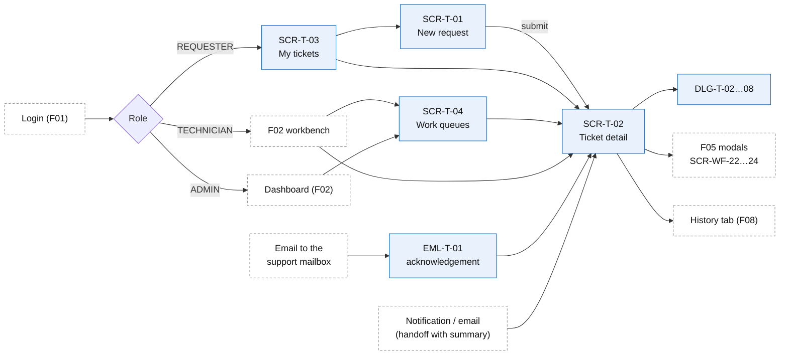

# Screens, Routes, and Navigation — F03 Ticket Management

> Design status: TARGET V1
>
> Related: [IA overview](README.md) · [Screen content](02-screen-content.md) · [User flows](03-user-flows.md) · [UI states](04-ui-states-and-accessibility.md)

## 1. Sitemap and routes

```text
/tickets/new                      SCR-T-01  New request (free text)          (all roles)
/tickets/new?followUpOf=:code     SCR-T-01  pre-filled follow-up ticket      (requester, UC-TK-07 A5)
/my-tickets                       SCR-T-03  My tickets                       (all roles; default home of REQUESTER)
  ├─ ?tab=open | action | done | cancelled
/tickets                          SCR-T-04  Work queues                      (TECHNICIAN, ADMIN)
  ├─ ?view=assigned-to-me                   default for TECHNICIAN
  ├─ ?view=subgroup-queue                   waiting in the sub-group queue (claim on F02)
  ├─ ?view=on-hold                          NEEDS_INFO, waiting for the requester
  ├─ ?view=due-soon | breached
  ├─ ?view=escalated-to-me                  ADMIN
  ├─ ?view=all-open                         default for ADMIN
  └─ ?view=saved:<id>                       personal saved views
/tickets/:code                    SCR-T-02  Ticket detail                    (per scope, BR-TK-01)
  ├─ ?tab=conversation                      default tab
  ├─ ?tab=attachments
  ├─ ?tab=email                             staff only, EMAIL tickets: original email
  ├─ ?tab=history                           rendered by F08 Activity Log
  ├─ ?tab=automation                        staff only, when a run exists (F04 SEC-AI-16)
  ├─ ?tab=ai                                staff only: AI decision, agent results (F05 / F04)
  └─ ?action=confirm | not-fixed | reopen   opens the dialog from an email link (nothing changes until the user clicks)
/403                              SCR-90    Access denied (out-of-scope ticket or page)
```

Routes are logical paths; the router mode is chosen in the architecture documents. `:code` is the ticket code `TK-YYYY-NNNNNN` (BR-TK-02). Filters, sort and page are query parameters (D-TK-IA-05).

## 2. Inventory

### Pages

| ID | Screen | Roles | Opened from | Main content | Stories |
|---|---|---|---|---|---|
| SCR-T-01 | New request | All roles | *+ New request* (top bar), SCR-T-03, SCR-T-02 *Create follow-up* | Description in free text, optional subject, *for someone else*, evidence upload with scan status. **No category, urgency or category form.** F04 SEC-AI-01 KB suggestions | US-TK-02, 03, 04 |
| SCR-T-02 | Ticket detail | Per scope (BR-TK-01) | SCR-T-03, SCR-T-04, F02 workbench, SCR-91, email link | Header, action bar, banner, SEC-T-01 summary (staff), conversation, details panel with fields *"Filled by AI"*, related tickets; tabs *Attachments*, *Email*, *History*, *Automation*, *AI* | US-TK-09 … 12, 15 … 21 |
| SCR-T-03 | My tickets | All roles | Sidebar (requester home) | Tabs *Open*, *Needs my action*, *Resolved & closed*, *Cancelled*; cards with plain status and last activity | US-TK-05 |
| SCR-T-04 | Work queues | Technician, Admin | Sidebar | Views with counts, search, filter chips, sortable table, saved views | US-TK-06, 07, 08 |

### Sections

| ID | Section | Host | Roles | Content | Stories |
|---|---|---|---|---|---|
| SEC-T-01 | Ticket summary | SCR-T-02 top (staff); handoff and approval notifications | Technician, Admin in scope | Seven sections (+ *Requested action*, *Why approval is needed* for an approval); fact → message links; version, *"Updated after a new message"*, *Regenerate*, helpful / not helpful; *"Summary unavailable"* | US-TK-10, 11, 12 |
| SEC-T-02 | On-hold banner | SCR-T-02 top | Requester; staff | Requester: the question, *"Waiting for your reply"*, reply box focused. Staff: *"On hold — waiting for the requester since …"*, who asked (AI / technician), *Resume work* | US-TK-15, 16 |
| SEC-T-03 | Related tickets | SCR-T-02 details panel | All (scope-filtered) | `DUPLICATE_OF`, `RELATED_TO`, `FOLLOW_UP_OF`; *Link*; F05 *Unlink* (SCR-WF-23) | US-TK-21 |

### Dialogs

Dialogs follow the permission of the page that opens them plus the [action matrix](02-screen-content.md#4-action-availability-status--role). DLG-T-01 (assign) and DLG-T-09 (category / priority) are **retired** (moved to F05); their numbers are not reused.

| ID | Dialog | Opened by | Opened from | Stories |
|---|---|---|---|---|
| DLG-T-02 | Transfer within the group | Assignee, Admin | SCR-T-02 | US-TK-13 |
| DLG-T-03 | Escalate (higher tier in the group / Admin) | Assignee, Admin | SCR-T-02 | US-TK-14 |
| DLG-T-04 | Ask requester (put on hold) | Assignee | SCR-T-02 | US-TK-16 |
| DLG-T-05 | Resolve (with F04 SEC-AI-13 drafts) | Assignee, Admin | SCR-T-02 | US-TK-20 |
| DLG-T-06 | Cancel | Requester (own), staff | SCR-T-02 | US-TK-24 |
| DLG-T-07 | Not fixed / reopen | Requester (own), Admin on behalf | SCR-T-02, EML-T-03 *Not fixed* link | US-TK-23 |
| DLG-T-08 | Confirm & rate | Requester (own), Admin on behalf | SCR-T-02, EML-T-03 *Confirm* link | US-TK-22 |

*Start work* and *Resume work* are buttons without a dialog (*Resume work* asks for a reason inline, BR-TK-05).

### Emails

All F03 emails have `[TK-YYYY-NNNNNN]` in the subject and a *View ticket* link; a reply to any of them is threaded into the ticket (BR-TK-23). Email content: [screen content §3](02-screen-content.md#3-emails).

| ID | Email | To | When | Stories |
|---|---|---|---|---|
| EML-T-01 | Acknowledgement | Requester (+ beneficiary) | Ticket raised (email or portal) | US-TK-01, 02 |
| EML-T-02 | Information needed | Requester (+ beneficiary) | Ticket put on hold (F05 question or DLG-T-04); reminders (F05) | US-TK-15, 16 |
| EML-T-03 | Resolved — please confirm | Requester | `RESOLVED` (by a technician or the AI) | US-TK-20, 22 |
| EML-T-04 | Ticket update | Requester / owner | Public reply, cancel, reopen, transfer (owner) | US-TK-17, 13, 23, 24 |

## 3. Routes and permissions

The API enforces every row (BR-TK-01, NFR-TK-SEC-001); hiding an element is only for usability. A dash `—` means the role cannot open it: a direct URL gives `/403`.

| Screen | Requester | Technician | Admin |
|---|---|---|---|
| SCR-T-01 New request | ✓ | ✓ | ✓ |
| SCR-T-02 Ticket detail | Own + beneficiary tickets | Assigned + own sub-groups' tickets (+ temporary read via @mention) | All |
| SCR-T-03 My tickets | Own + beneficiary | Own | Own |
| SCR-T-04 Work queues | — | Assigned + own sub-groups | All |
| SCR-T-04 `?view=escalated-to-me`, `?view=all-open` | — | — | ✓ |
| SEC-T-01 Summary, tabs *Email*, *Automation*, *AI* | — (absent from the response) | ✓ | ✓ |

### Behaviour when access is missing

| Situation | Result |
|---|---|
| Not signed in / session expired (also from an email link) | Go to SCR-01 (F01); after signing in, return to the requested ticket and action. |
| Ticket outside the user's scope | `/403`; never reveals the title or whether the ticket exists. |
| Ticket code does not exist | `404` page with a link to the role home. |
| Action the server refuses (`403`) | Stay on the page; *"You do not have permission to perform this action"*. |
| Action not allowed in the current status (`409 INVALID_TRANSITION`) | Reload the ticket and show its current status. |

## 4. Navigation

### Sidebar per role

| Menu item | REQUESTER | TECHNICIAN | ADMIN |
|---|---|---|---|
| **+ New request** (primary button, always visible) | ✅ | ✅ | ✅ |
| My tickets (badge: *needs my action*) | ✅ home | ✅ | ✅ |
| Work queues → Assigned to me (badge) | ❌ | ✅ | ✅ |
| Work queues → Sub-group queue | ❌ | ✅ | ✅ (all) |
| Work queues → On hold / Due soon / Breached | ❌ | ✅ | ✅ |
| Work queues → Escalated to me | ❌ | ❌ | ✅ |
| Work queues → All open tickets | ❌ | ❌ | ✅ |
| Saved views | ❌ | ✅ | ✅ |

Badges are server-computed counts (`getTicketViewCounts`). The Admin and Technician homes are the F02 dashboards.

### Contextual navigation



- **List → detail:** filters, sort and scroll are kept in the URL; *Back to list* restores them.
- **Breadcrumbs:** `My tickets / TK-2026-004871`, `Work queues › Assigned to me / TK-2026-004871`, `Notifications / TK-2026-004871`.
- **Related tickets:** links open the other ticket if it is in scope; otherwise only its code and status are shown.
- **After submit (SCR-T-01):** SCR-T-02 of the new ticket with *"Submitted — the assistant is reviewing your request"*.
- **After a dialog:** stay on SCR-T-02, refresh header, action bar and conversation. After a transfer away from oneself: *"Ticket moved to {sub-group}"* with *Back to queue*.
- **Wrong group:** DLG-T-02 links to F05 SCR-WF-24 *Return for re-routing*.
- **Conflict (`409 STALE_VERSION`):** keep the entered data, show *Reload* (BR-TK-21).

## 5. Notifications

All notifications are in-app (SCR-91); those marked ✉ are also sent by email. Each links to SCR-T-02.

| Event | Requester / beneficiary | Owner (technician) | Sub-group (no individual) | Admin |
|---|---|---|---|---|
| Ticket raised | ✉ EML-T-01 | — | — | — |
| Handed to a technician (F05 assignment, re-route, agent escalation, reopen) | — | ✉ **with summary** | ✉ when queue-only | — |
| Transferred / escalated to a higher tier | — | old: in-app; new: ✉ with summary | target sub-group ✉ | — |
| Escalated to Admin | — | — | — | ✉ with summary |
| Waiting for an approval decision | — | — | — | approver ✉ with summary (Q-TK-10) |
| On hold — information needed | ✉ EML-T-02 + reminders (F05) | — | — | — |
| Requester added information / replied | — | ✉ | in-app | — |
| Public reply by staff | ✉ EML-T-04 | — | — | — |
| @mention in an internal note | — | — | mentioned user in-app | — |
| Resolved | ✉ EML-T-03 with *Confirm / Not fixed* | — | — | — |
| Reopened / not fixed | — | ✉ with summary | in-app | 3rd reopen ✉ |
| Cancelled | ✉ (when by staff) | in-app (when by requester) | — | — |

Email links open the ticket with the action pre-selected; nothing changes until the user clicks in the dialog. Internal notes and the summary never reach the requester (BR-TK-10).

## 6. Story-to-screen mapping

Every Must story is reachable by its role.

| Story | MoSCoW | Role | Screens / dialogs / emails |
|---|---|---|---|
| US-TK-01 | Must | Requester | Support mailbox, EML-T-01 |
| US-TK-02 | Must | Requester | SCR-T-01 |
| US-TK-03 | Must | Requester | SCR-T-01 evidence zone, email attachments, SCR-T-02 *Attachments* |
| US-TK-04 | Should | Requester | SCR-T-01 *for someone else* |
| US-TK-05 | Must | Requester | SCR-T-03 |
| US-TK-06 | Must | Technician, Admin | SCR-T-04 views |
| US-TK-07 | Must | Staff | SCR-T-04 search and filters |
| US-TK-08 | Could | Staff | SCR-T-04 *Save view* |
| US-TK-09 | Must | All | SCR-T-02 |
| US-TK-10 | Must | Technician | SEC-T-01, handoff notification |
| US-TK-11 | Should | Technician | SEC-T-01 versions, *Regenerate* |
| US-TK-12 | Should | Admin (approver) | SEC-T-01 approval variant |
| US-TK-13 | Must | Technician, Admin | DLG-T-02 |
| US-TK-14 | Must | Technician, Admin | DLG-T-03 |
| US-TK-15 | Must | Requester | SEC-T-02, SCR-T-02 reply, EML-T-02 reply |
| US-TK-16 | Must | Technician | DLG-T-04, SEC-T-02 *Resume work* |
| US-TK-17 | Must | Requester, Technician | SCR-T-02 conversation, EML-T-04 |
| US-TK-18 | Must | Technician | SCR-T-02 composer *Internal note* |
| US-TK-19 | Must | Technician | SCR-T-02 *Start work* |
| US-TK-20 | Must | Technician | DLG-T-05, EML-T-03 |
| US-TK-21 | Should | Technician | SEC-T-03 |
| US-TK-22 | Must | Requester | SCR-T-02 banner, DLG-T-08, EML-T-03 |
| US-TK-23 | Must | Requester | DLG-T-07, SCR-T-01 follow-up |
| US-TK-24 | Must | Requester, staff | DLG-T-06 |

## 7. Differences with F04 / F05 and requests to other branches

| Topic | F04 / F05 today | F03 proposal |
|---|---|---|
| Ticket list | F05 IA has one list `SCR-T-03` for all roles | Two lists: SCR-T-03 *My tickets* (`/my-tickets`) and SCR-T-04 *Work queues* (`/tickets`) (D-TK-IA-02); F04 SEC-AI-14 goes on SCR-T-04 |
| Detail route | `/tickets/:id` | `/tickets/:code` (human code, BR-TK-02); F04 `?action=` parameters are kept |
| Triage | SCR-WF-10 removed (F05 D-IA-07) | No triage view in F03 either |
| Technician home | F05: SCR-T-03 *Assigned to me*; F02: workbench | F02 workbench, with SCR-T-04 *Assigned to me* as the full list |
| Summary | F04 retired SEC-AI-06 | F03 SEC-T-01 at the same place (top of SCR-T-02) |

| Owner | Request |
|---|---|
| F04 | Render SEC-AI sections in the zones listed in [screen content](02-screen-content.md); call `resolveTicket` with author `AI` and the AI resolution codes; expose the summary generation to F03 |
| F05 | Field corrections, priority change, routing history and modals SCR-WF-22 … 24 on SCR-T-02; confirm the list split; create approval requests (Q-TK-10) |
| F08 | *History* tab with the requester allowlist; approval requests and outcomes |
| F09 | `support_tier` per sub-group; groups and sub-groups for DLG-T-02 / DLG-T-03 |
| F02 | Workbench claim uses the F03 ticket API and opens SCR-T-02 |
