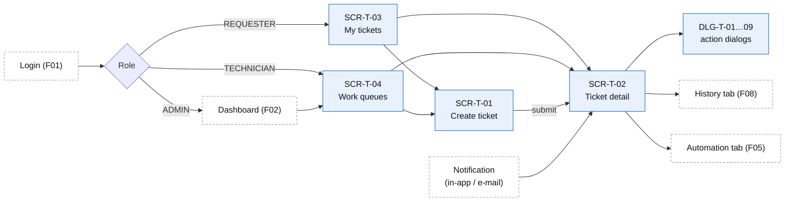

# Screens, Routes, and Navigation — F03 Ticket Management

> Design status: TARGET V1
>
> Related: [IA overview](README.md) · [Screen content](02-screen-content.md) · [User flows](03-user-flows.md) · [UI states](04-ui-states-and-accessibility.md)

## 1. Sitemap and routes

```text
/tickets/new                      SCR-T-01  Create ticket                    (all roles)
/tickets/new?followUpOf=:code     SCR-T-01  pre-filled follow-up ticket      (requester, UC-TK-06 A5)
/my-tickets                       SCR-T-03  My tickets                       (all roles; default home of REQUESTER)
  ├─ ?tab=open | action | done | cancelled
/tickets                          SCR-T-04  Ticket list / work queues        (TECHNICIAN, ADMIN)
  ├─ ?view=assigned-to-me                   default for TECHNICIAN
  ├─ ?view=team-unassigned
  ├─ ?view=waiting-requester
  ├─ ?view=due-soon | breached
  ├─ ?view=escalated-to-me                  ADMIN
  ├─ ?view=triage                           ADMIN  (= SCR-WF-10 of F05)
  ├─ ?view=all-open                         default for ADMIN
  └─ ?view=saved:<id>                       personal saved views
/tickets/:code                    SCR-T-02  Ticket detail                    (per scope, BR-TK-01)
  ├─ ?tab=conversation                      default tab
  ├─ ?tab=attachments
  ├─ ?tab=history                           rendered by F08 Activity Log
  ├─ ?tab=sla                               staff only (F05 data)
  ├─ ?tab=automation                        staff only, when a workflow run exists (F05)
  └─ ?tab=ai                                staff only: AI summary, routing reason, confidence (F04 / F05)
/403                              SCR-90    Access denied (out-of-scope ticket or page)
```

Routes are logical paths; the router mode is chosen in the architecture documents (F05 DF-IA-01). `:code` is the ticket code `TK-YYYY-NNNNNN` (BR-TK-02). Filters, sort and page are query parameters (D-TK-IA-05).

## 2. Screen and dialog inventory

### Pages

| ID | Screen | Roles | Opened from | Main content | Stories |
|---|---|---|---|---|---|
| SCR-T-01 | Create ticket | All roles | *+ New ticket* (top bar), SCR-T-03, SCR-T-02 *Create follow-up* | Title, description, category hint, urgency, affected system, on behalf of; evidence upload with scan status; similar tickets and KB suggestions | US-TK-01, 02, 03, 04 |
| SCR-T-02 | Ticket detail | Per scope (BR-TK-01) | SCR-T-03, SCR-T-04, SCR-WF-10, SCR-91, e-mail link | Header, action bar, banner, conversation, details panel, tabs *Attachments*, *History*, *SLA*, *Automation*, *AI* | US-TK-09, 14, 15, 17 |
| SCR-T-03 | My tickets | All roles | Sidebar (requester home) | Tabs *Open*, *Needs my action*, *Resolved & closed*, *Cancelled*; cards with plain status and last activity | US-TK-05 |
| SCR-T-04 | Work queues | Technician, Admin | Sidebar (staff home) | Views with counts, search, filter chips, sortable table, saved views, bulk claim / assign | US-TK-06, 07, 08, 11 |

### Dialogs

Dialogs follow the permission of the page that opens them plus the conditions of the [action matrix](02-screen-content.md#3-action-availability-status--role). Fields are in [screen content §2](02-screen-content.md#2-dialog-fields).

| ID | Dialog | Opened by | Opened from | Stories |
|---|---|---|---|---|
| DLG-T-01 | Assign / reassign | Admin | SCR-T-02, SCR-T-04 (bulk), SCR-WF-10 | US-TK-10 |
| DLG-T-02 | Transfer to another team | Assignee, Admin | SCR-T-02 | US-TK-12 |
| DLG-T-03 | Escalate (higher tier / Admin) | Assignee, Admin | SCR-T-02 | US-TK-13 |
| DLG-T-04 | Ask requester for information | Assignee | SCR-T-02 | US-TK-16 |
| DLG-T-05 | Resolve | Assignee, Admin | SCR-T-02 | US-TK-18 |
| DLG-T-06 | Cancel | Requester (own), staff | SCR-T-02 | US-TK-22 |
| DLG-T-07 | Not fixed / reopen | Requester (own), Admin on behalf | SCR-T-02, e-mail *Not fixed* link | US-TK-21 |
| DLG-T-08 | Confirm & rate | Requester (own), Admin on behalf | SCR-T-02, e-mail *Confirm* link | US-TK-20 |
| DLG-T-09 | Change category / priority | Assignee, Admin | SCR-T-02 | US-TK-19 |

Claim, *Start work* and *Resume work* need no input beyond what is on the page, so they are buttons without a dialog (*Resume work* asks for a reason inline, BR-TK-05).

## 3. Routes and permissions

The API enforces every row (BR-TK-01, NFR-TK-SEC-001); hiding an element is only for usability. A dash `—` means the role cannot open the page: the sidebar does not show it and a direct URL gives `/403`.

| Screen | Requester | Technician | Admin |
|---|---|---|---|
| SCR-T-01 Create ticket | ✓ | ✓ | ✓ |
| SCR-T-02 Ticket detail | Own + beneficiary tickets | Assigned + own teams' tickets (+ temporary read via @mention) | All |
| SCR-T-03 My tickets | Own + beneficiary | Own | Own |
| SCR-T-04 Work queues | — | Assigned + own teams | All |
| SCR-T-04 `?view=escalated-to-me`, `?view=triage`, `?view=all-open` | — | — | ✓ |
| Tabs *SLA*, *Automation*, *AI* on SCR-T-02 | — (fields absent from the response) | ✓ | ✓ |

### Behaviour when access is missing

| Situation | Result |
|---|---|
| Not signed in / session expired | Go to SCR-01 (F01); after signing in, return to the requested ticket. |
| Ticket outside the user's scope, opened by URL or e-mail link | `/403`; never reveals the title or whether the ticket exists (UC-TK-02 E1, Q-TK-05). |
| Ticket code does not exist | `404` page with a link to the role home. |
| Action the server refuses (`403`) | Stay on the page; *"You do not have permission to perform this action"*. |
| Action not allowed in the current status (`409 INVALID_TRANSITION`) | Stay on the page; reload the ticket and show its current status. |

## 4. Navigation

### Sidebar per role

| Menu item | REQUESTER | TECHNICIAN | ADMIN |
|---|---|---|---|
| **+ New ticket** (primary button, always visible) | ✅ | ✅ | ✅ |
| My tickets (badge: *needs my action*) | ✅ home | ✅ | ✅ |
| Work queues → Assigned to me (badge: count) | ❌ | ✅ home | ✅ |
| Work queues → My team — unassigned | ❌ | ✅ | ✅ (all teams) |
| Work queues → Waiting for requester / Due soon / Breached | ❌ | ✅ | ✅ |
| Work queues → Escalated to me | ❌ | ❌ | ✅ |
| Work queues → Triage | ❌ | ❌ | ✅ |
| Work queues → All open tickets | ❌ | ❌ | ✅ |
| Saved views | ❌ | ✅ | ✅ |

Menus and buttons are hidden when the user lacks permission; **the backend still enforces every permission and scope** (BR-TK-01). Badges are server-computed counts (`getTicketViewCounts`), always shown as digits. The Admin home is the F02 Dashboard.

### Contextual navigation



- **List → detail:** opening a ticket keeps the list's filters, sort and scroll in the URL; *Back to list* restores them.
- **Breadcrumbs:** `My tickets / TK-2026-004871`, `Work queues › Assigned to me / TK-2026-004871`, `Triage queue / TK-2026-004871`, `Notifications / TK-2026-004871`.
- **Related tickets:** links (`DUPLICATE_OF`, `RELATED_TO`, `FOLLOW_UP_OF`) open the other ticket's SCR-T-02 if it is in scope; otherwise only its code and status are shown.
- **After submit (SCR-T-01):** go to SCR-T-02 of the new ticket with *"Submitted — the assistant is reviewing your request"*.
- **After a dialog:** stay on SCR-T-02, close the dialog, refresh header, action bar and conversation. After transfer or reassign away from oneself, show *"Ticket moved to <team>"* with *Back to queue*.
- **After a bulk action (SCR-T-04):** stay on the list; show a per-ticket result summary.
- **Conflict (`409 STALE_VERSION`):** keep the entered data, show *Reload* (BR-TK-21).

## 5. Notifications

All notifications are in-app (SCR-91); those marked ✉ are also sent by e-mail. Each links to SCR-T-02.

| Event | Requester / beneficiary | Assignee | Team (no assignee) | Admin |
|---|---|---|---|---|
| Ticket created | ✉ *"We received TK-…"* | — | — | — |
| Assigned / claimed / reassigned | — | ✉ (with AI summary + routing reason) | ✉ when team-only | — |
| Transferred / escalated (tier) | — | old: in-app; new: ✉ | target team ✉ | in-app when no member is picked |
| Escalated to Admin | — | — | — | ✉ |
| Public reply by staff | ✉ | — | — | — |
| Public reply by requester | — | ✉ | in-app | — |
| @mention in internal note | — | — | mentioned user in-app | — |
| Info requested (`NEEDS_INFO`) | ✉ + reminders (F05) | — | — | — |
| Resolved | ✉ with *Confirm / Not fixed* | — | — | — |
| Reopened / not fixed | — | ✉ | in-app | 3rd reopen ✉ |
| Cancelled | ✉ (when by staff) | in-app (when by requester) | — | — |
| Assignee unavailable (BR-TK-20) | — | — | — | ✉ |

E-mail links open the ticket with the action pre-selected; nothing changes until the user clicks in the dialog (same rule as F04 D-AI-IA-02). Internal notes never trigger a requester notification (BR-TK-10).

## 6. Story-to-screen mapping

Every Must story is reachable by its role.

| Story | MoSCoW | Role | Screens / dialogs |
|---|---|---|---|
| US-TK-01 | Must | Requester | SCR-T-01 |
| US-TK-02 | Must | Requester | SCR-T-01 evidence zone, SCR-T-02 *Attachments* |
| US-TK-03 | Should | Requester | SCR-T-01 *for someone else* |
| US-TK-04 | Could | Requester | SCR-T-01 suggestions panel |
| US-TK-05 | Must | Requester | SCR-T-03 |
| US-TK-06 | Must | Technician, Admin | SCR-T-04 views |
| US-TK-07 | Must | Staff | SCR-T-04 search and filters |
| US-TK-08 | Could | Staff | SCR-T-04 *Save view*, *Saved views* |
| US-TK-09 | Must | All | SCR-T-02 |
| US-TK-10 | Must | Admin | DLG-T-01, SCR-WF-10 |
| US-TK-11 | Should | Technician | SCR-T-04 *Claim*, SCR-T-02 *Claim* |
| US-TK-12 | Must | Technician | DLG-T-02 |
| US-TK-13 | Must | Technician | DLG-T-03 |
| US-TK-14 | Must | Requester, Technician | SCR-T-02 conversation |
| US-TK-15 | Must | Technician | SCR-T-02 composer *Internal note* |
| US-TK-16 | Must | Technician, Requester | DLG-T-04, SCR-T-02 banner and reply |
| US-TK-17 | Must | Technician | SCR-T-02 *Start work* |
| US-TK-18 | Must | Technician | DLG-T-05 |
| US-TK-19 | Should | Technician, Admin | DLG-T-09 |
| US-TK-20 | Must | Requester | SCR-T-02 banner, DLG-T-08 |
| US-TK-21 | Must | Requester | DLG-T-07, SCR-T-01 follow-up |
| US-TK-22 | Must | Requester, staff | DLG-T-06 |

## 7. Differences with F04 / F05 and requests to other branches

| Topic | F04 / F05 today | F03 proposal |
|---|---|---|
| Ticket list | F05 IA has one list `SCR-T-03` for all roles; F04 calls it "Ticket list" at `/tickets` | Two lists: SCR-T-03 *My tickets* (`/my-tickets`) and SCR-T-04 *Work queues* (`/tickets`) (D-TK-IA-02). F04 SEC-AI-14 goes on SCR-T-04; F05 *Assigned to me* home becomes SCR-T-04 |
| Detail route | `/tickets/:id` | `/tickets/:code` (human code, BR-TK-02); F04 `?action=` parameters are kept |
| Triage | SCR-WF-10 page (F05) | Same page, also reachable as SCR-T-04 `?view=triage` |
| Technician home | F05 DF-IA-02: SCR-T-03 *Assigned to me* | SCR-T-04 *Assigned to me* |

| Owner | Request |
|---|---|
| F04 | Render SEC-AI sections in the zones listed in [screen content](02-screen-content.md); SEC-AI-14 columns on SCR-T-04 |
| F05 | *SLA* and *Automation* tab content; confirm the list split and the technician home page above |
| F08 | *History* tab content with the requester allowlist (BR-NK-04) |
| F09 | `support_tier` and absence flag for DLG-T-01 and DLG-T-03 |
