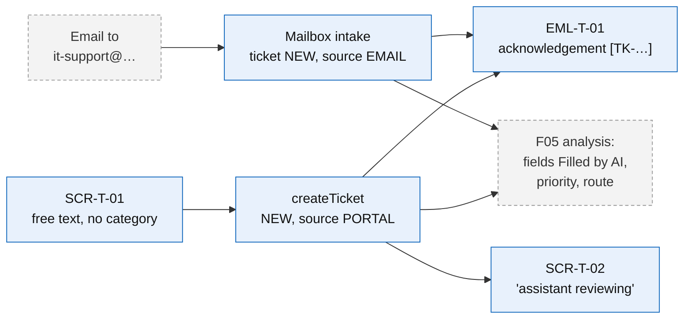
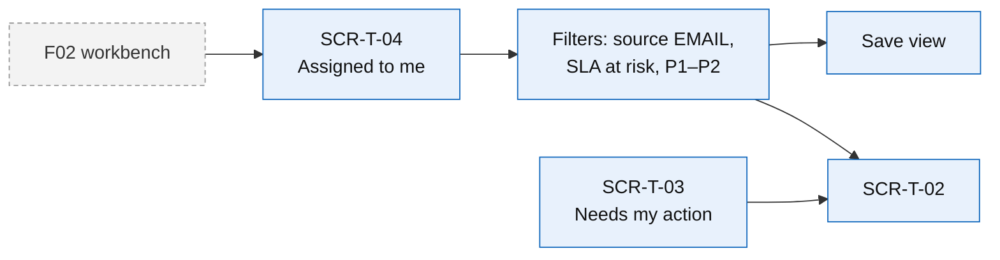
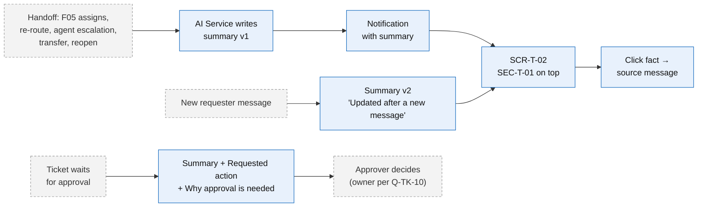
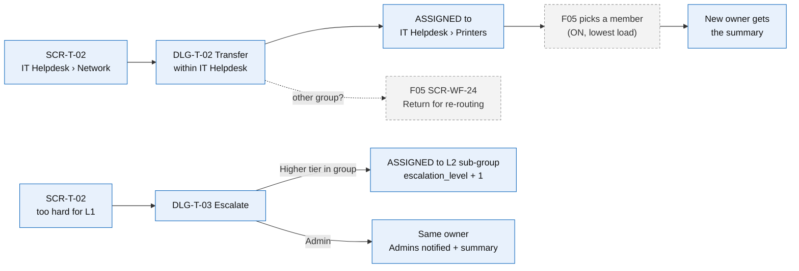
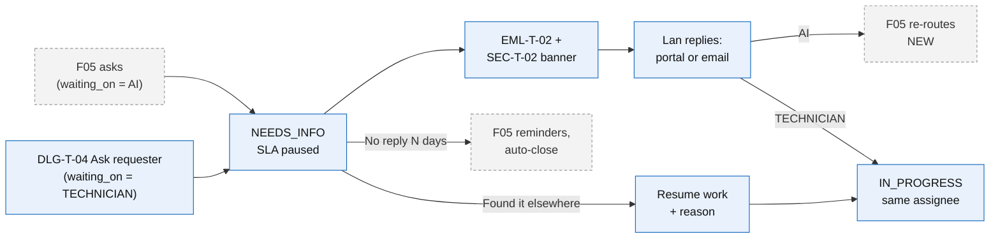
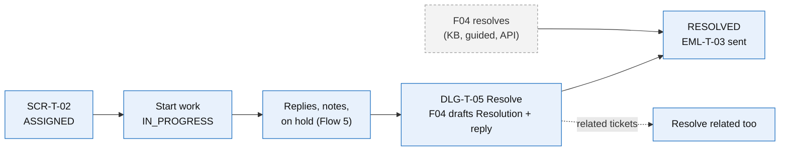
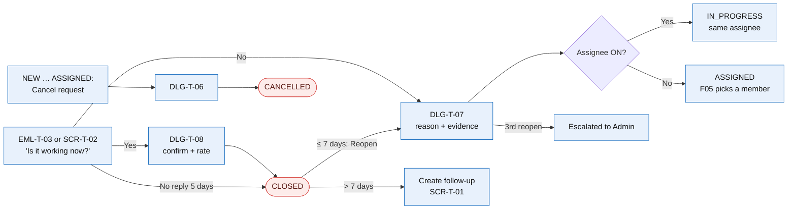

# User Flows — F03 Ticket Management

> Design status: TARGET V1
>
> Related: [IA overview](README.md) · [Screens and navigation](01-screens-and-navigation.md) · [Screen content](02-screen-content.md) · [UI states](04-ui-states-and-accessibility.md)

Seven flows, one per leaf of the **Ticket Management** branch of the mind map. Blue: an F03 page, dialog or email. Grey: done by another branch (F02, F04, F05). Red: a final state. Statuses are the names in the [use cases](../02-use-cases.md#4-ticket-lifecycle-f03-view).

| Flow | Mind-map leaf | Use case |
|---|---|---|
| 1 | Raise ticket by email or free text, no category form | UC-TK-01 |
| 2 | View / search / filter tickets | UC-TK-02 |
| 3 | View ticket summary on handoff and approval | UC-TK-03 |
| 4 | Transfer / escalate within the same division | UC-TK-04 |
| 5 | Add missing information to on-hold tickets | UC-TK-05 |
| 6 | Update status and resolution | UC-TK-06 |
| 7 | Confirm / close / reopen / cancel ticket | UC-TK-07 |

## Flow 1 — Raise a ticket by email or free text

*Lan (Sales) cannot open the shared Accounting folder. She emails IT; the next day she uses the portal for another request.* · US-TK-01 … 03 · UC-TK-01

1. Lan writes *"I get Access denied on \\fs01\accounting since this morning"* with a screenshot to the support mailbox. Within 2 minutes the ticket exists (`EMAIL`) and she receives **EML-T-01** with its code.
2. F05 fills request type, category, support level and priority (*"Filled by AI"*) and routes it. Lan never picked a category.
3. Next day, on **SCR-T-01**, she types her request in the description box only, pastes a screenshot (*✔ Clean*), and clicks *Submit*; **SCR-T-02** shows *"Submitted — the assistant is reviewing your request"*, then the outcome.
4. **Branches:** she replies to EML-T-01 → the reply is added to the same ticket (no new ticket); she emails the same request twice → F05 merges it (*Not the same problem* within 7 days); an auto-reply → ignored; file blocked → *"This file was blocked for security reasons"*; 21st ticket in an hour → `429` (portal) or added to her latest open ticket (email).

## Flow 2 — Find a ticket

*Minh (IT Helpdesk › Network) starts his day; Lan checks her requests.* · US-TK-05 … 09 · UC-TK-02

1. Minh opens **SCR-T-04** *Assigned to me*, sorted by SLA due; he filters *Due soon* and *P1–P2* and saves the view.
2. He searches `TK-2026-004871` and gets that ticket only. A ticket outside his sub-groups → `/403`.
3. Lan opens **SCR-T-03** *Needs my action*: one ticket *Waiting for your reply*, one *Resolved — please confirm*.

## Flow 3 — Read the summary on handoff and on approval

*The Helpdesk AI agent could not fix Lan's VPN; F05 hands it to Minh. Later, an access request outside the catalog waits for the Admin's approval.* · US-TK-10 … 12 · UC-TK-03

1. F05 assigns the ticket to Minh. The notification already contains the summary: *Problem — VPN disconnects every ~60 min · Already tried — AI guided reinstall, not fixed · Why it came to you — the agent could not resolve*.
2. On **SCR-T-02**, **SEC-T-01** is on top; Minh clicks *"not fixed"* and the conversation scrolls to Lan's answer to the agent.
3. Lan adds a log file; within 30 s the summary becomes v2 *"Updated after a new message"*; v1 stays viewable.
4. **Approval:** a ticket waiting for a human approval shows the summary with *Requested action* (grant `FI-Admin` on SAP for 30 days to Lan) and *Why approval is needed* (*"FI-Admin is not in Sales' catalog"*); the approver decides with this context (decision owned outside F03, Q-TK-10).
5. **Branches:** summary not ready → *"Summary is being prepared"*; AI down → *"Summary unavailable"* + the original description; Lan never sees the summary.

## Flow 4 — Transfer or escalate within the division

*Minh's printer ticket needs the Printers sub-group; a hard network fault needs L2.* · US-TK-13, 14 · UC-TK-04

1. **Transfer:** Minh clicks *Transfer* → **DLG-T-02** shows only sub-groups and technicians of *IT Helpdesk*; he picks *Printers*, reason `NEEDS_OTHER_SKILL`, note. F05 picks a member; the new owner is notified with the summary. The SLA is not reset.
2. **Wrong group:** the problem is an SAP authorization, not IT Helpdesk → the dialog's link opens F05 **SCR-WF-24** *Return for re-routing*; F05 routes it again.
3. **Escalate to a higher tier:** **DLG-T-03** lists only higher-tier sub-groups of IT Helpdesk; *work done so far* becomes an internal note.
4. **Escalate to Admin:** the owner stays; Admins get the ticket in *Escalated to me* with the summary.
5. **Exceptions:** target in another group → `400 OUTSIDE_DIVISION`; no higher tier → *"Escalate to Admin instead"*; ticket owned by the AI agent or `AUTOMATING` → actions hidden.

## Flow 5 — Add missing information to an on-hold ticket

*The AI needs to know which folder; later Minh needs Lan's VPN version.* · US-TK-15 … 18 · UC-TK-05

1. F05 is not confident about the folder and asks; the ticket is on hold. Lan gets **EML-T-02** and simply **replies to the email**: *"\\fs01\accounting\2026"*. The reply is threaded, passed to F05 and the ticket is routed again.
2. Later Minh clicks *Ask requester* → **DLG-T-04** (*"The ticket goes on hold and the SLA pauses"*). Lan sees **SEC-T-02** on SCR-T-02 and answers there with a screenshot; the ticket returns to `IN_PROGRESS` with Minh, the SLA resumes, the summary refreshes.
3. **Branches:** Minh finds the answer in AD → *Resume work* with a reason; no reply → F05 reminders day 1 and N−1, auto-close day N (Lan can reopen within 7 days); a reply from an unknown address → held for staff review, the ticket stays on hold.

## Flow 6 — Update status and resolution

*Minh fixes the VPN.* · US-TK-19 … 21 · UC-TK-06

1. Minh clicks *Start work* → `IN_PROGRESS`; Lan sees *In progress*.
2. He clicks *Resolve* → **DLG-T-05** opens with the Resolution (*"Root cause: client 4.8 timeout bug; updated to 5.2"*) and the reply drafted by F04; he edits and confirms with code `FIXED`.
3. The ticket is `RESOLVED`; Lan gets **EML-T-03** with *Confirm / Not fixed*.
4. **Branches:** duplicate → code `DUPLICATE` + original code; related tickets in SEC-T-03 → *Resolve the related tickets too*, each with its own reply; `AUTOMATING` → no *Resolve*, F04 verifies; when the AI agent resolves a ticket, F04 uses the same operation with author `AI` and `ANSWERED_BY_KB` / `SOLVED_BY_KB` / `GUIDED_BY_AI`.

## Flow 7 — Confirm, close, reopen, cancel

*Lan confirms; two days later the VPN drops again; a test ticket is cancelled.* · US-TK-22 … 24 · UC-TK-07

1. Lan clicks *Yes, it's solved* in **EML-T-03**; SCR-T-02 opens **DLG-T-08**; she rates 5 stars → `CLOSED` (`CONFIRMED`). No answer → reminders and auto-close on day 5 (`AUTO_CONFIRMED`).
2. Two days later she clicks *Reopen* → **DLG-T-07**; the ticket returns to Minh, who receives the summary again; `reopen_count` + 1. The 3rd reopen escalates to Admin. After 7 days → *Create follow-up ticket*.
3. Before work starts, Lan cancels a request she no longer needs → **DLG-T-06** → `CANCELLED`. Once `IN_PROGRESS`, she can only *Ask to cancel*; staff cancel test or spam tickets with a reason code. `AUTOMATING` tickets cannot be cancelled.
