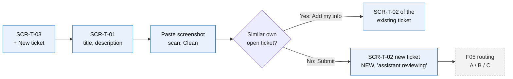
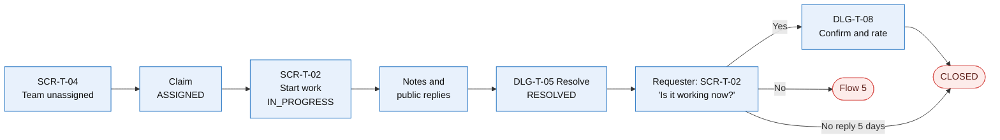
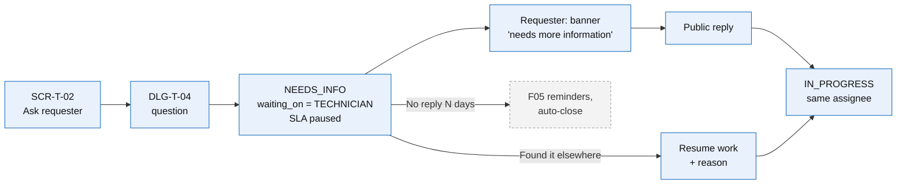
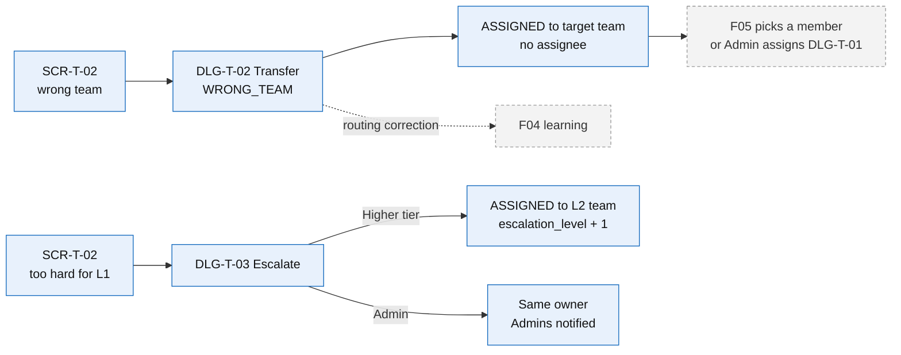
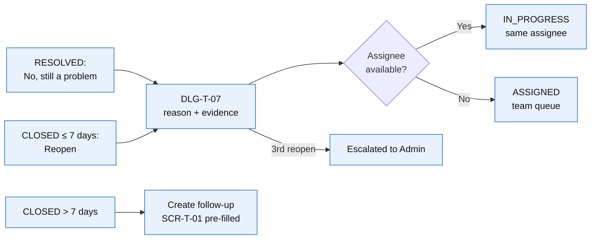
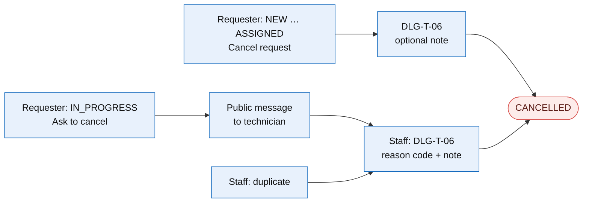

# User Flows — F03 Ticket Management

> Design status: TARGET V1
>
> Related: [IA overview](README.md) · [Screens and navigation](01-screens-and-navigation.md) · [Screen content](02-screen-content.md) · [UI states](04-ui-states-and-accessibility.md)

Six flows follow a ticket from creation to a final state. Flows 1–2 are the main path; flows 3–6 are the branches people use most. Blue: an F03 page or dialog. Grey: done by another branch (F04 AI, F05 Workflow). Red: a final state. Statuses are the names in the [use cases](../02-use-cases.md#4-ticket-lifecycle-f03-view).

## Flow 1 — Create a ticket with evidence

*Lan (Sales) cannot open the shared Accounting folder and attaches a screenshot.* · US-TK-01, US-TK-02, US-TK-04 · UC-TK-01

1. Lan clicks **+ New ticket** and fills title and description on **SCR-T-01**; category stays *I'm not sure*.
2. She pastes a screenshot; it uploads at once and shows *Scanning…* then *✔ Clean*. *Submit* stays disabled until the scan ends.
3. The suggestions panel shows no matching own ticket; she clicks *Submit* (`createTicket` with `Idempotency-Key`).
4. **SCR-T-02** opens with *"Submitted — the assistant is reviewing your request"*; within seconds F05 shows the routing outcome.
5. **Branches:** a similar own open ticket → *Add my info here* → no new ticket (UC-TK-01 A2); file blocked → removed with *"This file was blocked for security reasons"*; 21st ticket in an hour → `429` banner.

## Flow 2 — Technician handles, resolves; requester confirms

*Minh (Network L1) picks up Lan's VPN ticket.* · US-TK-06, US-TK-11, US-TK-14, US-TK-17, US-TK-18, US-TK-20 · UC-TK-03, UC-TK-05, UC-TK-06

1. Minh opens **SCR-T-04** *My team — unassigned*, sorted by SLA due; he clicks *Claim* (a second claimer gets `409 ALREADY_ASSIGNED`).
2. On **SCR-T-02** he reads the AI summary, clicks *Start work* → `IN_PROGRESS`; Lan sees *In progress*.
3. He writes an internal note (🔒, never sent to Lan) and a public reply; Lan is notified by e-mail.
4. He clicks *Resolve* → **DLG-T-05**: code `FIXED`, note *"Updated your VPN client to 5.2"* → `RESOLVED`.
5. Lan gets *"Resolved — please confirm"*; on SCR-T-02 she clicks *Yes, it's solved* → **DLG-T-08**, rates 5 stars → `CLOSED` (`CONFIRMED`).
6. **Branch:** no answer → reminders day 1 and N−1, auto-close on day 5 (`AUTO_CONFIRMED`, BR-TK-12).

## Flow 3 — Technician asks the requester for information

*Minh needs Lan's VPN client version.* · US-TK-16 · UC-TK-04 A1–A3

1. Minh clicks *Ask requester* → **DLG-T-04** with *"SLA will pause until the requester replies"*.
2. The ticket goes to `NEEDS_INFO`; the SLA badge shows *⏸ Paused*; the ticket appears in *Waiting for requester*.
3. Lan sees the banner on SCR-T-02 and in *Needs my action* on SCR-T-03; any public reply or attachment resumes the ticket to `IN_PROGRESS` with Minh as assignee.
4. **Branches:** Minh finds the answer himself → *Resume work* with a reason; no reply → F05 reminders and auto-close (UC-WF-06). An AI question (`waiting_on = AI`) looks the same to Lan, but her answer goes back to F05 routing.

## Flow 4 — Transfer a misrouted ticket, escalate a hard one

*A printer ticket reached Network L1; later a server fault needs L2.* · US-TK-10, US-TK-12, US-TK-13 · UC-TK-03

1. **Transfer:** Minh clicks *Transfer* → **DLG-T-02**: target team *Hardware*, reason `WRONG_TEAM`, note. The ticket is `ASSIGNED` to Hardware with no individual; F05 picks a member, otherwise it waits in the Hardware queue and Admins are notified. `WRONG_TEAM` is stored as a routing correction for F04. The SLA clock is not reset (BR-TK-06).
2. **Escalate to a higher tier:** **DLG-T-03** proposes only teams with a higher `support_tier` covering the category; *work done so far* (≥ 20 chars) becomes an internal note.
3. **Escalate to Admin:** the owner stays; Admins see the ticket in *Escalated to me* and may reassign (**DLG-T-01**) or raise the priority (**DLG-T-09**).
4. **Exceptions:** same team or no higher tier → `400`, UI suggests *Admin*; ticket `AUTOMATING` → actions hidden (BR-TK-08).

## Flow 5 — Not fixed, reopen, follow-up

*The VPN drops again two days after closure.* · US-TK-21 · UC-TK-06 A2–A5

1. From `RESOLVED`, Lan clicks *No, still a problem*; from `CLOSED` within 7 days, *Reopen*. Both open **DLG-T-07** (reason ≥ 10 chars, attachments, remaining window shown).
2. The ticket returns to Minh (`IN_PROGRESS`) or, if he is unavailable, to the team queue; `reopen_count` + 1.
3. The 3rd reopen escalates to Admin with *"Reopened 3 times"*.
4. After the window, *Reopen* is replaced by *Create follow-up ticket* → **SCR-T-01** pre-filled with a `FOLLOW_UP_OF` link.

## Flow 6 — Cancel a request

*Lan's problem disappears after a restart; a technician also finds a duplicate.* · US-TK-22 · UC-TK-06 A6–A7

1. Before work starts, Lan clicks *Cancel request* → **DLG-T-06** → `CANCELLED` (`REQUESTER_WITHDREW`); the assignee, if any, is notified.
2. Once `IN_PROGRESS`, the button becomes *Ask to cancel*, which posts a public message; the technician cancels with a reason.
3. Staff cancel duplicates and spam with a reason code; `DUPLICATE` needs the original ticket code. The requester is notified with the reason.
4. `AUTOMATING` tickets cannot be cancelled (*"This request is being executed automatically and cannot be cancelled now"*); `CANCELLED` is never reopenable.
