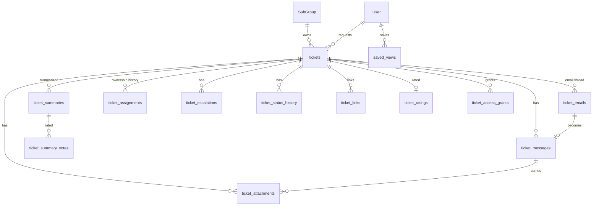

# Data and API — F03 Ticket Management

> Design status: TARGET V1 — table and operationId names are **proposed** and will be finalized with the OpenAPI contract and ERD.
>
> Related: [IA overview](README.md) · [Screens and navigation](01-screens-and-navigation.md) · [Screen content](02-screen-content.md)

## 1. Main data

Fields marked *(F05)* are written by F05 Workflow & Automation; F03 stores and shows them.

| Entity / table | Main fields |
|---|---|
| `tickets` | id, code (unique), title, description, source_channel (`EMAIL` / `PORTAL`), created_by, requester_id, requester_email (unknown senders), beneficiary_id, requester_department_id, request_type *(F05)*, category / subcategory *(F05)*, support_level *(F05)*, business_unit, site *(F05)*, field sources (`AI` / `TECHNICIAN` / `ADMIN`) *(F05)*, priority (P1–P3) *(F05)*, priority_source *(F05)*, status *(F05)*, waiting_on (`AI` / `TECHNICIAN`, null), group_id, subgroup_id, owner_type (`AI_AGENT` / `TECHNICIAN`), agent_domain, assignee_id, escalation_level, is_escalated_to_admin, sla_policy_version *(F05)*, sla_breached *(F05)*, first_responded_at, started_at, resolved_at, resolved_by, resolved_by_type (`USER` / `AI`), resolution_code, resolution, resolution_reply, closed_at, close_reason (`CONFIRMED` / `AUTO_CONFIRMED` / `NO_RESPONSE` / `DUPLICATE_MERGED`), cancelled_at, cancel_reason, cancel_note, reopen_count, version, created_at, updated_at |
| `ticket_emails` | id, ticket_id, message_id (unique), in_reply_to, direction (`IN` / `OUT`), from, to, cc, subject, raw_storage_key, received_at / sent_at, template (`EML-T-01` …), thread_status (`THREADED` / `NEW_TICKET` / `HELD` / `IGNORED_AUTO_REPLY`) |
| `ticket_messages` | id, ticket_id, author_type (`USER` / `AI` / `SYSTEM`), author_id, channel (`PORTAL` / `EMAIL`), email_id, visibility (`PUBLIC` / `INTERNAL`), kind (`REPLY` / `NOTE` / `AI_QUESTION` / `INFO_REQUEST` / `INFO_ADDED` / `SYSTEM_EVENT`), body, redacted_at, redacted_by, redaction_reason, created_at |
| `ticket_attachments` | id, ticket_id, message_id, uploaded_by, file_name, content_type, size_bytes, storage_key, sha256, scan_status (`PENDING` / `CLEAN` / `INFECTED` / `ERROR`), created_at |
| `ticket_summaries` | id, ticket_id, version, purpose (`HANDOFF` / `APPROVAL`), trigger (`ASSIGNED` / `TRANSFERRED` / `ESCALATED` / `REROUTED` / `AGENT_ESCALATED` / `REOPENED` / `NEW_MESSAGE` / `REGENERATE` / `APPROVAL_REQUESTED`), sections (JSON, each fact with its source message id), model_version, status (`READY` / `FAILED`), created_at |
| `ticket_summary_votes` | summary_id, user_id, helpful (bool), comment, created_at |
| `ticket_assignments` *(shared with F05)* | id, ticket_id, group_id, subgroup_id, assignee_id, assigned_by, source (`USER` / `AUTOMATION`), kind (`ASSIGN` *(F05)* / `TRANSFER` / `ESCALATE` / `REROUTE` *(F05)* / `UNASSIGN`), reason_code, reason, started_at, ended_at |
| `ticket_escalations` | id, ticket_id, type (`TIER` / `ADMIN`), group_id, from_subgroup_id, to_subgroup_id, from_level, to_level, reason, work_done_message_id, source (`USER` / `AUTOMATION`), created_by, created_at |
| `ticket_status_history` | id, ticket_id, from_status, to_status, waiting_on, actor_id, source, reason, created_at (feeds F07 time metrics and on-hold durations) |
| `ticket_links` *(shared with F05)* | id, ticket_id, linked_ticket_id, type (`DUPLICATE_OF` / `RELATED_TO` / `FOLLOW_UP_OF`), created_by, source (`USER` / `AUTOMATION`), created_at, removed_at, removed_reason |
| `ticket_ratings` | ticket_id (PK), rating (1–5), comment, rated_by, created_at |
| `ticket_access_grants` | id, ticket_id, user_id, reason (`MENTION`), granted_by, created_at, expires_at |
| `saved_views` | id, user_id, name, filters (JSON), sort, created_at |
| Sub-group *(F09)* | + `support_tier` (`L1` / `L2` / `L3`) — proposed |

Removed from the previous version: `routing_corrections` (field corrections are F05's `correctTicketField`), `category hint` and `urgency` columns (no category form, BR-TK-24), `TRIAGE` status.

Indexes for 8,000 tickets/day (~3 M/year): `(status, subgroup_id, assignee_id)`, `(requester_id, updated_at)`, `(beneficiary_id)`, `code` unique, `(created_at)`, `ticket_emails.message_id` unique, `(ticket_id, version)` on `ticket_summaries`; full-text index on title, description and public message bodies (internal notes in a separate staff-only index).

## 2. Main API

Prefix `/api/v1`, `Authorization: Bearer <token>`. Mutations take `If-Match: <version>` (BR-TK-21). Errors use `ProblemDetails` with a `code` (`INVALID_TRANSITION`, `STALE_VERSION`, `ASSIGNEE_UNAVAILABLE`, `OUTSIDE_DIVISION`, `REOPEN_WINDOW_EXPIRED`, …).

| Method | Path | operationId | Permission | Screen |
|---|---|---|---|---|
| POST | `/tickets` (+ `Idempotency-Key`) | `createTicket` | `ticket:create` | SCR-T-01 |
| — | mailbox intake (internal job) | — | internal (`AUTOMATION`) | support mailbox, EML-T-01 |
| GET | `/tickets?view=&q=&status=&source=&…&sort=&page=&size=` | `listTickets` | `ticket:read` (scoped) | SCR-T-03, SCR-T-04 |
| GET | `/tickets/views/counts` | `getTicketViewCounts` | `ticket:read` | Sidebar badges |
| GET | `/tickets/{code}` | `getTicket` | `ticket:read` | SCR-T-02 |
| GET | `/tickets/{code}/email` | `getTicketEmail` | `ticket:read` (staff) | SCR-T-02 *Email* |
| POST | `/attachments` (multipart, temporary) | `uploadAttachment` | `ticket:create` / `ticket:comment` | SCR-T-01, composer |
| GET | `/tickets/{code}/attachments/{id}/url` | `getAttachmentDownloadUrl` | `ticket:read` | SCR-T-02 |
| GET | `/tickets/{code}/messages` | `listTicketMessages` | `ticket:read` (visibility filtered) | SCR-T-02 |
| POST | `/tickets/{code}/messages` | `addTicketMessage` | `ticket:comment` / `ticket:note` | SCR-T-02 composer, SEC-T-02 |
| POST | `/tickets/{code}/messages/{id}/redact` | `redactTicketMessage` | `ticket:redact` | SCR-T-02 |
| GET | `/tickets/{code}/summary?purpose=` | `getTicketSummary` | `ticket:summary_read` | SEC-T-01 |
| GET | `/tickets/{code}/summary/versions` | `listTicketSummaryVersions` | `ticket:summary_read` | SEC-T-01 |
| POST | `/tickets/{code}/summary/regenerate` | `regenerateTicketSummary` | `ticket:summary_regenerate` | SEC-T-01 |
| POST | `/tickets/{code}/summary/{version}/vote` | `rateTicketSummary` | `ticket:summary_read` | SEC-T-01 |
| GET | `/tickets/{code}/transfer-targets?type=TRANSFER\|TIER` | `listTransferTargets` | `ticket:transfer` | DLG-T-02, DLG-T-03 |
| POST | `/tickets/{code}/transfer` | `transferTicket` | `ticket:transfer` | DLG-T-02 |
| POST | `/tickets/{code}/escalate` | `escalateTicket` | `ticket:escalate` | DLG-T-03 |
| POST | `/tickets/{code}/start` | `startTicketWork` | `ticket:update_status` | SCR-T-02 |
| POST | `/tickets/{code}/request-info` | `requestTicketInfo` | `ticket:update_status` | DLG-T-04 |
| POST | `/tickets/{code}/resume` | `resumeTicketWork` | `ticket:update_status` | SEC-T-02 |
| POST | `/tickets/{code}/links` | `linkTickets` | `ticket:link` | SEC-T-03 |
| POST | `/tickets/{code}/resolve` | `resolveTicket` | `ticket:update_status` (user or AI service account) | DLG-T-05 |
| POST | `/tickets/{code}/confirm` | `confirmTicketResolution` *(F05 name)* | `ticket:confirm` | DLG-T-08 |
| POST | `/tickets/{code}/reopen` | `reopenTicket` *(F05 name)* | `ticket:reopen` | DLG-T-07 |
| POST | `/tickets/{code}/cancel` | `cancelTicket` | `ticket:cancel` | DLG-T-06 |
| GET / POST | `/me/saved-views` | `listSavedViews` / `createSavedView` | staff | SCR-T-04 |
| PATCH / DELETE | `/me/saved-views/{id}` | `updateSavedView` / `deleteSavedView` | owner | SCR-T-04 |
| GET | `/tickets/{code}/history` | `listTicketHistory` *(F08)* | `ticket_history:read` | SCR-T-02 *History* |
| POST | `/tickets/{code}/clarification-answers` | `answerClarification` *(F05)* | owner | SEC-T-02 (called by F03 when `waiting_on = AI`) |
| POST | `/tickets/{code}/return-for-rerouting` | `returnForRerouting` *(F05)* | assignee, Admin | SCR-WF-24 |
| PATCH | `/tickets/{code}/fields/{field}`, `/tickets/{code}/priority` | `correctTicketField`, `changeTicketPriority` *(F05)* | assignee, Admin | SCR-T-02 details panel |
| DELETE | `/tickets/{code}/links/{id}` | `unlinkTickets` *(F05)* | assignee, Admin | SCR-WF-23 |

Removed from the previous version: `assignTicket`, `reassignTicket`, `listAssignableMembers` (F05 UC-WF-05), `claimTicket` (F02 workbench), `updateTicketClassification` (F05), `suggestSimilarTickets` (F05 / F04).

Events published for other features: `TicketCreated` (with `source_channel`), `TicketMessageAdded`, `TicketInfoAdded`, `TicketPutOnHold`, `TicketResumed`, `TicketTransferred`, `TicketEscalated`, `TicketStatusChanged`, `TicketResolved`, `TicketClosed`, `TicketReopened`, `TicketCancelled`, `TicketRated`, `TicketSummaryGenerated`.
