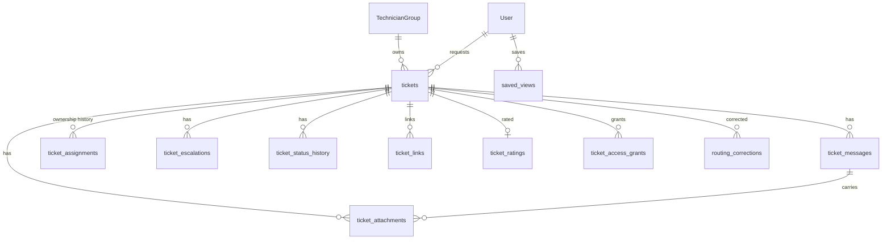

# Data and API — F03 Ticket Management

> Design status: TARGET V1 — table and operationId names are **proposed** and will be finalized with the OpenAPI contract and ERD.
>
> Related: [IA overview](README.md) · [Screens and navigation](01-screens-and-navigation.md) · [Screen content](02-screen-content.md)

## 1. Main data

Fields marked *(F05)* already exist in the Workflow design; F03 adds the rest.

| Entity / table | Main fields |
|---|---|
| `tickets` | id, code (unique), title, description, requester_id, beneficiary_id, requester_department_id, category, category_source (`AI` / `USER` / `TECHNICIAN`), request_type, urgency, affected_system, priority (P1–P4), priority_source, status *(F05)*, waiting_on (`AI` / `TECHNICIAN`, null), team_id, assignee_id, escalation_level, is_escalated_to_admin, sla_policy_version *(F05)*, sla_breached *(F05)*, first_responded_at, started_at, resolved_at, resolved_by, resolution_code, resolution_note, closed_at, close_reason (`CONFIRMED` / `AUTO_CONFIRMED` / `NO_RESPONSE`), cancelled_at, cancel_reason, cancel_note, reopen_count, source_channel (`WEB`), version, created_at, updated_at |
| `ticket_messages` *(F05 name)* | id, ticket_id, author_type (`USER` / `AI` / `SYSTEM`), author_id, visibility (`PUBLIC` / `INTERNAL`), kind (`REPLY` / `NOTE` / `AI_QUESTION` / `AI_ANSWER` / `INFO_REQUEST` / `SYSTEM_EVENT`), body, redacted_at, redacted_by, redaction_reason, created_at |
| `ticket_attachments` | id, ticket_id, message_id, uploaded_by, file_name, content_type, size_bytes, storage_key, sha256, scan_status (`PENDING` / `CLEAN` / `INFECTED` / `ERROR`), created_at |
| `ticket_assignments` *(F05 name)* | id, ticket_id, team_id, assignee_id, assigned_by, source (`USER` / `AUTOMATION`), rule_id, kind (`ASSIGN` / `CLAIM` / `REASSIGN` / `TRANSFER` / `ESCALATE` / `UNASSIGN`), reason_code, reason, started_at, ended_at |
| `ticket_escalations` | id, ticket_id, type (`TIER` / `ADMIN`), from_team_id, to_team_id, from_level, to_level, reason, source (`USER` / `AUTOMATION`), created_by, created_at |
| `ticket_status_history` | id, ticket_id, from_status, to_status, waiting_on, actor_id, source, reason, created_at (feeds F07 time metrics) |
| `ticket_links` | id, ticket_id, linked_ticket_id, type (`DUPLICATE_OF` / `RELATED_TO` / `FOLLOW_UP_OF`), created_by, created_at |
| `ticket_ratings` | ticket_id (PK), rating (1–5), comment, rated_by, created_at |
| `ticket_access_grants` | id, ticket_id, user_id, reason (`MENTION`), granted_by, created_at, expires_at |
| `routing_corrections` | id, ticket_id, field (`CATEGORY` / `TEAM` / `PRIORITY`), ai_value, human_value, actor_id, created_at (input for F04 learning, F07 reports) |
| `saved_views` | id, user_id, name, filters (JSON), sort, created_at |
| `TechnicianGroup` *(F09)* | + `support_tier` (`L1` / `L2` / `L3`) — proposed |

Indexes for 8,000 tickets/day (~3 M/year): `(status, team_id, assignee_id)`, `(requester_id, updated_at)`, `(beneficiary_id)`, `code` unique, `(created_at)`; full-text index on title, description and public message bodies (internal notes in a separate staff-only index).

## 2. Main API

Prefix `/api/v1`, `Authorization: Bearer <token>`. Mutations take `If-Match: <version>` (BR-TK-21). Errors use `ProblemDetails` with a `code` (`INVALID_TRANSITION`, `STALE_VERSION`, `ALREADY_ASSIGNED`, `ASSIGNEE_UNAVAILABLE`, `REOPEN_WINDOW_EXPIRED`, …).

| Method | Path | operationId | Permission | Screen |
|---|---|---|---|---|
| POST | `/tickets` (+ `Idempotency-Key`) | `createTicket` | `ticket:create` | SCR-T-01 |
| GET | `/tickets?view=&q=&status=&…&sort=&page=&size=` | `listTickets` | `ticket:read` (scoped) | SCR-T-03, SCR-T-04 |
| GET | `/tickets/views/counts` | `getTicketViewCounts` | `ticket:read` | Sidebar badges |
| GET | `/tickets/{code}` | `getTicket` | `ticket:read` | SCR-T-02 |
| POST | `/attachments` (multipart, temporary) | `uploadAttachment` | `ticket:create` / `ticket:comment` | SCR-T-01, composer |
| GET | `/tickets/{code}/attachments/{id}/url` | `getAttachmentDownloadUrl` | `ticket:read` | SCR-T-02 |
| GET | `/tickets/{code}/messages` | `listTicketMessages` | `ticket:read` (visibility filtered) | SCR-T-02 |
| POST | `/tickets/{code}/messages` | `addTicketMessage` | `ticket:comment` / `ticket:note` | SCR-T-02 composer |
| POST | `/tickets/{code}/messages/{id}/redact` | `redactTicketMessage` | `ticket:redact` | SCR-T-02 |
| GET | `/tickets/{code}/assignable-members?teamId=` | `listAssignableMembers` | `ticket:assign` | DLG-T-01 |
| POST | `/tickets/{code}/assign` | `assignTicket` | `ticket:assign` | DLG-T-01 |
| POST | `/tickets/{code}/reassign` | `reassignTicket` *(F05 name)* | `ticket:reassign` | DLG-T-01 |
| POST | `/tickets/{code}/claim` | `claimTicket` | `ticket:claim` | SCR-T-02, SCR-T-04 |
| POST | `/tickets/{code}/transfer` | `transferTicket` | `ticket:transfer` | DLG-T-02 |
| POST | `/tickets/{code}/escalate` | `escalateTicket` | `ticket:escalate` | DLG-T-03 |
| POST | `/tickets/{code}/start` | `startTicketWork` | `ticket:update_status` | SCR-T-02 |
| POST | `/tickets/{code}/request-info` | `requestTicketInfo` | `ticket:update_status` | DLG-T-04 |
| POST | `/tickets/{code}/resume` | `resumeTicketWork` | `ticket:update_status` | SCR-T-02 |
| PATCH | `/tickets/{code}/classification` | `updateTicketClassification` | `ticket:classify` | DLG-T-09 |
| POST | `/tickets/{code}/links` | `linkTickets` | `ticket:link` | SCR-T-02 |
| POST | `/tickets/{code}/resolve` | `resolveTicket` | `ticket:update_status` | DLG-T-05 |
| POST | `/tickets/{code}/confirm` | `confirmTicketResolution` *(F05 name)* | `ticket:confirm` | DLG-T-08 |
| POST | `/tickets/{code}/reopen` | `reopenTicket` *(F05 name)* | `ticket:reopen` | DLG-T-07 |
| POST | `/tickets/{code}/cancel` | `cancelTicket` | `ticket:cancel` | DLG-T-06 |
| GET / POST | `/me/saved-views` | `listSavedViews` / `createSavedView` | staff | SCR-T-04 |
| PATCH / DELETE | `/me/saved-views/{id}` | `updateSavedView` / `deleteSavedView` | owner | SCR-T-04 |
| GET | `/tickets/{code}/history` | `listTicketHistory` *(F08)* | `ticket_history:read` | SCR-T-02 *History* |
| POST | `/tickets/{code}/clarification-answers` | `answerClarification` *(F05)* | owner | SCR-T-02 |
| GET | `/tickets/similar?text=` | `suggestSimilarTickets` *(F04)* | `ticket:create` (own scope only) | SCR-T-01 |

Events published for other features: `TicketCreated`, `TicketMessageAdded`, `TicketAssigned`, `TicketTransferred`, `TicketEscalated`, `TicketStatusChanged`, `TicketResolved`, `TicketClosed`, `TicketReopened`, `TicketCancelled`, `TicketRated`, `TicketReclassified`.
