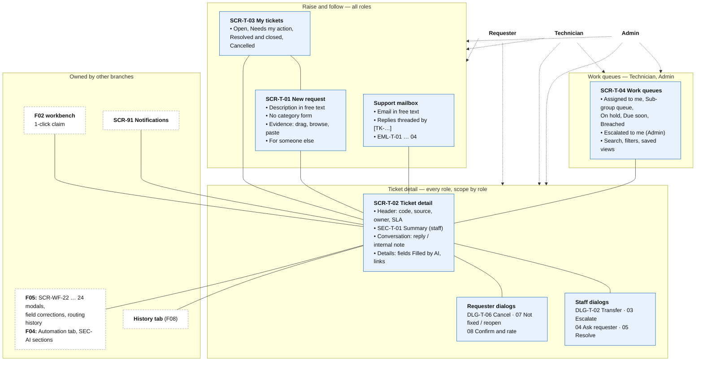

# Information Architecture — F03 Ticket Management

> Design status: TARGET V1 — screen, route, table and operationId names are **proposed** and will be finalized with the OpenAPI contract and ERD.
>
> Implementation status: NOT IMPLEMENTED

This folder places the 24 F03 stories on screens and emails. **F03 owns the ticket pages** that every role works in — the raise-ticket form, the requester's list, the staff work queues and the ticket detail — and the **ticket emails**. Other branches add their parts to these pages (F04 sections `SEC-AI-xx`, F05 fields, routing history and modals `SCR-WF-2x`, the F08 *History* tab). The inventory has four kinds of entries:

| Kind | ID | Meaning |
|---|---|---|
| Page | `SCR-T-xx` | A page with its own route, owned by F03 |
| Dialog | `DLG-T-xx` | A short form opened on a page, with no route of its own (D-TK-IA-03) |
| Section | `SEC-T-xx` | A zone of a page with its own content and permission |
| Email | `EML-T-xx` | An email F03 sends; links open SCR-T-02 |

Inputs: [Use cases](../02-use-cases.md), [User stories and acceptance criteria](../01-user-stories.md). Shared screens (`SCR-01` Login, `SCR-90` Access denied, `SCR-91` Notifications) and the modals `SCR-WF-22` … `SCR-WF-24` come from the [F05 information architecture](../../f05-workflow-automation/information-architecture/README.md). F05's triage queue `SCR-WF-10` was removed (F05 D-IA-07).

Four roles only (D-TK-IA-07): **Requester** (`REQUESTER`), **Technician** (`TECHNICIAN`), **Admin** (`ADMIN`) and the **AI Service** (`AI`). The AI Service has no screen; its messages appear in the conversation signed *"AI Assistant"* (BR-TK-18).

| File | Content |
|---|---|
| [01-screens-and-navigation.md](01-screens-and-navigation.md) | Sitemap and routes, page / dialog / section / email inventory, page permissions, navigation per role, notifications, story-to-screen mapping, requests to other branches |
| [02-screen-content.md](02-screen-content.md) | Zones of each page, the summary section, dialog fields, email content, action availability by status and role, low-fidelity wireframes |
| [03-user-flows.md](03-user-flows.md) | Seven flows, one per mind-map leaf |
| [04-ui-states-and-accessibility.md](04-ui-states-and-accessibility.md) | UI state contract, plain vs internal status labels, SLA badges, responsive layout, accessibility |
| [05-data-and-api.md](05-data-and-api.md) | Main tables, ERD, indexes, API endpoints, published events |

## IA decisions

| ID | Decision | Why |
|---|---|---|
| D-TK-IA-01 | **One ticket detail page (SCR-T-02) for every role**, with role-dependent zones and tabs. The server returns only what the role may see (BR-TK-10). | Same as F05 D-IA-04; keeps internal data out of requester responses. |
| D-TK-IA-02 | **Two list pages:** SCR-T-03 *My tickets* (cards, plain-language statuses, "needs my action") for everyone's own requests, and SCR-T-04 *Work queues* (table, filters) for staff. | "Where is my request?" vs "what do I work on next?". |
| D-TK-IA-03 | **Every ticket action with input is a dialog** (DLG-T-02 … 08) opened on SCR-T-02, with no route. | Keeps the conversation and the summary visible while acting. |
| D-TK-IA-04 | **The action bar shows only actions allowed for the current status, owner and role** ([action matrix](02-screen-content.md#4-action-availability-status--role)); forbidden actions are hidden. The API still rejects them (BR-TK-04). | One source of truth in the transition table. |
| D-TK-IA-05 | **Views, filters, sort and page live in the URL**, so Back restores them and a view can be shared. | Staff move between list and detail all day. |
| D-TK-IA-06 | **F03 hosts sections and tabs owned by other branches:** *History* (F08), routing history and the F05 modals, *Automation* and the AI sections (F04). F03 defines where they sit; their owners define the content. | One ticket page; each branch changes only its part. |
| D-TK-IA-07 | **No Team Lead and no triage queue.** Four roles: Requester, Technician, Admin, AI Service. F05 assigns tickets; technicians and Admins transfer and escalate within the division. | Team decision; F05 D-IA-07. |
| D-TK-IA-08 | **Requesters see plain-language statuses and an outcome line**, never internal codes, the summary, or individual technician names unless the technician replied (BR-TK-18). | Requesters need to know what is expected from them. |
| D-TK-IA-09 | **Email is a full channel, not a notification copy.** A requester can raise a ticket, add missing information, and open *Confirm* / *Not fixed* from email only; every ticket email carries `[TK-…]` in the subject and a link to SCR-T-02. | Most tickets arrive by email (mind-map leaf 1). |
| D-TK-IA-10 | **No category on the raise-ticket form.** SCR-T-01 has a description, an optional subject, *for someone else* and attachments only; the fields F05 fills appear on SCR-T-02 with *"Filled by AI"* (BR-TK-24). | Mind-map leaf 1: "no category form". |
| D-TK-IA-11 | **The summary (SEC-T-01) is the first thing staff see** on SCR-T-02, above the conversation, and is copied into every handoff and approval notification. | Mind-map leaf 3. |

## Information architecture

Solid lines: a page and the pages, sections or dialogs opened from it. Dashed arrows: which areas each actor uses. Blue: F03-owned. White: owned by other branches.

## Screen hierarchy per role

| Role | Home page | Pages | Dialogs |
|---|---|---|---|
| Requester | SCR-T-03 *My tickets* (or only email) | SCR-T-01, SCR-T-02 (own and beneficiary tickets), SCR-T-03 | DLG-T-06, 07, 08 (own tickets; the beneficiary can only reply, BR-TK-22) |
| Technician | F02 workbench, or SCR-T-04 *Assigned to me* | SCR-T-01, SCR-T-02 (assigned and sub-group tickets), SCR-T-03, SCR-T-04 | DLG-T-02, 03, 04, 05, 06 (as assignee) |
| Admin | Dashboard (F02) | Every page, every ticket, including *Escalated to me* and *All open tickets* | DLG-T-02, 03, 05, 06; DLG-T-07, 08 on behalf of the requester (reason required) |
| AI Service | — | No UI; writes the summary and messages through the API | — |

**Related:** [F03 README](../README.md) · [Screens and navigation](01-screens-and-navigation.md) · [Screen content](02-screen-content.md) · [User flows](03-user-flows.md) · [UI states](04-ui-states-and-accessibility.md) · [Data and API](05-data-and-api.md)
