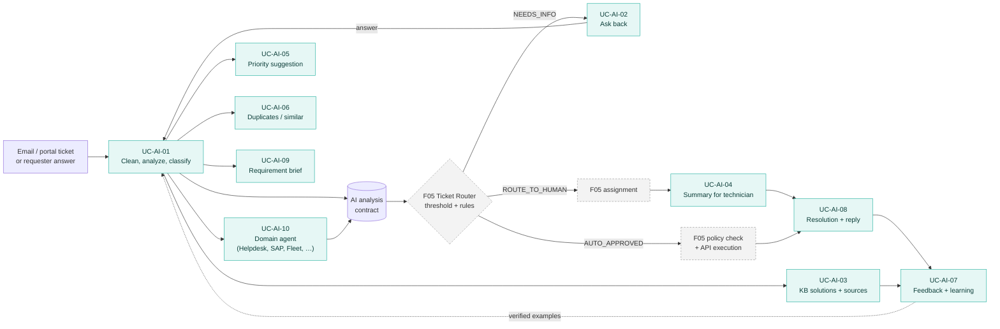

# F04 AI Ticket Processing

> Design status: TARGET V1 (draft for team review)
>
> Implementation status: NOT STARTED

This folder specifies the **AI Ticket Processing** branch (F04) of the mind map for the *AI-powered IT ticket routing and processing system*. The system receives about **8,000 internal IT tickets per day**. F04 is the part that **reads** each ticket and produces AI output: a classification with extracted fields, clarifying questions, knowledge-base (KB) solutions with sources, a technician summary, a priority suggestion, and links to duplicate or similar tickets.

Other branches **use** this output. In particular, F05 Workflow & Automation decides the A / B / C flow, runs the policy check, and calls the provisioning APIs.

## Business context (client brief)

- The group's IT division provides **all software for every company in the group** and supports its users.
- **Level 1 support:** computer setup, account access, email, phone.
- **Level 2 support:** software problems (slow, hanging), "how do I use this", and business requirements, where a department describes a problem for IT to build software for.
- Requests are handled today in **ManageEngine** with **email ticketing**: each email becomes a request with *Subject*, *Sender* and *Created by*. About **8,000 tickets per day**.
- In the ManageEngine portal the requester must **pick a topic from the Category list and fill in that category's form**, which then calls an API. This is rigid: people pick the wrong category or give up and send an email.
- **What the client wants:** raising a ticket should be less rigid (free text), and the AI should classify each ticket and route it to **specialized agents** that handle it.
- **The problem is who handles what.** Tickets must reach the right team: IT Helpdesk, AI Solutions, SAP, Fleet Management software, EV Charging, Real Estate, Healthcare, Education.
- **Today:** keywords in the subject decide the routing, step by step: large group → sub-group → individual handler.
- **Goal:** the AI understands each ticket, classifies it, sends it to the right group and person, handles the whole flow where it can, and replies on the ticket, so that fewer tickets need a person.

### Decision D-AI-01 — Agent first (confirmed by the team, 2026-11-10)

Each domain has an **AI agent** that resolves tickets **without a technician** wherever it can: account and access requests through F05's checked automation, how-to questions and known self-service fixes through cited KB answers, and missing information through one precise question. **Technicians handle only three kinds of ticket:**

1. tickets the agents **cannot resolve** (physical work, access outside the catalog, still unclear, requester says *Not solved*, …);
2. **system bugs**, defects in a group system that the team must fix;
3. **software requirements**, requests to design or build software for a business need.

Details: UC-AI-10 and BR-AI-13.

> "AI Solutions" is the group's team that supports AI products. It is a **routing target**, not the AI Service actor of this system.

### Brief coverage

The brief lists what the AI must understand. Each item, and where it is specified:

| Brief item | Owner | Where |
|---|---|---|
| Raise a ticket without picking a category or filling a form | **F04** fills category and form from free text; F03 offers the free-text form | UC-AI-01 (US-AI-01, US-AI-15), UC-AI-10 |
| Route to specialized agents that handle the ticket | **F04** (agent-first, D-AI-01) | UC-AI-10 (US-AI-20, US-AI-21) |
| Read the request, understand the whole ticket | **F04** | UC-AI-01 (email cleaning, classification, extraction), UC-AI-04 (summary) |
| Priority | **F04** suggests; F05 binds the SLA | UC-AI-05 |
| Who is asking and where from (business unit, department, site) | **F04** | UC-AI-01 requester context |
| Which group / sub-group / person | **F04** classifies into the team taxonomy; **F05** picks group and person (Q-AI-9) | UC-AI-01; F05 UC-WF-05 |
| SLA | F05 | UC-WF-02, UC-WF-06 |
| Hold the ticket when data is missing | **F04** asks; **F05** holds (`NEEDS_INFO`, SLA paused) | UC-AI-02; F05 UC-WF-04, BR-WF-07 |
| Fill in every ticket field | **F04** | UC-AI-01 (US-AI-15) |
| Produce the Resolution | **F04** | UC-AI-08 |
| Reply on the ticket after it is resolved | **F04** writes the text; F03 / F05 send it | UC-AI-08, UC-AI-03 (KB auto-reply) |
| Handle the whole flow, replace people where possible | F05 for account and access requests; **F04** for how-to tickets answered from the KB | F05 UC-WF-07/08; UC-AI-03 (US-AI-17) |
| The KB learns over time | **F04** reuses verified tickets as examples; **F06** turns resolutions into articles | UC-AI-07 (US-AI-19); F06 |
| Suggestions | **F04** | UC-AI-03, UC-AI-05, UC-AI-06 |
| Email threading, sending replies, ticket fields storage | F03 | — |

### Changes F05 must know about

These are additions to the AI analysis contract that the F05 owner should review:

1. New inputs: `channel` (`EMAIL` / `PORTAL`), `sender`, `createdBy`, `requestedFor`, requester context (business unit, department, site).
2. `category` becomes two levels, `domain/subcategory`. The domain is the team (`HELPDESK`, `AI_SOLUTIONS`, `SAP`, `FLEET_MANAGEMENT`, `EV_CHARGING`, `REAL_ESTATE`, `HEALTHCARE`, `EDUCATION`). F05 assignment rules and the groups' responsibility categories (UC-08 on `feature/author`) should use the same list.
3. New field `supportLevel` (`L1` / `L2`).
4. New request types `DEVICE_SETUP` and `BUSINESS_REQUIREMENT`.
5. New `routeReason` values `UNKNOWN_SENDER` and `WRONG_DOMAIN`, and a new `suggestedRoute` value `KB_ANSWERABLE` for the KB auto-reply (Q-AI-10). The auto-reply needs two ticket transitions F05's state diagram does not have yet: `NEW` → `RESOLVED` (answered by the AI, no `AUTOMATING` step), and `RESOLVED` → `ASSIGNED` via F05 assignment when the requester says *Not solved* (no technician is assigned yet, so `RESOLVED` → `IN_PROGRESS` does not apply).
6. New fields `agent`, `formFields` and `escalationClass` (`AGENT_CANNOT_RESOLVE`, `SYSTEM_BUG`, `SOFTWARE_REQUIREMENT`), and new `routeReason` values `SUSPECTED_BUG`, `SOFTWARE_REQUIREMENT`, `NOT_SOLVED_BY_AGENT`. `escalationClass` is a **ticket-level** value: F04 sets it when the agent escalates in the analysis, and **F05 must set `AGENT_CANNOT_RESOLVE` with its own reason for every escalation it starts** (policy check failed, run failed, `MAX_CLARIFICATION_REACHED`, `AI_UNAVAILABLE`, *Not solved*). F05 could use it in its assignment rules (bugs to the domain dev team). `agent` and `formFields` are the specialized domain agent that handled the ticket and the domain form it filled (UC-AI-10). The agent works inside the analysis pass, so F05 still receives one event per trigger. It proposes actions only from F05's whitelist; F05 still checks and runs them. Each domain agent's default escalation group should match a seeded F05 rule `domain/*` → group.

## Scope

The six leaves of the F04 branch of the mind map:

| Mind-map leaf | Core (bold in mind map) | Use case |
|---|---|---|
| Classify and suggest routing | Yes | UC-AI-01 |
| Ask back when the ticket lacks context | Yes | UC-AI-02 |
| Suggest solutions from the KB, with sources | Yes | UC-AI-03 |
| Summarize the ticket for technicians | Yes | UC-AI-04 |
| Suggest a priority | No | UC-AI-05 |
| Suggest links to duplicate / similar tickets | No | UC-AI-06 |
| *(added)* Review, feedback, and learning from verified tickets | No | UC-AI-07 |
| *(added from the brief)* Draft the Resolution and the reply | No | UC-AI-08 |
| *(added from the brief)* Structure a business requirement for the dev team | No | UC-AI-09 |
| *(added from the brief)* Domain agents resolve tickets; technicians only get what agents cannot resolve, bugs and software requirements | Yes (client decision D-AI-01) | UC-AI-10 |

UC-AI-07 is not a leaf of the mind map. It is how AI accuracy is measured in production, how wrong output gets corrected, and how the AI improves over time. UC-AI-08, UC-AI-09 and UC-AI-10 come from the client brief ("produce the Resolution", "reply on the ticket", "business requirements for IT to build", "route to specialized agents").

## Boundary with other branches

**F04 produces AI output. Other branches make decisions from it and change the system state.**

| Topic | F04 (this folder) | Owned elsewhere |
|---|---|---|
| Email intake | Cleans the email body, finds the requester and the person the request is for | F03 creates the ticket from the email, threads replies, sends emails |
| Self-service articles | Auto-replies to an `INCIDENT` only with an article marked self-service | F06 must add a "self-service" flag to articles |
| Resolution codes | Uses `SOLVED_BY_KB` (requester marked a suggested article as the fix) and `ANSWERED_BY_KB` (AI auto-reply) | F03 must add both codes |
| Group and person | Classifies into the team taxonomy (`domain/subcategory`) | F05 assignment rules choose the group and the person (Q-AI-9) |
| Resolution and reply | Drafts the Resolution and the reply text | F03 stores and sends; the technician confirms |
| Classification | Produces request type, category, extracted fields, confidence, missing fields, suggested route and reason (the **AI analysis contract**) | F05 UC-WF-04 decides the flow (`AUTO_APPROVED` / `NEEDS_INFO` / `ROUTE_TO_HUMAN`) and writes `ai_decisions` |
| Asking back | Finds which fields are missing, writes the question, reads the answer back into the fields | F05: round limit (BR-WF-06), `NEEDS_INFO` state, SLA pause, reminders, auto-close (UC-WF-06) |
| KB solutions | Retrieves **published** articles, writes cited suggestions | F06: create, review, publish and rate articles; draft articles from resolved tickets |
| Summary | Writes the summary, keeps it current | F05 UC-WF-05 puts it in the assignment notification |
| Priority | Suggests P1–P4 with a reason | F03 stores the priority; F05 binds the SLA to it (BR-WF-08) |
| Duplicates | Suggests candidates with a similarity score | F03 links or merges tickets |
| AI on/off and thresholds | Reads the settings | F05 UC-WF-03: `AUTO_CLASSIFY`, `ASK_FOR_INFO`, `SUGGEST_KB`, `SUGGEST_PRIORITY`, threshold |
| Policy check and API execution | Never | F05 UC-WF-07, UC-WF-08 |
| AI metrics | Records feedback and corrections | F07 reports on them |
| AI service account and API key | Uses it | F01 (`AI_AGENT`, `X-API-Key`) |
| Masking credentials in ticket text | Requires it (BR-AI-07) | F03 stores the ticket text, so F03 applies the masking on save |
| Closing a ticket solved by a KB article | Requires the transition `RESOLVED` → `CLOSED` without a second confirmation (Q-AI-6) | F03 / F05 own the ticket states |

## Processing overview

Teal boxes belong to F04. Grey dashed boxes belong to F05 and are shown only for context.

## Documents

| File | Content |
|---|---|
| [01-features.md](01-features.md) | Feature breakdown F04.1–F04.11, out of scope |
| [02-use-cases.md](02-use-cases.md) | Actors, permissions, AI analysis contract, team taxonomy, use case diagram, UC-AI-01 … UC-AI-10 specifications |
| [03-user-stories-invest.md](03-user-stories-invest.md) | Backlog US-AI-01 … US-AI-21 with MoSCoW and size, INVEST review |
| [04-acceptance-criteria.md](04-acceptance-criteria.md) | Given / When / Then criteria, evaluation sets |
| [05-business-rules.md](05-business-rules.md) | BR-AI-01 … BR-AI-13 |

## Open questions

| # | Question | Value used in these documents until decided |
|---|---|---|
| Q-AI-1 | Does the requester choose a priority on the create form, or does the AI's suggestion set the initial priority? | The requester does not choose. A new ticket starts at **P3**. If `SUGGEST_PRIORITY` is on and the confidence is ≥ the threshold, the AI's suggestion is applied as the initial priority (source `AI`) before routing completes, and the technician can change it. |
| Q-AI-2 | Does the AI read attachments (screenshots, photos of error messages) in V1? | No. V1 reads the title, description, ticket messages and attachment **file names** only. Image reading (OCR) is listed as future work. |
| Q-AI-3 | Who maintains the request types and categories the AI classifies into? | V1 uses a fixed seeded list (see [02-use-cases.md](02-use-cases.md)). Editing it is out of scope for V1. |
| Q-AI-4 | A `GRANT_ACCESS` request does not state a duration, and the entitlement has a maximum duration. Should the AI ask back, or should the maximum be applied? | Ask back (the duration becomes a missing field). |
| Q-AI-5 | Which LLM provider, and may ticket text leave the company network? | Not decided. The rules in BR-AI-07 (mask credentials before any model call) apply whichever provider is chosen. |
| Q-AI-6 | When the requester marks a KB article as the fix, F05's state diagram has no path to `CLOSED` from `NEW`, `NEEDS_INFO` or `ASSIGNED`. Can F03 / F05 add one? | The ticket goes to `RESOLVED` with resolution `SOLVED_BY_KB` and then straight to `CLOSED`, because the requester has already confirmed. Not allowed in `AUTOMATING`. To be agreed with the F03 and F05 owners. |
| Q-AI-7 | Does our system **replace** ManageEngine, or sit **on top of** it (read tickets from it and write back fields and replies)? | Our system has its own ticket store (F03) and receives the same support mailbox, so the email format above applies either way. An integration with ManageEngine is not specified yet. |
| Q-AI-8 | Should the requester's seniority or business unit raise the priority (VIP list, critical business unit)? | No. The AI rates impact and urgency only (BR-AI-09). If the business wants VIP handling, it is an explicit, visible rule in F05, not a hidden model behaviour. |
| Q-AI-9 | Should the AI choose the group and the person directly, or classify only and let F05's rules choose? | The AI classifies into `domain/subcategory`; F05 rules map it to a group and pick the person (round robin / least loaded). This keeps one routing engine. **F05 owner to confirm.** |
| Q-AI-10 | The domain agents answer how-to tickets and known self-service problems themselves (US-AI-17). What does F05 need to add? | Decided in principle by D-AI-01: `AUTO_RESOLVE_KB` is **on by default**, an Admin can turn it off per subcategory, relevance ≥ 0.85. F05 needs the action `AUTO_RESOLVE_KB`, `suggestedRoute = KB_ANSWERABLE`, and the transitions `NEW` → `RESOLVED` and `RESOLVED` → `ASSIGNED` (item 5 above). **F05 owner to confirm the mechanics.** |
| Q-AI-11 | What happens to emails from senders who are not in the directory (external addresses, shared mailboxes, aliases)? | The ticket is analyzed, but never sent for automation; `routeReason = UNKNOWN_SENDER` and it goes to a human. |
| Q-AI-12 | ~~"Specialized agents": AI agents or human agents?~~ | **Decided (D-AI-01):** AI agents per domain that resolve tickets themselves; technicians handle only what agents cannot resolve, system bugs and software requirements. |
| Q-AI-13 | Which domains get their own agent profile in V1? | `HELPDESK` and `SAP` (largest volume); the other domains use the `HELPDESK` agent and escalate to their team. |
| Q-AI-14 | What share of tickets should the agents close without a technician, and by when? | Proposed: 50% of all tickets within 3 months of go-live, measured weekly in F07; to agree with the client. |

## Progress

- [x] Scope and boundary with F05, F03, F06, F07
- [x] Use cases UC-AI-01 … UC-AI-10
- [x] User stories US-AI-01 … US-AI-21 (INVEST, MoSCoW)
- [x] Acceptance criteria and evaluation sets
- [x] Business rules
- [x] Aligned with the client brief (email ticketing, free-text tickets, team taxonomy, specialized agents, Resolution, learning)
- [x] Decision D-AI-01: agent first; technicians only for three classes
- [ ] Decide the remaining open questions with the team (Q-AI-9 and Q-AI-10 with the F05 owner, Q-AI-14 with the client)
- [ ] Non-functional requirements and traceability (screens, API, tables)
- [ ] Build the evaluation sets ES-AI-01 … ES-AI-07
