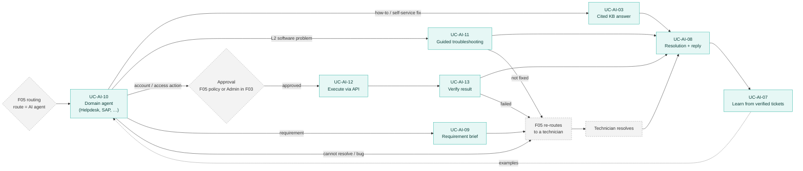

# F04 AI Ticket Processing

> Design status: TARGET V1 (draft for team review)
>
> Implementation status: NOT STARTED

This folder specifies the **AI Ticket Processing** branch (F04) of the mind map for the *AI-powered automated ticket routing and processing system*. The system receives about **8,000 internal IT tickets per day**.

**F05 routes, F04 processes.** F05 Workflow & Automation reads each ticket, classifies it, fills the ticket fields, sets the priority, detects duplicates, holds the ticket and asks the requester when data is missing, and routes it to a group, a sub-group, an AI agent or a technician. When a ticket is routed to an **AI agent**, F04 takes over and **resolves it**: with a cited KB answer, a guided troubleshooting session, or an approved action that F04 executes through the API and verifies. When a ticket is resolved, by the AI or by a technician, F04 fills in the Resolution and writes the reply to the requester. F04 also turns business requests into requirement briefs for the dev team and learns from verified tickets.

## Business context (client brief)

- The group's IT division provides **all software for every company in the group** and supports its users.
- **Level 1 support:** computer setup, account access, email, phone.
- **Level 2 support:** software problems (slow, hanging), "how do I use this", and business requirements, where a department describes a problem for IT to build software for.
- Requests are handled today in **ManageEngine** with **email ticketing**: each email becomes a request with *Subject*, *Sender* and *Created by*. About **8,000 tickets per day**.
- In the ManageEngine portal the requester must **pick a topic from the Category list and fill in that category's form**, which then calls an API. This is rigid: people pick the wrong category or give up and send an email.
- **What the client wants:** raising a ticket should be less rigid (free text), and the AI should classify each ticket and route it to **specialized agents** that handle it.
- **Today:** keywords in the subject decide the routing, step by step: large group → sub-group → individual handler.
- **Goal:** the AI understands each ticket, sends it to the right group and person, handles the whole flow where it can, and replies on the ticket, so that fewer tickets need a person.

Understanding and routing the ticket is F05. Handling it once it reaches an AI agent is F04.

### Decision D-AI-01 — Agent first (confirmed by the team, 2026-11-10)

Each domain has an **AI agent** that resolves tickets **without a technician** wherever it can: account and access requests through an approved action that F04 executes and verifies, how-to questions and known self-service fixes through cited KB answers, and L2 software problems through guided troubleshooting. **Technicians handle only three kinds of ticket:**

1. tickets the agents **cannot resolve** (physical work, access outside the catalog, guidance that did not fix it, requester says *Not solved*, execution failed, …);
2. **system bugs**, defects in a group system that the team must fix;
3. **software requirements**, requests to design or build software for a business need.

Details: UC-AI-10 and BR-AI-13.

> "AI Solutions" is the group's team that supports AI products. It is a **routing target**, not the AI Service actor of this system.

### Decision D-AI-02 — F05 routes, F04 processes (team, 2026-11-11)

The mind map was redrawn with one branch per feature folder. Reading, classifying, filling fields, priority, duplicates, ask-back and routing moved to the **Workflow & Automation** branch (F05). Executing approved requests through the API and verifying the result moved to the **AI Ticket Processing** branch (F04). The technician summary moved to **Ticket Management** (F03). What moved, and to whom, is listed under [Handover](#handover-to-other-branches).

## Scope

The eight leaves of the **AI Ticket Processing** branch of the mind map:

| # | Mind-map leaf | Use case | Stories |
|---|---|---|---|
| 1 | Propose resolution from KB with sources | UC-AI-03 | US-AI-05, US-AI-06, US-AI-17 |
| 2 | Auto-resolve L1 requests | UC-AI-10 | US-AI-20, US-AI-21 |
| 3 | Guide requester through L2 troubleshooting | UC-AI-11 | US-AI-26, US-AI-27 |
| 4 | Execute approved requests via API | UC-AI-12 | US-AI-22, US-AI-23 |
| 5 | Verify resolution result | UC-AI-13 | US-AI-24, US-AI-25 |
| 6 | Fill resolution and reply to requester | UC-AI-08 | US-AI-16 |
| 7 | Structure business requirements for dev team | UC-AI-09 | US-AI-18 |
| 8 | Learn from verified tickets and technician feedback | UC-AI-07 | US-AI-14, US-AI-19 |

IDs are kept stable on purpose: other branches cite them. IDs of work that moved are retired and never reused; new work takes the next free number.

### Brief coverage

| Brief item | Owner | Where |
|---|---|---|
| Raise a ticket without picking a category or filling a form | F05 classifies and fills the ticket fields; **F04** fills the domain form it needs to act | F05; UC-AI-10 (`formFields`) |
| Route to specialized agents that handle the ticket | F05 routes to the agent; **F04** is the agent | UC-AI-10 |
| Priority, SLA, group / sub-group / person, hold when data is missing | F05 | F05 |
| Fill in every ticket field | F05 (ticket fields); **F04** (domain form) | UC-AI-10 |
| Handle the whole flow, replace people where possible | **F04**: execute and verify account and access requests, answer how-to tickets from the KB, guide L2 troubleshooting | UC-AI-12, UC-AI-13, UC-AI-03, UC-AI-11 |
| Produce the Resolution | **F04** | UC-AI-08 |
| Reply on the ticket after it is resolved | **F04** writes the text; F03 sends it | UC-AI-08 |
| Business requirements for IT to build | **F04** | UC-AI-09 |
| The KB learns over time | **F04** reuses verified tickets; **F06** turns resolutions into articles | UC-AI-07; F06 |
| Email threading, sending emails, storing ticket fields | F03 | — |

## Boundary with other branches

**F04 acts on tickets that F05 has routed to an AI agent, and on approved requests. F05 decides the route; F03 owns the ticket record and its emails.**

| Topic | F04 (this folder) | Owned elsewhere |
|---|---|---|
| Reading and classifying the ticket | Reads F05's routing result as input (see [02-use-cases.md](02-use-cases.md), *Input from F05*) | F05: email cleaning, requester context, request type, category, support level, ticket fields, confidence |
| Missing information | Lists missing **domain-form** fields and gives the domain wording for the question | F05: holds the ticket, asks the requester, counts the rounds, pauses the SLA |
| Priority, SLA, duplicates | — | F05 |
| Routing to a group, an agent or a technician | Hands a ticket back with an `escalationClass` or `WRONG_DOMAIN` | F05 routes and re-routes; F05 assignment picks the person |
| KB solutions | Retrieves **published** articles, writes cited answers and steps, sends the KB auto-reply | F06 writes, reviews, publishes and rates articles, and marks them self-service |
| Approval | Never approves | F05 auto-approval policy check (UC-WF-07); human approval of access-provisioning requests in F03 |
| API execution and verification | **Owns them**: runs the approved action through the connector, retries, verifies, schedules revocation (UC-AI-12, UC-AI-13) | F05 whitelist, entitlement catalog and connector configuration (UC-WF-03); BR-WF-11 … BR-WF-15 still apply |
| Failure after execution or guidance | Reports the failure with its evidence | F05 re-routes to a technician |
| Ticket states | Requests transitions (`AUTOMATING`, `RESOLVED`) through the ticket API | F05 owns the state diagram; F03 stores the ticket |
| Resolution and reply | Drafts the Resolution and the reply; sends its own replies with author `AI` | F03 stores the Resolution and sends emails; the technician confirms drafts |
| Technician summary | — | F03 ("View ticket summary on handoff and approval") |
| AI metrics | Records outcomes, votes and draft edits | F07 reports them |
| AI service account and API key | Uses it | F01 (`AI_AGENT`, `X-API-Key`) |

## Processing overview

Teal boxes belong to F04. Grey dashed boxes belong to F05 or F03 and are shown only for context.

## Handover to other branches

These IDs were specified in F04 until `main@0d8ba02`. They are **retired in F04** and their numbers are not reused. Their full text is in git at that commit, for the new owner to take over.

| Retired ID | Content | New owner |
|---|---|---|
| UC-AI-01, US-AI-01, US-AI-02, US-AI-15, BR-AI-02 | Read, clean and classify the ticket, requester context, fill the ticket fields, the AI analysis contract and its versions | F05 |
| UC-AI-02, US-AI-03, US-AI-04, EML-AI-02 | Ask back when context is missing; answer by email reply. F05 should keep BR-AI-06 (never ask for secrets) for its questions | F05 |
| UC-AI-05, US-AI-09, US-AI-10, BR-AI-09, SEC-AI-08, SCR-AI-03 | Suggest priority; accept or change it | F05 |
| UC-AI-06, US-AI-11, US-AI-12, SEC-AI-02, SEC-AI-10 | Duplicate and similar tickets, duplicate warning on the create form | F05 |
| US-AI-13, SCR-AI-02 | Correct the AI's classification | F05 |
| SEC-AI-12 | Original email / cleaned text | F05 |
| SEC-AI-15 | Analysis versions tab on SCR-WF-31 | F05 |
| ES-AI-01, ES-AI-03, ES-AI-05, ES-AI-06 | Evaluation sets for classification, duplicates, incomplete tickets and raw emails | F05 |
| UC-AI-04, US-AI-07, US-AI-08, SEC-AI-06 | Technician summary, kept up to date | F03 |

Taken over **from F05**: UC-WF-08 (execute via API) → UC-AI-12; UC-WF-09 (verify, hand off on failure) → UC-AI-13; US-WF-17 → US-AI-22; US-WF-18 → US-AI-23; US-WF-19 → US-AI-24; US-WF-20 → US-AI-25. UC-WF-07 (policy check and auto-approval) **stays in F05**.

### Requests to F05 and F03

1. **F05:** retire UC-WF-08, UC-WF-09 and US-WF-17 … US-WF-20, and point to UC-AI-12, UC-AI-13 (Q-AI-17). Until then both folders specify execution; F04 is the one to follow.
2. **F05:** publish the routing output that F04 reads (*Input from F05* in [02-use-cases.md](02-use-cases.md)), including the route value for an AI agent.
3. **F05:** take over the retired items above, and add the settings `AUTO_RESOLVE_KB` (Q-AI-10) and `GUIDE_L2` (Q-AI-15).
4. **F05:** a ticket state, or a documented use of an existing one, for a ticket being handled by an AI agent and for a guided session waiting on the requester (Q-AI-10, Q-AI-15).
5. **F03:** take over the technician summary; add the resolution codes `ANSWERED_BY_KB`, `SOLVED_BY_KB` and `GUIDED_BY_AI` (Q-AI-18); approval of access-provisioning requests publishes an event that starts UC-AI-12 (Q-AI-16).
6. **F06:** the self-service flag on articles, and step-by-step troubleshooting articles with checks that UC-AI-11 can follow.

## Documents

| File | Content |
|---|---|
| [01-features.md](01-features.md) | Features F04.1 … F04.8, out of scope |
| [02-use-cases.md](02-use-cases.md) | Actors, permissions, input from F05, agent result contract, use case diagram, UC-AI-03, 07 … 13 |
| [03-user-stories-invest.md](03-user-stories-invest.md) | Backlog with MoSCoW and size, INVEST review |
| [04-acceptance-criteria.md](04-acceptance-criteria.md) | Given / When / Then criteria, evaluation sets |
| [05-business-rules.md](05-business-rules.md) | BR-AI rules |
| [information-architecture/](information-architecture/README.md) | Sections, pages and emails (SEC-AI, SCR-AI, EML-AI), routes and permissions, navigation, user flows, UI states |

## Open questions

| # | Question | Value used in these documents until decided |
|---|---|---|
| Q-AI-1 | Initial priority | Moved to F05 |
| Q-AI-2 | Does the AI read attachments (screenshots, photos of error messages) in V1? | No. V1 reads the text and attachment **file names** only. Image reading (OCR) is future work. |
| Q-AI-3 | Who maintains the request types and categories? | Moved to F05. Agent profiles (UC-AI-10) are seeded in V1 and cannot be edited (D-AI-IA-05). |
| Q-AI-4 | Ask back or apply the maximum duration | Moved to F05 |
| Q-AI-5 | Which LLM provider, and may ticket text leave the company network? | Not decided. BR-AI-07 (mask credentials before any model call) applies whichever provider is chosen. |
| Q-AI-6 | When the requester marks a KB article as the fix, can the ticket go straight to `CLOSED`? | The ticket goes to `RESOLVED` with `SOLVED_BY_KB` and then straight to `CLOSED`, because the requester has already confirmed. Not allowed in `AUTOMATING`. To agree with F03 and F05. |
| Q-AI-7 | Does our system **replace** ManageEngine, or sit **on top of** it? | Our system has its own ticket store (F03). An integration with ManageEngine is not specified yet. |
| Q-AI-8 | VIP priority | Moved to F05 |
| Q-AI-9 | ~~Should the AI choose the group and the person, or classify only?~~ | **Decided (D-AI-02):** F05 classifies and routes. |
| Q-AI-10 | What does F05 need for the KB auto-reply (US-AI-17)? | `AUTO_RESOLVE_KB` **on by default**, an Admin can turn it off per subcategory, relevance ≥ 0.85. F05 needs the setting and the transitions from the agent's state to `RESOLVED`, and `RESOLVED` → `ASSIGNED` when the requester says *Not solved*. **F05 owner to confirm.** |
| Q-AI-11 | Senders not in the directory | Moved to F05. F04 never executes an action for a ticket without a known requester. |
| Q-AI-12 | ~~"Specialized agents": AI agents or human agents?~~ | **Decided (D-AI-01):** AI agents per domain. |
| Q-AI-13 | Which domains get their own agent profile in V1? | `HELPDESK` and `SAP`; the other domains use the `HELPDESK` agent and escalate to their team. |
| Q-AI-14 | What share of tickets should the agents close without a technician, and by when? | Proposed: 50% of all tickets within 3 months of go-live, measured weekly in F07; to agree with the client. |
| Q-AI-15 | Guided L2 troubleshooting (UC-AI-11): which ticket state while the AI waits for the requester, and how many rounds? | **Proposed:** the ticket waits in F05's `NEEDS_INFO` with reason `GUIDED_TROUBLESHOOTING` (SLA paused, F05 reminders apply); at most **5 rounds** and **24 hours** of no answer, then escalate. Setting `GUIDE_L2`, on by default. **Conflict to resolve:** today F05 sends every answer in `NEEDS_INFO` back to `NEW` for re-routing, and auto-closes `NEEDS_INFO` after N days; F05 must skip both for reason `GUIDED_TROUBLESHOOTING` (answers go to the agent), or add a state. **F05 owner to confirm.** |
| Q-AI-16 | A request outside the catalog that an Administrator approves in F03: what does F04 re-check before it executes? | **Proposed:** the operation must still be in an enabled whitelist entry; the entitlement catalog check is replaced by the approval record (Administrator, time, scope). The approval record stores the operation and parameters that are executed, and its id replaces `decisionId` in the idempotency key (BR-AI-15). The final mind map has no approval leaf under Ticket Management (only "View approval requests and outcomes" under Activity Log), so whether a person approves in F03 at all is open. To agree with F03 and F05. |
| Q-AI-17 | When does F05 retire UC-WF-08/09 and US-WF-17 … 20? Who owns `workflow_runs`? | F04 owns execution and the tables `workflow_runs` and `workflow_run_attempts` (names kept). F05 keeps UC-WF-07. **F05 owner to confirm.** |
| Q-AI-18 | Resolution code for a ticket fixed by guided troubleshooting | **Proposed:** `GUIDED_BY_AI`. F03 to add it. |

## Progress

- [x] Scope and boundary with F05, F03, F06, F07
- [x] Decision D-AI-01: agent first; technicians only for three classes
- [x] Decision D-AI-02: F05 routes, F04 processes; scope re-cut to the eight mind-map leaves
- [x] Use cases, user stories, acceptance criteria and business rules for the new scope
- [x] Information architecture (sections, emails, navigation, flows, UI states)
- [ ] F05 takes over the retired items and retires UC-WF-08/09 (Q-AI-17)
- [ ] Decide the remaining open questions (Q-AI-10, Q-AI-15, Q-AI-16 with F05 and F03; Q-AI-14 with the client)
- [ ] Non-functional requirements and traceability (API, tables)
- [ ] Build the evaluation sets ES-AI-02, ES-AI-04, ES-AI-07, ES-AI-08
