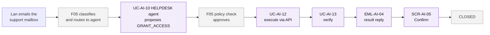
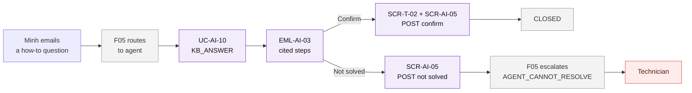
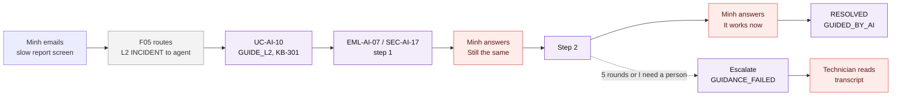
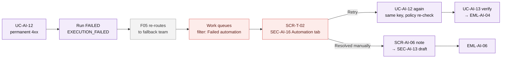
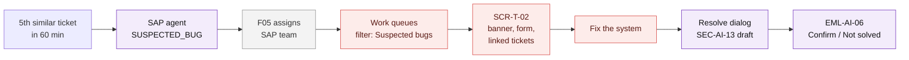
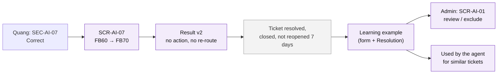

# User Flows — F04 AI Ticket Processing

> Design status: TARGET V1
>
> Related: [IA overview](README.md) · [Screens and navigation](01-screens-and-navigation.md) · [UI states](03-ui-states-and-accessibility.md)

Seven flows. Every flow starts after F05 has routed the ticket to an AI agent. Flows 1–3 are resolved by the agent with no technician (D-AI-01); flow 4 is an automation failure; flows 5–6 are two of the three escalation classes; flow 7 is how the AI improves. Sample people are the same as in the [acceptance criteria](../04-acceptance-criteria.md). Purple: F04. Grey: F03 / F05. Red: a person does the work.

## Flow 1 — Access request executed and verified, no technician

*Lan (Accounting, Real Estate) needs read access to the Accounting shared folder.* · US-AI-20, US-AI-22, US-AI-24, US-AI-16

1. Lan emails "Please give me read access to the Accounting shared folder". F03 creates the ticket and F05 classifies it as `GRANT_ACCESS` and routes it to the `HELPDESK` agent.
2. The agent fills the request (`recipient`, `system`, `permission`) and proposes `GRANT_ACCESS` (SEC-AI-07 shows the form later, marked "Filled by AI").
3. F05's policy check approves it. F04 executes it through the connector (UC-AI-12) and checks that Lan is in the access group (UC-AI-13). Lan's ticket shows "Being processed" in **SEC-AI-16**.
4. Lan receives **EML-AI-04**: "You now have read access to \\\\fs01\\ketoan." The ticket is `RESOLVED` with a Resolution written by the AI; no technician was assigned (AC-AI-20.7).
5. Lan clicks *Confirm* → SCR-T-02 with **SCR-AI-05** → *Yes, this solved it* → F05 `confirmTicketResolution` → `CLOSED`. *Not solved* → F05 `reopenTicket` → a technician. No click → F05 reminders and auto-close (UC-WF-06).
6. **Branches:** the policy check fails → F05 escalates with `AGENT_CANNOT_RESOLVE` (flow 5 from step 3); execution or verification fails → flow 4.

## Flow 2 — How-to question answered by the agent

*Minh (Sales, EV Charging) asks how to add the Sales shared mailbox in Outlook.* · US-AI-05, US-AI-17

1. Minh emails "How do I add the Sales shared mailbox to my Outlook?". F05 routes it to the `HELPDESK` agent.
2. The agent finds KB-205 (relevance ≥ 0.85) and sends **EML-AI-03** with cited steps; the ticket is `RESOLVED` (`ANSWERED_BY_KB`).
3. Minh clicks *Confirm* → SCR-T-02 opens with **SCR-AI-05** pre-selected (SSO first if needed) → he clicks *Yes, this solved it* → `CLOSED`.
4. **Branch:** *Not solved* → SCR-AI-05 → F05 assigns a technician with `NOT_SOLVED_BY_AGENT`; the banner says KB-205 was already sent.
5. **Portal variant:** while Minh types on SCR-T-01, **SEC-AI-01** shows KB-205; *This solved my problem* → no ticket is created.

## Flow 3 — L2 problem fixed with guided troubleshooting

*Minh writes "The charging report screen is very slow since this morning".* · US-AI-26, US-AI-27

1. F05 routes the ticket (`EV_CHARGING`, `L2`, `INCIDENT`) to the agent. KB-301 "Charging report is slow" has a self-service procedure, so the agent starts guidance.
2. Minh receives **EML-AI-07** with step 1 (clear the browser cache, `[KB-301 §1]`) and the three answers. The same card is in **SEC-AI-17** on the ticket.
3. Minh replies "Still the same, it takes about 2 minutes". The agent records the finding and sends step 2 (shorten the date range, `[KB-301 §2]`).
4. Minh chooses *It works now* → the ticket is `RESOLVED` with `GUIDED_BY_AI`; the reply and the Resolution say that step 2 fixed it. Minh confirms through **SCR-AI-05**.
5. **Branches:** no fix after the procedure or 5 rounds, or *I need a person* → `GUIDANCE_FAILED`; the technician opens the ticket and reads the transcript in **SEC-AI-17**. An answer shows a known defect code → `SYSTEM_BUG` (flow 5). No answer for 24 hours → F05 reminder, then escalation (Q-AI-15).

## Flow 4 — Automation fails and a technician takes over

*The connector rejects Lan's grant because the shared folder was moved.* · US-AI-25, US-AI-22, US-AI-16

1. The connector returns a permanent error. The run is `FAILED`; F04 sets `AGENT_CANNOT_RESOLVE` with `EXECUTION_FAILED` and reports the error code, failed step and attempts.
2. F05 re-routes the ticket to the whitelist entry's fallback team. Hai finds it with the saved filter *Failed automation* (**SEC-AI-14**).
3. On **SCR-T-02** the banner (**SEC-AI-05**) says what failed; the *Automation* tab (**SEC-AI-16**) shows the attempts. Lan's view says "A technician is taking over".
4. Hai fixes the folder path in the connector configuration (F05) and clicks *Retry* → the run restarts with the same idempotency key after a policy re-check → verification → **EML-AI-04**.
5. **Alternative:** Hai grants the access by hand and chooses *Resolved manually* → **SCR-AI-06** (note required) → the Resolve dialog with the AI draft (**SEC-AI-13**) → **EML-AI-06**.

## Flow 5 — Suspected system bug reaches the technician

*Five users report "FB60 error F5 702" within 60 minutes.* · US-AI-21, US-AI-20, US-AI-16

1. The 5th ticket gets `escalationClass = SYSTEM_BUG`; no auto-reply or guidance is started.
2. F05 assigns it to the SAP team. Quang opens the work queues with the saved filter *Suspected bugs* (**SEC-AI-14**).
3. On **SCR-T-02** Quang sees the **SEC-AI-05** banner (class, reason, set by the SAP agent, the 4 linked tickets), the F03 summary and the **SEC-AI-07** SAP form (company code, transaction, error); he links the tickets as duplicates in F03.
4. After fixing the system, Quang opens *Resolve*; **SEC-AI-13** drafts the Resolution and the reply; he edits and sends (**EML-AI-06**).
5. The requester confirms through **SCR-AI-05**, or chooses *Not solved*.
6. **Other start:** an `AGENT_CANNOT_RESOLVE` ticket (broken mouse, *Not solved*, failed policy check, failed guidance) enters at step 2 through the work queues, with the matching banner.

## Flow 6 — Business requirement to the dev team

*Lan asks for warnings when a lease contract is 60 days from expiry.* · US-AI-18

```mermaid
flowchart LR
    a["Lan emails a<br/>business need"] --> b["F05 routes<br/>BUSINESS_REQUIREMENT"]
    b --> c["UC-AI-09 brief<br/>missing: system"]
    c --> d["F05 asks<br/>the missing point"]
    d --> e["EML-AI-05"]
    e --> f["SCR-AI-04<br/>review, confirm"]
    f --> g["Agent escalates<br/>SOFTWARE_REQUIREMENT"]
    g --> h["Real Estate dev team<br/>SEC-AI-11 brief"]

    classDef f04 fill:#f3ecfb,color:#111,stroke:#7b3fbf
    classDef other fill:#f3f3f3,color:#333,stroke:#999
    classDef human fill:#fdecea,color:#5a1a14,stroke:#d9534f
    class c,e,f,g f04
    class b,d other
    class h human
```

1. F05 routes the ticket as `REAL_ESTATE/REQUIREMENT`; the agent drafts the brief and lists the missing system; F05 asks Lan.
2. **EML-AI-05** asks Lan to review; the link opens **SCR-AI-04**, where she edits and confirms.
3. The agent escalates with `SOFTWARE_REQUIREMENT`; the ticket reaches the Real Estate dev team with the confirmed brief in **SEC-AI-11**.
4. **Branch:** no confirmation within F05's reminder period → the brief goes marked "Not confirmed by requester".

## Flow 7 — Feedback and verified tickets teach the agents

*Quang finds that the SAP agent read the wrong transaction code, then resolves the ticket.* · US-AI-14, US-AI-19

1. In **SEC-AI-07** Quang clicks *Correct*; **SCR-AI-07** shows the SAP form; he saves FB70. Nothing is executed or re-routed.
2. Quang marks the cited steps *Helpful* in **SEC-AI-09**, resolves the ticket with the AI draft, and his edits to the draft are recorded.
3. When the ticket has been closed for 7 days without reopening, it becomes a learning example with the final form and the Resolution.
4. The Admin reviews it on **SCR-AI-01** and can exclude it; otherwise the SAP agent uses it for similar new tickets (`examplesUsed`, visible in **SEC-AI-18**).
5. **Tickets the agent resolved alone:** Quang opens the saved filter *Resolved by AI* (**SEC-AI-14**), picks a *Not reviewed* ticket, and reads it read-only with **SEC-AI-19**. He finds the agent granted `FI-Admin` instead of FI read-only and chooses *Resolved incorrectly* with the reason. The Admin is notified, and the ticket never becomes a learning example. Tickets that the requester confirmed and nobody flagged become examples without review.
