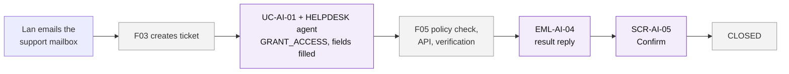
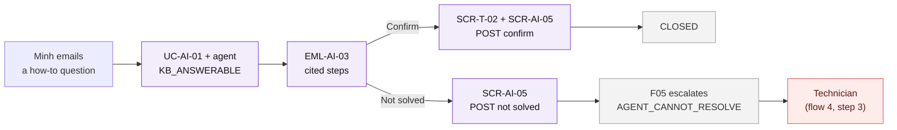
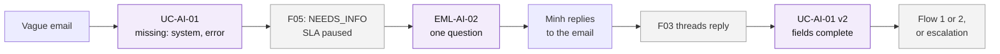
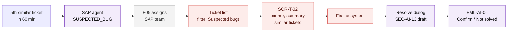
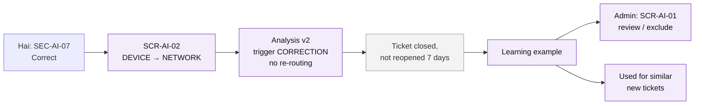

# User Flows — F04 AI Ticket Processing

> Design status: TARGET V1
>
> Related: [IA overview](README.md) · [Screens and navigation](01-screens-and-navigation.md) · [UI states](03-ui-states-and-accessibility.md)

Six flows. Flows 1–3 are resolved by the domain agent with no technician (D-AI-01); flows 4–5 are two of the three escalation classes; flow 6 is how the AI improves. Sample people are the same as in the [acceptance criteria](../04-acceptance-criteria.md). Purple: F04. Grey: F03 / F05. Red: a person does the work.

## Flow 1 — Access request resolved without a technician

*Lan (Accounting, Real Estate) needs read access to the Accounting shared folder.* · US-AI-15, US-AI-20, US-AI-16 · F05 UC-WF-07…09

1. Lan emails "Please give me read access to the Accounting shared folder".
2. F03 creates the ticket; UC-AI-01 cleans the email, resolves Lan's context, the `HELPDESK` agent fills `GRANT_ACCESS` with `recipient`, `system`, `permission` (SEC-AI-07 shows them later, marked "Filled by AI").
3. F05 checks the policy, calls the API and verifies (no F04 screen).
4. Lan receives **EML-AI-04**: "You now have read access to \\\\fs01\\ketoan." The ticket is `RESOLVED`; no technician was assigned (AC-AI-20.8).
5. Lan clicks *Confirm* → SCR-T-02 with **SCR-AI-05** → *Yes, this solved it* → F05 `confirmTicketResolution` → `CLOSED`. *Not solved* → F05 `reopenTicket` → a technician (flow 4). No click → F05 reminders and auto-close (UC-WF-06).
6. **Branch:** the policy check fails → F05 escalates with `AGENT_CANNOT_RESOLVE` and continues as flow 4 from step 3.

## Flow 2 — How-to question answered by the agent

*Minh (Sales, EV Charging) asks how to add the Sales shared mailbox in Outlook.* · US-AI-05, US-AI-17

1. Minh emails "How do I add the Sales shared mailbox to my Outlook?".
2. The agent finds KB-205 (relevance ≥ 0.85) and sends **EML-AI-03** with cited steps; the ticket is `RESOLVED` (`ANSWERED_BY_KB`).
3. Minh clicks *Confirm* → SCR-T-02 opens with **SCR-AI-05** pre-selected (SSO first if needed) → he clicks *Yes, this solved it* → `CLOSED`.
4. **Branch:** *Not solved* → SCR-AI-05 → F05 assigns a technician with `NOT_SOLVED_BY_AGENT`; the summary says KB-205 was already sent.
5. **Portal variant:** while Minh types on SCR-T-01, **SEC-AI-01** shows KB-205; *This solved my problem* → no ticket is created.

## Flow 3 — Missing information, answered by email reply

*Minh writes "I can't get into the system".* · US-AI-03, US-AI-04 · F05 BR-WF-06

1. The analysis lists `system` and `errorMessage` as missing; F05 sets `NEEDS_INFO`.
2. **EML-AI-02** asks one question in Vietnamese with examples (AC-AI-03.1). The same question appears in **SEC-AI-03**.
3. Minh replies to the email; F03 threads it; the AI reads only the new text.
4. Analysis version 2 has the fields; the ticket continues as flow 1, flow 2 or an escalation.
5. **Branch:** still missing after the last round → F05 escalates with `MAX_CLARIFICATION_REACHED`.

## Flow 4 — Suspected system bug reaches the technician

*Five users report "FB60 error F5 702" within 60 minutes.* · US-AI-21, US-AI-20, US-AI-07, US-AI-11, US-AI-16

1. The 5th ticket gets `escalationClass = SYSTEM_BUG`; no auto-reply is sent.
2. F05 assigns it to the SAP team. Quang opens the ticket list with the saved filter *Suspected bugs* (**SEC-AI-14**).
3. On **SCR-T-02** Quang sees the **SEC-AI-05** banner (class, reason, set by the SAP agent), the **SEC-AI-06** summary, the **SEC-AI-07** SAP form (company code, transaction, error) and the **SEC-AI-10** burst of linked tickets; he links them as duplicates.
4. After fixing the system, Quang opens *Resolve*; **SEC-AI-13** drafts the Resolution and the reply; he edits and sends (**EML-AI-06**). Whether the linked duplicates are resolved with it is F03's decision (section 7 of the screens file).
5. The requester confirms through **SCR-AI-05** (F05 `confirmTicketResolution`), or chooses *Not solved* (`reopenTicket`).
6. **Other start:** an `AGENT_CANNOT_RESOLVE` ticket (broken mouse, *Not solved*, failed policy) enters at step 2 through the assigned-tickets list, with the matching banner.

## Flow 5 — Business requirement to the dev team

*Lan asks for warnings when a lease contract is 60 days from expiry.* · US-AI-18

```mermaid
flowchart LR
    a["Lan emails a<br/>business need"] --> b["UC-AI-01<br/>BUSINESS_REQUIREMENT"]
    b --> c["UC-AI-09 brief<br/>+ questions"]
    c --> d["EML-AI-05"]
    d --> e["SCR-AI-04<br/>review, confirm"]
    e --> f["F05 escalates<br/>SOFTWARE_REQUIREMENT"]
    f --> g["Real Estate dev team<br/>SEC-AI-11 brief"]

    classDef f04 fill:#f3ecfb,color:#111,stroke:#7b3fbf
    classDef other fill:#f3f3f3,color:#333,stroke:#999
    classDef human fill:#fdecea,color:#5a1a14,stroke:#d9534f
    class b,c,d,e f04
    class f other
    class g human
```

1. The analysis classifies `REAL_ESTATE/REQUIREMENT`; the AI drafts the brief and asks for the missing system (UC-AI-02).
2. **EML-AI-05** asks Lan to review; the link opens **SCR-AI-04**, where she edits and confirms.
3. The ticket reaches the Real Estate dev team with the confirmed brief in **SEC-AI-11**.
4. **Branch:** no confirmation within F05's reminder period → the brief goes marked "Not confirmed by requester".

## Flow 6 — A correction teaches the AI

*Hai finds a ticket classified `HELPDESK/DEVICE` that is really a network problem.* · US-AI-13, US-AI-14, US-AI-19

1. In **SEC-AI-07** Hai clicks *Correct*; **SCR-AI-02** offers only seeded values; he saves `HELPDESK/NETWORK`. The ticket is not re-routed.
2. Hai marks the summary *Helpful* in **SEC-AI-06**.
3. When the ticket has been closed for 7 days without reopening, it becomes a learning example.
4. The Admin reviews it on **SCR-AI-01** and can exclude it; otherwise similar new tickets use it (`examplesUsed`, visible in **SEC-AI-15**).
