# Information Architecture — F04 AI Ticket Processing

> Design status: TARGET V1 (draft for team review)
>
> Implementation status: NOT STARTED

This folder places the 21 F04 stories on screens and emails. **F04 owns very few pages.** Almost all of its UI lives inside pages owned by other branches (the F03 ticket pages, the F05 AI-decision pages) and inside the emails that carry most of the 8,000 tickets a day. So the inventory has three kinds of entries:

| Kind | ID | Meaning |
|---|---|---|
| Host page section | `SEC-AI-xx` | An F04 section inside a page owned by F03, F05 or F01. The host page keeps its own ID (`SCR-T-02`, `SCR-WF-31`, …) |
| F04 page or modal | `SCR-AI-xx` | A page or modal that only F04 needs |
| Email | `EML-AI-xx` | An email whose text the AI writes; F03 / F05 send it |

Inputs: [Use cases](../02-use-cases.md), [User stories](../03-user-stories-invest.md), [Acceptance criteria](../04-acceptance-criteria.md). Host page IDs come from the Workflow branch (`docs/traceability/master-traceability.md`); F03 has not published its screens yet, so `SCR-T-01` and `SCR-T-02` are the names the Workflow branch proposed.

| File | Content |
|---|---|
| [01-screens-and-navigation.md](01-screens-and-navigation.md) | Screen, section and email inventory; routes and permissions; navigation per role; story-to-screen mapping |
| [02-user-flows.md](02-user-flows.md) | Six flows, each starting from an email or the portal |
| [03-ui-states-and-accessibility.md](03-ui-states-and-accessibility.md) | AI state contract, markers that separate AI / workflow / human, escalation banner, accessibility |

## IA decisions

| ID | Decision | Why |
|---|---|---|
| D-AI-IA-01 | F04 adds **sections** to F03's ticket pages instead of its own ticket pages. | One ticket page for everyone; F04 changes only what the AI contributes. |
| D-AI-IA-02 | A link in an email **never changes state with one click** (no GET that closes or reopens a ticket). The link opens the ticket with the action pre-selected; after Microsoft SSO login (F01) if needed, a confirm modal sends a POST, and the API checks that the user owns the ticket. | Corporate mail scanners such as Safe Links open every link in an email before the user does; a one-click link would close tickets by itself. |
| D-AI-IA-03 | The requester's view of a ticket shows the category, the AI's questions, the agent's replies, KB suggestions and the requirement brief. It **never** shows the summary, the confidence, the escalation banner or the analysis fields (AC-AI-01.3, AC-AI-07.5). | Internal working data stays with IT. |
| D-AI-IA-04 | No new menu for requesters or technicians. Technicians get new columns and filters in F03's ticket list. Admins get one **AI** group in the sidebar that gathers the existing F01 / F05 AI pages and F04's learning examples. | Users find AI features where they already work. |
| D-AI-IA-05 | No page to edit domain agent profiles in V1: profiles are seeded (Q-AI-3, Q-AI-13). | No story needs it. |
| D-AI-IA-06 | Every AI output on screen shows **who produced it**: the AI, the workflow (F05) or a person (see [UI states](03-ui-states-and-accessibility.md)). | Agent-first (D-AI-01) only works if people can tell what the AI did. |

## Information architecture

Solid lines: a page and its sections or modals. Dashed arrows: which areas each actor uses. Purple: F04-owned items. White: pages owned by other branches, with the F04 sections they host.

```mermaid
flowchart TB
    req["<b>Requester</b>"]
    tech["<b>Technician</b>"]
    admin["<b>Admin</b>"]

    subgraph email["Email (most tickets)"]
        direction TB
        eml01["<b>EML-AI-01</b> Acknowledgement + KB suggestions"]
        eml02["<b>EML-AI-02</b> AI question"]
        eml03["<b>EML-AI-03</b> Agent KB reply<br/>Confirm / Not solved"]
        eml04["<b>EML-AI-04</b> Result reply after automation"]
        eml05["<b>EML-AI-05</b> Requirement brief to confirm"]
        eml06["<b>EML-AI-06</b> Technician reply (AI-drafted)"]
    end

    subgraph tickets["Tickets (pages owned by F03)"]
        direction TB
        t01["<b>SCR-T-01 Create ticket</b><br/>• Free text only, no category<br/>• SEC-AI-01 KB suggestions<br/>• SEC-AI-02 Duplicate warning"]
        tlist["<b>Ticket list</b> (F03)<br/>• SEC-AI-14 Escalation class,<br/>AI category, bug cluster filters"]
        t02["<b>SCR-T-02 Ticket detail</b><br/>Requester: SEC-AI-03 conversation,<br/>SEC-AI-04 KB suggestions, SEC-AI-11 brief<br/>Technician: SEC-AI-05 … SEC-AI-12"]
        resolve["<b>Resolve dialog</b> (F03)<br/>• SEC-AI-13 AI draft of Resolution + reply"]
        m02["<b>SCR-AI-02</b> Correct AI fields"]
        m03["<b>SCR-AI-03</b> Change priority"]
        m04["<b>SCR-AI-04</b> Review requirement brief"]
        m05["<b>SCR-AI-05</b> Confirm resolution / Not solved"]
    end

    subgraph adminarea["AI administration"]
        direction TB
        wf03["<b>SCR-WF-03 AI scope</b> (F05)"]
        wf30["<b>SCR-WF-30 AI decisions</b> (F05)"]
        wf31["<b>SCR-WF-31 AI decision detail</b> (F05)<br/>• SEC-AI-15 Analysis versions tab"]
        ai01["<b>SCR-AI-01 Learning examples</b><br/>• List, filter by domain<br/>• Exclude example"]
        f01["<b>AI suggestions, Service accounts</b> (F01)"]
    end

    t02 --- m02 & m03 & m04 & m05
    t02 --- resolve
    tlist --- t02
    wf30 --- wf31

    req -.-> email
    req -.-> t01
    req -.-> t02
    tech -.-> tlist
    tech -.-> t02
    admin -.-> adminarea
    admin -.-> tickets

    classDef actor fill:none,stroke:none,color:#111
    classDef host fill:#fff,color:#111,stroke:#1168bd,text-align:left
    classDef ai fill:#f3ecfb,color:#111,stroke:#7b3fbf,text-align:left
    class req,tech,admin actor
    class t01,tlist,t02,resolve,wf03,wf30,wf31,f01 host
    class eml01,eml02,eml03,eml04,eml05,eml06,m02,m03,m04,m05,ai01 ai
```

## Screen hierarchy per role

| Role | Home page (F01) | Where F04 shows up |
|---|---|---|
| Requester | My tickets | Emails EML-AI-01 … 05; create form (SEC-AI-01, 02); ticket detail (SEC-AI-03, 04, 11); modals SCR-AI-04, SCR-AI-05 |
| Technician | Assigned tickets | Ticket list columns and filters (SEC-AI-14); ticket detail (SEC-AI-05 … 12); Resolve dialog (SEC-AI-13); modals SCR-AI-02, SCR-AI-03 |
| Admin | Dashboard | Everything a technician sees, on every ticket; sidebar **AI** group: SCR-WF-03, SCR-WF-30/31 with SEC-AI-15, SCR-AI-01, F01's AI suggestions and service accounts |
| AI Service | — | No UI; works through the API as `AI_AGENT` |

**Related:** [F04 README](../README.md) · [Screens and navigation](01-screens-and-navigation.md) · [User flows](02-user-flows.md) · [UI states](03-ui-states-and-accessibility.md)
