# Information Architecture — F04 AI Ticket Processing

> Design status: TARGET V1 (draft for team review)
>
> Implementation status: NOT STARTED

This folder places the 15 F04 stories on screens and emails. **F04 owns very few pages.** Almost all of its UI lives inside pages owned by other branches (the F03 ticket pages) and inside the emails that carry most of the 8,000 tickets a day. So the inventory has three kinds of entries:

| Kind | ID | Meaning |
|---|---|---|
| Host page section | `SEC-AI-xx` | An F04 section inside a page owned by F03 or F05. The host page keeps its own ID (`SCR-T-02`, `SCR-T-04`, …) |
| F04 page or modal | `SCR-AI-xx` | A page or modal that only F04 needs |
| Email | `EML-AI-xx` | An email whose text the AI writes; F03 sends it |

IDs of sections, modals and emails that moved to F05 or F03 (SEC-AI-02, 06, 08, 10, 12, 15; SCR-AI-02, 03; EML-AI-02) are retired and not reused; see [Handover](../README.md#handover-to-other-branches). SEC-AI-07 now covers only the **domain form** filled by the agent; the AI-filled ticket fields are F05's.

Inputs: [Use cases](../02-use-cases.md), [User stories](../03-user-stories-invest.md), [Acceptance criteria](../04-acceptance-criteria.md). Host page IDs come from the F03 information architecture (`SCR-T-01` create, `SCR-T-02` detail, `SCR-T-04` work queues).

| File | Content |
|---|---|
| [01-screens-and-navigation.md](01-screens-and-navigation.md) | Section, page and email inventory; routes and permissions; navigation per role; story-to-screen mapping |
| [02-user-flows.md](02-user-flows.md) | Seven flows, each starting from an email or the portal |
| [03-ui-states-and-accessibility.md](03-ui-states-and-accessibility.md) | AI state contract, markers that separate AI / workflow / human, escalation banner, accessibility |

## IA decisions

| ID | Decision | Why |
|---|---|---|
| D-AI-IA-01 | F04 adds **sections** to F03's ticket pages instead of its own ticket pages. | One ticket page for everyone; F04 changes only what the AI contributes. |
| D-AI-IA-02 | A link in an email **never changes state with one click** (no GET that closes or reopens a ticket, or answers a guidance step). The link opens the ticket with the action pre-selected; after Microsoft SSO login (F01) if needed, a confirm modal sends a POST, and the API checks that the user owns the ticket. | Corporate mail scanners such as Safe Links open every link in an email before the user does; a one-click link would act by itself. |
| D-AI-IA-03 | The requester's view of a ticket shows the agent's answers, guidance steps, the automation status in plain words, KB suggestions and the requirement brief. It **never** shows the escalation banner, the agent result, the run attempts or the learning data. | Internal working data stays with IT. |
| D-AI-IA-04 | No new menu for requesters or technicians. Technicians get new columns and filters in F03's work queues. Admins get one **AI** group in the sidebar that gathers the existing F01 / F05 AI pages and F04's learning examples. | Users find AI features where they already work. |
| D-AI-IA-05 | No page to edit domain agent profiles in V1: profiles are seeded (Q-AI-3, Q-AI-13). | No story needs it. |
| D-AI-IA-06 | Every AI output on screen shows **who produced it**: the AI, the workflow (F05) or a person (see [UI states](03-ui-states-and-accessibility.md)). | Agent-first (D-AI-01) only works if people can tell what the AI did. |
| D-AI-IA-07 | The automation run (execute and verify) is a tab of the ticket detail, not a page of its own. A failed run is fixed from the ticket the technician was assigned. | The technician already works on that ticket; the run is part of its history. |

## Information architecture

Solid lines: a page and its sections or modals. Dashed arrows: which areas each actor uses. Purple: F04-owned items. White: pages owned by other branches, with the F04 sections they host.

```mermaid
flowchart TB
    req["<b>Requester</b>"]
    tech["<b>Technician</b>"]
    admin["<b>Admin</b>"]

    subgraph email["Email (most tickets)"]
        direction TB
        eml01["<b>EML-AI-01</b> Acknowledgement + KB suggestions"]
        eml03["<b>EML-AI-03</b> Agent KB reply<br/>Confirm / Not solved"]
        eml07["<b>EML-AI-07</b> Guidance step"]
        eml04["<b>EML-AI-04</b> Result reply after execution"]
        eml08["<b>EML-AI-08</b> Access ends tomorrow"]
        eml05["<b>EML-AI-05</b> Requirement brief to confirm"]
        eml06["<b>EML-AI-06</b> Technician reply (AI-drafted)"]
    end

    subgraph tickets["Tickets (pages owned by F03)"]
        direction TB
        t01["<b>SCR-T-01 Create ticket</b><br/>• SEC-AI-01 KB suggestions"]
        tlist["<b>SCR-T-04 Work queues</b><br/>• SEC-AI-14 Escalation class,<br/>automation status, filters"]
        t02["<b>SCR-T-02 Ticket detail</b><br/>Requester: SEC-AI-03 conversation, SEC-AI-04 KB,<br/>SEC-AI-17 guidance, SEC-AI-11 brief<br/>Technician: SEC-AI-05, 07, 09, 16, 17<br/>Admin: SEC-AI-18"]
        resolve["<b>Resolve dialog</b> (F03)<br/>• SEC-AI-13 AI draft of Resolution + reply"]
        m04["<b>SCR-AI-04</b> Review requirement brief"]
        m05["<b>SCR-AI-05</b> This article solved my problem"]
        m06["<b>SCR-AI-06</b> Resolve run manually"]
        m07["<b>SCR-AI-07</b> Correct domain form"]
    end

    subgraph adminarea["AI administration"]
        direction TB
        wf03["<b>SCR-WF-03 AI scope</b> (F05)"]
        wf30["<b>SCR-WF-30 AI decisions</b> (F05)"]
        ai01["<b>SCR-AI-01 Learning examples</b><br/>• List, filter by domain<br/>• Exclude example"]
        f01["<b>AI suggestions, Service accounts</b> (F01)"]
    end

    t02 --- m04 & m05 & m06 & m07
    t02 --- resolve
    tlist --- t02

    req -.-> email
    req -.-> t01
    req -.-> t02
    tech -.-> tlist
    tech -.-> t02
    admin -.-> adminarea
    admin -.-> tickets

    classDef actor fill:none,stroke:none,color:#111
    classDef host fill:#fff,color:#111,stroke:#1168bd,text-align:left
    classDef ai fill:#f3ecfb,color:#111,stroke:#7b3fbf,text-align:left
    class req,tech,admin actor
    class t01,tlist,t02,resolve,wf03,wf30,f01 host
    class eml01,eml03,eml04,eml05,eml06,eml07,eml08,m04,m05,m06,m07,ai01 ai
```

## Screen hierarchy per role

| Role | Home page (F01) | Where F04 shows up |
|---|---|---|
| Requester | Portal (F02) | Emails EML-AI-01, 03 … 05, 07, 08; create form (SEC-AI-01); ticket detail (SEC-AI-03, 04, 11, 17); modals SCR-AI-04, SCR-AI-05 |
| Technician | Workbench (F02) | Columns and filters (SEC-AI-14); ticket detail (SEC-AI-05, 07, 09, 16, 17); Resolve dialog (SEC-AI-13); modals SCR-AI-06, SCR-AI-07 |
| Admin | Dashboard | Everything a technician sees, on every ticket, plus SEC-AI-18; sidebar **AI** group: SCR-WF-03, SCR-WF-30, SCR-AI-01, F01's AI suggestions and service accounts |
| AI Service | — | No UI; works through the API as `AI_AGENT` |

**Related:** [F04 README](../README.md) · [Screens and navigation](01-screens-and-navigation.md) · [User flows](02-user-flows.md) · [UI states](03-ui-states-and-accessibility.md)
