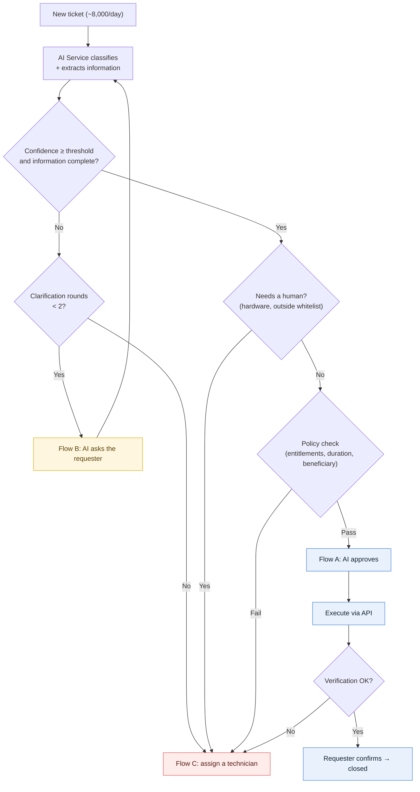
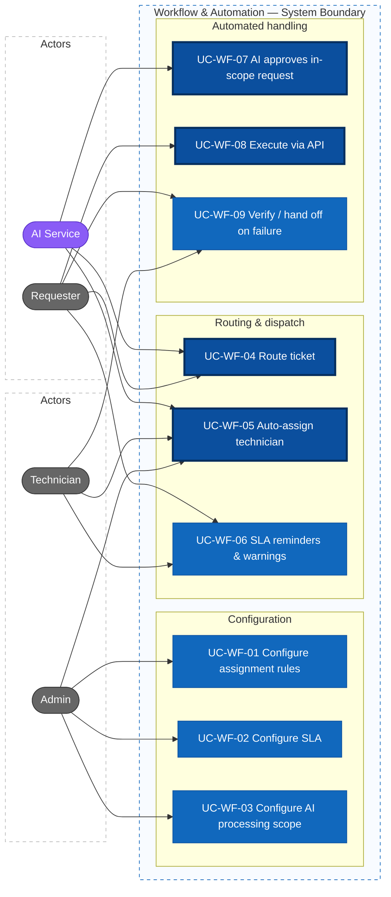
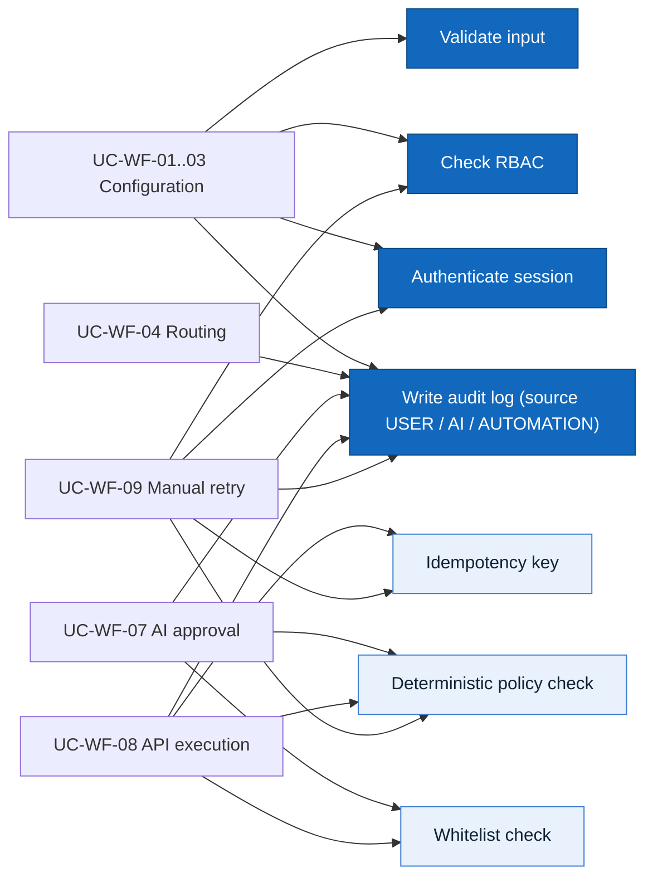
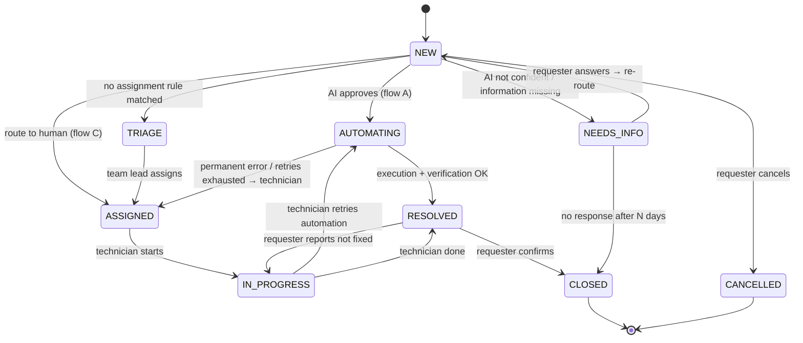

# Actors, Roles, Use Cases — Workflow & Automation

> Design status: TARGET V1
>
> Scope: F05 Workflow & Automation (UC-WF-01 … UC-WF-09)

## Actors / roles

| Role code | Display name | Workflow responsibilities |
|---|---|---|
| `ADMIN` | Administrator | Configures assignment rules, SLA, and the AI processing scope (AI actions, whitelist, entitlement catalog); reviews AI decisions |
| `TECHNICIAN` | Technician | Handles requests that need a human and automation failures; may be flagged as **Team Lead** (`is_lead`) within a team |
| `REQUESTER` | Requester | Submits requests, answers AI questions, confirms results |

| System actor | Audit code | Responsibilities |
|---|---|---|
| AI Service | `AI` | Classifies tickets with a confidence score, extracts information, asks for clarification when not confident, **approves basic in-scope requests**, summarizes tickets for technicians |

> The system has 3 user roles and **exactly 1 system actor: the AI Service**.
>
> Automated tasks (applying assignment rules, SLA timers, API execution, verification) are **internal system behavior**, not actors; they are logged with source `AUTOMATION` (BR-WF-05). The external access-management system (AD, Google Workspace, mock API…) is an **integration detail** reached through connectors.

## Routing principles

About **8,000 tickets per day** are routed by the AI Service into three flows:

| Flow | Condition | Handling |
|---|---|---|
| **A — AI self-service** | Confidence ≥ threshold, request type is in the whitelist, **policy check passes** | AI approves → system calls the API → verification → requester confirms |
| **B — Clarification** | Confidence < threshold, or required information is missing | AI asks the requester → requester answers → re-route (max 2 rounds) |
| **C — Human handling** | Needs a human (hardware…), outside the whitelist, policy check fails, or still unclear after 2 rounds | Automatic technician assignment with an AI summary |

**AI approval has two steps** (BR-WF-02):

1. **AI understands the request:** classifies it and extracts the beneficiary, target system, entitlement / account type and duration.
2. **Deterministic policy check (no AI involved):** the action is in the whitelist, the entitlement is in the beneficiary's department catalog, the duration does not exceed the maximum, and the beneficiary is valid. Pass → approve; fail → flow C.

As a result, even if the AI misunderstands a request, the system cannot grant access outside the scope configured by the Admin.

## Role × feature matrix

| Feature | Admin | Technician | Requester |
|---|---|---|---|
| Configure assignment rules | ✓ | | |
| Configure SLA and business calendar | ✓ | | |
| Configure AI scope (AI actions, whitelist, entitlement catalog) | ✓ | | |
| View AI decisions and their grounds | ✓ | Assigned tickets | Own tickets (summary reason) |
| View the manual triage queue | ✓ | Team Lead | |
| Reassign tickets | ✓ | Team Lead (own team) | |
| Receive reminders / SLA warnings | | ✓ | ✓ (when the AI is waiting for them) |
| Submit requests | ✓ | ✓ | ✓ |
| Answer AI questions | ✓ | ✓ | ✓ (own tickets) |
| Retry / resolve manually on failure | ✓ | Assigned tickets | |
| Confirm result / report not fixed | | | Own tickets |

Menus and buttons are hidden when the user lacks permission. Unauthorized URL access → `#/403`. **The backend enforces authorization**; hiding frontend controls serves UI/UX only.

## Use Case Diagram

Thick border: core business use cases. Purple: system actor (AI Service). UC-WF-05, 06, 08 and 09 are triggered automatically by the system; the connected actors are those who benefit from the result or act on it (reassign, retry, confirm).

### Shared rules and constraints

## Related states

### Ticket status (workflow-controlled part)

| Status | Meaning |
|---|---|
| `NEW` | Just created, waiting for AI classification |
| `NEEDS_INFO` | AI is asking the requester for clarification — **SLA paused** |
| `TRIAGE` | No team picked it up (no assignment rule matched) — waiting for manual triage by a team lead |
| `ASSIGNED` | Assigned to a team / technician |
| `IN_PROGRESS` | Technician is working on it |
| `AUTOMATING` | AI approved; the system is executing / verifying via API |
| `RESOLVED` | Handled, waiting for requester confirmation |
| `CLOSED` | Closed |
| `CANCELLED` | Cancelled by the requester |

### AI decision (`ai_decisions.outcome`)

| Value | Meaning | Flow |
|---|---|---|
| `AUTO_APPROVED` | Confidence and policy check passed | A |
| `NEEDS_INFO` | Not confident or information missing | B |
| `ROUTE_TO_HUMAN` | Needs a human / outside whitelist / policy check failed / clarification limit reached | C |

Each decision stores: category, confidence, extracted information, result of each policy condition, and reason.

### Workflow run status (`workflow_runs.status`)

`QUEUED` → `RUNNING` → (`RETRY_WAIT` → `RUNNING`)* → `VERIFYING` → `SUCCEEDED`
Failure branch: `FAILED` → `QUEUED` (manual retry) | `MANUALLY_RESOLVED`

## Use cases

### UC-WF-01 Configure assignment rules

- **Actor:** Admin
- **Preconditions:** logged in as `ADMIN`; at least one technical team has active members
- **Main flow:** open SCR-WF-01 → *Add rule* → enter name, conditions (request type, category, priority, requester department — combined with AND), target team, distribution strategy (`ROUND_ROBIN` / `LEAST_LOADED`) → `createAssignmentRule` → backend checks authorization and input → saved as **Disabled** → audit → the rule appears at the end of the ordered list
- **Secondary flows:**
  - Drag and drop to reorder → `reorderAssignmentRules`
  - Dry run on a sample ticket → `dryRunAssignmentRules` → shows the matching rule, team and expected assignee; no data is changed
  - Enable / disable → `updateAssignmentRule`
  - Archive a rule (no hard delete, to keep historical references) → `archiveAssignmentRule`
- **Exceptions:** target team has no active members → `400`; conditions identical to another rule → warning, saving still allowed
- **Permission:** `workflowConfigManage`
- **Result:** the rule applies to tickets entering flow C **after** it is enabled

### UC-WF-02 Configure SLA policies

- **Actor:** Admin
- **Preconditions:** logged in as `ADMIN`
- **Main flow:** open SCR-WF-02 → choose a priority (P1–P4) → enter first-response time, resolution time, warning threshold (%) → choose a business calendar (working hours, holidays) → `updateSlaPolicy` → a new policy version is saved → audit
- **Suggested defaults:**

  | Priority | First response | Resolution | Warning threshold |
  |---|---|---|---|
  | P1 — Critical | 15 minutes | 4 hours | 75% |
  | P2 — High | 1 hour | 8 business hours | 75% |
  | P3 — Medium | 4 business hours | 3 business days | 75% |
  | P4 — Low | 8 business hours | 5 business days | 75% |

- **Exceptions:** resolution time < response time, threshold outside 1–99% → `400`
- **Permission:** `workflowConfigManage`
- **Result:** new tickets, or tickets whose priority changes after saving, use the new version; open tickets keep their attached version (BR-WF-08)

### UC-WF-03 Configure the AI processing scope

- **Actor:** Admin
- **Preconditions:** logged in as `ADMIN`; connectors to the external access-management system are declared in deployment configuration (secrets are never entered through the UI)
- **Main flow — AI actions:** SCR-WF-03 tab *AI actions* → enable/disable each action (`AUTO_CLASSIFY`, `ASK_FOR_INFO`, `AUTO_APPROVE`, `SUGGEST_KB`, `SUGGEST_PRIORITY`) → set the confidence threshold (0.00–1.00) and the maximum clarification rounds (default 2) → `updateAiActionSetting` → audit
- **Main flow — whitelist:** tab *Automation actions* → *Add* → enter request type, connector, operation, required parameters, maximum access duration, fallback team on failure → `createAutomationAction` → audit. V1 operations:

  | Operation | Meaning | Changes data? |
  |---|---|---|
  | `CHECK_ACCOUNT` | Check account status (exists, locked, current access) and return it to the requester | No (read-only) |
  | `CREATE_ACCOUNT` | Create a new account from the department account template | Yes |
  | `GRANT_ACCESS` | Grant additional access on a system | Yes |
  | `REVOKE_ACCESS` | Revoke access on expiry (only invoked by the system) | Yes |

- **Main flow — entitlement catalog:** tab *Entitlement catalog* → choose a department → declare the entitlements / account templates the AI may grant to that department, with a maximum duration → `updateDepartmentEntitlements` → audit
- **Exceptions:** connector does not exist → `400`; entitlement references a system without a connector → `400`; threshold outside 0.00–1.00 → `400`
- **Permission:** `workflowConfigManage`
- **Result:** the AI only self-approves requests that are in an enabled whitelist entry **and** in the beneficiary department's entitlement catalog

### UC-WF-04 Route ticket

- **Actors:** Requester; AI Service
- **Trigger:** a new ticket is created, or the requester answers an AI question
- **Main flow:**
  1. The AI Service classifies the ticket, estimates confidence, and extracts information (beneficiary, system, entitlement / account type, duration)
  2. The system writes an `ai_decisions` record and selects the flow according to the *Routing principles* table
  3. Flow A → UC-WF-07; flow C → UC-WF-05
- **Alternative — clarification (flow B):** confidence < threshold or a required field is missing → the AI sends a specific question to the requester (e.g. *"Which system do you need access to?"*) → ticket `NEEDS_INFO` → requester answers → back to step 1. Still not confident after 2 rounds → flow C
- **Alternative — requester does not answer:** see UC-WF-06 (reminders and auto-close)
- **Exception:** AI Service unavailable / error → ticket goes to flow C with reason `AI_UNAVAILABLE`
- **Permission:** create ticket: `ticketCreate`; answer: ticket owner
- **Result:** each ticket has exactly one current routing decision, with its grounds, recorded in the audit log

### UC-WF-05 Auto-assign technician

- **Actors:** Technician (assignee); Team Lead, Admin (reassignment); AI Service (provides the summary)
- **Trigger:** a ticket enters flow C (needs a human, out of scope, policy check failed, clarification limit reached), or a ticket is returned from UC-WF-09
- **Main flow:** the system takes enabled rules in order → the **first matching** rule wins → filters target-team members who are active and not marked absent → picks a technician using the strategy → creates an assignment record → ticket `ASSIGNED` → sends a notification including **the AI summary and the reason it was routed to a human** → audit with source `AUTOMATION` and `ruleId`
- **Alternatives:**
  - No rule matches → ticket `TRIAGE`, the lead of the default intake team is notified
  - Nobody in the team is available → assign to the team (no individual yet), notify the team lead
  - Team Lead / Admin reassigns → `reassignTicket` with a mandatory reason → audit with before/after values
- **Permission:** automatic: internal system; reassignment: `ticketReassign`
- **Result:** every ticket that needs a human has an owner person or team; the SLA keeps running even in `TRIAGE`

### UC-WF-06 Response reminders and SLA warnings

- **Actors:** Technician, Team Lead, Requester (notification recipients)
- **Trigger:** automatic — a system job runs every minute
- **Main flow — warning:** ticket reaches the warning threshold → reminder to the assignee (once per threshold) → `SLA_WARNING` event recorded
- **Main flow — breach:** deadline passed → flag `sla_breached` → notify the team lead → if configured, raise priority by one level → `SLA_BREACHED` event recorded
- **Main flow — waiting for requester:** ticket in `NEEDS_INFO`, or `RESOLVED` awaiting confirmation → remind the requester on day 1 and day N−1 → on day N (default 5 business days) `NEEDS_INFO` becomes `CLOSED` with reason *no response*; the requester can reopen within 7 days
- **Exception:** `AUTOMATING` tickets are never auto-closed (BR-WF-11)
- **Permission:** internal system
- **Result:** no ticket becomes overdue without someone being notified

### UC-WF-07 AI approves in-scope request

- **Actors:** AI Service; Requester (receives the result)
- **Trigger:** UC-WF-04 places the ticket in flow A
- **Preconditions:** `AUTO_APPROVE` is enabled; confidence ≥ threshold; required information is complete
- **Main flow:**
  1. The system runs the **deterministic policy check** on the information extracted by the AI:
     - the operation is in an enabled whitelist entry;
     - the entitlement / account template is in the beneficiary department's catalog;
     - duration ≤ maximum duration;
     - the beneficiary is the requester, or in the same department as the requester (BR-WF-16);
     - the beneficiary does not already have that access (avoid duplicate grants).
  2. All pass → `ai_decisions.outcome = AUTO_APPROVED` with the result of each condition → ticket `AUTOMATING` → triggers UC-WF-08
  3. Notify the requester: *"Your request has been approved automatically and is being processed"*
- **Alternatives:**
  - `CHECK_ACCOUNT` (read-only) → only checks the whitelist and that the requester may view that account, then proceeds to UC-WF-08
  - Any condition fails → `ROUTE_TO_HUMAN` with a specific reason (e.g. *"Entitlement X is not in the Accounting catalog"*) → UC-WF-05
  - Beneficiary already has the access → ticket `RESOLVED` with the message *"You already have this access"*
- **Exception:** the AI Service returns invalid output (missing fields, wrong format) → flow C
- **Permission:** internal system; the AI can never approve outside the whitelist and the entitlement catalog (BR-WF-02)
- **Result:** basic requests are approved within seconds without human involvement; every decision has grounds the Admin can review

### UC-WF-08 Execute request via API

- **Actor:** Requester (receives the result)
- **Trigger:** automatically right after AI approval (`AiDecisionApproved` event), or when a technician clicks *Retry* (UC-WF-09)
- **Preconditions:** decision `AUTO_APPROVED`; the whitelist and entitlement catalog **at execution time** still allow it (BR-WF-12)
- **Main flow:** the system creates a `workflow_run` with idempotency key = `decisionId + action` → calls the connector of the external access-management system → stores each call in `workflow_run_attempts` (request/response with sensitive data masked) → success → UC-WF-09 verification step → if the access is time-bound, schedule revocation
- **Alternatives:**
  - `CHECK_ACCOUNT` → the check result is sent to the requester, ticket `RESOLVED`
  - Transient error (timeout, `5xx`, `429`) → `RETRY_WAIT` → up to 3 retries, 1 / 5 / 15 minutes apart
  - Permanent error (business `4xx`, permission denied) or retries exhausted → `FAILED` → UC-WF-09 failure branch
  - Revocation due → create a `workflow_run` with `REVOKE_ACCESS`, notify the user 1 day in advance
- **Exception:** preconditions not met → no API call, `FAILED` with code `PRECONDITION_FAILED`
- **Permission:** internal system; connectors use least-privilege service accounts
- **Result:** one approval decision leads to **exactly one** change in the external access-management system

### UC-WF-09 Verify result, hand off on failure

- **Actors:** Requester (confirms the result), Technician (handles failures)
- **Trigger:** automatically after UC-WF-08 finishes
- **Main flow — verification:** the system calls the connector's check operation (e.g. the account exists, the user is in the access group) → match → `workflow_run` `SUCCEEDED` → ticket `RESOLVED` → notify the requester → requester clicks *Confirm* → `confirmTicketResolution` → `CLOSED`
- **Alternative — requester reports not fixed:** `reopenTicket` → assigned to a technician of the owning team (UC-WF-05)
- **Alternative — failure:** `workflow_run` `FAILED` or verification mismatch → assigned to a technician of the owning team with the error code, failed step and attempt history → the technician opens SCR-T-02 tab *Automation*:
  - *Retry* → `retryWorkflowRun` → back to UC-WF-08 (policy re-checked)
  - *Resolved manually* (note required) → `resolveWorkflowRunManually` → `MANUALLY_RESOLVED`, ticket `RESOLVED`
- **Exception:** retry when the current policy no longer allows it → `409`
- **Permission:** confirm: ticket owner; retry / manual resolution: `workflowRunRetry` + assignee or Admin
- **Result:** a ticket is never marked resolved without successful verification or a technician's confirmation (BR-WF-13)

**Related:** [Features](01-features.md) · [INVEST backlog](04-invest-requirements.md) · [Acceptance criteria](03-acceptance-criteria.md) · [Business rules](../requirements/business-rules.md)
