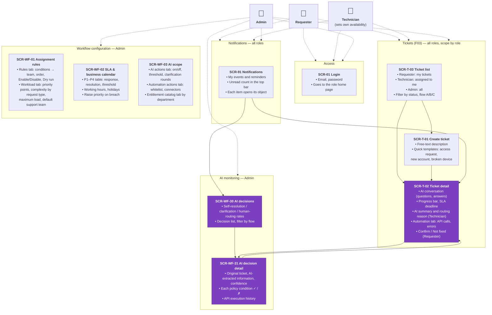

# Sitemap by Role

> Design status: V1 — draft, awaiting user review
>
> Implementation status: NOT STARTED

**Notation** (D-IA-01)

- **Card:** one page, with its ID and main content.
- **Area (box):** a group of pages used by the same roles.
- **Solid arrow:** parent page → child page (where the child is opened from).
- **Dashed arrow:** the actor uses the pages in that area. The arrows match the [page-permission table](02-routes-and-permissions.md).
- **Purple card:** a page with AI features (AI-generated content, always labelled **AI**).
- Modals, the "Access denied" page and loading/error states are **not** cards; see the [screen inventory](04-screen-inventory.md) and the [UI states](06-ui-states-and-accessibility.md).
- Pages marked *(F03)* belong to the Ticket Management feature; only their workflow-related parts are described here.

## Screens by role

| Role | Home page (DF-IA-02) | Pages available |
|---|---|---|
| **Requester** | SCR-T-03 *My tickets* | SCR-01, SCR-T-01, SCR-T-02, SCR-T-03, SCR-91 |
| **Technician** | SCR-T-03 *Assigned to me* | SCR-01, SCR-T-01, SCR-T-02, SCR-T-03, SCR-91 |
| **Admin** | SCR-WF-30 *AI decisions* (temporary, until the F02 Dashboard) | Every page in the sitemap |

**Related:** [Information architecture index](README.md) · [Routes and permissions](02-routes-and-permissions.md) · [Navigation](03-navigation.md)
