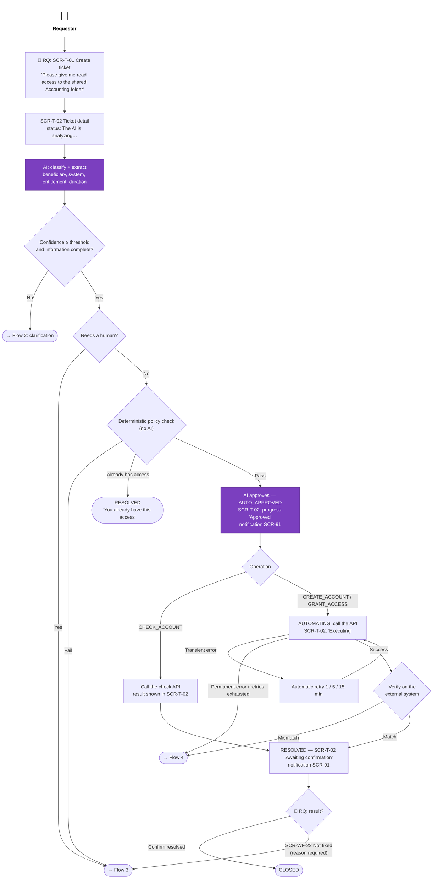
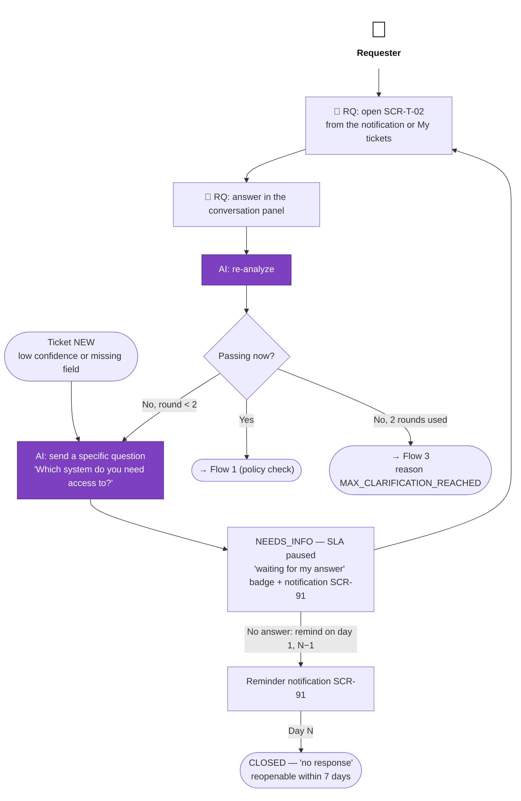
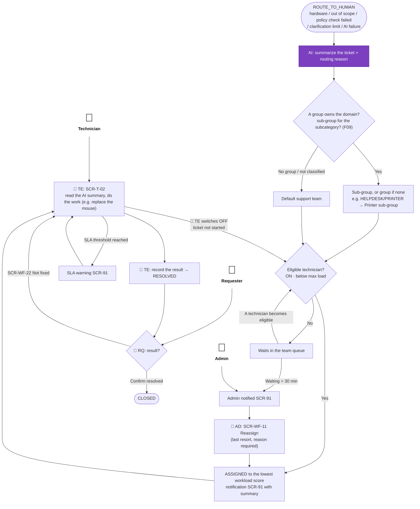
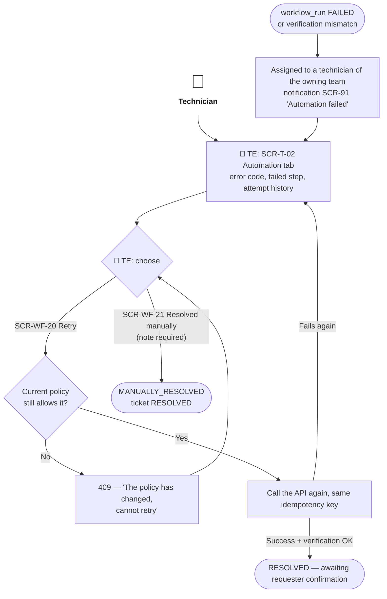
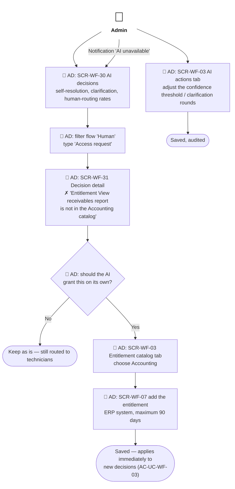
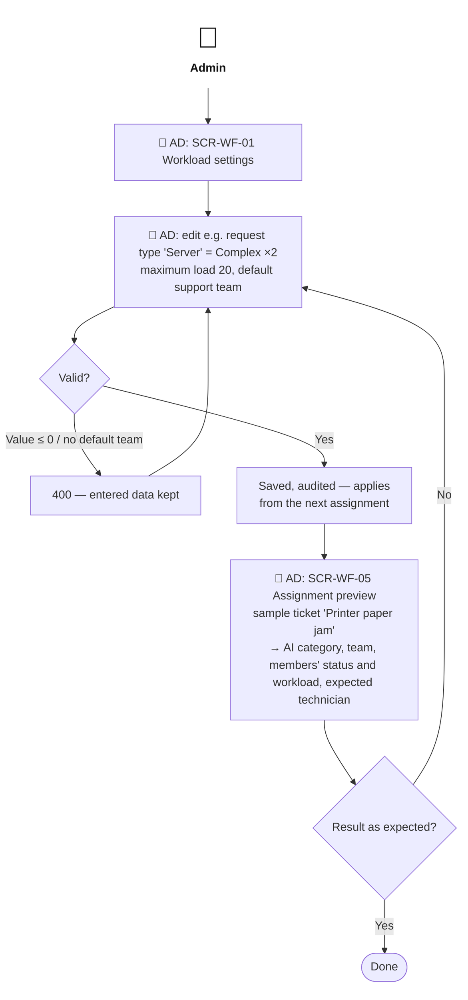

# Primary User Flows

> Design status: V1 — draft, awaiting user review
>
> Implementation status: NOT STARTED

Six flows cover a ticket's path through the three processing flows (A — AI self-service, B — clarification, C — human handling), automation failure handling, and two Admin configuration flows. In every flow a **purple** step is performed by the AI, and every AI step has a failure path that lets a person continue. Each flow starts from its actors (person icon). A step performed by a person begins with 👤 and an abbreviation: **RQ** Requester, **TE** Technician, **AD** Admin. Steps without a prefix are done by the system or the AI. State names are the exact names in the [use cases](../02-use-cases.md#related-states).

## Flow 1: Basic request — AI self-service (flow A)

Example: Lan (Accounting) asks for read access to the shared Accounting folder. This entitlement is in the Accounting catalog.

## Flow 2: AI not confident — ask the requester (flow B)

Example: Minh writes *"Please give me access to the system"* without saying which system.

## Flow 3: Request that needs a human (flow C)

Example: Lan reports *"The left button of my mouse doesn't work"*. In the Hardware team, Mai holds 3 P1 Complex tickets (score 18) and Hung holds 5 P3 Simple tickets (score 5); Nam is *OFF* (in a meeting). The ticket goes to Hung.

## Flow 4: Automation failure — technician handles it

## Flow 5: Admin configures the AI scope and reviews decisions

Example: Thao (Admin) adds the "View receivables report" entitlement for Accounting, after reviewing why a request was routed to a technician.

## Flow 6: Admin configures workload scoring

There are no assignment rules: the **team** comes from the AI category and the categories each team is responsible for (set up in F09). The Admin only configures how the **person** inside the team is chosen, and can preview the result.

**Related:** [Information architecture index](README.md) · [Navigation](03-navigation.md) · [UI states](06-ui-states-and-accessibility.md)
