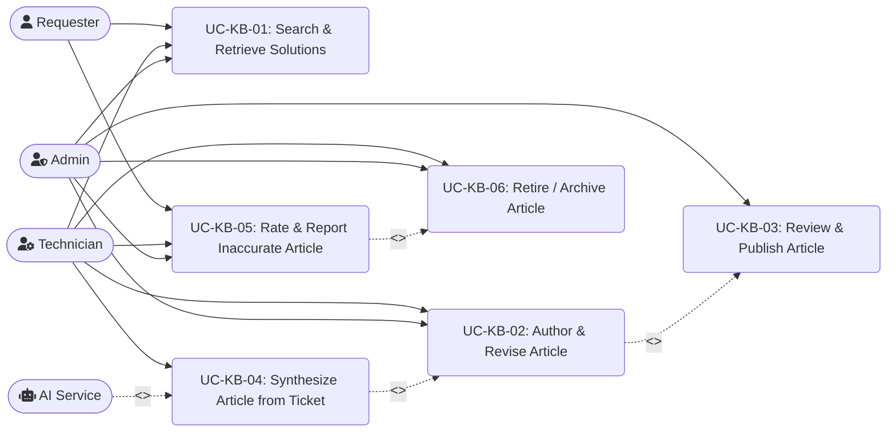

# 03. Use Cases — F06 Knowledge Base (KB)

> Design status: TARGET V1
>
> Scope: **F06 Knowledge Base — KB (UC-KB-01 … UC-KB-06)**
>
> Related: [User Stories](02-user-stories.md) · [Information Architecture](04-information-architecture.md)

---

## 1. Actors & Roles

| Role code | Display name | KB Responsibilities |
| :--- | :--- | :--- |
| `REQUESTER` | Requester | Searches KB articles for self-service, rates articles (helpful / unhelpful), reports outdated content |
| `TECHNICIAN` | Technician | Authors new articles, edits existing procedures, triggers AI synthesis from resolved tickets |
| `ADMIN` | Administrator | Approves or rejects articles, reviews visual diffs, manages categories, audits flagged content |

| System Actor | Audit Code | Responsibilities |
| :--- | :--- | :--- |
| AI Service | `AI` | Performs semantic embeddings, detects user intent, sanitizes PII, and synthesizes structured KB drafts from closed tickets |

---

## 2. Feature Ownership & Boundaries

| Responsibility | Owning module | F06 boundary |
| :--- | :--- | :--- |
| Create, edit, review, publish, revise, flag, and archive KB articles; enforce article audience visibility | **F06 Knowledge Base** | Owns article content, lifecycle, search index, and article-level permissions |
| Create, submit, cancel, resolve, close, and reopen tickets | **F03 Ticket Management** | F06 may provide KB results in ticket screens but does not create or change ticket state |
| Classify tickets, generate cited answers from KB content, and decide whether AI can resolve a ticket | **F04 AI Ticket Processing** | F06 supplies authorized published articles; F04 owns AI response generation and ticket-resolution decisions |
| Routing, assignment, SLA, and workflow notifications | **F05 Workflow & Automation** | F06 emits relevant article lifecycle events; F05 owns ticket routing and automation rules |
| Aggregate deflection, helpfulness, and article usage metrics | **F07 Reports & Analytics** | F06 records article and feedback events; F07 owns reporting and metric presentation |

**Cross-module flow rules**

- During ticket creation, F03 owns the form and ticket submission. F06 supplies matching, audience-authorized article links; F04 may use those articles to generate an answer or evaluate self-service resolution. Only F03 creates or cancels the ticket.
- On a resolved ticket, F03 remains the source of ticket status and content. F06 may use that content to create an AI-assisted article draft; the draft follows F06's authoring and approval lifecycle and does not change the ticket.
- A KB article is searchable by requesters only after publication and only when its audience is `PUBLIC`. F04 must use the same authorization and publication constraints when retrieving article sources.

---

## 3. Use Case Diagram (Mermaid)

---

## 4. Detailed Use Case Specifications

The use case set below covers the end-to-end knowledge lifecycle: search, authoring, approval, maintenance, and final archival of obsolete content.

---

### UC-KB-01: Search & Retrieve Solutions

| Field | Description |
| :--- | :--- |
| **ID & Name** | **UC-KB-01: Search & Retrieve Solutions** |
| **Primary Actor** | `REQUESTER`, `TECHNICIAN`, `ADMIN` |
| **Secondary Actor** | `AI` (Semantic Vector Engine) |
| **Pre-conditions** | User has navigated to the Help Center or Support Portal. |
| **Post-conditions** | System renders matching validated solutions and increments article view metrics. |
| **Main Flow** | 1. User inputs a query or error code (e.g., *"Cannot connect to VPN after password reset"*). 2. System calls AI Vector Engine to perform semantic embedding and intent classification. 3. System filters results based on caller's role (`REQUESTER` cannot view `INTERNAL_ONLY` articles). 4. System returns ranked article cards with extracted solution snippets highlighted. 5. User selects an article card to view full instructions: Symptoms, Root Cause, Step-by-Step Fix, and Attachments. 6. System increments `view_count` by 1. |
| **Alternative Flows** | **3a. Category Browsing:** User clicks a category node (e.g., *"Network & VPN"*); system displays top articles sorted by helpfulness. **4a. Deflection during ticket creation:** On the F03 ticket form, F06 returns the top 3 matching, authorized article links. F04 may use the returned articles to generate a cited answer or determine self-service resolution; F03 owns the form, ticket submission, and any cancellation. |
| **Exception Flows** | **4b. No matching article found:** Semantic match score is below 50%. System displays: *"No validated solutions found. Would you like to create a support ticket?"* and pre-fills the query into the ticket title. |
| **Business Rules** | **BR-KB-01:** Requesters only see `PUBLIC` articles. Only Technicians and Admins can view `INTERNAL_ONLY` technical documentation. |

---

### UC-KB-02: Author & Revise Article

| Field | Description |
| :--- | :--- |
| **ID & Name** | **UC-KB-02: Author & Revise Article** |
| **Primary Actor** | `TECHNICIAN`, `ADMIN` |
| **Pre-conditions** | User is authenticated with authoring privileges (`kb:create`, `kb:edit`). |
| **Post-conditions** | Article draft is stored in `DRAFT` or transitions to `PENDING_REVIEW`. |
| **Main Flow** | 1. Technician opens the KB Authoring Console and clicks **[+ New Article]**. 2. Technician enters Title, selects Category, tags error codes, and chooses Audience (`PUBLIC` or `INTERNAL_ONLY`). 3. Technician inputs content using rich text / markdown with step-by-step headings, code snippets, and screenshots. 4. System auto-saves draft state every 20 seconds. 5. Technician clicks **[Submit for Review]**. 6. System validates required fields, updates status to `PENDING_REVIEW`, and dispatches notification to the review queue. |
| **Alternative Flows** | **1a. Editing an already published article:** System forks an isolated revision draft (e.g., v1.1 Draft); active readers continue accessing v1.0 without interruption until v1.1 is approved. |
| **Exception Flows** | **5a. Missing mandatory metadata:** Title or Category is missing. System prevents submission and highlights invalid inputs with warning tooltips. |
| **Business Rules** | **BR-KB-02:** All new articles or edits originating from Technicians require formal approval before publishing to the public domain. |

---

### UC-KB-03: Review & Publish Article

| Field | Description |
| :--- | :--- |
| **ID & Name** | **UC-KB-03: Review & Publish Article** |
| **Primary Actor** | `ADMIN` / Admin |
| **Pre-conditions** | Admin has reviewer privileges (`kb:approve`); at least one article is in `PENDING_REVIEW`. |
| **Post-conditions** | Article transitions to `PUBLISHED` and becomes searchable in the production index. |
| **Main Flow** | 1. Admin accesses the Approval Queue tab. 2. Admin selects an article in `PENDING_REVIEW`. 3. System renders the visual Diff View (highlighting additions in green and deletions in red). 4. Admin validates technical correctness and compliance with security guidelines. 5. Admin clicks **[Approve & Publish]**. 6. System transitions status to `PUBLISHED`, updates active version, generates vector embeddings, and notifies the author. |
| **Alternative Flows** | **5a. Revision requested:** Admin enters feedback notes and clicks **[Request Changes]**; status reverts to `CHANGES_REQUESTED`. **5b. Rejection:** Admin clicks **[Reject]** with rejection reason; status transitions to `REJECTED`. |
| **Business Rules** | **BR-KB-03:** Each published revision creates an immutable changelog record for compliance auditing. |

---

### UC-KB-04: Synthesize Article from Ticket (AI)

| Field | Description |
| :--- | :--- |
| **ID & Name** | **UC-KB-04: Synthesize Article from Ticket** |
| **Primary Actor** | `TECHNICIAN` |
| **Secondary Actor** | `AI` (Knowledge Extraction Service) |
| **Pre-conditions** | Ticket status is `RESOLVED` or `CLOSED`. |
| **Post-conditions** | A structured article draft is generated and linked to the source ticket. |
| **Main Flow** | 1. Technician opens a resolved ticket and clicks **[Generate KB Draft with AI]**. 2. System dispatches ticket thread, logs, and resolution notes to the AI Service. 3. AI performs automated PII scrubbing (masking personal identities, private IPs, credentials). 4. AI structures content into standardized sections: Problem, Root Cause, and Step-by-Step Fix. 5. System renders an AI Preview Drawer with confidence score. 6. Technician clicks **[Transfer to Editor]**. 7. Content pre-fills the authoring form; technician refines text and submits for review. |
| **Alternative Flows** | **3a. Duplicate solution detected:** AI identifies an existing article with > 85% similarity; prompts: *"Similar article KB-102 already exists. Would you like to create an update revision instead?"* |
| **Business Rules** | **BR-KB-04:** AI cannot directly publish an article. Human technician review is mandatory before routing to the approval queue. |

---

### UC-KB-05: Rate & Report Inaccurate Article

| Field | Description |
| :--- | :--- |
| **ID & Name** | **UC-KB-05: Rate & Report Inaccurate Article** |
| **Primary Actor** | `REQUESTER`, `TECHNICIAN` |
| **Pre-conditions** | User is viewing a `PUBLISHED` article. |
| **Post-conditions** | Rating is persisted; if report is filed, issue is queued in the flagged audit queue. |
| **Main Flow** | 1. User reviews troubleshooting instructions on an article. 2. User clicks **[Not Helpful / Report Issue]**. 3. Modal opens prompting for issue categorization: *Outdated steps*, *Incorrect technical command*, *Missing context*, or *Broken link*. 4. User inputs contextual description and submits. 5. System logs feedback entity and increments `helpful_down_count`. 6. If article helpfulness drops below 60% or receives 3 reports within 30 days, status transitions to `FLAGGED` and triggers a review task for the author. |
| **Alternative Flows** | **2a. Helpful rating:** User clicks **[Helpful]**; system increments `helpful_up_count` and renders a confirmation thank-you message. |
| **Business Rules** | **BR-KB-05:** Articles flagged as `FLAGGED` display a warning banner to readers indicating procedures are under active revision. |

---

### UC-KB-06: Retire / Archive Article

| Field | Description |
| :--- | :--- |
| **ID & Name** | **UC-KB-06: Retire / Archive Article** |
| **Primary Actor** | `ADMIN`, `TECHNICIAN` |
| **Pre-conditions** | Article is in `PUBLISHED` or `FLAGGED` state and has been confirmed obsolete or superseded by a newer procedure. |
| **Post-conditions** | Article becomes read-only and is removed from active search index or marked as deprecated. |
| **Main Flow** | 1. Admin or technician opens the article maintenance queue. 2. System shows article health metrics, last review date, and replacement guidance if available. 3. User selects **[Archive / Retire]** and enters a rationale or replacement article reference. 4. System transitions state to `ARCHIVED`, locks edits, records the retirement event in changelog, and prevents reader-facing publication in active search results. 5. If a replacement exists, the archived article displays a redirect banner or link to the new version. |
| **Alternative Flows** | **3a. Soft deprecation:** System keeps article visible to internal roles only while public readers see an outdated warning banner and redirect recommendation. **3b. Reopen from archive:** Admin reactivates an archived article only when a justified rollback is approved. |
| **Business Rules** | **BR-KB-06:** Archived articles must remain in immutable history for auditability and may not be edited in place without a new revision or rollback approval. |
