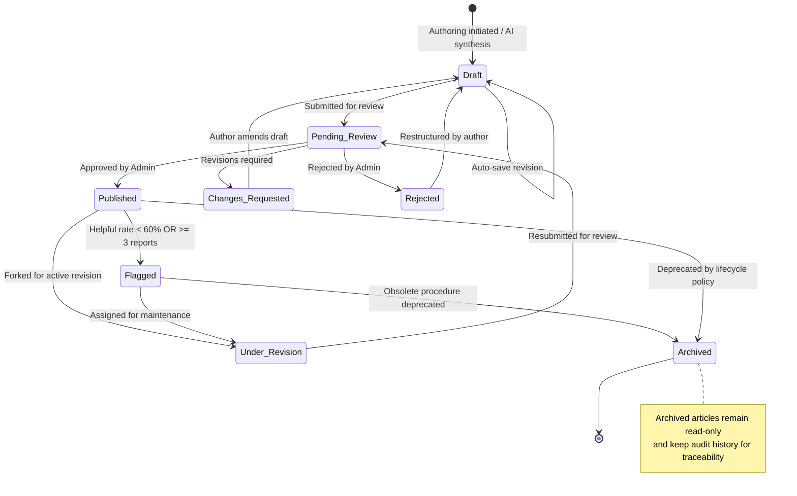
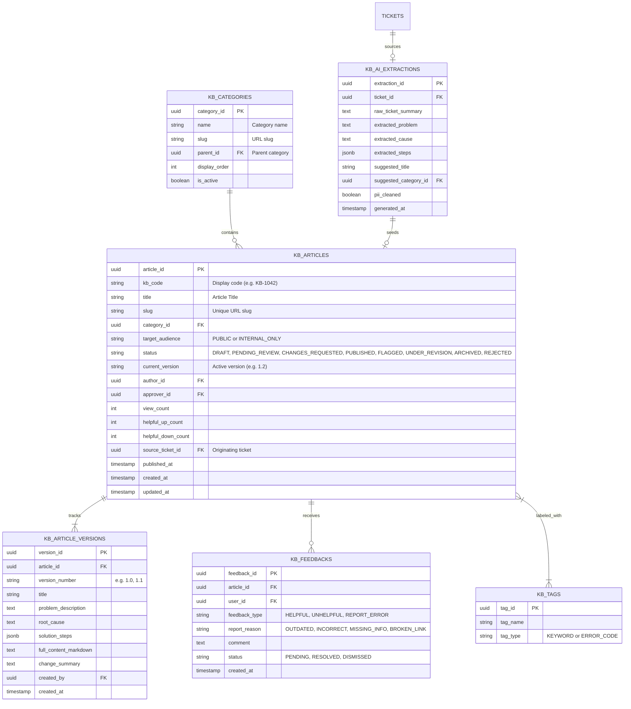
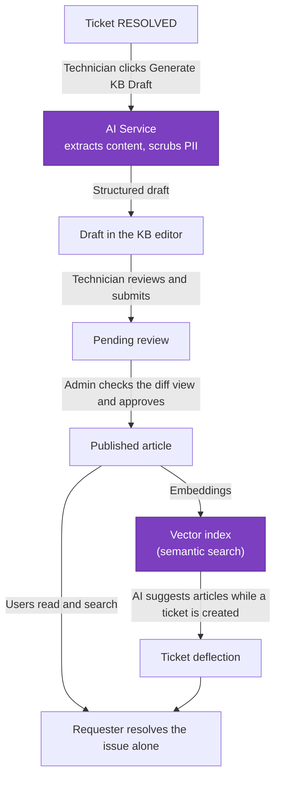

# 04. Information Architecture (IA) & Data Schema — F06 Knowledge Base

> Design status: TARGET V1
>
> System name: **AI-Powered IT Ticket Routing and Automated Resolution System**
>
> Scope: **F06 Knowledge Base — KB**
>
> Sub-specifications: [IA Overview](information-architecture/README.md) · [Screens & Navigation](information-architecture/01-screens-and-navigation.md) · [User Flows](information-architecture/02-user-flows.md) · [UI States & Accessibility](information-architecture/03-ui-states-and-accessibility.md) · [ERD & Data Dictionary](information-architecture/04-data-dictionary-and-erd.md)

---

## 1. Information Architecture & Navigation Map

```text
KNOWLEDGE BASE PORTAL & MANAGEMENT CONSOLE
│
├── 1.0 PUBLIC HELP CENTER (REQUESTER & TECHNICIAN)
│   ├── 1.1 Natural Language Search Bar (AI Semantic + Auto-suggest)
│   ├── 1.2 Category Taxonomy Hierarchy
│   │   ├── Hardware & Peripherals
│   │   ├── Office Applications & Productivity Software
│   │   ├── Corporate Network, Wi-Fi & VPN
│   │   └── Identity, Accounts & Access Permissions
│   ├── 1.3 Featured & Pinned Resolutions
│   └── 1.4 Ticket Deflection Widget ("Did this resolve your issue?")
│
├── 2.0 ARTICLE DETAIL VIEW
│   ├── 2.1 Breadcrumb Hierarchy
│   ├── 2.2 Metadata Header (Code, Version, Updated Date, Author, Scope Badge)
│   ├── 2.3 Structured Content Blocks:
│   │   ├── 2.3.1 Problem Description & Symptoms
│   │   ├── 2.3.2 Root Cause Analysis
│   │   ├── 2.3.3 Step-by-Step Resolution Procedures
│   │   └── 2.3.4 Script & Driver Downloads
│   ├── 2.4 Related Articles & Tag Taxonomy
│   └── 2.5 Reader Feedback Widget (👍 Helpful / 👎 Report Issue Modal)
│
├── 3.0 TECHNICIAN AUTHORING WORKSPACE
│   ├── 3.1 Personal Drafts & Submission Queue
│   ├── 3.2 AI Inbox: Resolved Tickets Ready for KB Conversion
│   └── 3.3 Article Editor & Auto-save Engine
│
└── 4.0 ADMINISTRATIVE GOVERNANCE CONSOLE
    ├── 4.1 Pending Review Queue with Visual Diff Inspection
    ├── 4.2 Flagged Content & Outdated Issue Queue
    ├── 4.3 Category & Tag Taxonomy Management
    └── 4.4 Operational Health Metrics (Deflection Rate, Helpful Ratio)
```

---

## 2. Article State Transition Machine



---

## 3. Entity Relationship Diagram (ERD)



---

## 4. Data Dictionary

### Table: `kb_articles`
| Column | Type | Constraints | Description |
| :--- | :--- | :--- | :--- |
| `article_id` | UUID | PK, NOT NULL | Unique internal identifier |
| `kb_code` | VARCHAR(20) | UNIQUE, NOT NULL | User-facing code (e.g. KB-1042) |
| `title` | VARCHAR(255) | NOT NULL | Standard article title |
| `category_id` | UUID | FK, NOT NULL | Reference to `kb_categories` |
| `target_audience` | ENUM | NOT NULL, DEFAULT 'PUBLIC' | `PUBLIC` or `INTERNAL_ONLY` |
| `status` | ENUM | NOT NULL, DEFAULT 'DRAFT' | `DRAFT`, `PENDING_REVIEW`, `CHANGES_REQUESTED`, `PUBLISHED`, `FLAGGED`, `UNDER_REVISION`, `REJECTED`, `ARCHIVED` |
| `current_version`| VARCHAR(10) | NOT NULL, DEFAULT '1.0' | Currently published version string |
| `author_id` | UUID | FK, NOT NULL | ID of technician author |
| `approver_id` | UUID | FK, NULLABLE | ID of approving administrator |
| `source_ticket_id`| UUID | FK, NULLABLE | Linked originating ticket if synthesized by AI |
| `view_count` | INT | DEFAULT 0 | Cumulative reader views |
| `helpful_up_count`| INT | DEFAULT 0 | Total positive helpful votes |
| `helpful_down_count`| INT | DEFAULT 0 | Total negative / problem reports |
| `published_at` | TIMESTAMP | NULLABLE | Timestamp of publication |

---

### Table: `kb_feedbacks`
| Column | Type | Constraints | Description |
| :--- | :--- | :--- | :--- |
| `feedback_id` | UUID | PK, NOT NULL | Unique feedback entry ID |
| `article_id` | UUID | FK, NOT NULL | Foreign key to `kb_articles` |
| `user_id` | UUID | FK, NULLABLE | User who submitted feedback |
| `feedback_type` | ENUM | NOT NULL | `HELPFUL`, `UNHELPFUL`, `REPORT_ERROR` |
| `report_reason` | ENUM | NULLABLE | `OUTDATED`, `INCORRECT_STEPS`, `MISSING_CONTEXT`, `BROKEN_LINK` |
| `comment` | TEXT | NULLABLE | Detailed reader report |
| `status` | ENUM | DEFAULT 'PENDING' | `PENDING`, `RESOLVED`, `DISMISSED` |
| `created_at` | TIMESTAMP | DEFAULT NOW() | Timestamp of submission |

---

## 5. Data Flow — Resolved Ticket to Published Article

How a resolved ticket becomes a published article that requesters find on their own. Ported from the earlier Vietnamese draft on `feature/kho-kien-thuc-kb`.


