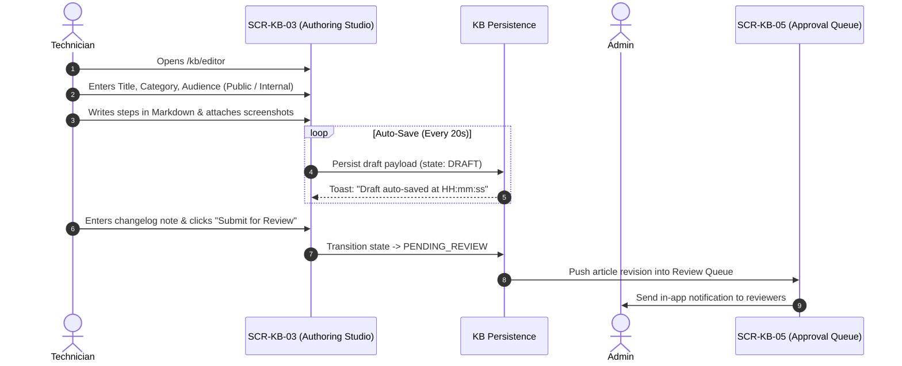
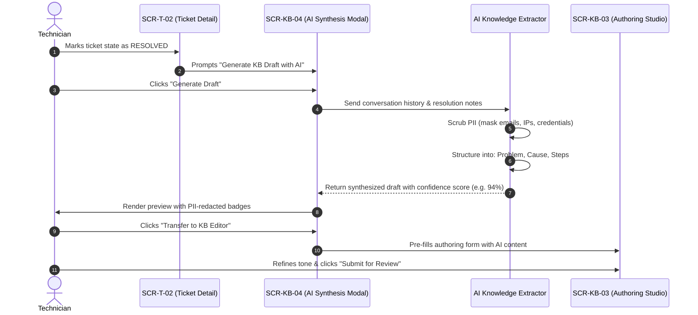
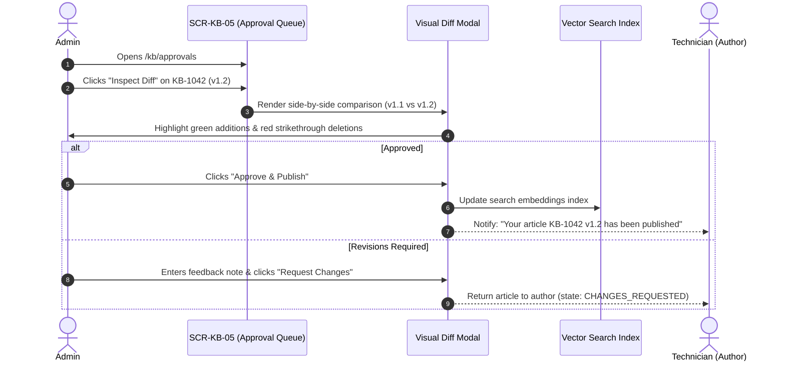
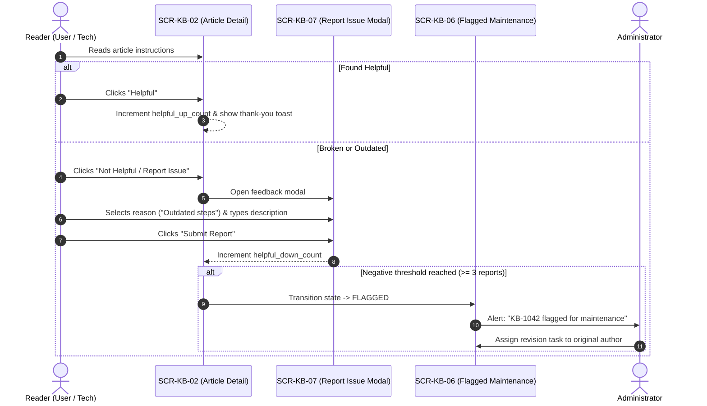

# User Flows — F06 Knowledge Base

> Design status: TARGET V1
>
> Related: [IA overview](README.md) · [Screens and navigation](01-screens-and-navigation.md) · [UI states](03-ui-states-and-accessibility.md)

---

## FLOW-KB-01: Requester Self-Service Search & Real-Time Deflection

This flow illustrates how requesters resolve technical issues independently, deflecting tickets before submission.

```mermaid
sequenceDiagram
    autonumber
    actor User as Requester
    participant Form as SCR-T-01 (Create Ticket)
    participant SEC as SEC-KB-01 (Deflection)
    participant KB as SCR-KB-02 (Article Detail)
    participant AI as AI Semantic Vector Service

    User->>Form: Enters issue description (> 20 chars)
    Form->>AI: Query embeddings (debounce 300ms)
    AI-->>SEC: Return top 3 matching articles (score >= 0.70)
    SEC->>User: Render instant solution suggestion cards
    alt Solution works (Deflection Success)
        User->>SEC: Clicks suggested article link
        SEC->>KB: Opens article in drawer / new tab
        User->>KB: Executes step-by-step fix
        User->>KB: Clicks "This solved my issue"
        KB-->>Form: Notify F03 of successful self-service outcome
        Form->>Form: F03 discards the unsubmitted draft; no ticket is created
        Form-->>Form: Record deflection outcome for F07 analytics
    else Solution does not apply
        User->>Form: Continues typing & clicks "Submit Ticket anyway"
        Form-->>Form: Create ticket in F03
    end
```

---

## FLOW-KB-02: Technician Manual Article Authoring & Review Submission



---

## FLOW-KB-03: AI 1-Click Synthesis from Resolved Ticket to KB Draft



---

## FLOW-KB-04: Admin Visual Diff Inspection & Publication Workflow



---

## FLOW-KB-05: Reader Helpfulness Rating & Outdated Issue Escalation


