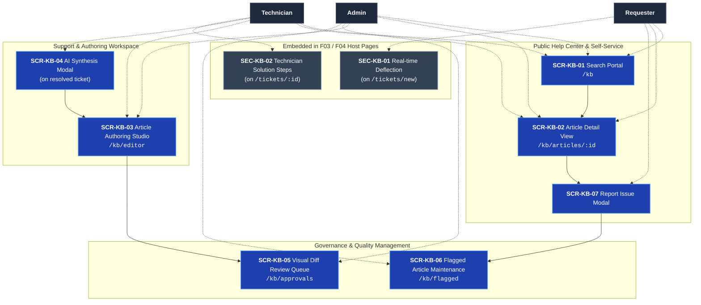

# Information Architecture — F06 Knowledge Base (KB)

> Design status: TARGET V1 (aligned with F04 & F05 specifications)
>
> Implementation status: NOT STARTED

This folder specifies the screen hierarchy, navigation routes, user flows, and interaction states for **F06 Knowledge Base**. It maps all user stories (`US-KB-01` … `US-KB-08`) and use cases (`UC-KB-01` … `UC-KB-05`) into concrete user-facing interfaces, embedded host sections, and administrative governance consoles.

## Architecture & Integration Scope

F06 delivers both dedicated self-service/governance pages and embedded widgets hosted within F03 (Ticket Management) and F04 (AI Processing):

| Kind | ID Prefix | Meaning |
|---|---|---|
| Dedicated Page / Modal | `SCR-KB-xx` | Standalone page or modal owned and operated by F06 |
| Host Page Section | `SEC-KB-xx` | An F06 component embedded inside pages owned by F03 or F04 |
| User Flow | `FLOW-KB-xx` | End-to-end task flows across screens |

### Related Documents
* [Screens, Routes, and Navigation](01-screens-and-navigation.md)
* [User Flows](02-user-flows.md)
* [UI States and Accessibility](03-ui-states-and-accessibility.md)
* [F06 User Stories](../02-user-stories.md) · [F06 Use Cases](../03-use-cases.md)

---

## IA Architectural Decisions

| ID | Decision | Rationale |
|---|---|---|
| **D-KB-IA-01** | **Embedded Self-Service Deflection:** F06 embeds a real-time solution card section (`SEC-KB-01`) directly inside F03's ticket creation view (`/tickets/new`). | Deflects up to 35% of repetitive tickets before requesters hit submit. |
| **D-KB-IA-02** | **Isolated Revision Branching:** Editing an active published article forks an isolated draft revision (`v1.1 (Draft)`) rather than modifying live content in-place. | Ensures public readers continue accessing validated instructions (`v1.0`) while updates await approval. |
| **D-KB-IA-03** | **Role-Scoped Article Visibility:** Public Help Center queries automatically filter out all records tagged `INTERNAL_ONLY`. | Protects sensitive infrastructure guides, passwords, and internal IT procedures from non-IT staff. |
| **D-KB-IA-04** | **1-Click AI Ticket-to-KB Synthesis:** Embedded modal on resolved tickets triggers automated PII scrubbing and pre-fills structured fields. | Captures operational troubleshooting know-how with near-zero transcription overhead for technicians. |
| **D-KB-IA-05** | **Visual Diff Review Inspection:** Admin approval queue provides side-by-side color-coded diffing (Green = added, Red = removed). | Eliminates manual text auditing errors and accelerates lead review turnaround times. |
| **D-KB-IA-06** | **Automated Quality Feedback Loop:** Articles receiving 3+ negative reports within 30 days automatically enter the `FLAGGED` maintenance queue. | Guarantees obsolete or inaccurate technical instructions are promptly flagged and corrected. |

---

## Information Architecture Diagram

