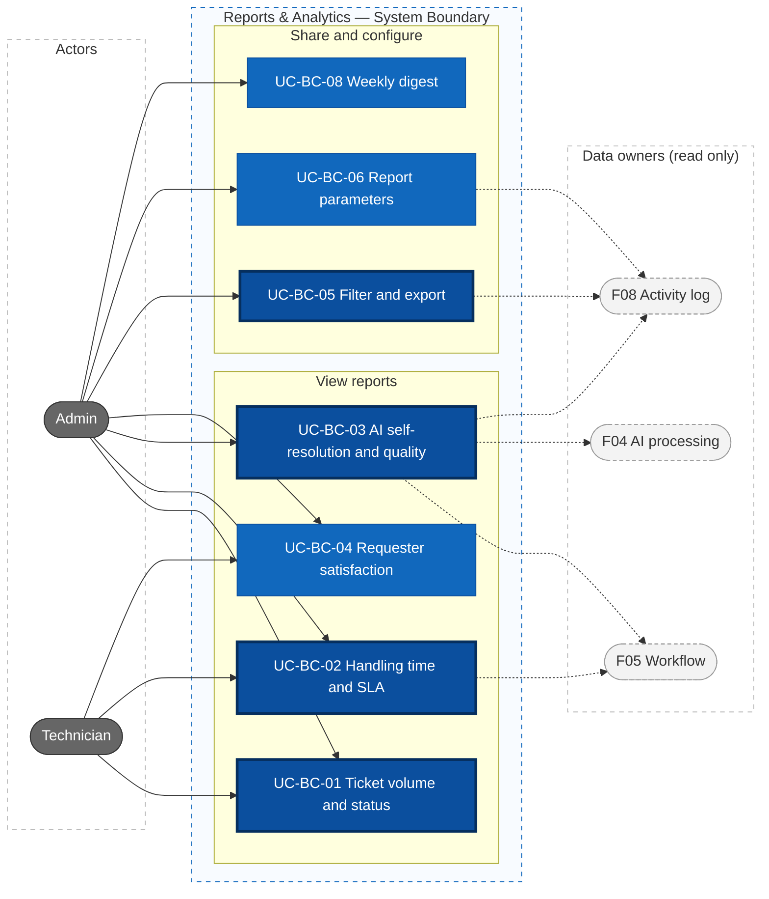
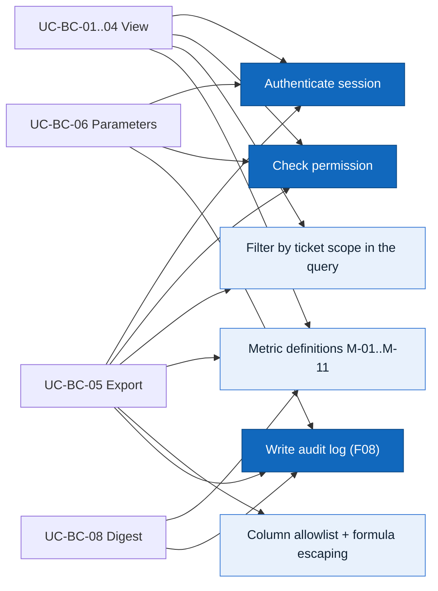

# Actors, Roles, and Use Cases — F07 Reports & Analytics

> Design status: TARGET V1
>
> Implementation status: NOT STARTED
>
> Scope: F07 Reports & Analytics (UC-BC-01 … UC-BC-08)

## Actors and roles

The role codes are the same as in F01, F04 and F05. **There is no Team Lead** (F05 D-IA-07): only Admin, Technician and Requester.

| Role code | Display name | Role in F07 |
|---|---|---|
| `ADMIN` | Administrator | Sees every report on every ticket, exports, sets report parameters, receives the weekly digest |
| `TECHNICIAN` | Technician | Sees volume, SLA and satisfaction for tickets in their scope (assigned to them or their groups); never other technicians' individual figures |
| `REQUESTER` | Requester | No access to reports |

| System actor | Code in the audit log | Role in F07 |
|---|---|---|
| AI Service | `AI` | None. Its decisions and analyses are **data** that F07 reads; it never calls the report API (its `AI_AGENT` service account gets `403`) |

> As in F04 and F05, the system has three user roles and **one system actor, the AI Service**. The nightly aggregation and the weekly digest are internal behaviour, logged with source `AUTOMATION`. They are not actors.

## Permission matrix

| Function | Admin | Technician | Requester |
|---|---|---|---|
| Ticket volume and status (UC-BC-01) | ✓ all tickets | Tickets in their scope | |
| Handling time and SLA (UC-BC-02) | ✓ | Tickets in their scope | |
| AI self-resolution and quality (UC-BC-03) | ✓ | | |
| Satisfaction (UC-BC-04) | ✓ (with comments) | Tickets in their scope, no comments, no colleagues' individual figures | |
| Export (UC-BC-05) | ✓ | | |
| Report parameters (UC-BC-06) | ✓ | | |
| Weekly digest (UC-BC-08) | Receives, manages recipients | | |

"Tickets in their scope" means assigned to the technician or one of their groups (F01, `ticket:read`). **The API enforces every row**, filtering in the query before aggregation (BR-BC-02); hiding a menu item is only for usability.

Proposed permissions, for the F01 owner to accept (naming: Q-BC-12):

| Permission | Admin | Technician | Requester | `AI_AGENT` |
|---|---|---|---|---|
| `report:read` | all | scope | ✗ | ✗ |
| `report:read_ai` | ✓ | ✗ | ✗ | ✗ |
| `report:export` | ✓ | ✗ | ✗ | ✗ |
| `report:configure` | ✓ | ✗ | ✗ | ✗ |

## Data sources

F07 owns only its parameters (`report_config`) and, in production, nightly aggregates. Everything else is read.

| Data | Owner | Used for |
|---|---|---|
| Ticket status `NEW`, `NEEDS_INFO`, `ASSIGNED`, `IN_PROGRESS`, `AUTOMATING`, `RESOLVED`, `CLOSED`, `CANCELLED`; priority; channel; resolution code (`ANSWERED_BY_KB`, `SOLVED_BY_KB`, …) | F03 / F05 | M-01, M-02, M-04, volume |
| SLA policy versions, `sla_breached`, `SLA_WARNING` / `SLA_BREACHED`, pause intervals | F05 (BR-WF-07, BR-WF-08) | M-02, M-03 |
| `ai_decisions` (`AUTO_APPROVED` / `NEEDS_INFO` / `ROUTE_TO_HUMAN` with reason) | F05 (BR-WF-17) | M-08 |
| AI analysis versions: `category`, `agent`, `escalationClass`, status `COMPLETED` / `INVALID` / `FAILED`, model and prompt version | F04 (BR-AI-02) | M-05, M-10, M-11 |
| Corrections and helpful votes on summary, solution steps, KB suggestions | F04 UC-AI-07 (AC-AI-14.3) | M-05, M-06 |
| KB article ratings | F06 | M-06 |
| Satisfaction rating 1–5 and comment | F03 | M-07 |
| Audit log (actor `USER` / `AI` / `AUTOMATION`) | F08 | M-04 (handling actions), M-05 |
| Users, groups, service accounts | F01 / F09 | Scope, names |

## Metric definitions

Reports, the Dashboard (F02), F05's SCR-WF-30 cards, exports and the digest all use **these** definitions (BR-BC-01). Defaults are demo values set in UC-BC-06 unless another branch owns them.

| Code | Metric | Calculation | Parameters |
|---|---|---|---|
| M-01 | First response time | Ticket creation → first **public** reply to the requester. Human (`USER`) and AI (`AI`: question, KB answer, result reply) first responses are reported **separately**. `AUTOMATION` acknowledgements do not count. | Whether an AI reply meets the SLA: Q-BC-04 |
| M-02 | Resolution time | Creation → **last** transition to `RESOLVED`, minus time in `NEEDS_INFO` (SLA paused, BR-WF-07) and minus time in `RESOLVED` before a *Not solved*. Measured on the business calendar of the ticket's SLA policy version (BR-WF-08), so M-02 and M-03 agree. Mean, median, P90. | Calendar: F05 |
| M-03 | SLA breach | **Read, never recomputed:** breached when F05 set `sla_breached = true`. At risk = `SLA_WARNING` without breach. Breach rate = breached / tickets with an SLA policy in the period, split by response / resolution target (Q-BC-05). | Targets: F05 |
| M-04 | AI self-resolution rate | **Numerator:** tickets `CLOSED` in the period with **no handling action by a Technician or Admin** (reply, assignment, status change, reclassification, internal note, retry or manual resolution of a workflow run) **and** not reopened within N days. **Denominator:** tickets `CLOSED` in the period. **Excluded from both:** `CANCELLED`; auto-closed for no answer (`NEEDS_INFO` → `CLOSED`, UC-WF-06); closed less than N days ago (shown as "under observation"). Split by **path**: automation (F05 flow A), agent KB answer (`ANSWERED_BY_KB`), requester self-help (`SOLVED_BY_KB`), answered after an AI question; and by **domain agent** (F04 `agent`). The requester's confirmation is not a handling action. | N = the reopen window of F03 BR-TK-11 (demo 7 days), read, not set by F07 (Q-BC-10); target line (demo 50%, Q-BC-13) |
| M-05 | AI classification correction rate | Tickets whose request type or `domain/subcategory` was set by the AI and later changed by a person (F04 UC-AI-07) / tickets classified by the AI. By field, domain, model version and prompt version. | — |
| M-06 | Helpful AI output rate | Votes "helpful" / votes, per output kind (KB suggestion, solution steps, summary). Also vote rate = outputs with a vote / outputs shown. | Who can vote: Q-BC-08 |
| M-07 | Satisfaction | Average 1–5 of rated tickets, count per score, **response rate** = rated / `CLOSED` in the period, always shown together. Split by handler: AI only / with a technician. | Low-response threshold (demo 20%) |
| M-08 | AI routing outcome | Share of `ai_decisions` per outcome: `AUTO_APPROVED` (A), `NEEDS_INFO` (B), `ROUTE_TO_HUMAN` (C), and route C reasons ranked (NFR-WF-OBS-001). | — |
| M-09 | Escalation rate | Tickets escalated at least once / tickets created. Sources reported separately: manual escalation (F03), SLA escalation (F05 UC-WF-06). | — |
| M-10 | Escalation to a technician by class | Tickets handed to a technician / tickets created, split by F04 `escalationClass`: `AGENT_CANNOT_RESOLVE` (with its reason), `SYSTEM_BUG`, `SOFTWARE_REQUIREMENT`. | — |
| M-11 | AI analysis failure rate | Analyses with status `INVALID` or `FAILED`, and `AI_UNAVAILABLE` routings / analyses. By model and prompt version. | — |

**Common rules**

- **Count** metrics place a ticket in a period by **creation date**; **time, SLA, M-04 and M-07** by **resolution / close date**. `CANCELLED` tickets count in volume only.
- Grouping by priority uses the **final** priority, flagged when raised by SLA escalation (Q-BC-06).
- A ticket moved across groups is attributed to the **last** group (Q-BC-07).
- Time zone `Asia/Ho_Chi_Minh`; a metric with no data is "not enough data", never `0%`.
- Every metric is computed only on tickets in the viewer's scope (BR-BC-02).

## Use case diagram

Thick border: core use cases. Dashed: branches whose data F07 reads. UC-BC-08 is triggered by a weekly schedule; Admin is the actor who benefits and manages recipients.

### Shared rules

## Use case specifications

### UC-BC-01 Ticket Volume and Status

- **Actors:** Admin; Technician (scope)
- **Preconditions:** signed in with `report:read`
- **Main flow:**
  1. The user opens *Reports → Tickets* (default period: last 30 days).
  2. The backend loads tickets in the user's scope and counts new, open (backlog at period end), closed, cancelled, reopened and escalated (M-09).
  3. It groups them by request type, `domain/subcategory`, group, priority P1–P4 and channel, with a daily / weekly / monthly trend.
  4. Tickets `ASSIGNED` to a team but not yet to a technician (F05 team queue) appear as "Team queue" under their group.
- **Alternative flows:**
  - Technician: the group filter lists only their groups; a membership change applies from the next request (BR-07).
  - Click a count → the ticket list (F03) with the same filters, still limited by `ticket:read`.
- **Exceptions:** no permission → `403`; group outside scope → `403`; from > to or longer than the maximum → `422 INVALID_DATE_RANGE`
- **Result:** the user sees where tickets come from and where the backlog grows
- **Stories:** US-BC-01, US-BC-02 · **Rules:** BR-BC-01, BR-BC-02, BR-BC-03

### UC-BC-02 Handling Time and SLA

- **Actors:** Admin; Technician (scope)
- **Preconditions:** `report:read`; F05 SLA policies exist
- **Main flow:**
  1. The user opens *Reports → SLA* and picks a period and filters.
  2. The system shows M-01 (human and AI separately), M-02 (mean, median, P90) and M-03 by priority, type and group.
  3. Tabs **Breached** and **At risk** list tickets (number, type, group, priority, SLA policy version, target missed, overdue by).
  4. Clicking a ticket opens SCR-T-02 (checked against `ticket:read`).
- **Alternative flows:**
  - Tickets without an SLA policy are counted as "No SLA".
  - A ticket whose policy version changed after a priority change is evaluated by F05 on its current version; the report does not re-evaluate.
- **Exceptions:** SLA data unavailable → M-01 and M-02 still shown; M-03 shows "Unavailable", not `0%`
- **Result:** bottlenecks are visible before breaches become a habit
- **Stories:** US-BC-03 · **Rules:** BR-WF-07, BR-WF-08, BR-BC-01, BR-BC-03

### UC-BC-03 AI Self-Resolution and Quality

- **Actors:** Admin
- **Preconditions:** `report:read_ai`
- **Main flow:**
  1. The Admin opens *Reports → AI* and picks a period (default: last 12 weeks, weekly).
  2. The system shows M-04 with its "under observation" count, split by path and by domain agent, and a weekly line against the target (Q-BC-13).
  3. It shows M-08 (route A / B / C and ranked route C reasons) and M-10 (escalations by `escalationClass`).
  4. It shows quality: M-05 by field and domain, M-06 per output kind, M-11.
  5. Lists: AI-closed tickets that were reopened; corrected classifications (AI value → human value); *Not solved* after an agent KB answer.
- **Alternative flows:**
  - Filter by model version or prompt version to compare before and after a change (F04 BR-AI-02), or before and after an AI scope change in F05 UC-WF-03.
  - Filter by domain agent (`HELPDESK`, `SAP`, …).
- **Exceptions:** Technician, Requester, `AI_AGENT` → `403`; no ticket closed for N days in the period → "Not enough data"
- **Result:** the Admin knows whether to widen or narrow what the AI may do, and the client sees progress against the target
- **Stories:** US-BC-04, US-BC-08, US-BC-09 · **Rules:** BR-BC-01, BR-BC-03, BR-BC-06

### UC-BC-04 Requester Satisfaction

- **Actors:** Admin; Technician (scope)
- **Preconditions:** `report:read`
- **Main flow:**
  1. The user opens *Reports → Satisfaction*.
  2. The system shows M-07: average next to response rate, distribution 1–5, by type, group and handler (AI only / with a technician).
  3. Tickets rated 1–2 are listed with a link to the ticket.
- **Alternative flows:**
  - Technician: tickets in scope only; no colleagues' individual figures (Q-BC-02).
  - Comments are shown to Admin only.
- **Exceptions:** response rate below the threshold → score shown with "Few ratings, not representative"
- **Result:** conclusions are not drawn from a handful of ratings
- **Stories:** US-BC-05 · **Rules:** BR-BC-01, BR-BC-02

### UC-BC-05 Filter and Export

- **Actors:** Admin
- **Preconditions:** `report:export`; a report open with filters
- **Main flow:**
  1. The Admin clicks *Export* on a report and picks CSV or XLSX; the modal shows the row count.
  2. The system writes `REPORT_EXPORTED` to the audit log (report, filters, format, row count).
  3. It builds the file from allowlisted columns only, escaping formula cells (BR-BC-04).
  4. The file downloads; it contains the same rows and figures as the screen.
- **Alternative flows:** filters live in the URL, so the same report can be reopened and shared
- **Exceptions:** more rows than the limit (demo 50,000) → `422 EXPORT_TOO_LARGE`; audit log unavailable → `503 AUDIT_UNAVAILABLE`, **no file** (BR-BC-05); not Admin → `403`
- **Result:** management gets figures that match the screen, with no sensitive data
- **Stories:** US-BC-06 · **Rules:** BR-BC-02, BR-BC-04, BR-BC-05

### UC-BC-06 Report Parameters

- **Actors:** Admin
- **Preconditions:** `report:configure`
- **Main flow:**
  1. The Admin opens *Report settings*.
  2. Edits the satisfaction response-rate threshold, the self-resolution target line, the export row limit, the maximum period, the digest recipients. N days for M-04 is shown read-only: it is the reopen window of F03 BR-TK-11, so a ticket counts as self-resolved only once it can no longer be reopened.
  3. Saves → audit entry `REPORT_CONFIG_UPDATED` with before and after values.
- **Alternative flows:** SLA targets and the calendar are not here; a link opens F05 SCR-WF-02. When the reopen window changes, the next view of M-04 uses the new N. Each report states the parameters in use ("N = 7 days"); files already exported do not change.
- **Exceptions:** negative value, limit = 0, target outside 1–100% → `422`; a request that sets N → `422` (read-only); not Admin → `403`
- **Result:** figures match how the organization works, and every change is traceable
- **Stories:** US-BC-07 · **Rules:** BR-BC-01, BR-BC-05

### UC-BC-08 Weekly Digest

- **Actors:** Admin (receives, manages recipients)
- **Trigger:** every Monday 08:00 `Asia/Ho_Chi_Minh`
- **Main flow:**
  1. The system computes last week's key figures with the M-xx definitions over all tickets: volume, M-03, M-04 against target, M-10, M-07 with response rate.
  2. It sends EML-BC-01 to the recipients, each figure linking to its report (sign-in required).
  3. It writes `REPORT_DIGEST_SENT` (source `AUTOMATION`, recipients, week).
- **Alternative flows:** an Admin sends a test digest to themselves from Report settings
- **Exceptions:** figures unavailable → the digest says which ones and is still sent; email failure → retried, the Admin is notified (F05 SCR-91)
- **Result:** management sees the trend without opening the system
- **Stories:** US-BC-11 · **Rules:** BR-BC-01, BR-BC-07
