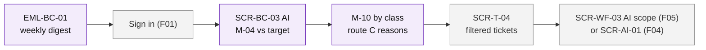

# User Flows — F07 Reports & Analytics

> Design status: TARGET V1
>
> Implementation status: NOT STARTED
>
> Related: [IA overview](README.md) · [Screens and navigation](01-screens-and-navigation.md) · [UI states](03-ui-states-and-accessibility.md)

Three flows. Sample people are the same as in the [acceptance criteria](../04-acceptance-criteria.md). Purple: F07. Grey: other branches.

## Flow 1 — Weekly review of the AI

*Thu (Admin) checks on Monday whether the agents are on track for the 50% target.* · US-BC-11, US-BC-04, US-BC-08, US-BC-09

1. Thu receives EML-BC-01: "Closed without a technician: 41% (target 50%), 312 under observation".
2. She clicks the figure → signs in → SCR-BC-03 for last week.
3. The path split shows agent KB answers rising; M-10 shows `AGENT_CANNOT_RESOLVE` with reason "Access not in catalog" at the top.
4. She clicks the reason → SCR-T-04 lists those tickets → she opens a few in SCR-T-02.
5. She widens the Accounting entitlement catalog in F05 SCR-WF-03. Next week's M-04 shows the effect.
6. **Branch:** a new prompt version went live → she filters M-05 by prompt version; corrections went up → she reports it to the F04 owner.

## Flow 2 — Finding an SLA bottleneck

*Thu sees P2 breaches rising.* · US-BC-03, US-BC-01

1. SCR-BC-02 for 30 days → breach rate by priority: P2 resolution target 18%.
2. Breakdown by group → SAP has most breaches.
3. Tab **At risk** → 9 SAP tickets with `SLA_WARNING` → open in SCR-T-02 and escalate through F03 / F05 dialogs.
4. **Branch:** F05 SLA data unavailable → M-03 shows "Unavailable"; M-01 and M-02 are still usable.

## Flow 3 — Export for management

*Thu needs the monthly figures in a spreadsheet.* · US-BC-06

1. SCR-BC-01 with last month's filter → *Export* → SCR-BC-10 shows "4,812 rows, XLSX".
2. *Export* → the file downloads; the audit log has `REPORT_EXPORTED`.
3. **Branch:** 60,000 rows → `EXPORT_TOO_LARGE`, the modal asks to narrow the period.
4. **Branch:** audit log unavailable → `AUDIT_UNAVAILABLE`, no file, the modal says to try later.
