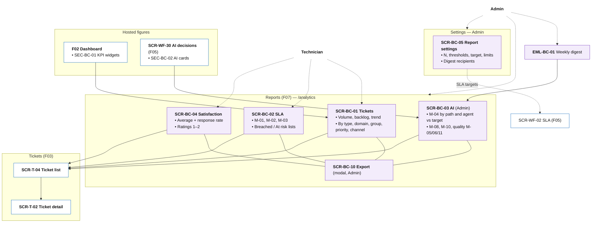

# Information Architecture — F07 Reports & Analytics

> Design status: TARGET V1 (draft for team review)
>
> Implementation status: NOT STARTED

This folder places the 10 F07 stories on screens and emails. F07 owns **one page with tabs** (Reports), one settings page, one modal and one email. Its figures also appear on pages owned by other branches (F02 Dashboard, F05 SCR-WF-30), always through the same API. The inventory has four kinds of entries:

| Kind | ID | Meaning |
|---|---|---|
| F07 page or tab | `SCR-BC-xx` | A page or a tab of the Reports page |
| F07 modal | `SCR-BC-1x` | A modal opened on an F07 page, no route of its own |
| Host page section | `SEC-BC-xx` | F07 figures inside a page owned by F02 or F05. The host page keeps its own ID |
| Email | `EML-BC-xx` | An email F07 composes |

Inputs: [Use cases](../02-use-cases.md), [User stories](../03-user-stories-invest.md), [Acceptance criteria](../04-acceptance-criteria.md). Routes follow the system IA ([`/analytics/*`](../../information-architecture.md)); host IDs come from F03 (`SCR-T-02`, `SCR-T-04`) and F05 (`SCR-WF-02`, `SCR-WF-30`, `SCR-90`, `SCR-91`).

| File | Content |
|---|---|
| [01-screens-and-navigation.md](01-screens-and-navigation.md) | Screen, section and email inventory; routes and permissions; navigation per role; story-to-screen mapping; screen-to-API mapping |
| [02-user-flows.md](02-user-flows.md) | Three flows: weekly AI review, SLA bottleneck, export for management |
| [03-ui-states-and-accessibility.md](03-ui-states-and-accessibility.md) | Data state contract, chart rules, responsive layout, accessibility |

## IA decisions

| ID | Decision | Why |
|---|---|---|
| D-BC-IA-01 | **One Reports page with tabs** (Tickets, SLA, AI, Satisfaction) sharing one filter bar; filters live in the URL, so switching tabs keeps them and a link reopens the same view. | The reports answer one question from different angles; Admins compare them side by side. |
| D-BC-IA-02 | **F07 owns the metric, other pages host it.** F02 Dashboard widgets and F05 SCR-WF-30 cards call `/api/v1/reports/*` (SEC-BC-01, SEC-BC-02) and link to the full tab. | One number per metric everywhere (BR-BC-01). |
| D-BC-IA-03 | **Tabs are hidden, not disabled,** when the role may not open them (Technician: no AI tab). Opening the URL anyway gives SCR-90. | Same behaviour as F05 (D-IA-02). |
| D-BC-IA-04 | **Every figure drills down to the ticket list** (F03 SCR-T-04) with the same filters; nothing on a report page changes data. | Reports are read-only (BR-BC-03); the work happens in the ticket pages. |
| D-BC-IA-05 | **Report settings is a separate Admin page** under *Settings*, not a tab: it changes how figures are computed for everyone. | Different permission, audited (BR-BC-05). |
| D-BC-IA-06 | **The weekly digest is an email, not a page;** it links back to the tabs. | Management reads email; PDF is not in V1 (Q-BC-11). |

## Information architecture

Solid lines: a page and its tabs or modals. Dashed arrows: which areas each actor uses. Purple: F07-owned items. White: pages owned by other branches.

## Screen hierarchy per role

| Role | Home page | Where F07 shows up |
|---|---|---|
| Requester | My tickets (F03) | Nowhere |
| Technician | Work queues (F03) | Sidebar *Reports*: SCR-BC-01, 02, 04, scope only; SEC-BC-01 on the Dashboard |
| Admin | Dashboard (F02) | Every tab, SCR-BC-05, SCR-BC-10, EML-BC-01, SEC-BC-01, SEC-BC-02 |
| AI Service | — | No UI; its `AI_AGENT` account gets `403` on `/reports/*` |

**Related:** [F07 README](../README.md) · [Screens and navigation](01-screens-and-navigation.md) · [User flows](02-user-flows.md) · [UI states](03-ui-states-and-accessibility.md)
