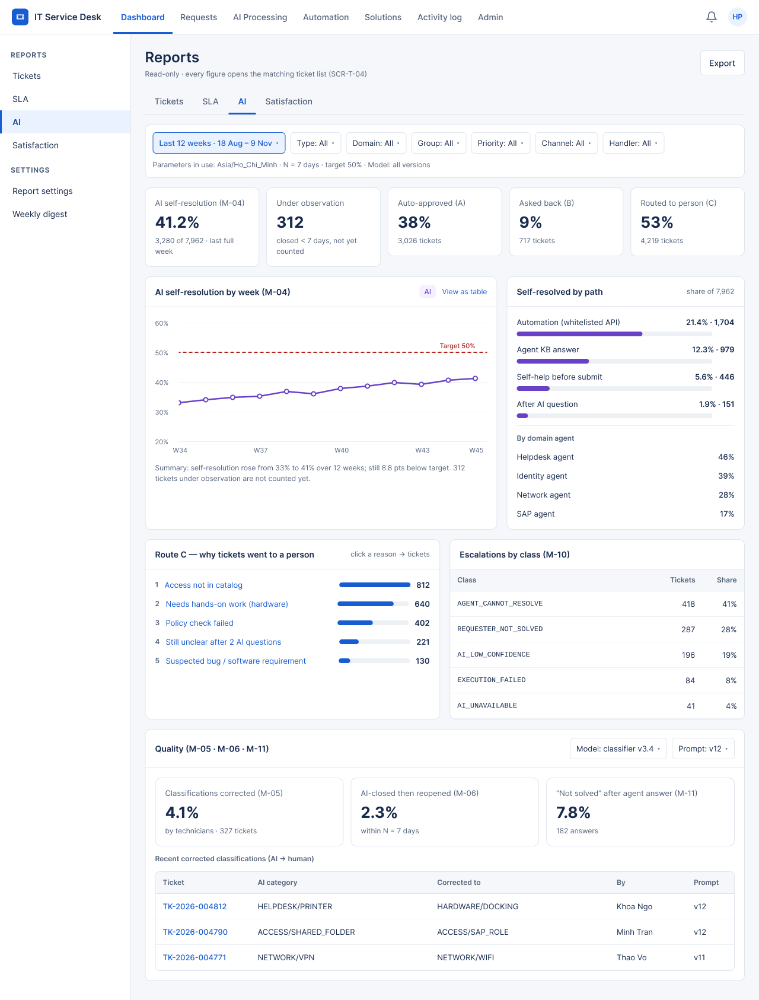
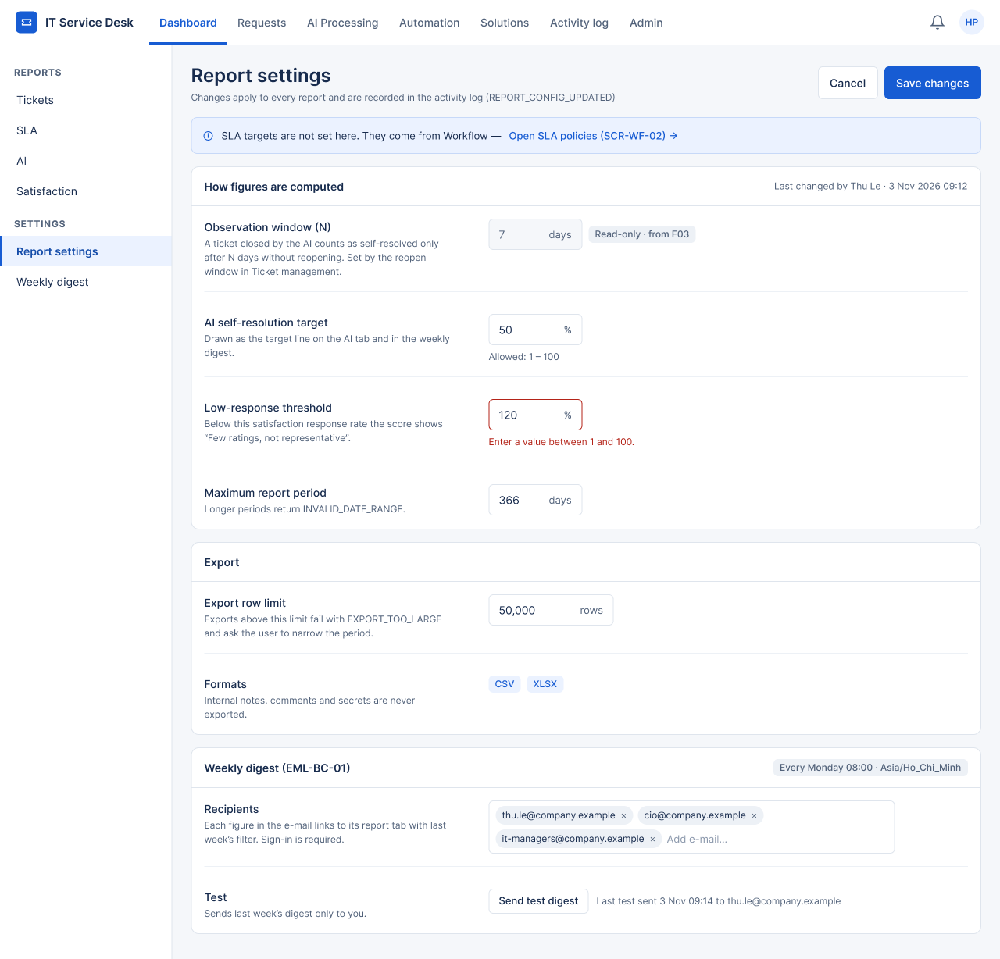
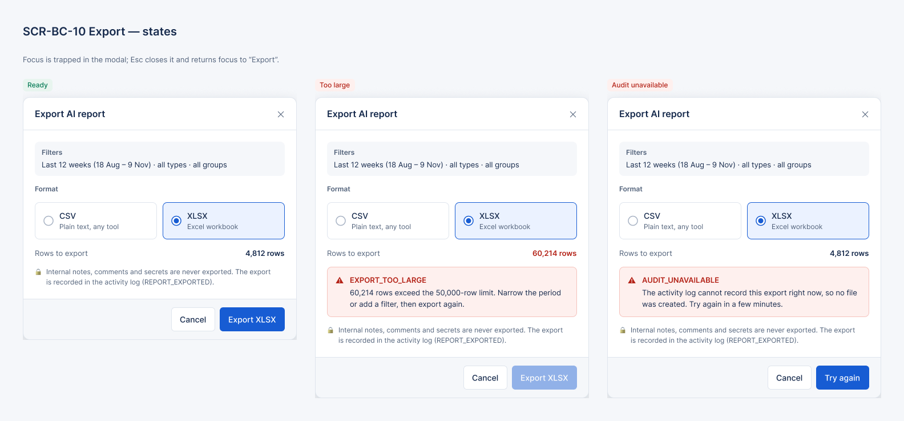

# Screen Notes and States — F07 Reports & Analytics

> Design status: TARGET V1 (draft for team review)
>
> Related: [UI design overview](README.md) · [Decisions](00-decisions.md) · [UI states (IA)](../information-architecture/03-ui-states-and-accessibility.md)

Each screen lists its purpose, its layout, the elements worth noting and its states. The **Source** column names the row of the [data state contract](../information-architecture/03-ui-states-and-accessibility.md#1-data-state-contract), or the rule or acceptance criterion behind it. Sample data: last 12 weeks to 9 Nov 2026, about 8,000 tickets a week.

## Reports

### SCR-BC-03 Reports › AI — `/analytics/ai` · Admin · [PNG](../../image/admin/10_SCR-BC-03_Reports-AI.png)

Purpose: show whether the AI is on track for the self-resolution target, why tickets still go to a person, and whether the AI output is good (US-BC-04, US-BC-08, US-BC-09).

**Layout:** page header (title "Reports", *Export*); tabs Tickets / SLA / **AI** / Satisfaction; filter bar; five tiles; two rows of two cards; the Quality card full width.

| # | Element | Note |
|---|---|---|
| 1 | Filter bar | Period (default *Last 12 weeks*, highlighted when not the default), type, domain, group, priority, channel, handler. The line under it is "Parameters in use: Asia/Ho_Chi_Minh · N = 7 days · target 50%". Filters live in the URL (D-BC-IA-01). |
| 2 | Tile **AI self-resolution (M-04)** | 41.2% with "3,280 of 7,962 · last full week": a rate always comes with its count (UI states §3). |
| 3 | Tile **Under observation** | 312 tickets closed less than N days ago; not counted in M-04 yet (`UNDER_OBSERVATION`). |
| 4 | Tiles **Auto-approved (A)**, **Asked back (B)**, **Routed to person (C)** | M-08 routing outcome with counts. |
| 5 | Chart **AI self-resolution by week** | Weekly purple line, dashed red **Target 50%** line, **AI** badge, *View as table*, and a text summary under the chart. |
| 6 | Card **Self-resolved by path** | Automation, agent KB answer, self-help, after an AI question; then the split by domain agent. |
| 7 | Card **Route C — why tickets went to a person** | Ranked reasons; each reason opens SCR-T-04 with the same filters (Flow 1, step 4). |
| 8 | Card **Escalations by class (M-10)** | `escalationClass` codes with count and share. |
| 9 | Card **Quality** | Filters *Model* and *Prompt*; tiles M-05, M-06, M-11; table of recent corrected classifications (AI category → human category, by, prompt version). |

| State | Source | Behavior |
|---|---|---|
| default | `READY` | As in the PNG. |
| loading | `LOADING` | Each tile and chart shows its own skeleton; the filter bar stays usable; previous figures stay greyed while filters change. |
| not enough data | `NOT_ENOUGH_DATA` (BR-BC-01) | M-04 shows "Not enough data for this period", never `0%`. |
| AI data unavailable | `UNAVAILABLE` | "AI data unavailable" on the affected tiles only; the others stay `READY`. |
| invalid period | `ERROR` `422 INVALID_DATE_RANGE` | Message under the period filter; previous figures kept. |
| technician | `FORBIDDEN` (D-BC-IA-03) | The AI tab is not shown; the URL opens SCR-90. |

### SCR-BC-05 Report settings — `/analytics/settings` · Admin · [PNG](../../image/admin/11_SCR-BC-05_Report-settings.png)

Purpose: set the parameters that change how figures are computed for everyone, and the weekly digest (US-BC-07, US-BC-11).

**Layout:** page header with *Cancel* and *Save changes*; info banner; three cards with label / help text on the left and the control on the right.

| # | Element | Note |
|---|---|---|
| 1 | Header note | "Changes apply to every report and are recorded in the activity log (`REPORT_CONFIG_UPDATED`)" (BR-BC-05). |
| 2 | Info banner | "SLA targets are not set here" with the link *Open SLA policies (SCR-WF-02)*. |
| 3 | Card header meta | "Last changed by Thu Le · 3 Nov 2026 09:12". |
| 4 | Observation window (N) | Read-only input, tag "Read-only · from F03". |
| 5 | AI self-resolution target, low-response threshold, maximum report period | Number inputs with unit and allowed range. |
| 6 | Export row limit, formats | Limit used by `EXPORT_TOO_LARGE`; note that notes, comments and secrets are never exported. |
| 7 | Weekly digest | Schedule badge (Monday 08:00, Asia/Ho_Chi_Minh), recipients as removable chips, *Send test digest* with the last test time. |

| State | Source | Behavior |
|---|---|---|
| default | Initial | As in the PNG, apart from the error shown on one field. |
| validation error | Validation (master IA §2) | Red border and "Enter a value between 1 and 100." under the field; checked on blur. Shown in the PNG on *Low-response threshold*. |
| saving | Saving / Processing | *Save changes* disabled with "Saving…". |
| saved | Success | Toast "Report settings saved" for 5 s; the meta line shows the new author and time. |
| technician | `FORBIDDEN` | Page not in the sidebar; URL opens SCR-90. |

### SCR-BC-10 Export (modal) — on any tab · Admin · [PNG over the page](../../image/admin/12_SCR-BC-10_Export.png) · [PNG states](../../image/admin/13_SCR-BC-10_Export-states.png)

Purpose: download the figures of the current tab with its filters as CSV or XLSX (US-BC-06).

| # | Element | Note |
|---|---|---|
| 1 | Filters | The filters of the tab, read-only; the export uses exactly these. |
| 2 | Format | Two radio cards, CSV and XLSX. |
| 3 | Rows to export | Count before export; red when above the limit. |
| 4 | Note | "Internal notes, comments and secrets are never exported. The export is recorded in the activity log (`REPORT_EXPORTED`)." |

| State | Source | Behavior |
|---|---|---|
| Ready | Initial | 4,812 rows, *Export XLSX* enabled. |
| Too large | `EXPORT_TOO_LARGE` (Flow 3, branch 3) | 60,214 rows; danger banner asks to narrow the period or add a filter; *Export* disabled. |
| Audit unavailable | `AUDIT_UNAVAILABLE` (Flow 3, branch 4) | No file is created; banner asks to try later; the primary button becomes *Try again*. |
| exporting | Saving / Processing | Button "Exporting…" disabled; the modal stays open until the file starts downloading. |

Accessibility: focus is trapped in the modal, Esc closes it, and focus returns to *Export* (UI states §5).
