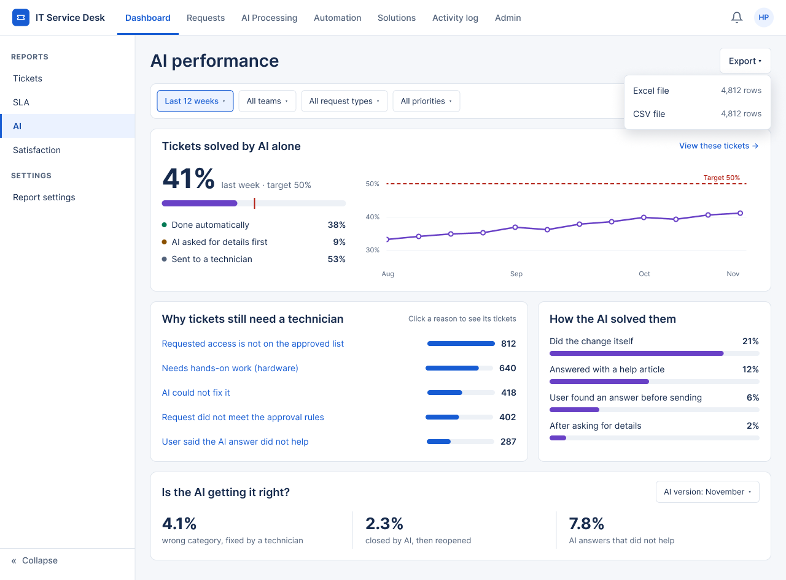

# Screen Notes — F07 Reports & Analytics

> Design status: TARGET V1 (draft for team review)
>
> Related: [UI design overview](README.md) · [Decisions](00-decisions.md) · [UI states (IA)](../information-architecture/03-ui-states-and-accessibility.md)

Two screens. Every component kept on a screen is listed with what it tells the reader and what they can do with it; anything that could not be justified was removed (D-BC-UI-08).

## Shared behavior

| Behavior | Rule |
|---|---|
| Filter bar | Sticks under the page title. Scrolling down hides it to give the content more room; scrolling up shows it again. |
| Tables | Fixed-height box that scrolls inside, both vertically and horizontally; the header row stays on top. *Columns* lets each person hide or show columns (the main column is always shown); the choice is remembered. |
| Sidebar | *« Collapse* at the bottom hides it; the ☰ button next to the page title brings it back. The choice is remembered. |
| Titles | Page title 28 px, section titles 18 px, written as what you read or do. No small captions under titles. |

## AI performance — SCR-BC-03 · `/analytics/ai` · Admin

| Component | What it tells you | What you can do |
|---|---|---|
| Page title **AI performance** + *Export* | Which report this is | *Export* opens a small menu: Excel or CSV with the row count (replaces the old SCR-BC-10 modal). Too many rows: the option is disabled with "Choose a shorter period" (`EXPORT_TOO_LARGE`) |
| Filter bar | The period, teams, request types and priorities the numbers use | Change them; every number on the page updates |
| **Tickets solved by AI alone** | Last week's share (41%) against the 50% target, the progress bar with the target mark, the split into done automatically / AI asked for details / sent to a technician (M-04, M-08), and the weekly trend | *View these tickets* opens the ticket list with the same filters |
| **Why tickets still need a technician** | The five most common reasons, ranked, with counts (route C reasons, M-10) | Click a reason to see its tickets and fix the cause (e.g. widen the approved access list) |
| **How the AI solved them** | Which way the AI solves tickets: did the change, help article, self-help, after asking | Compare paths to see where to invest (more articles, more automatic actions) |
| **Is the AI getting it right?** | Wrong category (M-05), closed then reopened (M-06), answers that did not help (M-11) | Switch *AI version* to compare after a change to the AI |

| State | Behavior |
|---|---|
| Not enough data | The figure shows "Not enough data for this period", never 0% (BR-BC-01) |
| Source unavailable | Only the affected section shows "Data unavailable"; the others stay |
| Technician | This page is not shown (AI tab is Admin only) |

## Report settings — SCR-BC-05 · `/analytics/settings` · Admin

| Component | What it tells you | What you can do |
|---|---|---|
| Page title + *Save changes* | Which settings these are | Save; the change is recorded in the activity log (`REPORT_CONFIG_UPDATED`) |
| **Targets and limits** | AI target, when a ticket counts as solved (7 days, locked: set in ticket settings), minimum share of users who rate, longest report period, most rows per export | Change the values that drive every report |
| **Weekly summary e-mail** | Whether the e-mail is on, when it goes, who gets it | Turn it on/off, add or remove people, *Send me a test* |

| State | Behavior |
|---|---|
| Invalid value | Red border and one line under the field ("Enter a value between 1 and 100") |
| Saved | Toast "Settings saved" for 5 s |
