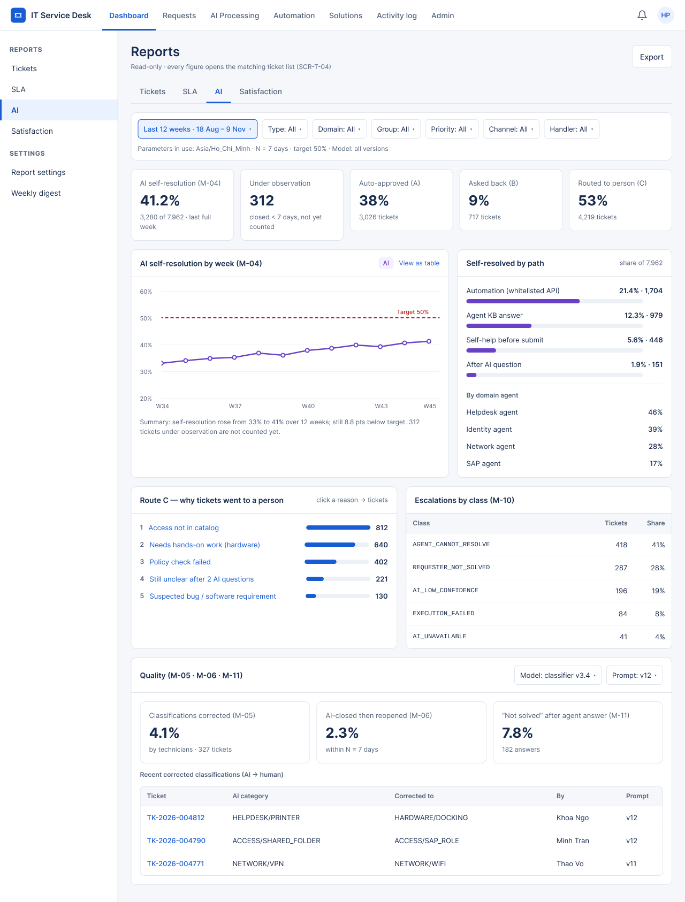

# UI Design — F07 Reports & Analytics

> Design status: TARGET V1 (draft for team review)
>
> Implementation status: NOT STARTED

This folder turns the F07 [information architecture](../information-architecture/README.md) into high-fidelity screens. They were drawn in Figma on the shared template *Service Desk UI – DS-01 Relay* (row **4 · Governance detail — Analytics (F07)**) and exported to PNG. The scope is the part of the Governance area given to this branch in the screen split: the **AI self-resolution** report, the **report settings** and the **CSV / XLSX export**.

The screens show how the rules of F07 look on a page: every rate comes with its count (BR-BC-01), the AI figure counts only tickets past the N-day window and shows the rest as "under observation", every figure opens the ticket list with the same filters (D-BC-IA-04), and the export always writes `REPORT_EXPORTED` first. Inputs: [Screens and navigation](../information-architecture/01-screens-and-navigation.md), [UI states](../information-architecture/03-ui-states-and-accessibility.md), [Acceptance criteria](../04-acceptance-criteria.md) and [Business rules](../05-business-rules.md).

| File | Content |
|---|---|
| [00-decisions.md](00-decisions.md) | Design decisions D-BC-UI-01 … D-BC-UI-06, what is not drawn yet |
| [01-screen-notes.md](01-screen-notes.md) | Per screen: purpose, layout, annotated elements, and every state |
| [`../../image/admin/`](../../image/admin/) | PNG exports of the Figma frames (shared Admin image folder) |
| [Figma file](https://www.figma.com/design/Dfak5zzpiXKxVEqvTOZLdJ/Service-Desk-UI-%E2%80%93-DS-01-Relay?node-id=0-1) | Source frames; the same names as the PNGs below |

## Screens

| ID | Screen | Route | Role | PNG |
|---|---|---|---|---|
| SCR-BC-03 | Reports › AI tab | `/analytics/ai` | Admin | [10_SCR-BC-03_Reports-AI.png](../../image/admin/10_SCR-BC-03_Reports-AI.png) |
| SCR-BC-05 | Report settings | `/analytics/settings` | Admin | [11_SCR-BC-05_Report-settings.png](../../image/admin/11_SCR-BC-05_Report-settings.png) |
| SCR-BC-10 | Export (modal) | on the tab route | Admin | [12_SCR-BC-10_Export.png](../../image/admin/12_SCR-BC-10_Export.png), [13_SCR-BC-10_Export-states.png](../../image/admin/13_SCR-BC-10_Export-states.png) |

## Design system used

The frames reuse the template, so they match the other Admin pages of the file (Dashboard, Activity log, Users & roles).

| Part | Value |
|---|---|
| Shell | Top bar 58 px with the module tabs (*Dashboard* is active for Reports); sidebar 220 px with the groups **Reports** and **Settings**; content 1012 px wide, padding 20 / 24 |
| Type | Inter: page title 24 Semi Bold, card title 14 Semi Bold, body 13–14, caption 12; Cousine for codes (`AGENT_CANNOT_RESOLVE`) |
| Color | Ink `#172B4D`, secondary `#52627A`, border `#DFE5ED`, page `#F5F7FA`, primary `#175CD3`, AI `#6941C6`, success `#057A55`, warning `#8A5100`, danger `#B42318` |
| Components | Local components `WB/Button` (primary / secondary, md / sm), `WB/Badge` (info, warning, success, danger, neutral, ai), `WB/KPI card` |
| Charts | One metric per chart, AI series in purple, target as a dashed red line with the label "Target 50%", text summary under the chart and *View as table* (UI states §3) |

**Related:** [F07 README](../README.md) · [Information architecture](../information-architecture/README.md) · [Decisions](00-decisions.md) · [Screen notes](01-screen-notes.md)
