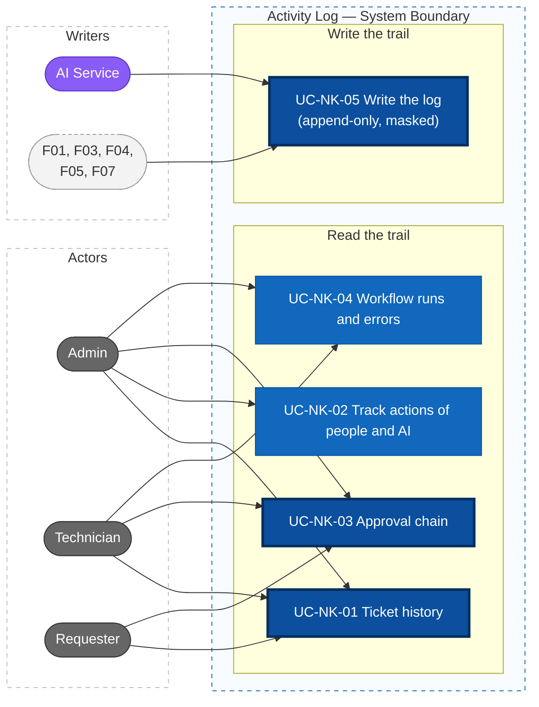
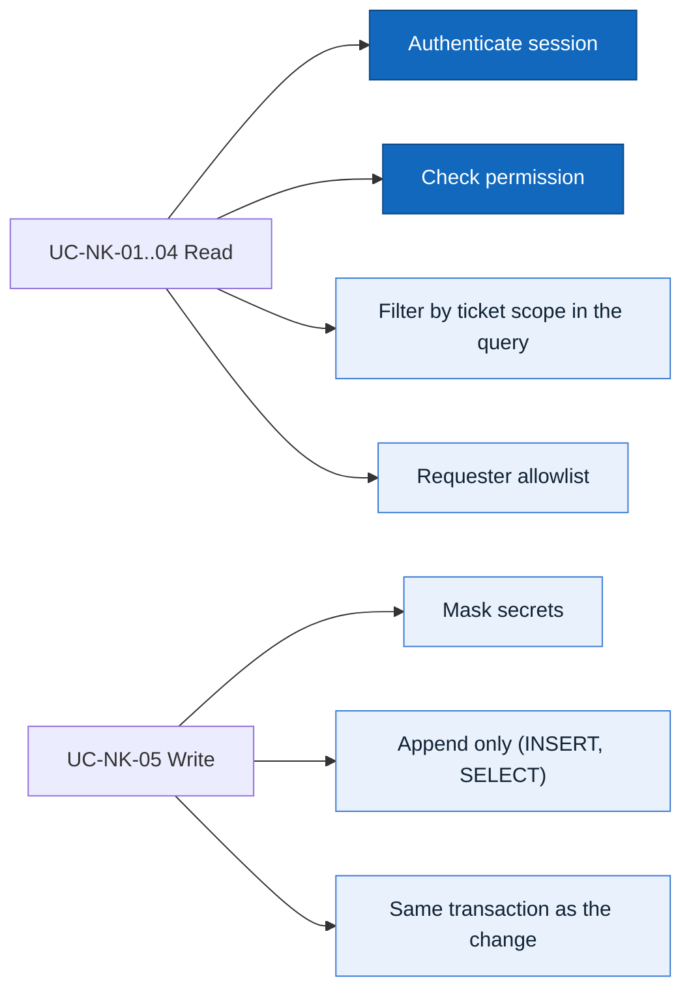

# Actors, Roles, and Use Cases — F08 Activity Log

> Design status: TARGET V1
>
> Scope: F08 Activity Log (UC-NK-01 … UC-NK-05)

## Actors and roles

The role codes are the same as in F01, F04 and F05. **There is no Team Lead** (F05 D-IA-07): only Admin, Technician and Requester.

| Role code | Display name | Role in F08 |
|---|---|---|
| `ADMIN` | Administrator | Searches every entry, sees every approval chain step with its reason and every workflow run; opens F05 SCR-WF-31 for the full AI decision |
| `TECHNICIAN` | Technician | Sees the full history of tickets in scope and a summary of their approval chain with the reason for routing to a person (F05 D-IA-06); sees workflow runs in the F05 `#automation` tab |
| `REQUESTER` | Requester | Sees an allowlisted history and a summary approval status of their own tickets |

| System actor | Code in the audit log | Role in F08 |
|---|---|---|
| AI Service | `AI` | Writes entries for what it decides or sends (analysis, question, KB answer, escalation, approval within policy). Reads ticket history through the `AI_AGENT` service account to learn from corrections (read-only) |

> As in F04 and F05, the system has three user roles and **one system actor, the AI Service**. Background jobs (assignment rules, SLA timers, API execution, verification, Microsoft sync, digests) are internal behaviour, logged with source **`AUTOMATION`** (BR-WF-05, Q-NK-03). They are not actors.

## Permission matrix

| Function | Admin | Technician | Requester |
|---|---|---|---|
| Ticket history (UC-NK-01) | ✓ all | Tickets in their scope, full | Own tickets, allowlist only (BR-NK-04) |
| Activity log search (UC-NK-02) | ✓ | | |
| Approval chain (UC-NK-03) | ✓ steps, results, reasons; link to SCR-WF-31 | Tickets in their scope: summary + reason | Own tickets, status line |
| Workflow runs pages SCR-NK-04 / 05 (UC-NK-04) | ✓ | — (runs of their tickets: F05 `#automation` tab) | |
| Edit or delete an entry | ✗ (`405`) | ✗ | ✗ |

"Tickets in their scope" means assigned to the technician or one of their groups (F01, `ticket:read`). **The API enforces every row**; hiding a tab is only for usability.

Proposed permissions, for the F01 owner to accept (naming: F07 Q-BC-12):

| Permission | Admin | Technician | Requester | `AI_AGENT` |
|---|---|---|---|---|
| `ticket_history:read` | all | scope | own (allowlist) | all, read-only |
| `audit:read` | ✓ | ✗ | ✗ | ✗ |
| `approval:read` | all (steps, results, reasons) | scope: summary + reason | own: status line | ✗ |
| `workflow_log:read` | ✓ | ✗ (F05 governs the `#automation` tab) | ✗ | ✗ |

No `audit:write`, `audit:update` or `audit:delete` exists for any role: only the backend writes, and nobody edits or deletes (BR-NK-02).

## Audit record

F08 uses the record of F01 **BR-09** unchanged and adds evidence ids (Q-NK-04).

| Field | Content |
|---|---|
| `id`, `created_at` | Append order; UTC |
| `actor_type` | `USER`, `AI`, `AUTOMATION` |
| `actor_id` | User, or service account (`AI_AGENT`); empty for `AUTOMATION` |
| `action` | From the event catalog below |
| `target_type`, `target_id` | Ticket, rule, SLA policy, user, service account, report, … |
| `before`, `after` | Masked values (BR-NK-03) |
| Evidence | `ticket_id`, `decision_id`, `analysis_id`, `rule_id`, `sla_policy_version`, `run_id`, `suggestion_id`; `model_version`, `prompt_version` and `agent` for AI entries |
| `corrects_id` | For a correction: the entry it corrects |

## Event catalog

Each event type has a **visibility class**. A new type is `INTERNAL` until classified (BR-NK-04).

| Group | Actions (examples) | Written by | Visibility to the requester |
|---|---|---|---|
| Ticket | `TICKET_CREATED`, `STATUS_CHANGED`, `PUBLIC_REPLY`, `RESOLVED`, `CLOSED`, `REOPENED`, `CANCELLED`, `RATED` | F03 | Shown |
| Ticket (internal) | `INTERNAL_NOTE`, `ASSIGNED`, `REASSIGNED`, `PRIORITY_CHANGED`, `ESCALATED` | F03, F05 | Hidden |
| AI | `AI_ANALYSIS_COMPLETED` / `_INVALID` / `_FAILED`, `AI_FIELDS_CORRECTED`, `AI_ESCALATED` (`escalationClass`), `AI_PRIORITY_SUGGESTED` | F04 | Hidden |
| AI (to requester) | `AI_QUESTION_SENT`, `REQUESTER_ANSWERED`, `AI_KB_ANSWER_SENT` (`ANSWERED_BY_KB`), `KB_SOLVED_BY_REQUESTER` (`SOLVED_BY_KB`) | F04 | Shown |
| Routing | `AI_DECISION` (`AUTO_APPROVED` / `NEEDS_INFO` / `ROUTE_TO_HUMAN`), `TICKET_ROUTED_TO_HUMAN` (`AI_UNAVAILABLE`, `AI_INVALID_OUTPUT`, …) | F05 | Summary only |
| Workflow | `RUN_QUEUED`, `RUN_STARTED`, `RUN_ATTEMPT`, `RUN_VERIFIED`, `RUN_FAILED`, `RUN_RETRIED`, `RUN_MANUALLY_RESOLVED`, `ACCESS_REVOKED` | F05 | Summary only |
| SLA | `SLA_WARNING`, `SLA_BREACHED`, `SLA_PAUSED`, `SLA_RESUMED` | F05 | Hidden |
| Configuration | `WORKFLOW_RULE_*`, `SLA_POLICY_*`, `AI_SCOPE_*`, `REPORT_CONFIG_UPDATED`, user / group / service account changes | F05, F07, F01 | — |
| Reports | `REPORT_EXPORTED`, `REPORT_DIGEST_SENT` | F07 | — |

## Use case diagram

Thick border: core use cases. Purple: system actor. UC-NK-05 has no user actor: every branch writes through it.

### Shared rules

## Use case specifications

### UC-NK-01 View Ticket History

- **Actors:** Admin; Technician (scope); Requester (own tickets)
- **Preconditions:** the user can open the ticket (`ticket:read`)
- **Main flow:**
  1. The user opens SCR-T-02 and the `#history` tab (SEC-NK-01).
  2. The system returns entries for the ticket, newest first: created, AI analysis and routing decision, questions and answers, type / group / assignee / priority / status changes, escalations, replies, internal notes, workflow runs, SLA events, resolved, closed, reopened, cancelled, rated.
  3. Each row shows the actor (name, **AI** with the domain agent, or **Automation**), time, before → after and evidence links (`decision_id` → SCR-WF-31 for Admin, `run_id` → SCR-NK-05 for Admin or the F05 `#automation` tab for a technician, `analysis_id`).
  4. The user filters by event group (status, assignment, replies, AI, workflow, SLA).
- **Alternative flows:**
  - **Requester:** only events visible to the requester in the catalog (BR-NK-04); routing and workflow events as one summary line; the AI shown as "IT assistant"; technician display name only (Q-NK-08).
  - **Technician:** everything for tickets in scope.
- **Exceptions:** ticket outside scope → `403` (not `404`, so existence is not revealed); any edit / delete call → `405`
- **Result:** anyone involved can pick up the ticket without asking around
- **Stories:** US-NK-01, US-NK-02 · **Rules:** BR-09, BR-WF-05, BR-NK-02, BR-NK-04

### UC-NK-02 Track Actions of People and AI

- **Actors:** Admin
- **Preconditions:** `audit:read`
- **Main flow:**
  1. The Admin opens *Audit → Activity log* (SCR-NK-02).
  2. Filters by actor type (`USER` / `AI` / `AUTOMATION`), actor, action, target type, target id, evidence id, model or prompt version, period.
  3. The system returns a paginated table (time, actor, action, target, summary).
  4. Opening a row shows `before` / `after` as a diff and the evidence links.
- **Alternative flows:**
  - *View log* on a user, service account, assignment rule or SLA policy opens SCR-NK-02 pre-filtered (`?actor=…`, `?target=…`).
  - `actor_type = AI` reviews everything the AI decided or sent; filter by `agent` (F04) to review one domain agent.
  - Disabled or removed users still appear with their names (F01 BR-20 keeps the user record).
- **Exceptions:** not Admin → `403`; period longer than the maximum → `422 INVALID_DATE_RANGE`
- **Result:** the Admin can review AI behaviour and investigate incidents
- **Stories:** US-NK-04, US-NK-10 · **Rules:** BR-09, BR-15, BR-18, BR-20, BR-NK-02, BR-NK-03

### UC-NK-03 View the Approval Chain

- **Actors:** Admin; Technician (tickets in scope, summary); Requester (own tickets, status line)
- **Preconditions:** the ticket has an access request handled by F05 (`CHECK_ACCOUNT`, `CREATE_ACCOUNT`, `GRANT_ACCESS`, `REVOKE_ACCESS`)
- **Boundary:** F05 owns the AI decision (`ai_decisions`) and its full detail page **SCR-WF-31** (each condition with compared values, configuration version, confidence, extracted fields; F05 D-IA-06). F08 shows the **timeline** of the request: each step, its result and the reason, and links to SCR-WF-31. It does not repeat the decision detail.
- **Main flow:** SEC-NK-02 on SCR-T-02 shows the chain in time order, each step with actor, time, result (*Passed*, *Failed*, *Asked back*, …) and reason:
  1. **Request:** requester, recipient, operation, target system, requested duration, source ticket.
  2. **AI understanding:** request type and domain agent (from F04 / `ai_decisions`).
  3. **Policy check:** overall result; when it fails, the failed condition by name as stated in the decision reason (BR-WF-02, BR-WF-17).
  4. **Decision:** `AUTO_APPROVED` (actor `AI`, `decision_id`), `NEEDS_INFO`, or `ROUTE_TO_HUMAN` with the reason and `escalationClass`.
  5. **Execution:** run status, number of attempts, last result code, policy re-check at run time (BR-WF-12); attempts are in SCR-NK-05 (Admin) or the F05 `#automation` tab (technician).
  6. **Verification:** connector check → `SUCCEEDED` or mismatch.
  7. **Requester confirmation**, and for time-limited grants the scheduled / executed `REVOKE_ACCESS` (BR-WF-14).
- **Alternative flows:**
  - **Approved but execution failed:** highlighted "Approved — execution failed", with the assigned technician. A retry adds new steps; earlier steps never change. *Resolved manually* shows the technician's note (BR-WF-13).
  - **Admin:** every step with its evidence ids (`decision_id`, `run_id`); *View AI decision* opens F05 SCR-WF-31 for each condition, the compared values, the configuration version and the confidence; *View run* opens SCR-NK-05.
  - **Technician (assigned or group):** summary: each step and its result, and the reason the request was asked back or routed to a person (`escalationClass`, failed condition by name). No confidence, extracted values, compared values, configuration version or payloads (F05 D-IA-06). Runs and attempts are in the F05 `#automation` tab.
  - **Requester:** one status line (received / need more info / approved / in progress / done / failed, being handled by IT) and the short reason (F05 DF-IA-08). No confidence, conditions, payloads or attempts.
- **Exceptions:** ticket outside scope → `403`
- **Result:** anyone can see why a request was approved, asked back or sent to a person
- **Stories:** US-NK-05 · **Rules:** BR-WF-02, BR-WF-04, BR-WF-12, BR-WF-13, BR-WF-14, BR-WF-17, BR-NK-04

### UC-NK-04 Look Up Workflow Runs and Errors

- **Actors:** Admin
- **Preconditions:** `workflow_log:read`
- **Boundary:**
  - **F05 owns** the runs: it writes `workflow_runs` and their attempts, owns the endpoints `listWorkflowRuns` / `getWorkflowRun`, the `#automation` tab of SCR-T-02 (who sees which attempts) and the *Retry* / *Resolved manually* actions (UC-WF-09, SCR-WF-20, 21).
  - **F08 owns** the audit entries of each run step (UC-NK-05), the Admin pages **SCR-NK-04** (search across tickets) and **SCR-NK-05** (run detail), and the error-type grouping below. Both pages read the F05 endpoints; the `#automation` tab and SCR-NK-05 use the same run component (D-NK-IA-03).
- **Main flow:**
  1. The Admin opens *Audit → Workflow runs* (SCR-NK-04): counters by status and a table (run id, ticket, operation, status, error type, attempts, started, duration).
  2. Filters by status (`QUEUED`, `RUNNING`, `RETRY_WAIT`, `VERIFYING`, `SUCCEEDED`, `FAILED`, `MANUALLY_RESOLVED`), error type, operation, connector, ticket, period.
  3. Opens a run (SCR-NK-05): attempts with time, duration, result code, masked request / response, error message, link to the ticket.
- **Error types:** `AI_UNAVAILABLE` (F05 UC-WF-04); `AI_INVALID_OUTPUT` (F04 analysis `INVALID` / `FAILED`); transient connector error (timeout, `5xx`, `429`, retried after 1 / 5 / 15 minutes); permanent connector error (`4xx`, access denied); `PRECONDITION_FAILED` (BR-WF-12); verification mismatch; `AUDIT_UNAVAILABLE` (BR-NK-06).
- **Alternative flows:**
  - **AI failure → a person:** on `AI_UNAVAILABLE` or `AI_INVALID_OUTPUT`, F05 does not apply the AI result and routes the ticket to a human (assignment rule, or the default support team; F05 BR-WF-09); the log has `TICKET_ROUTED_TO_HUMAN` with the error type, also visible in UC-NK-01.
  - **Technician:** has no access to SCR-NK-04 / 05; sees the runs of their tickets in the F05 `#automation` tab, with the attempts F05 shows there. *Retry* and *Resolved manually* are F05 buttons.
  - **Admin on a ticket:** *View run* in SEC-NK-01 or SEC-NK-02 opens SCR-NK-05.
- **Exceptions:** no `workflow_log:read` (Technician, Requester) → `403`
- **Result:** broken connectors and AI outages are found quickly
- **Stories:** US-NK-06, US-NK-07 · **Rules:** BR-WF-05, BR-WF-12, BR-WF-15, BR-NK-03, BR-NK-05, BR-NK-06

### UC-NK-05 Write the Log

- **Actors:** none (every branch writes through it; source `USER`, `AI` or `AUTOMATION`)
- **Trigger:** an action in the event catalog
- **Main flow:**
  1. The caller passes actor, action, target, before / after and evidence.
  2. F08 masks secrets (BR-NK-03).
  3. It appends a new entry (BR-NK-02). For changes in the system database the entry is written **in the same transaction** (NFR-WF-AUD-001); if the write fails, the change is rolled back.
- **Alternative flows:**
  - **Operations that change an external system** (`CREATE_ACCOUNT`, `GRANT_ACCESS`, `REVOKE_ACCESS`): an "execution started" entry is written **before** the connector call. If it fails, the connector is not called, the run ends `FAILED` with `AUDIT_UNAVAILABLE` and the ticket goes to a technician (BR-NK-06). If the call succeeds but the result entry fails, the entry is queued for retry and the Admin is alerted; the connector is not called again (idempotency, BR-WF-04).
  - **Correction:** a new entry with `corrects_id`; the old entry is unchanged.
- **Exceptions:** a sensitive value not recognized by field name is still masked by pattern; any edit / delete request → `405`
- **Result:** the trail is complete, unchangeable and free of secrets
- **Stories:** US-NK-03, US-NK-08, US-NK-09 · **Rules:** BR-09, BR-13, BR-WF-04, BR-WF-15, BR-NK-01, BR-NK-02, BR-NK-03, BR-NK-06, BR-NK-07
