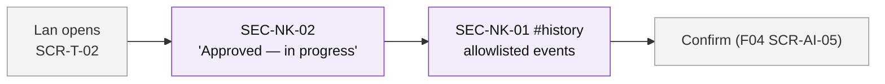
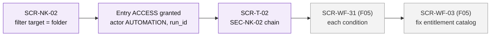

# User Flows — F08 Activity Log

> Design status: TARGET V1
>
> Related: [IA overview](README.md) · [Screens and navigation](01-screens-and-navigation.md) · [UI states](03-ui-states-and-accessibility.md)

Four flows. Sample people are the same as in the [acceptance criteria](../04-acceptance-criteria.md). Purple: F08. Grey: other branches.

## Flow 1 — Requester follows a ticket

*Lan asked for read access to the Accounting shared folder.* · US-NK-02, US-NK-05

1. Lan opens her ticket from *My tickets* or EML-AI-04.
2. SEC-NK-02 shows one line: "Approved — in progress", then "Done".
3. `#history` shows: created, approved, done, resolved — no confidence, no policy conditions, no attempts.
4. She confirms through F04 SCR-AI-05; `CLOSED` appears in the history.

## Flow 2 — Admin investigates a wrong grant

*A manager reports that someone got access they should not have.* · US-NK-04, US-NK-05, US-NK-10

1. Thu opens SCR-NK-02, filters on the folder as target.
2. The `GRANT_ACCESS` entry shows actor **Automation**, `run_id`, `decision_id`.
3. She opens the ticket → SEC-NK-02: AI understanding *Passed*, policy check *Passed*, decision `AUTO_APPROVED` by the AI.
4. *View AI decision* → SCR-WF-31 shows each condition and the compared values: the entitlement was in the catalog → the catalog was wrong, not the AI. She fixes it in SCR-WF-03; that change is itself logged (`AI_SCOPE_UPDATED`).
5. **Branch:** the AI extracted the wrong recipient → she filters SCR-NK-02 on `prompt_version` to find similar cases and reports to the F04 owner.

## Flow 3 — Admin finds a broken connector

*Many access tickets reach technicians this morning.* · US-NK-06, US-NK-07

1. SCR-91 notification "Workflow runs failing" → SCR-NK-04.
2. Counters: 37 `FAILED` since 08:00; filter by connector → all on the AD connector, error "permanent `4xx` access denied".
3. SCR-NK-05 shows the masked request and response of one run.
4. Thu fixes the connector credentials (F05). Technicians retry from `#automation`; each retry appears as new steps.
5. **Branch:** error `AI_UNAVAILABLE` → tickets were routed to people; the history of each shows `TICKET_ROUTED_TO_HUMAN`.

## Flow 4 — Technician picks up a ticket

*Hai takes over a ticket the agent escalated.* · US-NK-01

1. Hai opens the ticket from his work queue → `#history`.
2. He filters "AI": the agent asked two questions, sent KB-087, the requester said *Not solved*, F05 escalated with `AGENT_CANNOT_RESOLVE`.
3. He starts work without asking the requester again.
