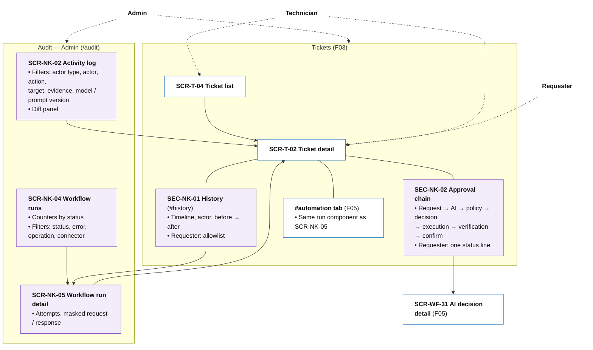

# Information Architecture — F08 Activity Log

> Design status: TARGET V1 (draft for team review)
>
> Implementation status: NOT STARTED

This folder places the 10 F08 stories on screens. F08 owns **three Admin pages** (Activity log, Workflow runs, Workflow run detail) and **two sections** inside the ticket detail page owned by F03. It has no email. The inventory has two kinds of entries:

| Kind | ID | Meaning |
|---|---|---|
| F08 page | `SCR-NK-xx` | A page only F08 needs |
| Host page section | `SEC-NK-xx` | An F08 section inside a page owned by F03 (`SCR-T-02`). The host page keeps its own ID |

Inputs: [Use cases](../02-use-cases.md), [User stories](../03-user-stories-invest.md), [Acceptance criteria](../04-acceptance-criteria.md). Routes follow the system IA (`/audit/activity-log`, [information-architecture.md](../../information-architecture.md)); host IDs come from F03 (`SCR-T-02` with tabs `#history`, `#automation`; `SCR-T-04`) and F05 (`SCR-WF-31`, `SCR-90`, `SCR-91`).

| File | Content |
|---|---|
| [01-screens-and-navigation.md](01-screens-and-navigation.md) | Page and section inventory; routes and permissions; navigation per role; story-to-screen mapping; screen-to-API mapping |
| [02-user-flows.md](02-user-flows.md) | Four flows: requester follows a ticket, Admin investigates a wrong grant, Admin finds a broken connector, technician picks up a ticket |
| [03-ui-states-and-accessibility.md](03-ui-states-and-accessibility.md) | State contract, actor markers, responsive layout, accessibility |

## IA decisions

| ID | Decision | Why |
|---|---|---|
| D-NK-IA-01 | **Ticket history is the `#history` tab of SCR-T-02** (SEC-NK-01), as F03 already reserved, not a page of its own. | People look for history where the ticket is. |
| D-NK-IA-02 | **The approval chain is a section of SCR-T-02** (SEC-NK-02), shown when the ticket has an F05 access request. For the Admin it links to **F05 SCR-WF-31** instead of repeating the policy details. | SCR-WF-31 already shows each condition and the configuration version; the chain shows the whole story in time order. |
| D-NK-IA-03 | **Workflow run detail (SCR-NK-05) and the `#automation` tab of SCR-T-02 use the same component and the same F05 endpoint.** *Retry* / *Resolved manually* stay F05 actions (SCR-WF-20, 21). | One view of a run, one owner of the actions. |
| D-NK-IA-04 | **The audit area is Admin only** (Activity log, Workflow runs). Technicians reach runs from their tickets. | Matches the system IA (`/audit` Admin only). |
| D-NK-IA-05 | **No edit, delete or "hide" control anywhere.** Corrections appear as new entries linked to the old one. | Append-only (BR-NK-02). |
| D-NK-IA-06 | **Every entry says who did it:** a person, the **AI** (with the domain agent) or **Automation**, with icon and text. | Same rule as F04 D-AI-IA-06. |

## Information architecture

Solid lines: a page and its sections or child pages. Dashed arrows: which areas each actor uses. Purple: F08-owned items. White: pages owned by other branches.

## Screen hierarchy per role

| Role | Home page | Where F08 shows up |
|---|---|---|
| Requester | My tickets (F03) | SCR-T-02: SEC-NK-01 (allowlist), SEC-NK-02 (summary) |
| Technician | Work queues (F03) | SCR-T-02: SEC-NK-01, SEC-NK-02 (full when assigned, summary for the group); runs through `#automation` |
| Admin | Dashboard (F02) | Sidebar **Audit**: SCR-NK-02, SCR-NK-04 → SCR-NK-05; everything on SCR-T-02; links to SCR-WF-31 |
| AI Service | — | No UI; writes entries, reads history read-only as `AI_AGENT` |

**Related:** [F08 README](../README.md) · [Screens and navigation](01-screens-and-navigation.md) · [User flows](02-user-flows.md) · [UI states](03-ui-states-and-accessibility.md)
