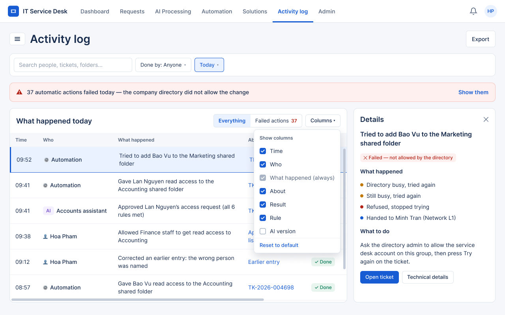

# Screen Notes — F08 Activity Log

> Design status: TARGET V1 (draft for team review)
>
> Related: [UI design overview](README.md) · [Decisions](00-decisions.md) · [UI states (IA)](../information-architecture/03-ui-states-and-accessibility.md)

One screen covers the activity log (SCR-NK-02), the automatic actions (SCR-NK-04) and the detail of one action (SCR-NK-05) (D-NK-UI-08). Every component kept is listed with what it tells the reader and what they can do with it.

## Shared behavior

| Behavior | Rule |
|---|---|
| Filter bar | Sticks under the page title. Scrolling down hides it to give the content more room; scrolling up shows it again. |
| Tables | Fixed-height box that scrolls inside, both vertically and horizontally; the header row stays on top. *Columns* lets each person hide or show columns (the main column is always shown); the choice is remembered. |
| Sidebar | *« Collapse* at the bottom hides it; the ☰ button next to the page title brings it back. The choice is remembered. |
| Titles | Page title 28 px, section titles 18 px, written as what you read or do. No small captions under titles. |

## Activity log — SCR-NK-02 / 04 / 05 · `/audit/activity-log` · Admin

Shown with the sidebar collapsed and the *Columns* menu open.

| Component | What it tells you | What you can do |
|---|---|---|
| Page title **Activity log** + *Export* | Where you are | Export what the filters show |
| Filter bar | Search, who did it, period | Narrow the log to a person, a ticket, a folder or a day |
| Red alert | Automatic actions failed today and the shared reason | *Show them* switches the table to failed actions |
| **What happened today** | One sentence per entry: when, who (person, AI assistant or automation), what happened, about what, result | *Everything / Failed actions* switch; *Columns* hides or shows columns; click a row for details |
| **Details** panel | For a change: before / after in words. For an automatic action: what happened step by step and what to do next | *Open ticket*, *Technical details* (request / response, for developers only), links to the AI decision |

No control edits or deletes an entry (D-NK-IA-05); corrections are new entries.

| State | Behavior |
|---|---|
| Nothing found | "No entries match. Remove a filter or choose a longer period." |
| Period too long | One line under the filters; previous results stay |
| Not admin | Page not shown (SCR-90) |
