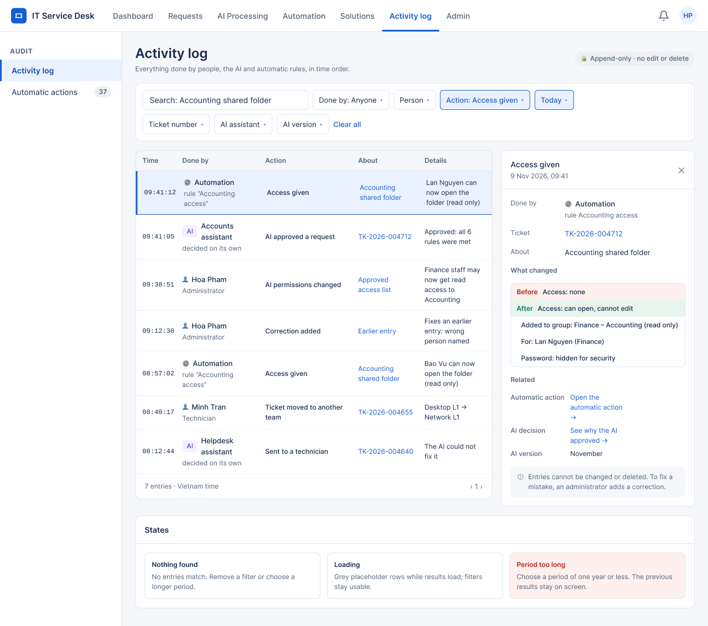

# UI Design — F08 Activity Log

> Design status: TARGET V1 (draft for team review)
>
> Implementation status: NOT STARTED

This folder turns the F08 [information architecture](../information-architecture/README.md) into high-fidelity screens. They were drawn in Figma on the shared template *Service Desk UI – DS-01 Relay* (row **5 · Governance detail — Audit (F08)**) and exported to PNG. The scope is the **Audit** area of the Admin: the activity log and the workflow runs with their detail page.

The screens show the F08 rules on a page: no edit, delete or hide control anywhere (D-NK-IA-05), every entry says who did it with an icon and text (D-NK-IA-06), passwords are always hidden (BR-NK-03), every automated entry links to what caused it, and everything is written in plain words for non-technical readers (D-NK-UI-07). Inputs: [Screens and navigation](../information-architecture/01-screens-and-navigation.md), [User flows](../information-architecture/02-user-flows.md), [UI states](../information-architecture/03-ui-states-and-accessibility.md) and [Acceptance criteria](../04-acceptance-criteria.md).

| File | Content |
|---|---|
| [00-decisions.md](00-decisions.md) | Design decisions D-NK-UI-01 … D-NK-UI-07, what is not drawn yet |
| [01-screen-notes.md](01-screen-notes.md) | Per screen: purpose, layout, annotated elements, and every state |
| [`../../image/admin/`](../../image/admin/) | PNG exports of the Figma frames (shared Admin image folder) |
| [Figma file](https://www.figma.com/design/Dfak5zzpiXKxVEqvTOZLdJ/Service-Desk-UI-%E2%80%93-DS-01-Relay?node-id=0-1) | Source frames; the same names as the PNGs below |

## Screens

| ID | Screen | Route | Role | PNG |
|---|---|---|---|---|
| SCR-NK-02 | Activity log | `/audit/activity-log` | Admin | [14_SCR-NK-02_Activity-log.png](../../image/admin/14_SCR-NK-02_Activity-log.png) |
| SCR-NK-04 | Workflow runs | `/audit/workflow-runs` | Admin | [15_SCR-NK-04_Workflow-runs.png](../../image/admin/15_SCR-NK-04_Workflow-runs.png) |
| SCR-NK-05 | Workflow run detail | `/audit/workflow-runs/:id` | Admin | [16_SCR-NK-05_Workflow-run-detail.png](../../image/admin/16_SCR-NK-05_Workflow-run-detail.png) |

## Design system used

Same template and tokens as the other Admin pages (see [F07 UI design](../../f07-reports-analytics/ui-design/README.md#design-system-used)). Specific to F08:

| Part | Value |
|---|---|
| Shell | Module tab **Activity log** active; sidebar group **Audit** with *Activity log* and *Workflow runs* (badge = failed runs today) |
| Language | Plain sentences only (D-NK-UI-07): actions, reasons and changes in words; no event codes, error codes or raw ids. Cousine (monospace) only for times |
| *Done by* marker | Person: 👤 icon + name + role; AI: `AI` badge (purple) + assistant name + "decided on its own"; Automation: ⚙ icon + "Automation" + rule name |
| Run status chips | ◷ In progress (info), ✓ Succeeded (success), ✕ Failed (danger), 👤 Resolved manually (neutral) — icon and text, never color alone (UI states §3) |
| What changed | Old value on red `#FEF0EE` with the word *Before*; new value on green `#E8F5EF` with the word *After*; other changes as plain lines |

**Related:** [F08 README](../README.md) · [Information architecture](../information-architecture/README.md) · [Decisions](00-decisions.md) · [Screen notes](01-screen-notes.md)
