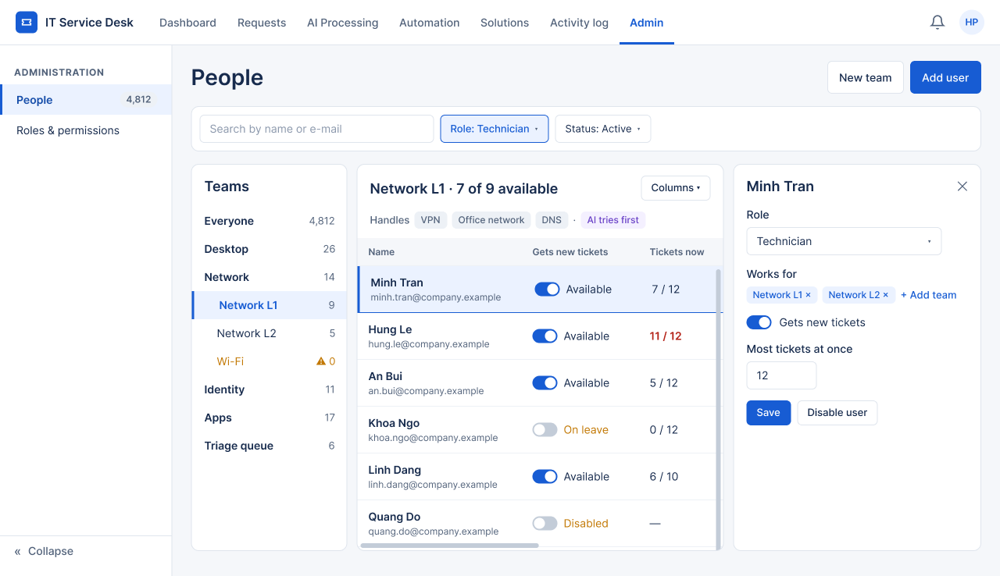

# Screen Notes — F09 User Management

> Design status: UI DRAFT (for team review)
>
> Related: [UI design overview](README.md) · [Decisions](00-decisions.md)

One screen covers users, editing a user and teams (D-UM-UI-08). Every component kept is listed with what it tells the reader and what they can do with it.

## Shared behavior

| Behavior | Rule |
|---|---|
| Filter bar | Sticks under the page title. Scrolling down hides it to give the content more room; scrolling up shows it again. |
| Tables | Fixed-height box that scrolls inside, both vertically and horizontally; the header row stays on top. *Columns* lets each person hide or show columns (the main column is always shown); the choice is remembered. |
| Sidebar | *« Collapse* at the bottom hides it; the ☰ button next to the page title brings it back. The choice is remembered. |
| Titles | Page title 28 px, section titles 18 px, written as what you read or do. No small captions under titles. |

## People — `/admin/users`, `/admin/teams` · Admin

| Component | What it tells you | What you can do |
|---|---|---|
| Page title **People** + *New team*, *Add user* | Where you are | Create a team or a user |
| Filter bar | Search, role, account status | Find people quickly |
| **Teams** tree | The team structure with the number of people; a warning on a team with nobody (Wi-Fi) | Pick a team to filter the table; *Everyone* shows all |
| **Network L1 · 7 of 9 available** | What the team handles (VPN, Office network, DNS), that the AI tries first, and each member: gets new tickets, tickets now (red when nearly full), role, teams, account, last sign-in | *Columns*; switch a person's *Gets new tickets*; click a person to edit |
| Person panel | The selected person's role, teams and limits | Change role, teams, *Gets new tickets*, most tickets at once; *Save*; *Disable user* |

| State | Behavior |
|---|---|
| Empty team | "Nobody in this team yet" with *Add user*; its tickets go to the parent team |
| Saved | Toast "Minh Tran updated"; the change is in the activity log |
| Not admin | Page not shown (SCR-90) |
