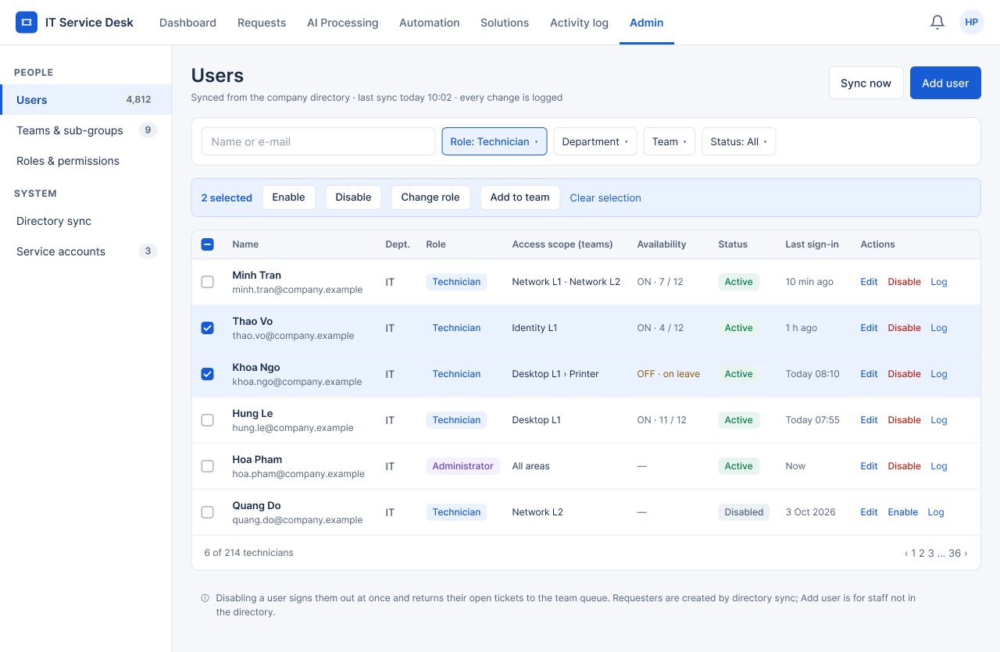

# UI Design — F09 User Management

> Design status: UI DRAFT (for team review; F09 specification not written)
>
> Implementation status: NOT STARTED

This folder holds the high-fidelity draft of the **Users and teams** part of the Governance area. The screens were drawn in Figma on the shared template *Service Desk UI – DS-01 Relay* (row **6 · Governance detail — Users & teams (F09)**) and exported to PNG. Because F09 has no specification yet, the screen IDs `SCR-UM-xx` are provisional and the content comes from the sources listed in the [F09 README](../README.md).

The screens follow the rules other branches already set: a technician receives tickets only from the teams in their access scope and only while `ON` (F05 BR-WF-09, BR-WF-10); every change is logged and can be opened with *View log* (F08, SCR-NK-02 pre-filtered); the Admin is the only role on these pages (master IA §3).

| File | Content |
|---|---|
| [00-decisions.md](00-decisions.md) | Design decisions D-UM-UI-01 … D-UM-UI-06, assumptions to confirm |
| [01-screen-notes.md](01-screen-notes.md) | Per screen: purpose, layout, annotated elements, and every state |
| [`../../image/admin/`](../../image/admin/) | PNG exports of the Figma frames (shared Admin image folder) |
| [Figma file](https://www.figma.com/design/Dfak5zzpiXKxVEqvTOZLdJ/Service-Desk-UI-%E2%80%93-DS-01-Relay?node-id=0-1) | Source frames; the same names as the PNGs below |

## Screens

| ID (provisional) | Screen | Route | Role | PNG |
|---|---|---|---|---|
| SCR-UM-01 | Users | `/admin/users` | Admin | [17_SCR-UM-01_Users.png](../../image/admin/17_SCR-UM-01_Users.png) |
| SCR-UM-02 | Edit user (drawer) | on `/admin/users` | Admin | [18_SCR-UM-02_Edit-user-drawer.png](../../image/admin/18_SCR-UM-02_Edit-user-drawer.png) |
| SCR-UM-03 | Teams & sub-groups | `/admin/teams` | Admin | [19_SCR-UM-03_Teams.png](../../image/admin/19_SCR-UM-03_Teams.png) |

## Design system used

Same template and tokens as the other Admin pages (see [F07 UI design](../../f07-reports-analytics/ui-design/README.md#design-system-used)). Specific to F09:

| Part | Value |
|---|---|
| Shell | Module tab **Admin** active; sidebar groups **People** (Users, Teams & sub-groups, Roles & permissions) and **System** (Directory sync, Service accounts) |
| Role badge | Technician: info (blue); Administrator: ai (purple); Requester: neutral |
| Status badge | Active: success; Disabled: neutral |
| Availability | Toggle (blue = `ON`) with text; `OFF` text in warning color with the reason |
| Workload bar | 70 px bar `open / max`; red above 85% |
| Forms | Drawer 480 px from the right for edits; read-only fields on grey `#F5F7FA` |

**Related:** [F09 README](../README.md) · [Decisions](00-decisions.md) · [Screen notes](01-screen-notes.md)
