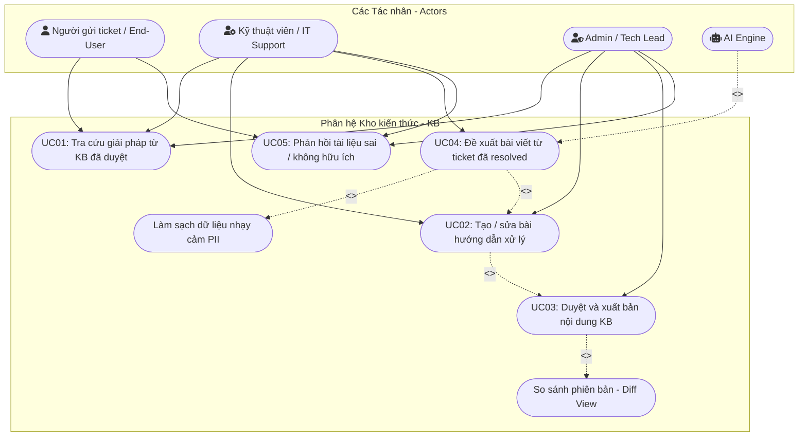

# 03. ĐẶC TẢ USE CASE CHI TIẾT (USE CASE SPECIFICATIONS)
> **Phân hệ:** Kho kiến thức — KB (Knowledge Base)  
> **Dự án:** Hệ thống Phân luồng & Xử lý Ticket tự động ứng dụng AI  
> **Tiêu chuẩn:** RUP / IEEE 830 Use Case Specification Standard

---

## 1. Sơ đồ Use Case tổng thể (Mermaid Diagram)

---

## 2. Đặc tả chi tiết từng Use Case

---

### UC01: Tra cứu giải pháp từ KB đã duyệt

| Thuộc tính | Mô tả chi tiết |
| :--- | :--- |
| **Mã Use Case** | **UC01** |
| **Tên Use Case** | Tra cứu giải pháp từ KB đã duyệt |
| **Tác nhân chính (Primary Actor)** | Người gửi ticket (End-User), Kỹ thuật viên (IT Support), Quản trị viên (Admin) |
| **Tác nhân phụ (Secondary Actor)** | AI Semantic Search Engine |
| **Mô tả vắn tắt** | Cho phép người dùng tìm kiếm, tra cứu tài liệu hướng dẫn khắc phục sự cố kỹ thuật dựa trên từ khóa, câu hỏi tự nhiên hoặc bộ lọc danh mục. |
| **Tiền điều kiện (Pre-conditions)** | Người dùng đã truy cập vào hệ thống (hoặc cổng Help Center). |
| **Hậu điều kiện (Post-conditions)** | Người dùng xem được nội dung chi tiết bài viết phù hợp để tự giải quyết vấn đề. |
| **Luồng sự kiện chính (Main Flow)** | **1.** Người dùng truy cập trang "Kho kiến thức - KB". **2.** Hệ thống hiển thị thanh tìm kiếm thông minh và danh sách các chuyên mục sự cố phổ biến. **3.** Người dùng nhập câu hỏi hoặc từ khóa lỗi (ví dụ: *"lỗi màn hình xanh khi cắm sạc"*). **4.** Hệ thống gửi truy vấn đến AI Semantic Search Engine để phân tích ý định (Intent) và độ tương đồng ngữ nghĩa. **5.** Hệ thống hiển thị danh sách kết quả bài viết phù hợp nhất kèm đoạn tóm tắt giải pháp. **6.** Người dùng nhấp chọn một bài viết. **7.** Hệ thống hiển thị toàn bộ nội dung bài viết: Mô tả lỗi, Nguyên nhân, Các bước xử lý chi tiết (Step-by-step), Ảnh minh họa và Tệp đính kèm. **8.** Hệ thống ghi nhận thêm 1 lượt đọc (+1 view count) cho bài viết. |
| **Luồng rẽ nhánh (Alternative Flows)** | **3a. Tra cứu bằng cách duyệt danh mục:** &nbsp;&nbsp;&nbsp;&nbsp;1. Thay vì nhập từ khóa, người dùng bấm chọn một Danh mục (ví dụ: "Mạng & VPN"). &nbsp;&nbsp;&nbsp;&nbsp;2. Hệ thống tải danh sách các bài viết thuộc danh mục đó, sắp xếp theo lượt đánh giá hữu ích giảm dần. &nbsp;&nbsp;&nbsp;&nbsp;3. Người dùng chọn bài viết và tiếp tục bước 7. **5a. Lọc kết quả nâng cao:** &nbsp;&nbsp;&nbsp;&nbsp;1. Tại danh sách kết quả, người dùng tick chọn bộ lọc: Hệ điều hành (Windows/macOS), Thời gian (Năm 2026), Đánh giá (>4 sao). &nbsp;&nbsp;&nbsp;&nbsp;2. Hệ thống cập nhật lại danh sách kết quả tương ứng. |
| **Luồng ngoại lệ (Exception Flows)** | **5b. Không tìm thấy bài viết phù hợp:** &nbsp;&nbsp;&nbsp;&nbsp;1. Hệ thống không tìm thấy bài viết nào có độ tương đồng > 50%. &nbsp;&nbsp;&nbsp;&nbsp;2. Hệ thống hiển thị thông báo: *"Không tìm thấy giải pháp phù hợp với từ khóa của bạn."* &nbsp;&nbsp;&nbsp;&nbsp;3. Hệ thống gợi ý nút bấm: **[Tạo Ticket hỗ trợ mới]**; khi bấm vào, hệ thống tự động điền từ khóa vừa tìm vào ô Tiêu đề của Ticket mới. |
| **Quy tắc nghiệp vụ (Business Rules)** | **BR-01:** Người dùng thông thường (End-User) chỉ được xem bài viết có phạm vi `Public`. Bài viết đánh dấu `Internal Only` chỉ hiển thị với Kỹ thuật viên và Admin. |

---

### UC02: Tạo / Sửa bài hướng dẫn xử lý

| Thuộc tính | Mô tả chi tiết |
| :--- | :--- |
| **Mã Use Case** | **UC02** |
| **Tên Use Case** | Tạo / sửa bài hướng dẫn xử lý |
| **Tác nhân chính (Primary Actor)** | Kỹ thuật viên (IT Support), Quản trị viên (Admin) |
| **Mô tả vắn tắt** | Kỹ thuật viên soạn thảo bài viết mới hoặc cập nhật bài viết cũ bằng trình soạn thảo chuẩn hóa, đính kèm hình ảnh và gắn nhãn phân loại trước khi gửi duyệt. |
| **Tiền điều kiện (Pre-conditions)** | Kỹ thuật viên đã đăng nhập và có quyền biên tập KB (`kb:create`, `kb:edit`). |
| **Hậu điều kiện (Post-conditions)** | Bản thảo bài viết được lưu trữ ở trạng thái `Draft` hoặc chuyển sang `Pending Review` chờ người có thẩm quyền phê duyệt. |
| **Luồng sự kiện chính (Main Flow - Tạo mới)** | **1.** KTV truy cập menu "Quản lý KB" và nhấn nút **[+ Viết bài mới]**. **2.** Hệ thống mở giao diện Soạn thảo bài viết. **3.** KTV nhập các thông tin metadata: &nbsp;&nbsp;&nbsp;&nbsp;- Tiêu đề bài viết. &nbsp;&nbsp;&nbsp;&nbsp;- Chọn Danh mục (Category). &nbsp;&nbsp;&nbsp;&nbsp;- Gắn Thẻ từ khóa (Tags) và Mã lỗi (nếu có). &nbsp;&nbsp;&nbsp;&nbsp;- Chọn Đối tượng xem: `Toàn công ty (Public)` hoặc `Nội bộ IT (Internal)`. **4.** KTV nhập nội dung bài viết theo cấu trúc chuẩn: Hiện tượng lỗi -> Nguyên nhân -> Các bước xử lý chi tiết (Step 1, Step 2...). **5.** KTV chèn ảnh chụp màn hình minh họa và tệp log mẫu (nếu cần). **6.** Hệ thống tự động kích hoạt cơ chế Auto-save mỗi 20 giây. **7.** KTV nhấn nút **[Gửi phê duyệt]**. **8.** Hệ thống kiểm tra tính hợp lệ của dữ liệu, chuyển trạng thái bài viết thành `Pending Review` và gửi thông báo tới nhóm Admin/Lead. |
| **Luồng rẽ nhánh (Alternative Flows - Chỉnh sửa bài đã xuất bản)** | **1a. KTV chọn sửa một bài viết đang Published:** &nbsp;&nbsp;&nbsp;&nbsp;1. KTV chọn bài viết KB-102 và bấm **[Chỉnh sửa]**. &nbsp;&nbsp;&nbsp;&nbsp;2. Hệ thống nhân bản nội dung hiện tại thành phiên bản nháp mới (ví dụ: v1.1 Draft). Bài viết v1.0 vẫn mở cho người dùng đọc bình thường. &nbsp;&nbsp;&nbsp;&nbsp;3. KTV chỉnh sửa nội dung và nhập trường bắt buộc: *"Lý do cập nhật"*. &nbsp;&nbsp;&nbsp;&nbsp;4. KTV bấm **[Gửi phê duyệt bản cập nhật]**. &nbsp;&nbsp;&nbsp;&nbsp;5. Hệ thống gửi bản thảo mới vào hàng đợi phê duyệt. |
| **Luồng ngoại lệ (Exception Flows)** | **7a. Thiếu trường thông tin bắt buộc:** &nbsp;&nbsp;&nbsp;&nbsp;1. KTV bấm gửi duyệt nhưng để trống Tiêu đề hoặc Danh mục. &nbsp;&nbsp;&nbsp;&nbsp;2. Hệ thống cảnh báo viền đỏ và hiển thị: *"Vui lòng điền đầy đủ các mục bắt buộc"*. Không cho phép gửi. **7b. Tệp đính kèm vượt quá dung lượng:** &nbsp;&nbsp;&nbsp;&nbsp;1. KTV tải lên video/file > 25MB. &nbsp;&nbsp;&nbsp;&nbsp;2. Hệ thống từ chối tệp và thông báo: *"Dung lượng tệp tối đa cho phép là 25MB"*. |
| **Quy tắc nghiệp vụ (Business Rules)** | **BR-02:** Mọi bài viết tạo mới hoặc sửa đổi từ KTV đều bắt buộc phải qua khâu duyệt của Admin/Lead trước khi xuất bản ra công chúng. |

---

### UC03: Duyệt và xuất bản nội dung KB

| Thuộc tính | Mô tả chi tiết |
| :--- | :--- |
| **Mã Use Case** | **UC03** |
| **Tên Use Case** | Duyệt và xuất bản nội dung KB |
| **Tác nhân chính (Primary Actor)** | Quản trị viên (Admin), IT Support Lead |
| **Tác nhân phụ (Secondary Actor)** | Kỹ thuật viên (Tác giả bài viết) |
| **Mô tả vắn tắt** | Admin kiểm tra nội dung bài viết đang chờ duyệt, so sánh các điểm thay đổi bằng công cụ Diff View, quyết định Xuất bản, Yêu cầu sửa hoặc Từ chối. |
| **Tiền điều kiện (Pre-conditions)** | Admin đăng nhập với quyền duyệt bài (`kb:approve`) và có bài viết ở trạng thái `Pending Review`. |
| **Hậu điều kiện (Post-conditions)** | Bài viết được xuất bản chính thức (`Published`) hoặc trả về cho tác giả kèm nhận xét. |
| **Luồng sự kiện chính (Main Flow - Phê duyệt)** | **1.** Admin vào trang Quản trị KB, chọn tab **"Hàng đợi phê duyệt"**. **2.** Hệ thống hiển thị danh sách các bài viết `Pending Review`. **3.** Admin nhấp vào bài viết cần kiểm tra. **4.** Hệ thống hiển thị nội dung bài viết. (Nếu là bài sửa, hệ thống bật chế độ **Diff View** hiển thị chi tiết phần thêm mới tô xanh, phần xóa tô đỏ). **5.** Admin kiểm tra nội dung kỹ thuật, độ an toàn thông tin và văn phong. **6.** Admin nhấn nút **[Phê duyệt & Xuất bản]**. **7.** Hệ thống cập nhật trạng thái bài viết thành `Published`, tăng số hiệu phiên bản chính thức, cập nhật chỉ mục tìm kiếm và gửi thông báo tới Tác giả. |
| **Luồng rẽ nhánh (Alternative Flows)** | **6a. Yêu cầu tác giả chỉnh sửa lại:** &nbsp;&nbsp;&nbsp;&nbsp;1. Admin phát hiện nội dung thiếu bước hoặc hình ảnh mờ. &nbsp;&nbsp;&nbsp;&nbsp;2. Admin nhấn **[Yêu cầu chỉnh sửa]** và nhập phản hồi cụ thể. &nbsp;&nbsp;&nbsp;&nbsp;3. Hệ thống đổi trạng thái bài thành `Changes Requested` và bắn thông báo tới KTV. **6b. Từ chối xuất bản bài viết:** &nbsp;&nbsp;&nbsp;&nbsp;1. Admin nhận thấy nội dung bị trùng lặp hoặc không phù hợp chính sách công ty. &nbsp;&nbsp;&nbsp;&nbsp;2. Admin bấm **[Từ chối]**, nhập lý do từ chối. &nbsp;&nbsp;&nbsp;&nbsp;3. Hệ thống đổi trạng thái sang `Rejected`. |
| **Quy tắc nghiệp vụ (Business Rules)** | **BR-03:** Khi một phiên bản mới được duyệt (`Published`), phiên bản cũ ngay lập tức được lưu vào lịch sử (Archive) để phục vụ tra cứu kiểm toán (Audit Trail) khi cần. |

---

### UC04: Đề xuất bài viết từ ticket đã resolved (AI)

| Thuộc tính | Mô tả chi tiết |
| :--- | :--- |
| **Mã Use Case** | **UC04** |
| **Tên Use Case** | Đề xuất bài viết từ ticket đã resolved |
| **Tác nhân chính (Primary Actor)** | Kỹ thuật viên (IT Support) |
| **Tác nhân phụ (Secondary Actor)** | AI Knowledge Extraction Engine |
| **Mô tả vắn tắt** | AI tự động phân tích ngữ cảnh, mô tả sự cố và giải pháp của một ticket đã xử lý thành công, làm sạch thông tin nhạy cảm và sinh ra bản thảo bài viết KB chuẩn hóa. |
| **Tiền điều kiện (Pre-conditions)** | 1. Ticket mục tiêu đã ở trạng thái `Resolved` hoặc `Closed`. 2. KTV có quyền xem và xử lý ticket đó. |
| **Hậu điều kiện (Post-conditions)** | Một bản nháp bài viết KB mới được khởi tạo và liên kết với mã ticket nguồn. |
| **Luồng sự kiện chính (Main Flow)** | **1.** KTV mở màn hình chi tiết của một Ticket vừa xử lý xong. **2.** KTV nhấn nút hành động **[Tạo bài viết KB với AI]**. **3.** Hệ thống gửi toàn bộ lịch sử ticket (Mô tả ban đầu, các tin nhắn trao đổi, mã lỗi, ghi chú giải pháp của KTV) sang AI Engine. **4.** AI Engine thực hiện: &nbsp;&nbsp;&nbsp;&nbsp;a. **Làm sạch PII (PII Redaction):** Nhận diện và ẩn danh hóa tên người dùng, email, địa chỉ IP, mật khẩu, link bí mật. &nbsp;&nbsp;&nbsp;&nbsp;b. **Trích xuất tri thức:** Tóm tắt Tiêu đề chuẩn, xác định Hiện tượng lỗi, Nguyên nhân gốc rễ và chuẩn hóa các bước thực hiện tuần tự. &nbsp;&nbsp;&nbsp;&nbsp;c. **Gán nhãn:** Đề xuất Danh mục phù hợp nhất và các Thẻ tag liên quan. **5.** Hệ thống hiển thị cửa sổ Modal: *"Xem trước bản thảo KB do AI đề xuất"*. **6.** KTV xem qua nội dung, thấy giải pháp chính xác và nhấn nút **[Chuyển vào Form soạn thảo]**. **7.** Hệ thống mở màn hình Soạn thảo KB với toàn bộ thông tin đã được AI điền sẵn. **8.** KTV trau chuốt lại câu từ và bấm **[Gửi phê duyệt]**. |
| **Luồng rẽ nhánh (Alternative Flows)** | **4a. AI phát hiện giải pháp tương tự đã tồn tại trong KB:** &nbsp;&nbsp;&nbsp;&nbsp;1. AI so sánh độ tương đồng và phát hiện bài viết `KB-045` đã có nội dung gần giống. &nbsp;&nbsp;&nbsp;&nbsp;2. Hệ thống cảnh báo: *"Đã có bài viết tương tự [KB-045: Cấu hình mạng Wifi văn phòng]. Bạn có muốn cập nhật bài viết cũ hay tạo bài mới?"* &nbsp;&nbsp;&nbsp;&nbsp;3. KTV chọn "Cập nhật bài viết cũ" -> Hệ thống mở giao diện sửa phiên bản của bài `KB-045`. |
| **Luồng ngoại lệ (Exception Flows)** | **3a. AI Engine phản hồi chậm hoặc lỗi kết nối:** &nbsp;&nbsp;&nbsp;&nbsp;1. Quá thời gian timeout 10 giây hoặc AI service báo lỗi. &nbsp;&nbsp;&nbsp;&nbsp;2. Hệ thống thông báo lỗi: *"Dịch vụ AI đang bận. Bạn có muốn sao chép nội dung ticket vào mẫu soạn thảo thông thường không?"* &nbsp;&nbsp;&nbsp;&nbsp;3. KTV chọn tiếp tục soạn thảo thủ công. |
| **Quy tắc nghiệp vụ (Business Rules)** | **BR-04:** Bắt buộc phải qua bước làm sạch dữ liệu PII trước khi đưa nội dung vào bản nháp KB để chống rò rỉ dữ liệu khách hàng hoặc nội bộ. |

---

### UC05: Phản hồi tài liệu sai / không hữu ích

| Thuộc tính | Mô tả chi tiết |
| :--- | :--- |
| **Mã Use Case** | **UC05** |
| **Tên Use Case** | Phản hồi tài liệu sai / không hữu ích |
| **Tác nhân chính (Primary Actor)** | Người gửi ticket (End-User), Kỹ thuật viên (IT Support) |
| **Tác nhân phụ (Secondary Actor)** | Tác giả bài viết, Quản trị viên (Admin) |
| **Mô tả vắn tắt** | Người đọc đánh giá mức độ hữu ích của bài viết (Like/Dislike) hoặc gửi báo cáo chi tiết khi phát hiện hướng dẫn sai lệch, lỗi thời để đội ngũ IT kịp thời cập nhật. |
| **Tiền điều kiện (Pre-conditions)** | Người dùng đang xem một bài viết KB đã xuất bản (`Published`). |
| **Hậu điều kiện (Post-conditions)** | Đánh giá được ghi nhận vào hệ thống; nếu có báo cáo lỗi, cờ cảnh báo được kích hoạt và gửi thông báo tới Tác giả/Admin. |
| **Luồng sự kiện chính (Main Flow - Báo cáo lỗi)** | **1.** Người dùng đọc xong bài viết KB nhưng làm theo không thành công hoặc phát hiện sai. **2.** Người dùng cuộn xuống chân bài viết và bấm nút **[👎 Không hữu ích / Báo cáo nội dung sai]**. **3.** Hệ thống hiển thị hộp thoại pop-up "Báo cáo chất lượng tài liệu". **4.** Người dùng tick chọn lý do chính: &nbsp;&nbsp;&nbsp;&nbsp;[ ] Hướng dẫn đã lỗi thời (Phần mềm đã đổi giao diện/cách làm mới). &nbsp;&nbsp;&nbsp;&nbsp;[ ] Các bước kỹ thuật bị sai (Gây lỗi nặng hơn). &nbsp;&nbsp;&nbsp;&nbsp;[ ] Thiếu thông tin / Thiếu hình ảnh minh họa. &nbsp;&nbsp;&nbsp;&nbsp;[ ] Đường link tải phần mềm bị hỏng / chết link. **5.** Người dùng nhập nội dung góp ý chi tiết vào khung văn bản. **6.** Người dùng nhấn **[Gửi phản hồi]**. **7.** Hệ thống lưu bản ghi phản hồi, hiển thị thông báo cảm ơn người dùng. **8.** Hệ thống tự động kiểm tra số lượng báo cáo tiêu cực của bài viết. Nếu đạt ngưỡng quy định, hệ thống tự động đổi trạng thái sang `Flagged` và tạo thông báo nhắc việc cho Tác giả bài viết. |
| **Luồng rẽ nhánh (Alternative Flows - Đánh giá tích cực)** | **2a. Người dùng bấm 👍 Hữu ích:** &nbsp;&nbsp;&nbsp;&nbsp;1. Hệ thống tăng bộ đếm `helpful_up_count` lên 1 đơn vị. &nbsp;&nbsp;&nbsp;&nbsp;2. Hệ thống hiển thị lời nhắn: *"Cảm ơn phản hồi của bạn đã giúp cải thiện kho tri thức!"* và khóa nút bấm. |
| **Quy tắc nghiệp vụ (Business Rules)** | **BR-05:** Nếu bài viết có tỷ lệ hữu ích (Helpful Rate) giảm xuống dưới 60% hoặc có từ 3 báo cáo lỗi nghiêm trọng, hệ thống tự động gắn nhãn cảnh báo vàng trên bài viết để người đọc cẩn trọng. |
